## Introduction

Reverse engineering makes it possible to study the inner workings of a program from its binary, even when the source code is not available. In cybersecurity, this technique is useful for understanding the logic of an application, analyzing its validation mechanisms and detecting designs that may compromise its security.

In this article we will analyze a *crackme*, that is, a program created as a practical exercise to test reverse engineering techniques. The goal is to study a PE32 executable compiled in C, reconstruct the mechanism it uses to validate the registration and develop a *keygen* in Python capable of generating valid keys without knowing the password beforehand.

The analysis will be carried out with IDA Freeware, following the execution flow and examining the assembly block by block and line by line, without resorting to the source code or a decompiled view. Throughout the process we will review the text strings, the imported and called functions, the main function and the routines responsible for validating the username and the key. Finally, we will port the identified logic to Python and verify the result against the application.

## Binary analysis

Before diving into the assembly, it is worth getting a first impression of the executable and observing its behavior from a user's perspective. This phase allows us to formulate initial hypotheses that we can later check against the evidence obtained during the static analysis.

In this case we will use IDA Freeware to disassemble the file and study its execution flow through the Control Flow Graph (CFG). First we will carry out a preliminary analysis of the text strings, the imported functions and the calls between functions. Then we will follow the flow from the entry point and examine the relevant code blocks.

### Preliminary analysis

#### Identification and initial execution

The analyzed file has PE32 format (32-bit *Portable Executable*), which indicates that it is an executable intended for Windows on a 32-bit architecture.

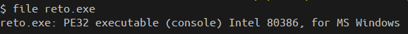
*Figure 1. Executable file type.*

A useful first step when analyzing a binary is to run it the way a normal user would. This way we can learn the general behavior of the program before delving into its implementation.

When running the file, the application asks for a username in order to register, so we can initially interpret it as a program with a registration mechanism.

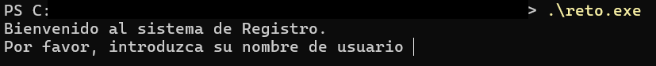
*Figure 2. Execution of the binary under analysis.*

Since we do not know the valid user yet, we can try different inputs: common names, combinations of characters and different lengths. During these tests we managed to enter a username that seems valid: `1111111111`.

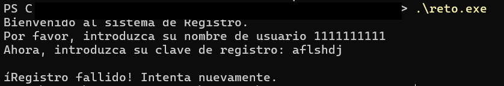
*Figure 3. Failed registration attempt in the application.*

The key is still unknown, so the registration fails and the application asks to try again. However, the observed behavior provides an important clue: the entered username seems to be accepted, since the execution advances to the key prompt.

When repeating the test with other usernames, we observe that the length is decisive: the name must have exactly 10 characters for the registration process to continue. This initial observation allows us to establish the context of the analysis: the application requires a ten-character username and an associated key. If the input does not meet the conditions, the registration fails.

From here on we will investigate how the application validates the name and how it calculates the key, in order to determine whether the generation mechanism is predictable and can be reproduced outside the program.

#### Strings

Before analyzing the assembly, it is useful to examine the text strings included in the executable. Sometimes they can reveal relevant information —for example, error messages, function names or even passwords stored literally in the code— and help locate the interesting parts of the program.

In IDA we can access the **Strings** window or use the `Shift+F12` shortcut.

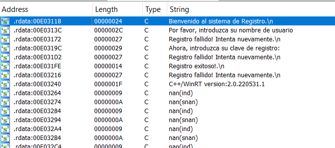
*Figure 4. Strings in the `reto.exe` executable.*

In this case, the strings we had already observed when running the application appear, along with a new one that indicates a successful registration: `Registro exitoso!.\n`. This message will be a useful reference during the analysis, since we want to identify which conditions lead to the execution path that displays it.

#### Imported functions

IDA's **Imports** window lets us consult the external functions used by the executable. Among the ones that stand out in this case are `atoi`, `isdigit` and `getchar`.

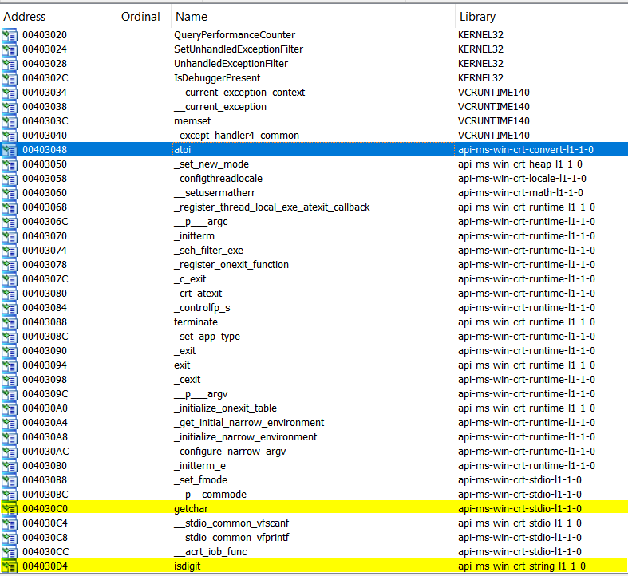
*Figure 5. Functions imported by the application.*

These imports provide clues about the implementation. They suggest that the program was written in C and that it reads user input, works with numeric characters and performs checks to determine whether a character is a digit. It may also convert a text string into an integer, for example, to check that the entered key is numeric and then use its numeric value.

These are still hypotheses: we will have to verify them by examining the code that calls these functions.

#### Called functions

IDA also lets us consult the functions called from a specific function. For example, we can inspect the calls made by `main`.

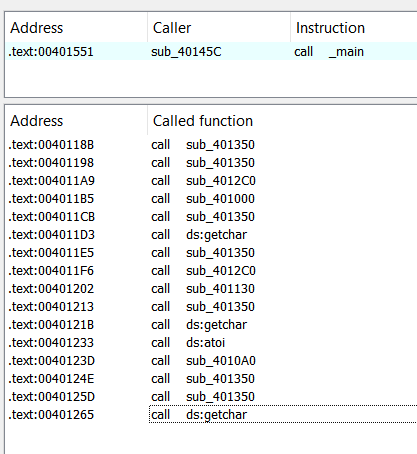
*Figure 6. Functions called by the `main` function.*

In this case, the functions already mentioned appear, such as `getchar` and `atoi`, along with repeated calls to other routines, including `sub_401350`. The latter may be the program's own functions or standard functions that IDA has not automatically identified.

To determine the responsibility of each one, it will be necessary to study its implementation and the context in which it is invoked.

### Detailed analysis

#### The `main` function

The control flow graph of the main function is shown in the following image.

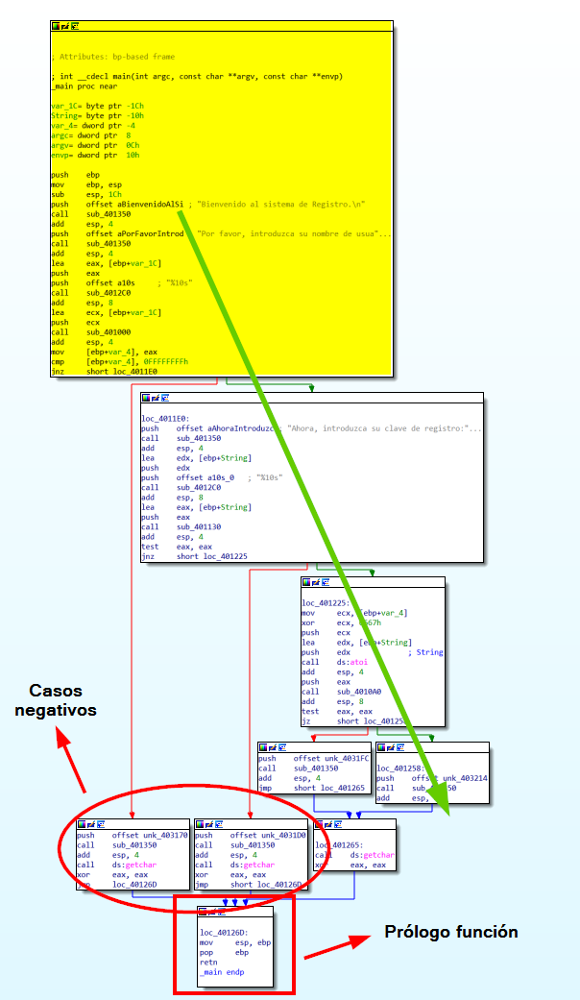
*Figure 7. CFG of the `main` function in IDA.*

At first glance, the branches of the graph make it possible to distinguish the paths that end immediately from those that continue executing additional blocks. In the representation, negative comparisons appear in red and positive ones in green. Some paths lead to the function epilogue and end the execution, while others allow advancing to larger blocks.

Therefore, we are interested in identifying which condition is evaluated in the first large block —highlighted in yellow in the original analysis— and which path must be followed to reach the successful registration message that we located when examining the strings.

The first block contains the definition of some local variables, including stack offsets, and gives access to the function parameters (`argc`, `argv` and `envp`).

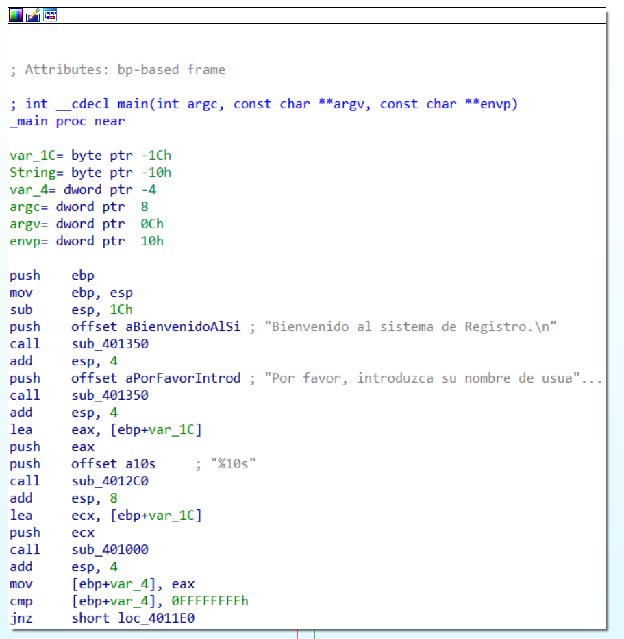
*Figure 8. Block 1 of the `main` function.*

In this block the previously identified text strings appear, which are used as arguments of a function named `sub_401350`. Inside it, there is a reference to `ds:__acrt_iob_func` and, in another call, to `ds:__stdio_common_vfprintf`. Given these references, everything points to `sub_401350` being C's `printf` function, so we can rename it to make the analysis easier.

Next, another function is called, passing it the format string `%10s`. In C, this specifier is used to read a string with a field width of ten characters. Moreover, the call coincides with the moment when the execution stops to wait for the username. Given these signs, it seems to be the `scanf` function, used to read the input.

The local variable `var_1C` seems to represent the buffer where the entered data is stored: it is defined as a pointer to a byte that contains the address of the first character of an array. Then, the content of the buffer is passed as an argument to `sub_401000`, and the result is stored in `var_4`, declared as a `dword` and, therefore, presumably an integer.

That result is compared with `0x0FFFFFFFF`. It makes sense to interpret it as the value `-1` represented in two's complement. Consequently, the value returned by `sub_401000` determines whether the program continues asking for the key or ends the execution.

#### Function `sub_401000`: `check_user`

> **Note:** the function names in this article (`check_user`, `check_keys`, `check_key`) are an English translation of the names used in the original Spanish analysis. In the screenshots they appear as `comprobar_usuario`, `comprobar_claves` and `comprobar_clave`, respectively.
{: .prompt-info }

From what was observed in `main`, this function receives the username and returns a value that determines the next execution path. An initial hypothesis would be that it compares the name with a valid user and returns `-1` if it is not valid, and another value if it accepts it. To confirm this interpretation we must analyze the routine in more detail.

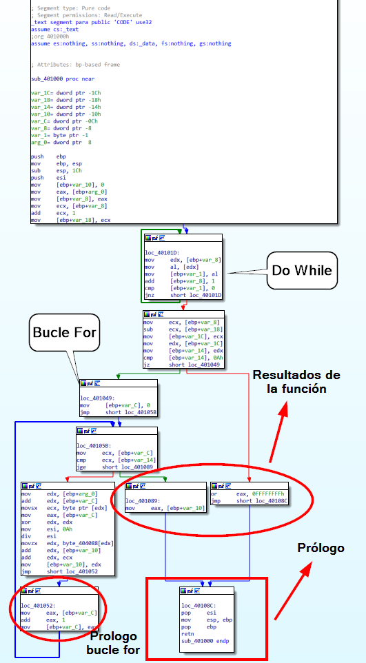
*Figure 9. CFG of the `check_user` function (`comprobar_usuario` in the screenshot).*

The structure of the graph suggests that the function begins with a `do-while` loop and continues with a `for` loop. The latter is deduced from the increment of a register by one at the beginning and at the end of the loop, similar to an iteration variable `i++`, until an exit condition is reached.

It is also observed that the function can return `-1` (`0x0FFFFFFFF`) when the check fails, or the value of `var_10` —a `dword` integer— when the positive path is completed. This last value seems to correspond to the result accumulated during the loop.

The analysis of the first `do-while` loop reveals that its function is to calculate the length of the string received as an argument. To do so, it goes through the characters one by one until it finds the null byte (`NULL BYTE`), which marks the end of the string.

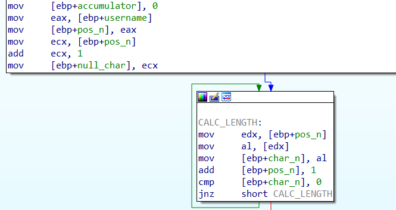
*Figure 10. Renamed `do-while` block.*

Once the end of the string is reached, the program checks whether its length is exactly ten. If it is not, it returns `-1`; if the condition is met, the `for` loop begins.

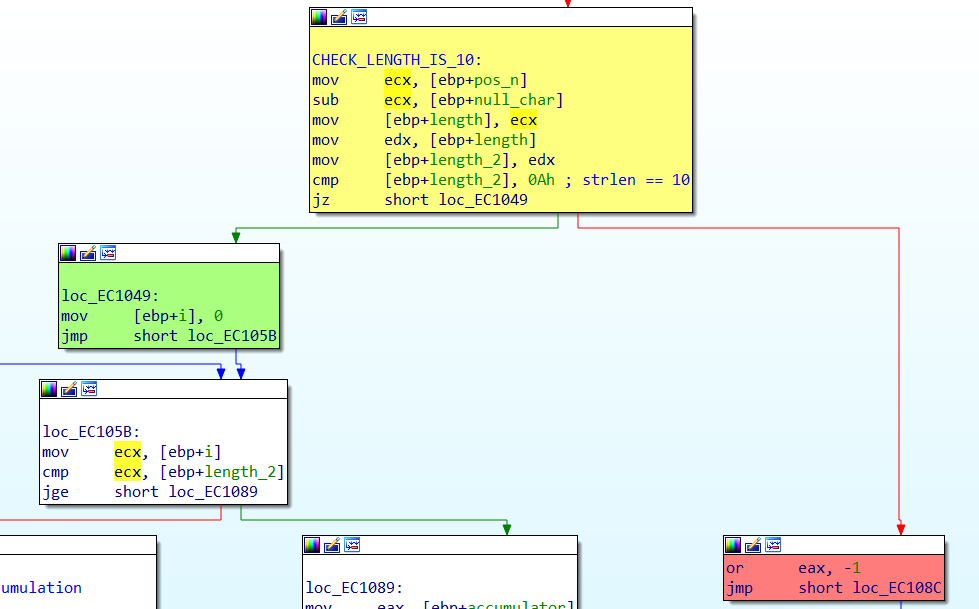
*Figure 11. String length check.*

The `for` loop goes through the name character by character and adds each value to its corresponding character of a predefined string of length ten. This is the reason why the length check is performed beforehand.

For example, for the name `1111111111`, the decimal ASCII value of each `1` character is 49. The first character of the name is added to the first character of the predefined string `R3V3RS1NG!`, whose first character, `R`, has the decimal ASCII value 82. The result is accumulated and the process is repeated with the following characters.

The following pseudocode summarizes this operation.

**Code 1. Pseudocode of the username calculation**

```text
reversing ← "R3V3RS1NG!"
sum ← 0

for i ← 0; i < 10; i ← i + 1 do
    sum ← sum + (username[i] + reversing[i])
end
```

The assembly implementation is shown in the following image.

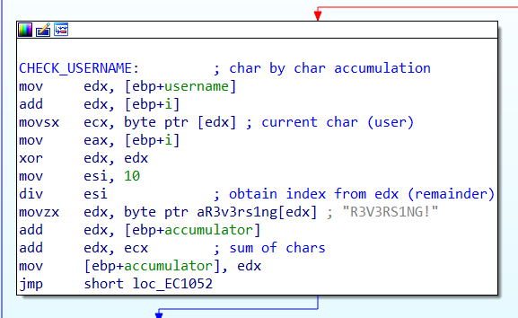
*Figure 12. Assembly code of the name calculation.*

It is worth paying attention to instructions such as `movsx` and `movzx`, which make it possible to move smaller data —such as the bytes of a string— into larger 32-bit registers, extending the sign or padding with zeros, respectively.

A division instruction also appears, which divides the value of `eax` by `esi`. The quotient is left in `eax` and the remainder in `edx`. In this case, the operation is used to obtain the index of the predefined string through the remainder of the division.

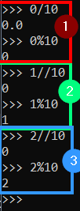
*Figure 13. Iterations for the index calculation of the username.*

In the first iteration, `eax` is zero, so the integer division by ten produces a quotient of zero. This remains the same in the following iterations, since `eax` represents the loop index and never exceeds ten. The remainder, on the other hand, matches the index: zero in iteration 0, one in iteration 1, two in iteration 2, and so on.

Therefore, the behavior of the function can be summarized as follows:

```text
// Returns the character-by-character accumulated sum of the names
// or -1 if the length is NOT 10.
func check_user(username: string) → int
```

#### Entering the user's key

When `check_user` finishes, the program checks that the returned value is different from `-1`. If it is, it considers the username valid and asks for the key, as we saw during the initial execution.

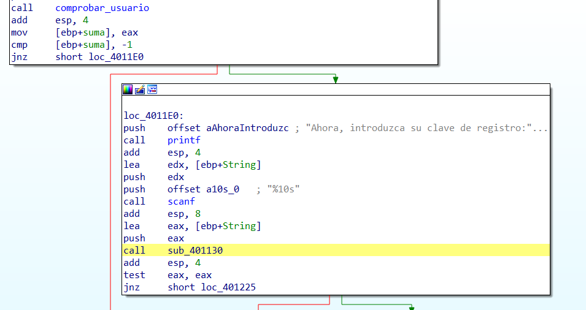
*Figure 14. User key prompt.*

Once the key has been read as a text string, it is passed as an argument to `sub_401130`. This function returns a number: if the result is zero, the registration ends with a failure; if it is different from zero, the execution continues to the next block through the `test` and `jnz` instructions.

When analyzing `sub_401130` we find a call to `isdigit`, which we had already identified in the list of imported functions. This suggests that the routine goes through the entered string to check that the key is made up of numeric characters, returning `1` if the condition is met and `0` otherwise.

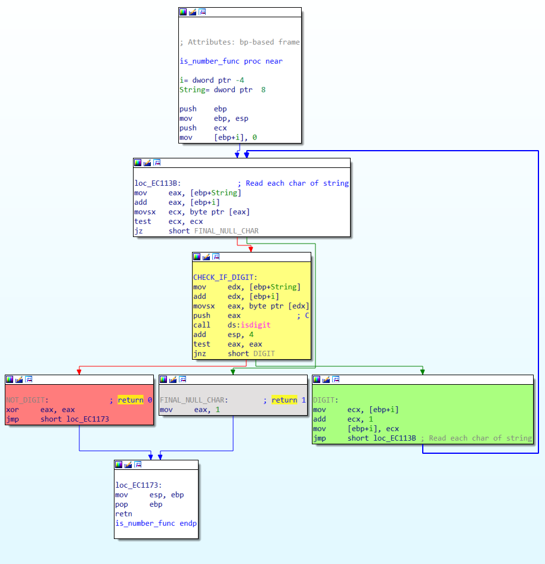
*Figure 15. CFG of the `sub_401130` function.*

Once it has been verified that the key is numeric, the program executes the next block.

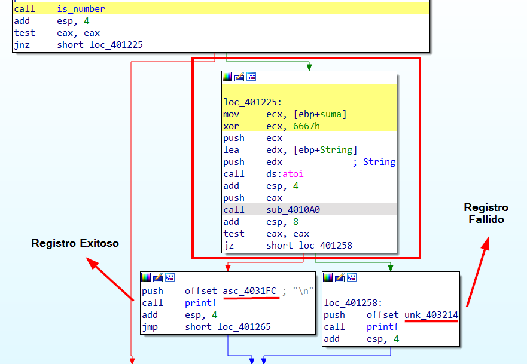
*Figure 16. CFG of the key check.*

In this block a bitwise XOR operation is performed between the result of the accumulated sum and the hexadecimal value `0x6667`. Next, the key entered by the user is converted from a string to a number through `atoi`, another of the functions identified in the preliminary analysis.

Finally, `sub_4010A0` is called, passing it as arguments the key converted to a number and the result of the XOR operation. If the function returns zero, the registration fails; if it returns one, the registration is successful. This can be seen in the `test` and `jz` instructions, which determine which `printf` call will be executed. The associated strings display the messages `\n!Registro exitoso!.` and `\n!Registro fallido! Intenta nuevemente.`.

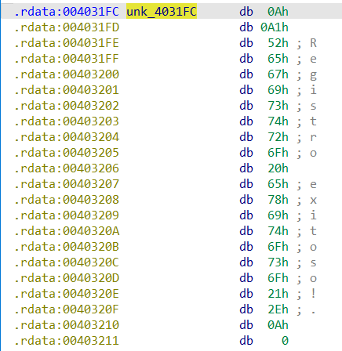
*Figure 17. Example of the memory address of a failed registration.*

#### Function `sub_4010A0`: `check_keys`

> **Note:** `check_keys` appears in Figure 18 and Figure 19 as `comprobar_claves`. The pseudocode function `check_key` in Code 2 corresponds to `comprobar_clave`.
{: .prompt-info }

The analysis of `sub_4010A0` allows us to determine that it compares the key entered by the user —previously converted to an integer through `atoi`— with the result of the XOR operation described in the previous section.

The function returns `1` if both values match and `0` otherwise. The check is based on comparing the digits of both numbers: the routine goes through each one from right to left and contrasts it with the corresponding digit of the calculated key.

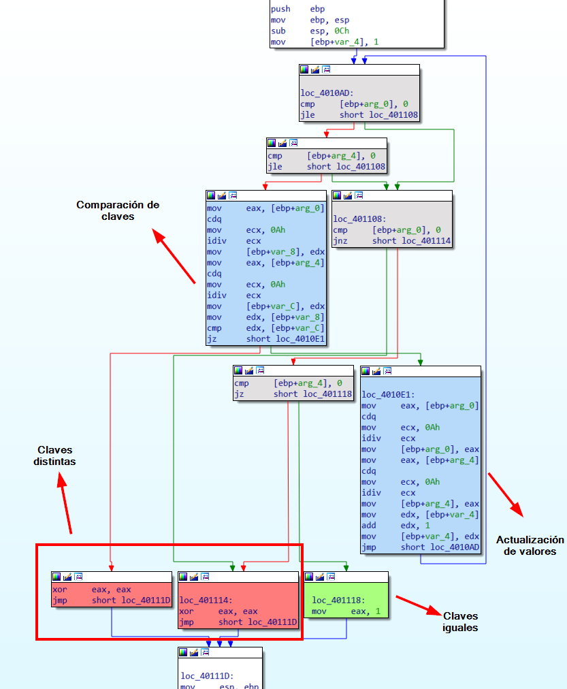
*Figure 18. CFG of `check_keys` (`comprobar_claves` in the screenshot).*

The procedure is similar to the one used in `check_user`, although now the digits of the number are traversed from right to left by means of a loop. For example, to traverse the number `987`, a signed integer division (`idiv`) can be used, as shown below.

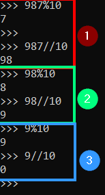
*Figure 19. Iterations for the calculation of each digit in `check_keys` (`comprobar_claves` in the screenshot).*

In each iteration, the remainder of the division by ten yields the rightmost digit. The integer quotient removes that last digit and is used as the input for the next iteration. The process continues until zero is reached, taking advantage of the mathematical properties of division by ten.

The pseudocode of the function is summarized as follows.

**Code 2. Pseudocode of the key check**

```text
func check_key(user_key: int, real_key: int) → int
    i ← 1

    while user_key > 0 and real_key > 0 do
        if remainder(user_key, 10) ≠ remainder(real_key, 10)
            return 0
        end

        user_key ← user_key / 10
        real_key ← real_key / 10
        i ← i + 1
    end

    return ¬user_key and ¬real_key
```

## Key generator (*keygen*)

After analyzing the binary in detail, we have identified a fundamental operation in the validation mechanism: the XOR operation.

Once the accumulated sum has been calculated from the username, the program combines the result with the literal value `0x6667` —26215 in decimal— through an XOR operation. The result is used as the key that the application will later verify.

This means that the key is derived from known information: the username and a constant included in the program itself. Therefore, for this version of the application it is possible to create a key generator that reproduces the observed behavior from a username that meets the length restriction established in the code.

**Code 3. Source code of the keygen in Python**

```python
"""Generates a valid key for a given username in reto.exe"""

XOR_NUM = 0x6667
BASE_KEY = b"R3V3RS1NG!"
MAX_LEN = len(BASE_KEY)

try:
    username = input("> Username: ").encode()

    if len(username) != MAX_LEN:
        print(f"[ERROR] Username length must be {MAX_LEN}")
        exit(1)

    accum = 0
    for i in range(MAX_LEN):
        accum += username[i] + BASE_KEY[i]

    keygen = accum ^ XOR_NUM
    print(f"The key for '{username.decode()}' is: {keygen}")
except KeyboardInterrupt:
    print("\nCtrl-C pressed!\nExiting...")
except Exception:
    print("\nUnexpected exception :(")
```

The implementation directly follows the logic reconstructed during the analysis: it checks that the name has the required length, accumulates the sum of the values of each character of the name and of the base string and, finally, applies XOR with the constant `0x6667`. The result is displayed as the key corresponding to the entered user.

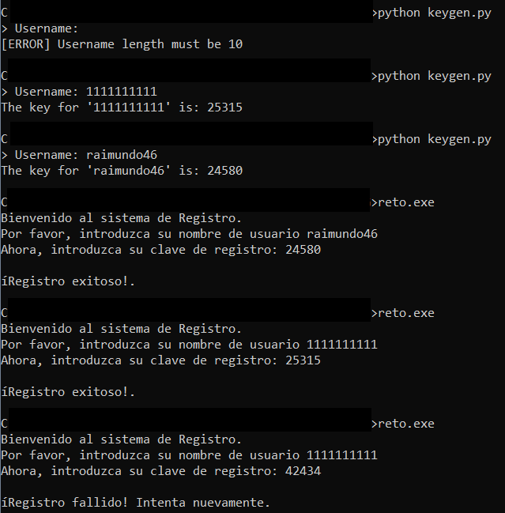
*Figure 20. Execution of the keygen and successful registration with generated keys.*

As shown in the image, once the calculations have been made, it is possible to enter a username that meets the length condition and obtain a key that allows completing the registration in the application.

## Conclusions

The analysis of the binary has made it possible to identify two main operations: one related to the username and another related to the validation of the key.

First, the program reads the username from the command line and checks that it has exactly ten characters. If this condition is not met, the execution ends. If the length is correct, it calculates an accumulated sum of the ASCII values of each character together with the values of the predefined string `R3V3RS1NG!`.

The result of that sum is used to calculate the key. To do so, the program performs a bitwise XOR operation between the accumulated value and the decimal constant `26215` —`0x6667` in hexadecimal—. Then it compares the result with the numeric key entered by the user. If both values match, the registration is considered successful.

Therefore, the key generation mechanism of this application is not secure: it is based on a predictable derivation operation and on values that can be recovered through reverse engineering. Once the username, the base string and the constant used in the XOR operation are known, it is possible to reproduce the calculation and generate valid keys, as has been demonstrated with the *keygen* in Python.

The main lesson of this exercise is that **hiding the validation logic inside a binary does not, by itself, constitute a solid security mechanism**. If the application contains all the elements needed to calculate or verify a key, analyzing the executable can reveal the algorithm and allow it to be reproduced outside the program.
