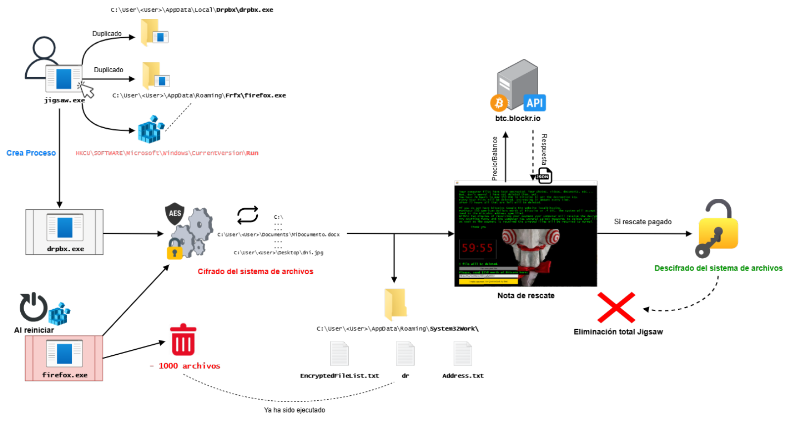

## Introduction

A window with a sinister puppet, a countdown and an unmistakable threat: every hour that passes, **one more file disappears forever**. This is how **Jigsaw** presents itself, a ransomware that is not content with encrypting the victim's data, but also uses time pressure as a weapon of extortion.

Behind that staging lie very concrete technical questions. How does it reach the machine and what does it do in the first few seconds? How does it achieve persistence? Which algorithm does it use to encrypt, and where is the key? How does it communicate with the attacker? And above all: can the damage be reversed?

This work is my **Master's Thesis (TFM)** for the [Master's in Cybersecurity and Information Security](https://mcsi.uclm.es/) at UCLM, and it answers all of those questions with a complete technical analysis of a Jigsaw sample. The goal is not only to understand the malware, but to turn that knowledge into **actionable results for a defense team**: indicators of compromise, detection rules, mitigation measures and a tool able to recover the encrypted files.

## Project description

The project covers the **static and dynamic analysis** of the sample to reconstruct the whole lifecycle of the infection:

- **Infection and initial execution:** how the malware is deployed and what it does on startup.
- **Persistence:** mechanisms used to survive system reboots.
- **File encryption:** target selection, algorithm, key management and extension changes.
- **Extortion:** ransom note, countdown and file deletion mechanism.
- **Communications:** network traffic generated and behavior against simulated services.

Besides the analysis, the work includes four additional deliverables:

- **Technical report:** a complete document with the methodology, evidence and conclusions.
- **Working decryptor:** a custom tool that recovers the files affected by the sample.
- **IoC extraction and YARA rules:** hashes, host and network artifacts, and signatures to detect the threat and its variants.
- **Security measures:** a list of preventive, detective and response controls against similar threats.

## Methodology

The analysis was carried out in an isolated lab, combining several layers of observation so that each finding was cross-checked against more than one source.

### Static analysis

The sample was inspected without executing it. **Detect It Easy (DIE)** and **PE-bear** were used to identify the format, sections and characteristics of the executable. Since it is a .NET binary, **dnSpy** made it possible to decompile and debug the code to study its logic, encryption routines and key management.

### Dynamic analysis

The sample was run in virtual machines with **VirtualBox**, monitoring its behavior in real time:

- **Processes, files and registry:** **Process Monitor**, **Process Explorer**, **System Informer** and **API Monitor** to trace what it creates, modifies and deletes.
- **Persistence:** **Autoruns** and **Regshot** to compare the system state before and after the infection.
- **Network:** **REMnux** with **INetSim** simulating Internet services and **Wireshark** capturing the traffic.

### Sandboxes

To validate the results, public and commercial environments were used: **VirusTotal**, **ANY.RUN**, **VMRay** and **Joe Sandbox**. This made it possible to confirm the observed behavior and compare detection across engines and platforms.

## Tools and technologies

| Area | Tools |
| --- | --- |
| System monitoring | Sysinternals (ProcMon, ProcExp, Autoruns), System Informer, Regshot, API Monitor |
| Static analysis | dnSpy, PE-bear, Detect It Easy (DIE) |
| Network | REMnux, INetSim, Wireshark |
| Sandboxes | VirusTotal, ANY.RUN, VMRay, Joe Sandbox |
| Lab | VirtualBox |

## Skills demonstrated

This project covers the full workflow of a malware analyst and a *Blue Team*:

- Building a **safe, isolated lab** for malware analysis.
- **Reverse engineering** of .NET binaries and understanding of cryptographic routines.
- Behavioral analysis on **host and network**, correlating evidence.
- **Tool development** for response (decryptor) based on the analysis.
- **Threat hunting and detection:** IoC extraction and YARA rule writing.
- **Technical documentation:** writing rigorous, reproducible technical documentation.
- Proposal of **mitigation measures** aligned with defense in depth.

## Decryptor

One of the most relevant results of the project is a **working decryptor**, developed after understanding how the sample generates and uses its encryption keys. The source code, together with usage instructions, is available on GitHub:

👉 [Decryptor source code on GitHub](https://github.com/bytem1nd/JigsawDecryptor)

> This tool was developed for educational and research purposes. Always test it on copies of the files and in controlled environments.
{: .prompt-warning }

## Kill chain

After completing the analysis, the full kill chain of the sample was reconstructed, from initial execution to the encryption of the victim's files and the ransom demand. It is shown below.

_Figure 1. Jigsaw ransomware kill chain._

## Technical report

The complete report of the work follows, with the analysis details, evidence, IoCs, YARA rules and security recommendations.

> The technical report is only available in Spanish. There is no English version of the PDF at the moment.
{: .prompt-warning }



## Conclusions

The analysis of Jigsaw shows that even a relatively simple ransomware can cause significant damage when combined with social engineering and psychological pressure. Understanding how it works from start to finish lets us move from reacting to the incident to **anticipating it**: detecting its signals, blocking its techniques and, when possible, recovering the information.

The value of this work lies in that transition, from analysis to action, with tools, signatures and recommendations that a security team can apply directly.
