## Introducción

La ingeniería inversa permite estudiar el funcionamiento interno de un programa a partir de su binario, incluso cuando no se dispone del código fuente. En ciberseguridad, esta técnica resulta útil para comprender la lógica de una aplicación, analizar sus mecanismos de validación y detectar diseños que puedan comprometer su seguridad.

En este artículo analizaremos un *crackme*, es decir, un programa creado como ejercicio práctico para poner a prueba técnicas de ingeniería inversa. El objetivo es estudiar un ejecutable PE32 compilado en C, reconstruir el mecanismo que utiliza para validar el registro y desarrollar un *keygen* en Python capaz de generar claves válidas sin conocer de antemano la contraseña.

El análisis se realizará con IDA Freeware, siguiendo el flujo de ejecución y examinando el ensamblador bloque a bloque y línea a línea, sin recurrir al código fuente ni a una vista decompilada. A lo largo del proceso revisaremos las cadenas de texto, las funciones importadas y llamadas, la función principal y las rutinas responsables de validar el nombre de usuario y la clave. Finalmente, trasladaremos la lógica identificada a Python y comprobaremos el resultado con la aplicación.

## Análisis del binario

Antes de entrar en el ensamblador, conviene obtener una primera impresión del ejecutable y observar su comportamiento desde la perspectiva de un usuario. Esta fase permite formular hipótesis iniciales que después podremos contrastar con las evidencias obtenidas durante el análisis estático.

En este caso utilizaremos IDA Freeware para desensamblar el archivo y estudiar su flujo de ejecución mediante el grafo de flujo de control (*Control Flow Graph*, CFG). Primero realizaremos un análisis preliminar de las cadenas de texto, las funciones importadas y las llamadas entre funciones. Después seguiremos el flujo desde el punto de entrada y examinaremos los bloques de código relevantes.

### Análisis preliminar

#### Identificación y ejecución inicial

El archivo analizado tiene formato PE32 (*Portable Executable* de 32 bits), lo que indica que se trata de un ejecutable destinado a Windows para una arquitectura de 32 bits.

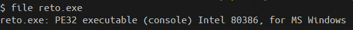
*Imagen 1. Tipo del fichero ejecutable.*

Un primer paso útil al analizar un binario consiste en ejecutarlo como lo haría un usuario normal. De esta manera podemos conocer el comportamiento general del programa antes de profundizar en su implementación.

Al ejecutar el archivo, la aplicación solicita un nombre de usuario para realizar un registro, por lo que inicialmente podemos interpretarla como un programa con un mecanismo de registro.

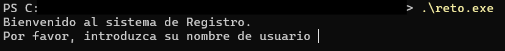
*Imagen 2. Ejecución del binario a analizar.*

Como todavía desconocemos el usuario válido, podemos probar distintas entradas: nombres habituales, combinaciones de caracteres y longitudes diferentes. Durante estas pruebas se consiguió introducir un usuario que parece válido: `1111111111`.

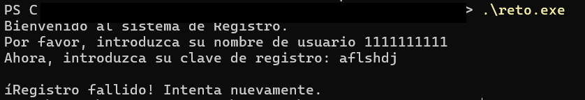
*Imagen 3. Intento de registro fallido en la aplicación.*

La clave sigue siendo desconocida, por lo que el registro falla y la aplicación solicita volver a intentarlo. Sin embargo, el comportamiento observado aporta una pista importante: el usuario introducido parece aceptarse, ya que la ejecución avanza hasta la solicitud de la clave.

Al repetir la prueba con otros usuarios se observa que la longitud es determinante: el nombre debe tener exactamente 10 caracteres para que el proceso de registro continúe. Esta observación inicial nos permite establecer el contexto del análisis: la aplicación requiere un nombre de usuario de diez caracteres y una clave asociada. Si la entrada no cumple las condiciones, el registro falla.

A partir de aquí investigaremos cómo valida la aplicación el nombre y cómo calcula la clave, con el fin de determinar si el mecanismo de generación es predecible y puede reproducirse fuera del programa.

#### Strings

Antes de analizar el ensamblador, resulta útil examinar las cadenas de texto incluidas en el ejecutable. En ocasiones pueden revelar información relevante —por ejemplo, mensajes de error, nombres de funciones o incluso contraseñas almacenadas literalmente en el código— y ayudar a localizar las partes interesantes del programa.

En IDA podemos acceder a la ventana **Strings** o utilizar el atajo `Shift+F12`.

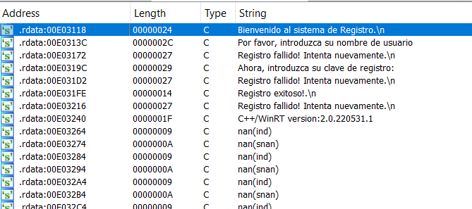
*Imagen 4. Cadenas en el ejecutable `reto.exe`.*

En este caso aparecen las cadenas que ya habíamos observado al ejecutar la aplicación y una nueva que indica un registro correcto: `Registro exitoso!.\n`. Este mensaje será una referencia útil durante el análisis, ya que queremos identificar qué condiciones conducen a la ruta de ejecución que lo muestra.

#### Funciones importadas

La ventana **Imports** de IDA permite consultar las funciones externas que utiliza el ejecutable. Entre las que destacan en este caso se encuentran `atoi`, `isdigit` y `getchar`.

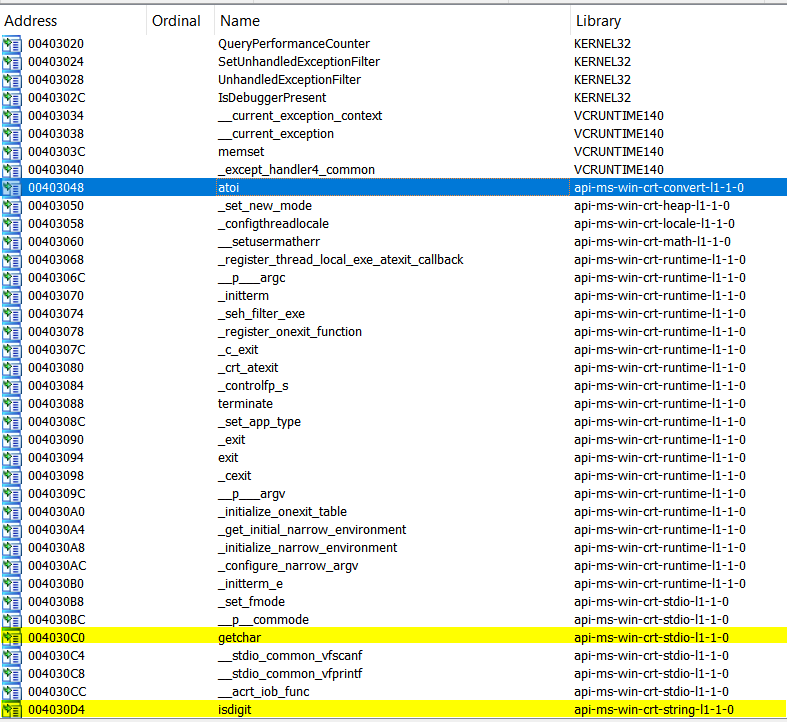
*Imagen 5. Funciones importadas por la aplicación.*

Estas importaciones aportan pistas sobre la implementación. Sugieren que el programa fue escrito en C y que lee entradas del usuario, trabaja con caracteres numéricos y realiza comprobaciones para determinar si un carácter es un dígito. También es posible que convierta una cadena de texto a un entero, por ejemplo, para comprobar que la clave introducida sea numérica y utilizar después su valor numérico.

Se trata todavía de hipótesis: habrá que comprobarlas examinando el código que llama a estas funciones.

#### Funciones llamadas

IDA también permite consultar las funciones llamadas desde una función concreta. Por ejemplo, podemos inspeccionar las llamadas realizadas por `main`.

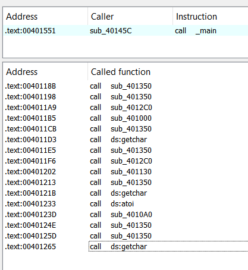
*Imagen 6. Funciones que llama la función `main`.*

En este caso aparecen las funciones ya mencionadas, como `getchar` y `atoi`, junto con llamadas repetidas a otras rutinas, entre ellas `sub_401350`. Estas últimas pueden ser funciones propias del programa o funciones estándar que IDA no ha identificado automáticamente.

Para determinar qué responsabilidad tiene cada una será necesario estudiar su implementación y el contexto en el que se invoca.

### Análisis detallado

#### Función `main`

El grafo de flujo de control de la función principal se muestra en la siguiente imagen.

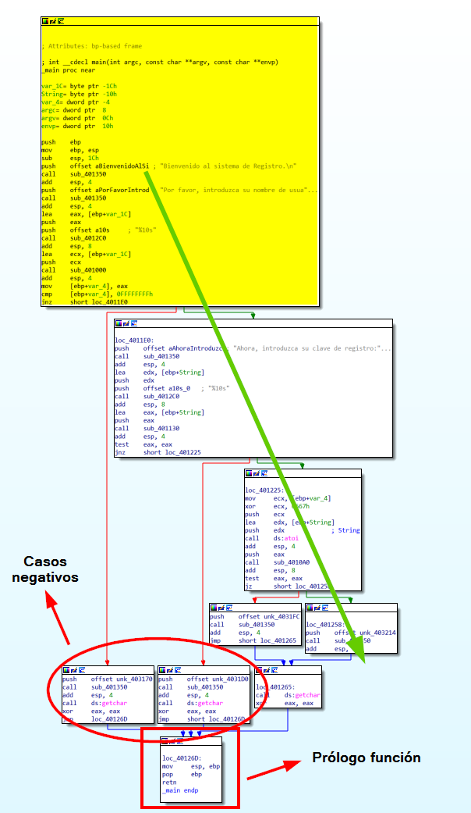
*Imagen 7. CFG de la función `main` en IDA.*

A primera vista, las bifurcaciones del grafo permiten distinguir las rutas que terminan inmediatamente de aquellas que continúan ejecutando bloques adicionales. En la representación, las comparaciones negativas aparecen en rojo y las positivas en verde. Algunas rutas conducen al epílogo de la función y finalizan la ejecución, mientras que otras permiten avanzar hacia bloques más extensos.

Por tanto, interesa identificar qué condición se evalúa en el primer bloque grande —remarcado en amarillo en el análisis original— y qué camino debe seguirse para alcanzar el mensaje de registro exitoso que localizamos al examinar las cadenas.

El primer bloque contiene la definición de algunas variables locales, incluidos desplazamientos de la pila, y permite acceder a los parámetros de la función (`argc`, `argv` y `envp`).

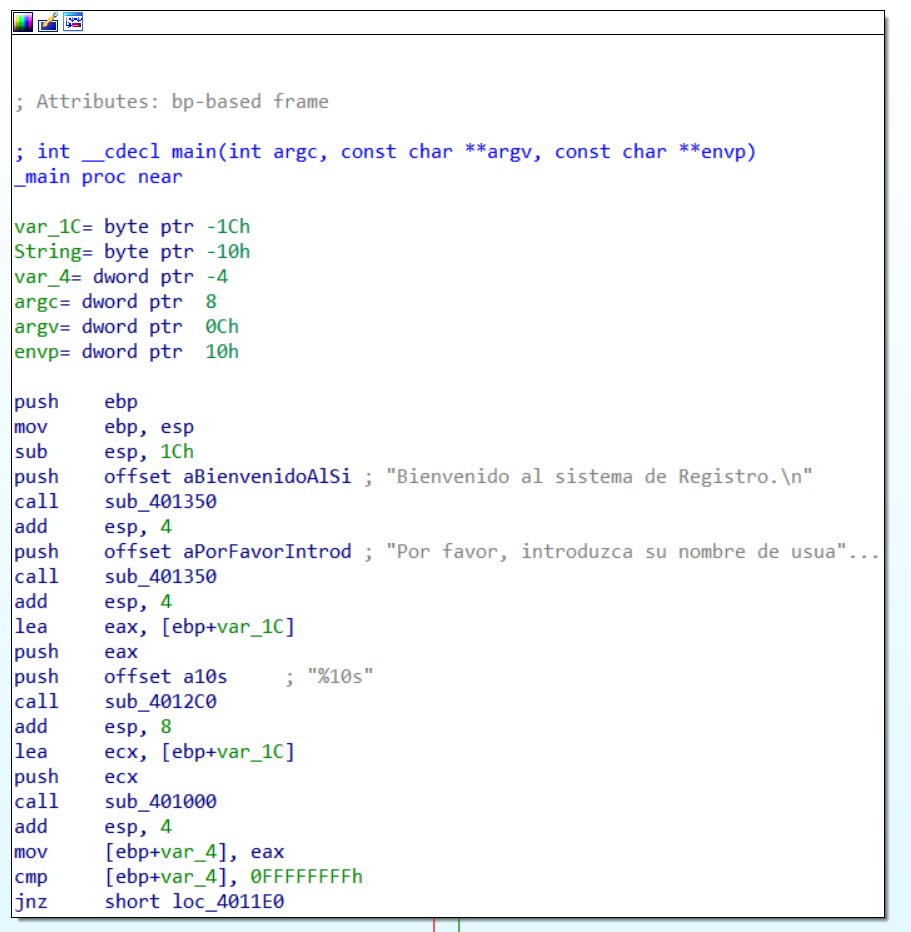
*Imagen 8. Bloque 1 de la función `main`.*

En este bloque aparecen las cadenas de texto identificadas anteriormente, que se utilizan como argumentos de una función denominada `sub_401350`. Dentro de ella se hace referencia a `ds:__acrt_iob_func` y, en otra llamada, a `ds:__stdio_common_vfprintf`. Por estas referencias, todo apunta a que `sub_401350` corresponde a la función `printf` de C, por lo que podemos renombrarla para facilitar el análisis.

A continuación se llama a otra función pasándole la cadena de formato `%10s`. En C, este especificador se utiliza para leer una cadena con un ancho de campo de diez caracteres. Además, la llamada coincide con el momento en que la ejecución se detiene para esperar el nombre de usuario. Por estos indicios, parece tratarse de la función `scanf`, utilizada para leer la entrada.

La variable local `var_1C` parece representar el búfer donde se almacena el dato introducido: se define como un puntero a un byte que contiene la dirección del primer carácter de un array. Después, el contenido del búfer se pasa como argumento a `sub_401000`, y el resultado se almacena en `var_4`, declarado como un `dword` y, por tanto, presumiblemente un entero.

Ese resultado se compara con `0x0FFFFFFFF`. Tiene sentido interpretarlo como el valor `-1` representado en complemento a dos. En consecuencia, el valor devuelto por `sub_401000` determina si el programa continúa solicitando la clave o termina la ejecución.

#### Función `sub_401000`: `comprobar_usuario`

Por lo observado en `main`, esta función recibe el nombre de usuario y devuelve un valor que determina la siguiente ruta de ejecución. Una hipótesis inicial sería que compara el nombre con un usuario válido y devuelve `-1` si no lo es, y otro valor si lo acepta. Para confirmar esta interpretación debemos analizar la rutina con más detalle.

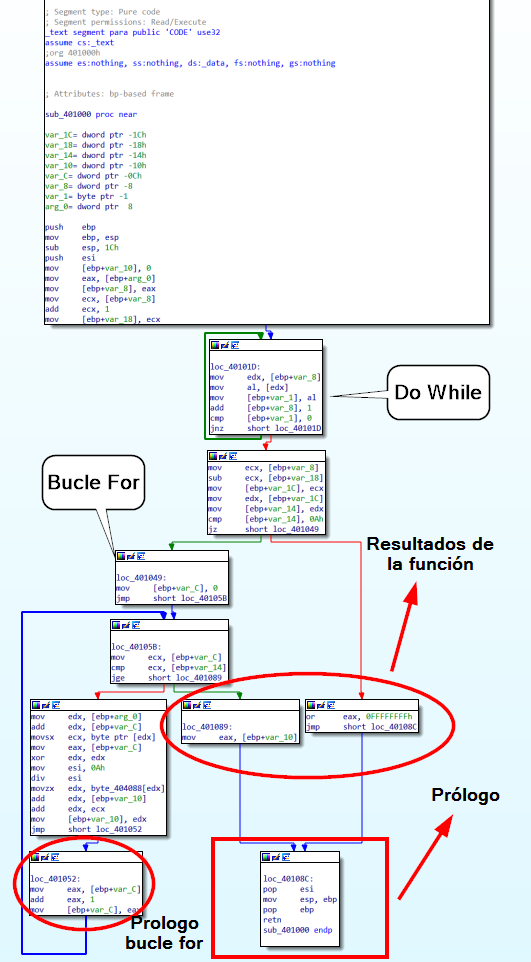
*Imagen 9. CFG de la función `comprobar_usuario`.*

La estructura del grafo sugiere que la función comienza con un bucle `do-while` y continúa con un bucle `for`. Esto último se deduce del incremento de un registro en uno al inicio y al final del bucle, de forma similar a una variable de iteración `i++`, hasta alcanzar una condición de salida.

También se observa que la función puede devolver `-1` (`0x0FFFFFFFF`) cuando la comprobación falla, o el valor de `var_10` —un entero de tipo `dword`— cuando se completa la ruta positiva. Este último valor parece corresponder al resultado acumulado durante el bucle.

El análisis del primer bucle `do-while` revela que su función es calcular la longitud de la cadena recibida como argumento. Para ello recorre los caracteres uno a uno hasta encontrar el byte nulo (`NULL BYTE`), que marca el final de la cadena.

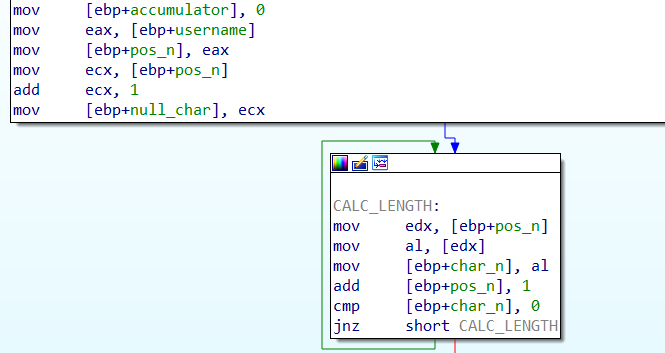
*Imagen 10. Bloque `do-while` renombrado.*

Una vez alcanzado el final de la cadena, el programa comprueba si su longitud es exactamente diez. Si no lo es, devuelve `-1`; si se cumple la condición, comienza el bucle `for`.

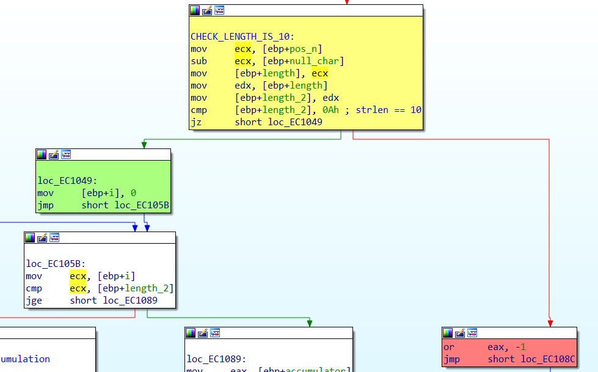
*Imagen 11. Comprobación de la longitud de la cadena.*

El bucle `for` recorre el nombre carácter a carácter y suma cada valor a su correspondiente carácter de una cadena predefinida de longitud diez. Esta es la razón por la que se realiza previamente la comprobación de longitud.

Por ejemplo, para el nombre `1111111111`, el valor ASCII decimal de cada carácter `1` es 49. El primer carácter del nombre se suma al primer carácter de la cadena predefinida `R3V3RS1NG!`, cuyo primer carácter, `R`, tiene el valor ASCII decimal 82. El resultado se acumula y el proceso se repite con los caracteres siguientes.

El siguiente pseudocódigo resume esta operación.

**Código 1. Pseudocódigo del cálculo del nombre de usuario**

```text
reversing ← "R3V3RS1NG!"
suma ← 0

for i ← 0; i < 10; i ← i + 1 do
    suma ← suma + (nombre_usuario[i] + reversing[i])
end
```

La implementación en ensamblador se muestra en la siguiente imagen.

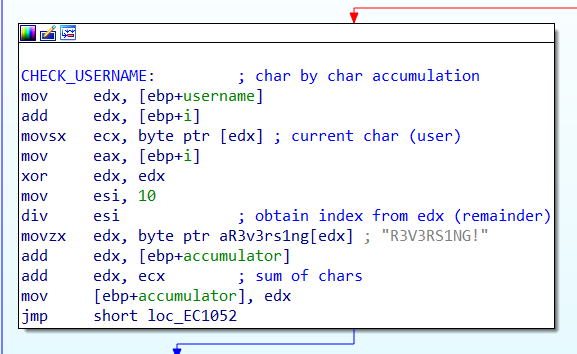
*Imagen 12. Código ensamblador del cálculo de los nombres.*

Conviene prestar atención a instrucciones como `movsx` y `movzx`, que permiten mover datos de menor tamaño —como los bytes de una cadena— a registros más grandes de 32 bits, extendiendo el signo o rellenando con ceros, respectivamente.

También aparece una instrucción de división que divide el valor de `eax` entre `esi`. El cociente queda en `eax` y el resto en `edx`. En este caso, la operación se utiliza para obtener el índice de la cadena predefinida mediante el resto de la división.

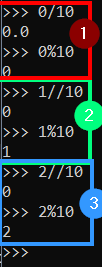
*Imagen 13. Iteraciones para el cálculo del índice del nombre de usuario.*

En la primera iteración, `eax` vale cero, por lo que la división entera entre diez produce un cociente de cero. Esto se mantiene en las iteraciones siguientes, ya que `eax` representa el índice del bucle y no llega a superar diez. El resto, en cambio, coincide con el índice: cero en la iteración 0, uno en la iteración 1, dos en la iteración 2, y así sucesivamente.

Por tanto, el comportamiento de la función puede resumirse de la siguiente manera:

```text
// Devuelve la suma acumulada carácter a carácter de los nombres
// o -1 si la longitud NO es 10.
func comprobar_usuario(nombre_usuario: string) → int
```

#### Introducción de la clave del usuario

Cuando termina `comprobar_usuario`, el programa comprueba que el valor devuelto sea distinto de `-1`. Si lo es, considera válido el nombre de usuario y solicita la clave, tal como vimos durante la ejecución inicial.

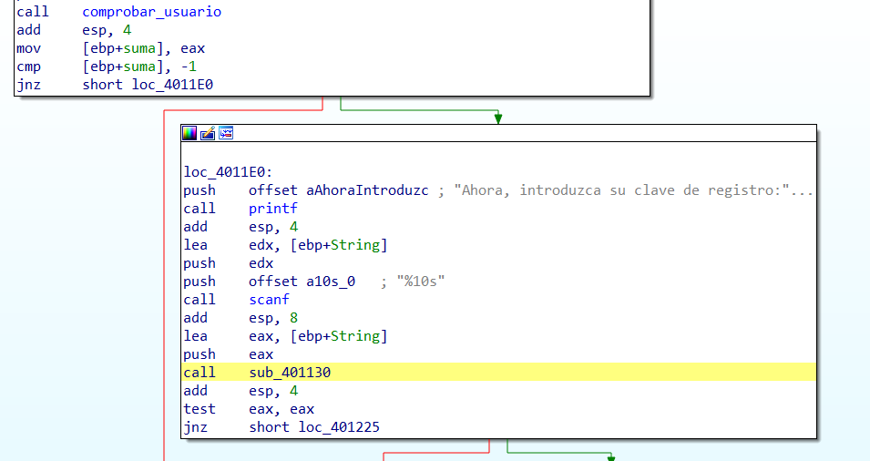
*Imagen 14. Solicitud de clave del usuario.*

Una vez leída la clave como una cadena de texto, se pasa como argumento a `sub_401130`. Esta función devuelve un número: si el resultado es cero, el registro termina con un fallo; si es distinto de cero, la ejecución continúa hacia el siguiente bloque mediante las instrucciones `test` y `jnz`.

Al analizar `sub_401130` encontramos una llamada a `isdigit`, que ya habíamos identificado en la lista de funciones importadas. Esto sugiere que la rutina recorre la cadena introducida para comprobar que la clave esté formada por caracteres numéricos, devolviendo `1` si la condición se cumple y `0` en caso contrario.

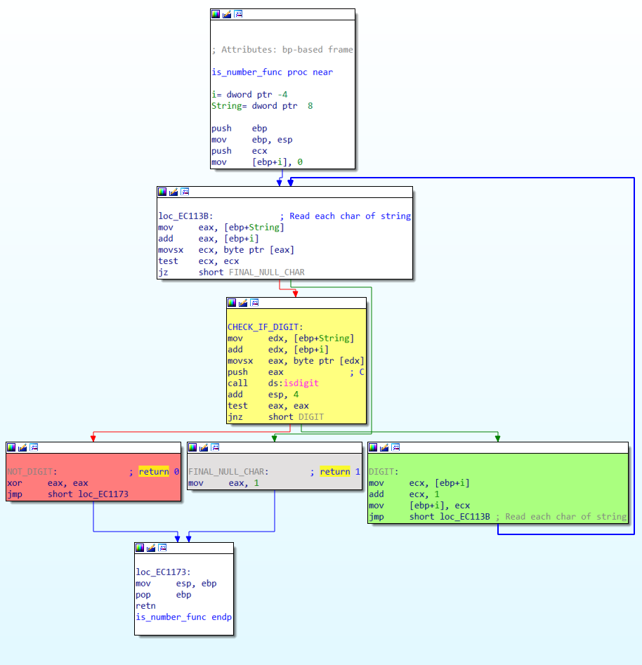
*Imagen 15. CFG de la función `sub_401130`.*

Una vez comprobado que la clave es numérica, el programa ejecuta el siguiente bloque.

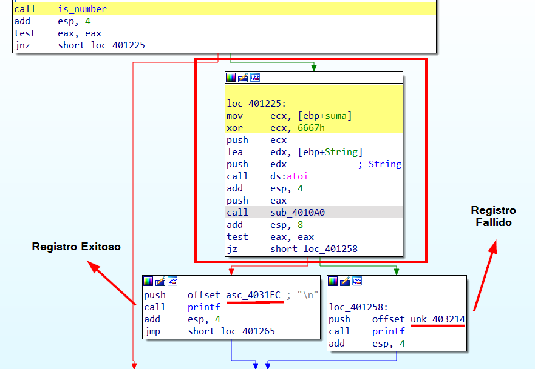
*Imagen 16. CFG de la comprobación de la clave.*

En este bloque se realiza una operación XOR bit a bit entre el resultado de la suma acumulada y el valor hexadecimal `0x6667`. A continuación, la clave introducida por el usuario se convierte de cadena a número mediante `atoi`, otra de las funciones identificadas en el análisis preliminar.

Finalmente, se llama a `sub_4010A0`, pasándole como argumentos la clave convertida a número y el resultado de la operación XOR. Si la función devuelve cero, el registro falla; si devuelve uno, el registro es exitoso. Esto se observa en las instrucciones `test` y `jz`, que determinan qué llamada a `printf` se ejecutará. Las cadenas asociadas muestran los mensajes `\n!Registro exitoso!.` y `\n!Registro fallido! Intenta nuevemente.`.

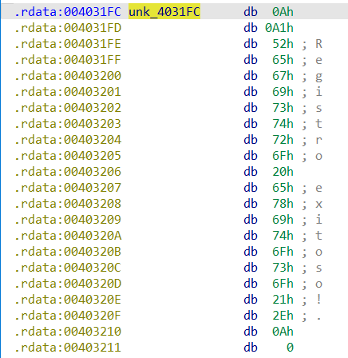
*Imagen 17. Ejemplo de dirección de memoria de registro fallido.*

#### Función `sub_4010A0`: `comprobar_claves`

El análisis de `sub_4010A0` permite determinar que compara la clave introducida por el usuario —convertida previamente a entero mediante `atoi`— con el resultado de la operación XOR descrita en el apartado anterior.

La función devuelve `1` si ambos valores coinciden y `0` en caso contrario. La comprobación se basa en comparar los dígitos de ambos números: la rutina recorre cada uno de derecha a izquierda y lo contrasta con el dígito correspondiente de la clave calculada.

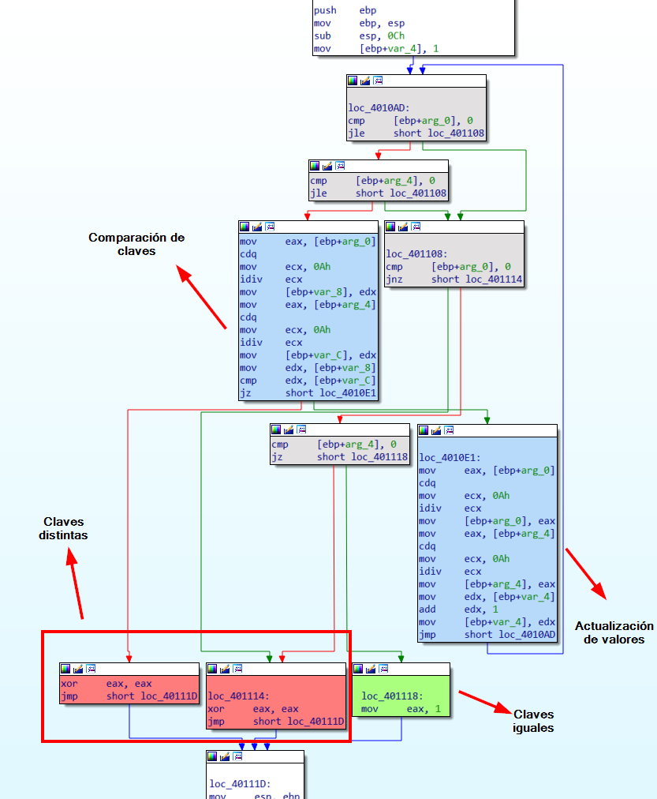
*Imagen 18. CFG de `comprobar_claves`.*

El procedimiento es similar al utilizado en `comprobar_usuario`, aunque ahora se recorren los dígitos del número de derecha a izquierda mediante un bucle. Por ejemplo, para recorrer el número `987`, se puede utilizar una división entera con signo (`idiv`), como se muestra a continuación.

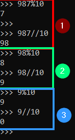
*Imagen 19. Iteraciones para el cálculo de cada dígito en `comprobar_claves`.*

En cada iteración, el resto de la división entre diez permite obtener el dígito situado más a la derecha. El cociente entero elimina ese último dígito y se utiliza como entrada para la siguiente iteración. El proceso continúa hasta que se llega a cero, aprovechando las propiedades matemáticas de la división entre diez.

El pseudocódigo de la función queda resumido de la siguiente manera.

**Código 2. Pseudocódigo de comprobación de claves**

```text
func comprobar_clave(clave_usuario: int, clave_real: int) → int
    i ← 1

    while clave_usuario > 0 and clave_real > 0 do
        if resto(clave_usuario, 10) ≠ resto(clave_real, 10)
            return 0
        end

        clave_usuario ← clave_usuario / 10
        clave_real ← clave_real / 10
        i ← i + 1
    end

    return ¬clave_usuario and ¬clave_real
```

## Generador de claves (*keygen*)

Tras analizar el binario en detalle, hemos identificado una operación fundamental en el mecanismo de validación: la operación XOR.

Una vez calculada la suma acumulada a partir del nombre de usuario, el programa combina el resultado con el valor literal `0x6667` —26215 en decimal— mediante una operación XOR. El resultado se utiliza como clave que después verificará la aplicación.

Esto significa que la clave se deriva de información conocida: el nombre de usuario y una constante incluida en el propio programa. Por tanto, para esta versión de la aplicación es posible crear un generador de claves que reproduzca el comportamiento observado a partir de un nombre de usuario que cumpla la restricción de longitud establecida en el código.

**Código 3. Código fuente del keygen en Python**

```python
"""Generates a valid key for a given username in reto.exe"""

XOR_NUM = 0x6667
BASE_KEY = b"R3V3RS1NG!"
MAX_LEN = len(BASE_KEY)

try:
    username = input("> Username: ").encode()

    if len(username) != MAX_LEN:
        print(f"[ERROR] Username length must be {MAX_LEN}")
        exit(1)

    accum = 0
    for i in range(MAX_LEN):
        accum += username[i] + BASE_KEY[i]

    keygen = accum ^ XOR_NUM
    print(f"The key for '{username.decode()}' is: {keygen}")
except KeyboardInterrupt:
    print("\nCtrl-C pressed!\nExiting...")
except Exception:
    print("\nUnexpected exception :(")
```

La implementación sigue directamente la lógica reconstruida durante el análisis: comprueba que el nombre tenga la longitud requerida, acumula la suma de los valores de cada carácter del nombre y de la cadena base y, finalmente, aplica XOR con la constante `0x6667`. El resultado se muestra como la clave correspondiente al usuario introducido.

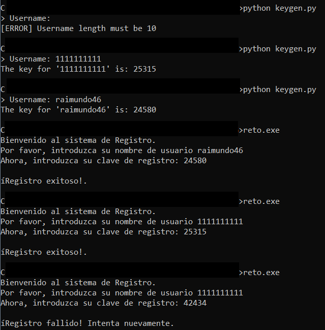
*Imagen 20. Ejecución del keygen y registro exitoso con claves generadas.*

Como se muestra en la imagen, una vez realizados los cálculos es posible introducir un nombre de usuario que cumpla la condición de longitud y obtener una clave que permite completar el registro en la aplicación.

## Conclusiones

El análisis del binario ha permitido identificar dos operaciones principales: una relacionada con el nombre de usuario y otra con la validación de la clave.

En primer lugar, el programa lee el nombre de usuario desde la línea de comandos y comprueba que tenga exactamente diez caracteres. Si no se cumple esta condición, la ejecución termina. Si la longitud es correcta, calcula una suma acumulada de los valores ASCII de cada carácter junto con los valores de la cadena predefinida `R3V3RS1NG!`.

El resultado de esa suma se utiliza para calcular la clave. Para ello, el programa realiza una operación XOR bit a bit entre el valor acumulado y la constante decimal `26215` —`0x6667` en hexadecimal—. Después compara el resultado con la clave numérica introducida por el usuario. Si ambos valores coinciden, el registro se considera exitoso.

Por tanto, el mecanismo de generación de claves de esta aplicación no es seguro: se basa en una operación de derivación predecible y en valores que pueden recuperarse mediante ingeniería inversa. Una vez conocidos el nombre de usuario, la cadena base y la constante utilizada en la operación XOR, es posible reproducir el cálculo y generar claves válidas, tal como se ha demostrado con el *keygen* en Python.

La principal lección de este ejercicio es que **ocultar la lógica de validación dentro de un binario no constituye, por sí solo, un mecanismo de seguridad sólido**. Si la aplicación contiene todos los elementos necesarios para calcular o verificar una clave, el análisis del ejecutable puede revelar el algoritmo y permitir que se reproduzca fuera del programa.
