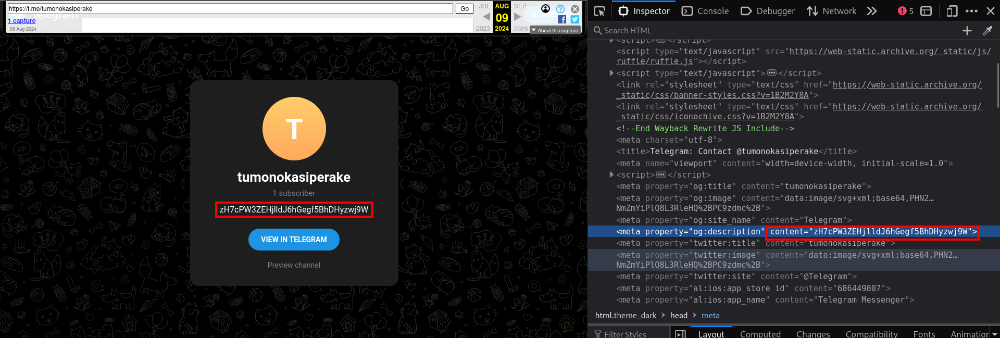

## Introducción

El análisis de malware para Android requiere ir más allá de la
apariencia de una aplicación y estudiar qué hace realmente cuando se
ejecuta. En muestras empaquetadas y ofuscadas, esta tarea comienza
incluso antes de analizar el código: primero es necesario localizar y
extraer el ejecutable que contiene la lógica maliciosa.

En este artículo se documenta la investigación de una aplicación Android
desconocida, identificada posteriormente como perteneciente a la familia
**GodFather**, un malware de tipo *infostealer*. El análisis se realiza
mediante ingeniería inversa de los archivos APK y se centra en
reconstruir el proceso de desempaquetado, localizar la infraestructura
de mando y control (*Command and Control*, C2), comprender el registro
del dispositivo víctima y estudiar el envío cifrado de información.

Los objetivos son:

-   Desempaquetar las distintas capas de la muestra hasta obtener el
    código DEX que contiene la lógica analizada.
-   Identificar los permisos, componentes y mecanismos relevantes para
    comprender su comportamiento.
-   Seguir las clases y métodos responsables de obtener y almacenar la
    dirección C2.
-   Analizar los parámetros enviados durante el registro de la víctima.
-   Examinar el mecanismo de captura de eventos de accesibilidad y el
    cifrado de las comunicaciones.

El alcance se limita al análisis estático del APK y a la reconstrucción
del comportamiento a partir del código. Se utilizan herramientas como
`file`, `find`, `unzip`, `apktool`, `jadx-gui` y CyberChef, además de
pequeños scripts para descodificar y descifrar cadenas.

Para seguir el artículo es útil tener conocimientos básicos de Android,
del formato APK/DEX, de Java y de conceptos como Base64, cifrado
simétrico y peticiones HTTP. No es necesario dominar previamente el
análisis de malware: los elementos relevantes se explican a medida que
aparecen.

La muestra recibida tiene el siguiente hash SHA-256:

``` text
f29a09a24bbf97617c0db01f19d01be607857e0bb58117556e90390de4576216
```

Se comprobó que la muestra estaba empaquetada, por lo que era necesario
desempaquetarla antes de poder analizar el código real del malware
contenido en su interior. En los siguientes apartados se describe el
proceso seguido y los hallazgos obtenidos a partir del ejecutable `.dex`
final.

## Desempaquetado

Tras descomprimir el archivo `packed_pass_infected.zip`, utilizando la
contraseña `infected`, se obtiene la muestra del malware en un formato
comprimido.

La firma del archivo, comprobada con el comando `file`, indica que se
trata de un ZIP. Al listar su contenido se observa una estructura
similar a la de un APK, con la tabla de recursos y ficheros habituales
como `AndroidManifest.xml` o `classes.dex`.


Al examinar el contenido se observa que el ZIP incluye varios
directorios, entre ellos uno denominado `AndroidManifest.xml` y otro
`classes.dex`. Esto provoca un conflicto durante la extracción: los
archivos reales con esos nombres no se pueden extraer porque ya existen
directorios con el mismo nombre. Estos directorios parecen contener
recursos de la aplicación, como imágenes, por lo que se pueden renombrar
al descomprimir el archivo. Para ello se utiliza, por ejemplo, el
comando:

``` bash
unzip -d layer1 f29a0...
```

De esta forma se obtiene el contenido de la primera capa del APK.

También se utiliza `apktool`, con la opción `d`, para decodificar el
contenido de archivos como `AndroidManifest.xml` y los recursos de la
aplicación.

Al visualizar el código con `jadx-gui` se observa que está muy ofuscado
y que, por tanto, todavía no se ha llegado al código final del malware.

En las primeras capas de empaquetado es habitual que los archivos APK se
oculten en directorios de recursos. Para localizarlos se utiliza `find`
para buscar ficheros y, a continuación, `file` para consultar su firma.
De este modo se filtran aquellos que realmente corresponden a un APK.


Como se esperaba, en la carpeta de recursos aparece un fichero APK que
puede ser cargado dinámicamente por el malware.

Al listar su contenido con `unzip`, la salida es similar a la de la
muestra inicial: aparecen los directorios `AndroidManifest.xml` y
`classes.dex`. Por tanto, se repite el procedimiento utilizando
`apktool` y `unzip`.


El proceso de decodificación con `apktool` se realiza, por ejemplo,
mediante:

``` bash
apktool d assets/app-debug.apk -o <directorio-salida>
```

En esta segunda capa se vuelve a ejecutar la búsqueda de APK descrita
anteriormente, pero esta vez no se encuentra ningún otro archivo APK.
Sin embargo, al revisar manualmente los recursos de la aplicación se
localiza un fichero con un nombre poco habitual: `assets/RFj.json`. Al
inspeccionar su contenido aparece información binaria, algo poco común
en un fichero `.json`, lo que hace sospechar que puede contener datos
ocultos o cifrados.


Para comprobarlo se utiliza `sandlfy-entropyscan`, una herramienta que
permite calcular la entropía del fichero.

El resultado muestra una entropía elevada, de aproximadamente 8. Este
valor es un indicio de que el contenido puede estar cifrado o
comprimido, ya que los datos de alta entropía presentan una distribución
de valores aparentemente aleatoria.

El siguiente paso consiste en averiguar qué algoritmo de cifrado se ha
utilizado y cuál es la clave. Para ello se abre el `classes.dex` de esta
segunda capa con `jadx-gui` y se busca el nombre del archivo `RFj.json`.
La intención es localizar alguna referencia en el código que permita
identificar la función encargada de descifrarlo y la clave utilizada.


El nombre del fichero aparece definido como una constante en la clase
`com.undo.divorce.Hobtainsetup`, con el nombre de variable
`Iconvinceeight`.

Al continuar buscando referencias a esta variable se localizan otros
puntos de uso en el código. También se identifica una clave en la clase
`com.undo.divorce.Kwolfintact`, con el nombre `Zkeengenre`. Esta clave
se introduce en una función junto con el nombre del fichero `RFj.json`,
aunque el flujo está repartido entre varias llamadas debido a la
ofuscación.

A pesar de realizar búsquedas de distintas maneras, el nivel de
ofuscación dificulta seguir las variables y determinar qué funciones se
ejecutan para descifrar el contenido. Siguiendo las llamadas y las
referencias a `RFj.json` se llega a una función que, aparentemente, lee
el fichero y descifra su contenido para escribirlo en un directorio
privado. Posteriormente, el `.dex` extraído se carga mediante
`DexClassLoader`.


El hash SHA-256 de la muestra resultante es:

``` text
98f3c88e2893fb5fc322bbaf24d8c11d395c0322dce4906dce9414d8f0151ed0
```

## Obtención de la dirección C2 y mecanismo de almacenamiento

### Resultado

La dirección del servidor C2 se obtiene a través de la descripción de un
canal de Telegram (`t.me/tumonokasiperake`). En concreto, el malware
extrae el contenido de la etiqueta HTML:

``` html
<meta property="og:description" content="...">
```

La dirección está codificada en Base64 y cifrada mediante el algoritmo
Blowfish. Una vez obtenida, se almacena en las `SharedPreferences` del
dispositivo bajo la clave `min`.

La dirección C2 que devuelve actualmente el canal de Telegram, después
de descodificarla y descifrarla, es:

``` text
hxxps://vavase[.]icu
```

Por su parte, la dirección C2 asociada al valor proporcionado en el
campus (`zH7cPW3ZEHjVTG9k7cxAEFPMXyfMjJ9RLHgQmMHa/VI=`) es:

``` text
hxxps://yukoramparata[.]top
```

### Análisis

Al analizar el fichero `AndroidManifest.xml` del APK se observa que la
actividad `com.example.panelapp.nemer` está marcada como `MAIN` y que la
aplicación declara la realización de comunicaciones HTTP. Por este
motivo, dicha actividad se toma como punto de partida para investigar el
código.




Para el análisis del código se utiliza `jadx-gui`, que permite
visualizar el código fuente de la aplicación.

La clase `Nemer`, perteneciente al paquete `com.example.panelapp`,
parece encargarse, entre otras tareas, de definir cadenas de texto
codificadas en Base64 y de establecer valores por defecto para algunas
claves de `SharedPreferences`. También participa en la obtención de la
dirección del C2, tal y como muestra el fragmento de código de la
función `onResume()`.


`onResume()` es un método del ciclo de vida de una `Activity` en
Android. Se ejecuta cuando la actividad vuelve a primer plano y está
preparada para interactuar con el usuario.

De forma simplificada, el ciclo habitual de una actividad incluye las
siguientes llamadas:

1.  `onCreate()`: se crea la actividad.
2.  `onStart()`: la actividad pasa a ser visible.
3.  `onResume()`: la actividad queda en primer plano y el usuario puede
    interactuar con ella.

Cuando el usuario cambia a otra aplicación, pueden ejecutarse:

``` text
onPause()
onStop()
```

Y cuando vuelve a la actividad:

``` text
onRestart()
onStart()
onResume()
```

Por tanto, cada vez que el usuario lleva la aplicación a primer plano se
crea un hilo que realiza una petición HTTP GET mediante la biblioteca
OkHttp. La petición se ejecuta a través del método
`panxaro.httpget_okhttp` y se dirige a:

``` text
https://t.me/tumonokasiperake
```


Si la respuesta es correcta, el código busca un patrón mediante una
expresión regular en el HTML recibido. El patrón selecciona el contenido
del atributo `content` de la etiqueta
`<meta property="og:description" content="...">`.

El contenido extraído se almacena en `SharedPreferences` bajo la clave
`min`. Para ello se utiliza el método `PWrite` de la clase `Panxaro`,
que guarda los datos en las preferencias de la aplicación.


De forma análoga a `PWrite`, existe el método `Pread`, que permite leer
los valores almacenados en `SharedPreferences`, concretamente en
`app.xml`.

La siguiente imagen muestra el canal de Telegram y su descripción, que
es el contenido que se obtiene de la etiqueta HTML `<meta>` en el
momento de realizar el análisis.


Como se verá a continuación, el valor almacenado está codificado y
cifrado, por lo que el código debe descifrarlo antes de utilizarlo. Al
buscar las referencias a `Pread` para la clave `min`, se observa que su
valor se devuelve y se utiliza como argumento de la función `functiones`
de la clase `Panxaro`.


La función llama a `function2` con varios parámetros: el algoritmo de
cifrado Blowfish (`Cipher c`), la clave `ABC` (`SecretKeySpec sec`) y la
cadena que se debe descifrar (`String s`). En primer lugar, los bytes se
descodifican mediante Base64. Después se configura el vector de
inicialización en `c.init()` en modo descifrado, indicado mediante el
primer argumento con valor `2`.


Al no especificarse opciones adicionales, el análisis del código
interpreta que Android utiliza el modo ECB para Blowfish. Por tanto,
conociendo la clave (`ABC`) y el vector de inicialización (`abcdefgh`),
aunque este último no es necesario en ECB, se puede crear un pequeño
script en Python que, dada una cadena codificada en Base64 como las
utilizadas por el malware, aplique el proceso inverso al del código y
obtenga el valor descifrado.

De esta forma se obtiene el valor por defecto con el que se inicializó
la clave `min`, así como los valores actuales del C2 y otros valores
anteriores, como el proporcionado en el campus.


Con este procedimiento se determina que el C2 actual es
`hxxps://vavase[.]icu` y que su valor se almacena cifrado en la clave
`min` de `SharedPreferences`. También se identifica el método utilizado
para descifrarlo.

## Identificación de la familia del malware

La familia identificada es **GodFather**. La atribución se obtiene al
buscar referencias al C2 encontrado durante el análisis
(`hxxps://yukoramparata[.]top`). Entre los resultados aparece un
artículo que recoge dicho dominio como indicador de compromiso (IoC) y
analiza malware de la familia GodFather.

El análisis publicado presenta numerosas similitudes con la muestra
investigada: el almacenamiento de datos en `SharedPreferences`, el
mecanismo de cifrado, los nombres de las clases y otros elementos de
implementación. Estas coincidencias apuntan a que la muestra analizada
pertenece a la misma familia, aunque se trate de una muestra diferente.

El análisis de referencia está disponible en:

<https://securethinklab.com/blog/2025-03-14-godfather-android-analysis/>

## Registro del usuario víctima

### Resultado

La función encargada de registrar al usuario víctima es
`panxaro.SendNewUser()`. Esta función utiliza `dakh.SendCommand()` para
comunicarse con la dirección C2.

En esencia, se envían mediante una petición HTTP POST una serie de
parámetros obtenidos de `SharedPreferences`. La petición se dirige a la
dirección C2 obtenida de Telegram ---almacenada bajo la clave `min` en
`app.xml`--- y se concatena el recurso `z.php` para construir la URL
final:

``` text
hxxps://vavase[.]icu/z.php
```

Los parámetros enviados son los siguientes:

| Parámetro | Descripción |
|---|---|
| `ky` | Número aleatorio de 13 dígitos que actúa como identificador de la víctima. |
| `tag` | Etiqueta que identifica, aparentemente, la versión de la muestra. |
| `cy` | País (**c**ountr**y**) según el valor de locale en SharedPreferences. |
| `model` | Versión de Android y modelo del dispositivo, separados por un espacio. |
| `sim` | Nombre del operador de telefonía (Orange, T-Mobile, etc.). |
| `nw` | Se establece como true; podría indicar que se trata de un usuario nuevo (**n**e**w**). |
| `alt` | Lista de aplicaciones instaladas en el dispositivo, separadas por `|||`. |
| `eys` | Indica si el dispositivo está bloqueado (0) o desbloqueado (1). |
| `rpn` | Parámetro cuyo significado no se ha podido determinar. |

### Análisis

Partiendo de la clase `Nemer`, se observa que esta llama a otra
actividad, `aaaAntony`, que a su vez crea un servicio denominado
`savmano`. Este servicio realiza tareas en segundo plano, entre ellas la
creación de un nuevo usuario mediante `panxaro.SendNewUser()`.

El flujo identificado es el siguiente:

``` text
nemer
  └── aaaAntony
        └── savmano (service)
              └── savmano.onStartCommand()
                    └── task_start
                          └── number_task
                                └── panxaro.SendNewUser()
```

El código de la función `number_task` permite seguir este proceso.


Básicamente, la función obtiene la dirección C2 y establece la variable
`eyes` a `1` si el dispositivo no está bloqueado, o a `0` si está
bloqueado. Esta variable se pasa como argumento a
`panxaro.SendNewUser()`.

El nombre `eyes` podría hacer referencia a si la víctima está prestando
atención al dispositivo: cuando está bloqueado toma el valor `0`, ya que
normalmente no se está utilizando; cuando está desbloqueado toma el
valor `1`, lo que podría indicar que el usuario está viendo la pantalla.

En `SendNewUser()` se construyen los parámetros que se enviarán al C2.
Para ello se consulta la información disponible en `SharedPreferences` y
se utiliza la función `functiones` ---descrita anteriormente--- para
descifrar el valor de `min`, que contiene la dirección C2. Así se
construye la URL final:

``` text
hxxps://vavase[.]icu/z.php
```


La función que realiza la comunicación con el C2 para enviar los
comandos ---en este caso, registrar un nuevo usuario--- es
`dakh.SendCommand()`.


Este método envía mediante HTTP POST los parámetros recibidos como
argumentos en texto plano. La respuesta del servidor, en cambio, está
cifrada con Blowfish. Después de descifrarla mediante `functiones`, el
contenido se procesa (*parsea*) y se almacena en `SharedPreferences` y/o
se utiliza para ejecutar determinadas acciones.

#### Parámetros enviados en SendNewUser()

El significado de los parámetros enviados en `SendNewUser()` se ha
deducido buscando en `jadx-gui` referencias a los nombres de cada clave.

La información se obtiene principalmente de la clase `Nemer`, que
establece los valores por defecto de las claves de `SharedPreferences`,
aunque también se han consultado otras partes del código en las que esos
valores cambian como resultado de alguna lógica o evento.


-   **`ky`:** es un número aleatorio de 13 dígitos que funciona como
    identificador de la víctima. Solo se establece una vez y se envía
    como parámetro en todas las comunicaciones con el C2.

    

    

    ``` text
    c0sbl76qv4igm
    ```

-   **`tag`:** también se inicializa en `Nemer` a partir de una cadena
    constante predefinida. Esta contiene texto codificado en Base64 para
    distintos idiomas, separado mediante el símbolo `::`. Su estructura
    es la siguiente:

    ``` text
    [<country-code>]<base64>::[<country-code>]<base64>
    ```

    Un ejemplo de las cadenas encontradas es:

    ``` text
    [ar]MjVFTk1TQzA0::[az]MjVBWk1TQzA0::[en]MjVFTk1TQzA0::
    [ms]MjVFTk1TQzA0::[tr]MjVUUk1TQzA0
    ```

    

    En el caso de `tag`, el valor es siempre la misma cadena, lo que
    hace pensar que identifica la versión de la muestra del malware.

    

    A continuación se muestra el principio de la función `Nemer.a()`,
    que inicializa por defecto los valores de `SharedPreferences` y
    comienza una serie de bucles `while` para actualizar los valores de
    las claves según el idioma local de la víctima.

    

    Cabe destacar que los valores están codificados en Base64 sin
    cifrar. Por tanto, es posible obtener el valor de `tag` de esta
    muestra mediante una simple descodificación.

    El valor de `tag`, independientemente del idioma, es:

    ``` text
    25ENMSC04
    ```

    

-   **`cy`:** corresponde al país (*country*) y se obtiene de la clave
    `locale` de `SharedPreferences` (`es`, `en`, etc.), como se ha visto
    en el código de inicialización.

-   **`model`:** se obtiene de la clave `smm` de `SharedPreferences`,
    que se inicializa en `Nemer.a()`.

    

    El formato utilizado es:

    ``` text
    <version-android> <modelo>
    ```

    Por ejemplo:

    ``` text
    13 Pixel 7
    ```

-   **`sim`:** contiene el nombre del operador de telefonía, como Orange
    o T-Mobile. Se obtiene mediante el siguiente código:

    ``` java
    panxaro.PWrite(
        acs.getApplicationContext(),
        "sim",
        telephonyManager.getNetworkOperatorName()
    );
    ```

-   **`nw`:** se establece de forma constante a `true`, como se observa
    en la función `SendNewUser()`. Por tanto, podría indicar que se
    trata de un usuario nuevo (*new*).

-   **`alt`:** se obtiene de la clave `alt` de `SharedPreferences` y
    contiene la lista de aplicaciones instaladas en el dispositivo. Su
    valor se inicializa mediante `savmano.getApps()`, función que se
    invoca desde `Nemer.a()`.

    

    La función recopila una lista de las aplicaciones instaladas por el
    usuario en el dispositivo, concatena sus nombres de paquete en una
    única cadena separada por `|||` y almacena el resultado en
    `SharedPreferences` bajo la clave `alt`.

-   **`eys`:** procede de la función mostrada anteriormente en el
    análisis de `number_task`. Si el dispositivo está bloqueado, toma el
    valor `0`; si está desbloqueado, toma el valor `1`.

-   **`rpn`:** procede de la clave `psv` de `SharedPreferences`. No se
    ha podido determinar su significado, ya que `psv` únicamente se
    establece a `0` en la clase `aaaArabota` cuando termina un
    `WebView`.

    


## Conexión cifrada

Al continuar investigando el resto de las clases y siguiendo el flujo de
actividades invocadas mediante `Intents` desde la clase `Nemer`, se
llega a la clase `nomas`. En concreto, se identifica el método
`onAccessibilityEvent()`, donde se realizan acciones para monitorizar
eventos de accesibilidad, como cambios de ventana, clics,
desplazamientos (*scrolling*), texto escrito y otros eventos.

Por ejemplo, cuando se produce un cambio de ventana
(`AccessibilityEvent 32`), se registra en una cadena llamada `log` el
nombre de la ventana mediante `event.getText().toString()`, así como la
aplicación correspondiente a la ventana (`packageName`). También se
incluye la marca de tiempo (*timestamp*) `t`, definida al inicio del
método.

A continuación, ese registro se envía mediante una conexión cifrada
utilizando `panxaro.SendKeyLog()`.


El resultado del registro tendría un formato similar al siguiente:

``` text
Package:com.whatsapp|Time: Sep 10, 2025 7:30:43 PM|
[(WINDOW)]|[WhatsApp Messenger]
```

El método `SendKeyLog()` es similar a `SendNewUser()`: primero se
establecen una serie de parámetros y después se llama a
`dakh.SendCommand()` con la URL:

``` text
hxxps://vavase[.]icu/z.php
```

Sin embargo, en este caso el campo `msg` se envía en formato hexadecimal
mediante la función `Escape()`, tal y como se observa en el código.


La función `Escape()` recibe una cadena `k`, que corresponde al registro
codificado en Base64, y la pasa a la función `encrypt` de la clase
`onartna`.

Esta última se encarga de cifrar la cadena utilizando el algoritmo **AES
en modo CBC, sin padding**, con la siguiente clave y vector de
inicialización:

``` text
Clave:                0123456789abcdef
Vector de inicialización: fedcba09876543210
```


## Conclusiones y medidas de seguridad

El análisis ha permitido reconstruir el funcionamiento de una muestra
Android empaquetada y ofuscada, desde la extracción de sus distintas
capas hasta la identificación de los mecanismos utilizados para
comunicarse con su infraestructura C2.

Los principales hallazgos son:

-   La muestra inicial contenía varias capas de empaquetado. La segunda
    capa ocultaba el ejecutable DEX en un recurso denominado `RFj.json`,
    cuyo contenido presentaba una entropía elevada.
-   La dirección C2 se obtiene dinámicamente desde la descripción de un
    canal de Telegram. El valor extraído se encuentra codificado en
    Base64 y cifrado con Blowfish antes de almacenarse en
    `SharedPreferences`.
-   La muestra se ha relacionado con la familia **GodFather** por las
    coincidencias observadas con análisis públicos de esa familia,
    incluidos los indicadores de compromiso y los patrones de
    implementación.
-   Durante el registro de la víctima, el malware recopila información
    del dispositivo, como el modelo, la versión de Android, el operador,
    el idioma y las aplicaciones instaladas.
-   El malware utiliza eventos de accesibilidad para registrar actividad
    relacionada con las ventanas y las aplicaciones utilizadas. Los
    registros se envían al C2 mediante una comunicación cifrada con
    AES-CBC.

Desde el punto de vista defensivo, este análisis permite extraer varias
medidas de seguridad relevantes:

1.  **Instalar aplicaciones únicamente desde fuentes confiables.**
    Evitar APK procedentes de repositorios o enlaces no verificados y
    comprobar la legitimidad del desarrollador.
2.  **Revisar los permisos y servicios de accesibilidad.** Una
    aplicación que solicita acceso a funcionalidades de accesibilidad
    sin una justificación clara debe considerarse sospechosa.
3.  **Mantener Android y las aplicaciones actualizados.** Las
    actualizaciones reducen la exposición a vulnerabilidades conocidas
    que pueden facilitar la instalación o persistencia de malware.
4.  **Monitorizar el tráfico de red.** Las conexiones HTTP(S) hacia
    dominios desconocidos, especialmente cuando se combinan con patrones
    de consulta a servicios externos como Telegram, pueden aportar
    indicadores útiles para la detección.
5.  **Buscar indicadores de compromiso.** Los dominios, rutas, nombres
    de paquetes, hashes y patrones de comunicación identificados durante
    el análisis pueden utilizarse para enriquecer reglas de detección,
    siempre teniendo en cuenta que la infraestructura C2 puede cambiar.
6.  **Aplicar el principio de mínimo privilegio.** Revisar
    periódicamente los permisos concedidos y retirar aquellos que no
    sean necesarios.

La principal lección de esta investigación es que el análisis de una
aplicación maliciosa no debe limitarse a identificar sus permisos o
inspeccionar su primera capa de código. El empaquetado, la ofuscación,
la carga dinámica de DEX y la obtención remota de la infraestructura C2
obligan a reconstruir el flujo de ejecución y relacionar los distintos
componentes de la aplicación.

El seguimiento de las funciones, el análisis de los datos almacenados y
la identificación de los mecanismos criptográficos han permitido
comprender cómo GodFather registra a sus víctimas y transmite
información obtenida del dispositivo. Este enfoque, basado en evidencias
y en la trazabilidad del código, constituye una metodología útil para
investigar otras amenazas dirigidas a dispositivos Android.
