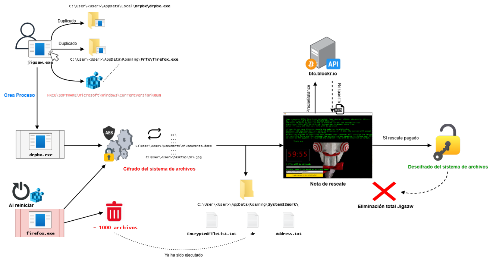

## Introducción

Una ventana con una marioneta siniestra, una cuenta atrás y una amenaza muy clara: cada hora que pasa, **un archivo más desaparece para siempre**. Así se presenta **Jigsaw**, un ransomware que no se conforma con cifrar los datos de la víctima, sino que además utiliza la presión del tiempo como arma de extorsión.

Detrás de esa puesta en escena hay preguntas técnicas muy concretas. ¿Cómo llega a la máquina y qué hace en los primeros segundos? ¿Cómo consigue persistencia? ¿Qué algoritmo usa para cifrar y dónde está la clave? ¿Cómo se comunica con el atacante? Y, sobre todo, ¿se puede revertir el daño?

Este trabajo es mi **Trabajo Fin de Máster (TFM)** del [Máster de Ciberseguridad y Seguridad de la Información](https://mcsi.uclm.es/) de la UCLM y responde a todas esas preguntas con un análisis técnico completo de una muestra de Jigsaw. El objetivo no es solo entender el malware, sino convertir ese conocimiento en **resultados accionables para un equipo de defensa**: indicadores de compromiso, reglas de detección, medidas de mitigación y una herramienta capaz de recuperar los archivos cifrados.

## Descripción del proyecto

El proyecto aborda el **análisis estático y dinámico** de la muestra para reconstruir todo el ciclo de vida de la infección:

- **Infección y ejecución inicial:** cómo se despliega el malware y qué acciones realiza al arrancar.
- **Persistencia:** mecanismos utilizados para sobrevivir a reinicios del sistema.
- **Cifrado de archivos:** selección de objetivos, algoritmo, gestión de claves y modificación de extensiones.
- **Extorsión:** nota de rescate, cuenta atrás y mecanismo de borrado de archivos.
- **Comunicaciones:** tráfico de red generado y comportamiento frente a servicios simulados.

Además del análisis, el trabajo incluye cuatro entregables adicionales:

- **Memoria técnica:** documento completo con la metodología, las evidencias y las conclusiones.
- **Decryptor funcional:** herramienta propia que recupera los archivos afectados por la muestra.
- **Extracción de IoCs y reglas YARA:** hashes, artefactos de host y de red, y firmas para detectar la amenaza y sus variantes.
- **Medidas de seguridad:** listado de controles preventivos, de detección y de respuesta frente a amenazas similares.

## Metodología

El análisis se realizó en un laboratorio aislado, combinando varias capas de observación para contrastar cada hallazgo con más de una fuente.

### Análisis estático

Se inspeccionó la muestra sin ejecutarla. Con **Detect It Easy (DIE)** y **PE-bear** se identificaron el formato, las secciones y las características del ejecutable. Al tratarse de un binario .NET, **dnSpy** permitió descompilar y depurar el código para estudiar su lógica, las rutinas de cifrado y la gestión de claves.

### Análisis dinámico

La muestra se ejecutó en máquinas virtuales con **VirtualBox**, monitorizando su comportamiento en tiempo real:

- **Procesos, ficheros y registro:** **Process Monitor**, **Process Explorer**, **System Informer** y **API Monitor** para trazar qué crea, modifica y borra.
- **Persistencia:** **Autoruns** y **Regshot** para comparar el estado del sistema antes y después de la infección.
- **Red:** **REMnux** con **INetSim** simulando servicios de Internet y **Wireshark** capturando el tráfico.

### Sandboxes

Para contrastar los resultados se utilizaron entornos públicos y comerciales: **VirusTotal**, **ANY.RUN**, **VMRay** y **Joe Sandbox**. Esto permitió validar el comportamiento observado y comparar la detección entre motores y plataformas.

## Herramientas y tecnologías

| Ámbito | Herramientas |
| --- | --- |
| Monitorización del sistema | Sysinternals (ProcMon, ProcExp, Autoruns), System Informer, Regshot, API Monitor |
| Análisis estático | dnSpy, PE-bear, Detect It Easy (DIE) |
| Red | REMnux, INetSim, Wireshark |
| Sandboxes | VirusTotal, ANY.RUN, VMRay, Joe Sandbox |
| Laboratorio | VirtualBox |

## Competencias demostradas

Este proyecto recoge un recorrido completo por el trabajo de un analista de malware y de un equipo *Blue Team*:

- Montaje de un **laboratorio seguro y aislado** para el análisis de malware.
- **Ingeniería inversa** de binarios .NET y comprensión de rutinas criptográficas.
- Análisis de comportamiento en **host y red**, con correlación de evidencias.
- **Desarrollo de herramientas** de respuesta (decryptor) a partir del análisis.
- **Threat hunting y detección:** extracción de IoCs y escritura de reglas YARA.
- **Documentación técnica:** redacción de documentación técnica rigurosa y reproducible.
- Propuesta de **medidas de mitigación** alineadas con la defensa en profundidad.

## Decryptor

Uno de los resultados más relevantes del proyecto es un **decryptor funcional** desarrollado tras comprender cómo la muestra genera y utiliza sus claves de cifrado. El código fuente, junto con las instrucciones de uso, está disponible en GitHub:

👉 [Código del decryptor en GitHub](https://github.com/bytem1nd/JigsawDecryptor)

> Esta herramienta se ha desarrollado con fines educativos y de investigación. Debe probarse siempre sobre copias de los archivos y en entornos controlados.
{: .prompt-warning }

## Kill chain

Tras completar el análisis, se ha reconstruido la kill chain completa de la muestra, desde su ejecución inicial hasta el cifrado de los archivos de la víctima y la exigencia del rescate. Se muestra a continuación.

_Figura 1. Kill chain del ransomware Jigsaw._

## Memoria técnica

A continuación se incluye la memoria completa del trabajo, con el detalle del análisis, las evidencias, los IoCs, las reglas YARA y las recomendaciones de seguridad.



## Conclusiones

El análisis de Jigsaw demuestra que incluso un ransomware relativamente sencillo puede causar un daño importante si se combina con ingeniería social y presión psicológica. Comprender su funcionamiento de principio a fin permite pasar de reaccionar ante el incidente a **anticiparlo**: detectar sus señales, bloquear sus técnicas y, cuando es posible, recuperar la información.

El valor del trabajo está en esa transición: del análisis a la acción, con herramientas, firmas y recomendaciones que un equipo de seguridad puede aplicar directamente.
