Active Directory es, todavía hoy, el corazón de la gran mayoría de las redes corporativas: el sistema que decide **quién eres, a qué puedes acceder y bajo qué condiciones** dentro de una organización. Y precisamente por ser tan central, es uno de los objetivos favoritos de cualquier atacante. Comprometer el dominio suele significar comprometerlo *todo*.

La mejor manera de entender cómo se ataca —y, sobre todo, cómo se defiende— un entorno de Active Directory no es leer sobre ello, sino construir uno con tus propias manos y romperlo en un espacio controlado. Eso es exactamente lo que vamos a hacer en esta serie: levantar un laboratorio realista, sembrarlo deliberadamente de malas configuraciones y, en entregas posteriores, explotarlas paso a paso como lo haría un equipo de Red Team.

Este primer post se centra en los cimientos: **el montaje del entorno**. Al terminarlo tendrás un dominio funcional con un controlador de dominio, equipos cliente unidos a él y una batería de configuraciones vulnerables listas para los ataques que vendrán después.

> Todo lo que se describe aquí se realiza en un laboratorio aislado y de tu propiedad. Reproducir estas técnicas contra sistemas de terceros sin autorización explícita es ilegal. El objetivo es exclusivamente educativo y defensivo.
{: .prompt-warning }

## Objetivos y alcance de la serie

Antes de arrancar conviene fijar el mapa completo del viaje. A lo largo de esta serie abordaremos:

- **Diseño, creación y despliegue** de un entorno de laboratorio de Active Directory con máquinas virtuales para realizar pruebas de seguridad y simulaciones de ataque.
- **Enumeración** de usuarios y recursos con PowerShell.
- **Ejecución de técnicas** de ASREP-Roasting, Kerberoasting, suplantación de usuarios, Pass-the-Hash (PtH) y Pass-the-Ticket (PtT) para evaluar la seguridad de credenciales y autenticación.
- **Movimiento lateral y escalada de privilegios** dentro del dominio mediante técnicas de post-explotación.
- **Documentación de vulnerabilidades y escenarios de ataque**, incluyendo evidencias, impacto y recomendaciones de mitigación.

Las tecnologías que iremos usando a lo largo de las distintas entregas son: **PowerShell**, **Rubeus**, **Impacket**, **mimikatz**, **Metasploit**, **Meterpreter** y **msfvenom** entre otras.

El alcance de *este* post en concreto es el montaje del laboratorio de principio a fin: desde la preparación de las máquinas virtuales hasta el primer inicio de sesión correcto de un usuario del dominio, pasando por el despliegue de Active Directory, la configuración del controlador de dominio y la creación de los objetos (usuarios, grupos, GPOs y atributos) que servirán de superficie de ataque en los capítulos siguientes.

### Conocimientos previos recomendados

No necesitas ser un experto para seguir esta primera parte, pero te será de ayuda manejar algunas nociones básicas:

- Fundamentos de redes TCP/IP (direccionamiento IP, DNS, puertas de enlace).
- Soltura mínima administrando sistemas Windows (Server y cliente).
- Qué es un controlador de dominio y para qué sirve, a nivel conceptual.
- Conocer tu software de virtualización (en este caso, VirtualBox) y haber creado anteriormente máquinas virtuales.

Si no conoces alguno de estos puntos, no te preocupes: iremos explicando los conceptos clave sobre la marcha.

## El entorno

El entorno utilizado para realizar esta práctica consta principalmente de las siguientes máquinas virtuales y hace uso del software de virtualización *VirtualBox*.

- **Windows Server 2019** — DC01 — IP: `10.0.2.14`
- **Windows 10 Enterprise** — Cliente — IP: `10.0.2.0/24`
- **Kali Linux** (atacante) — IP: `10.0.2.9`

En términos sencillos: tendremos un **servidor** que hará de "jefe" de la red (el controlador de dominio), un **equipo cliente** que será un ordenador corporativo típico unido a ese dominio, y una **máquina atacante** (Kali Linux) desde la que, en próximas entregas, lanzaremos las ofensivas. Todos en el mismo segmento de red.

## Creación del laboratorio de Active Directory

### Windows Server 2019

> Se ha decidido omitir algunos pasos de la creación del laboratorio como la configuración de la máquina virtual porque se considera algo fácil y que se debe de conocer antes de realizar este tipo de proyectos: el proceso es prácticamente el mismo independientemente del software de virtualización o de la máquina que se cree (nombre, memoria, disco, red y la ISO de arranque). Por la misma razón se omite la instalación de Windows Server 2019, ya que consiste en seguir las instrucciones del asistente y pulsar "*Next*" hasta terminar.
{: .prompt-info }

Una vez configurada la máquina virtual e instalado el sistema operativo Windows Server 2019, llamaremos a este equipo **DC01** y desplegaremos sobre él la infraestructura de Active Directory.

Lo primero será cambiar el nombre por defecto del servidor a DC01 para evitar futuros problemas.

En la consola de administrador de *Server Manager* hacemos *click* en la propiedad *Computer name* para cambiar el nombre del servidor.

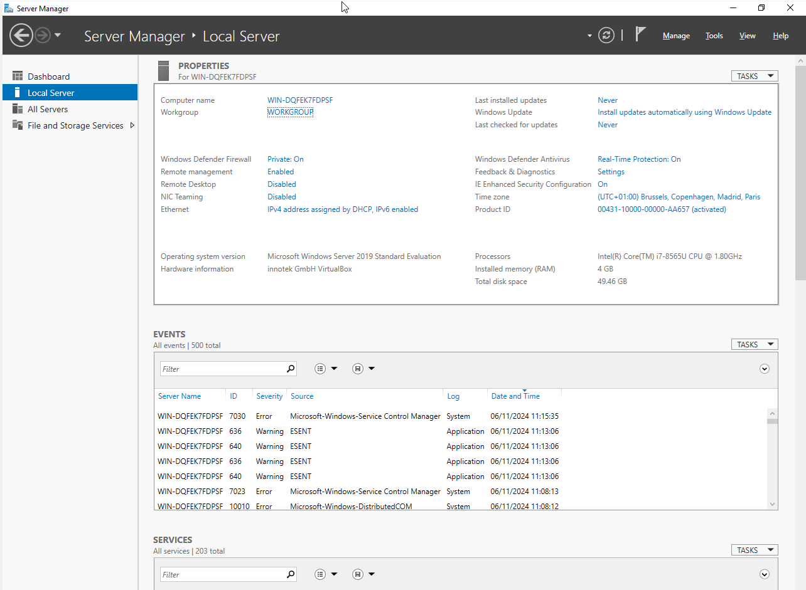
_Imagen 1. Panel de administración inicial de Windows Server 2019._

Pulsamos el botón "*Change*".

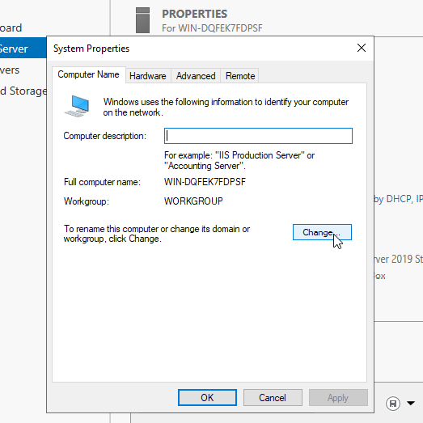
_Imagen 2. Menú de propiedades del sistema._

Cambiamos el nombre y presionamos *OK*.

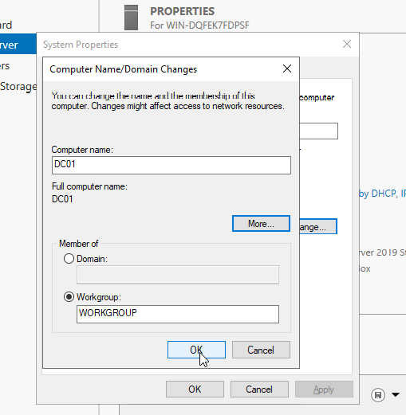
_Imagen 3. Cambio de nombre del servidor._

Después de cambiar el nombre del servidor, el sistema nos pedirá reiniciarlo para que los cambios surtan efecto.

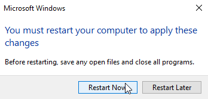
_Imagen 4. Menú de reinicio del dispositivo._

Tras reiniciar, los cambios tienen efecto.

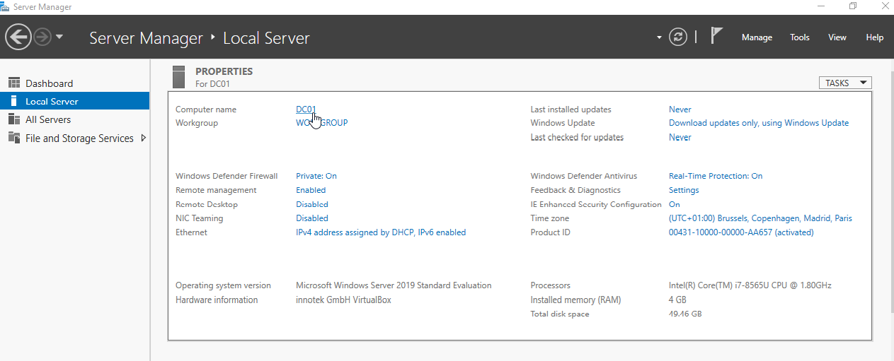
_Imagen 5. Cambio de nombre del servidor realizado correctamente._

De manera adicional, es conveniente configurar la dirección de red del servidor que actuará como controlador de dominio para que tenga una **IP estática**. Así, el resto de equipos que se unan al dominio sabrán siempre de manera fija cuál es el controlador de dominio y el servicio de DNS.

Hacemos *click* en el apartado de *Ethernet* y, a continuación, en el botón de *Propiedades*.

_Imagen 6. Cambio de IP en servidor._

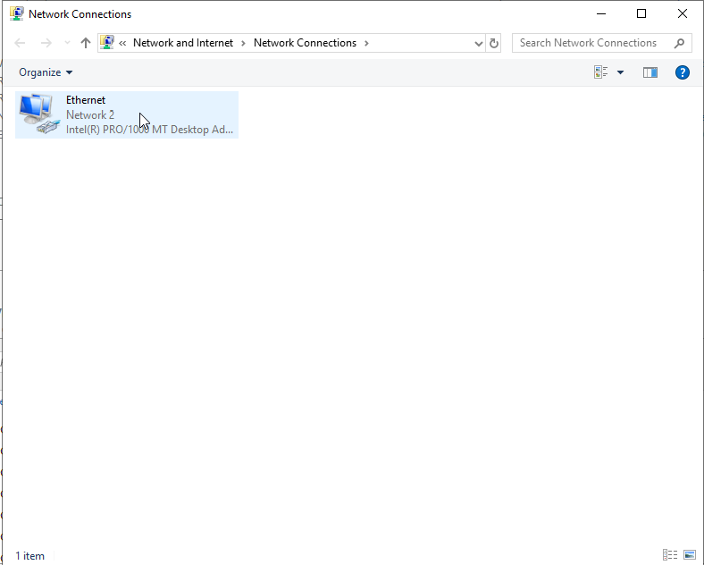
_Imagen 7. Menú de conexiones de red._

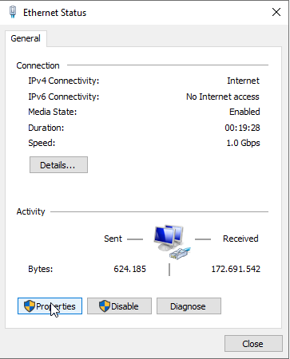
_Imagen 8. Menú de estado de red._

En las propiedades seleccionamos la de *TCP/IPv4* y configuramos la dirección IP y el servicio de DNS.

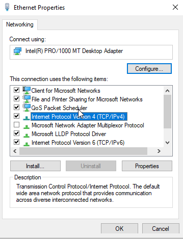
_Imagen 9. Menú de cambio de dirección IP._

> En este caso, al ser el servidor que actuará como controlador de dominio, el DNS que utilizará será el suyo propio.
{: .prompt-tip }

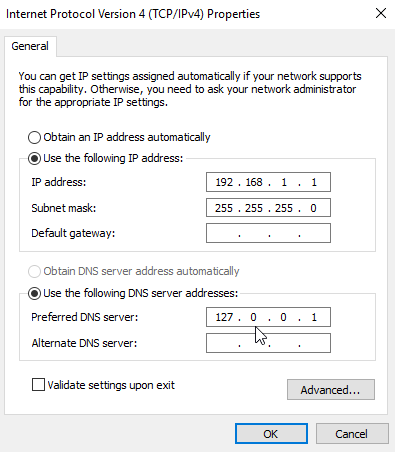
_Imagen 10. Actualización de la configuración de red._

Observamos que los cambios se han aplicado correctamente.

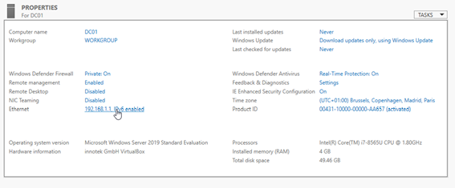
_Imagen 11. Panel de administración del servidor con cambios de red actualizados._

> En caso de añadir nuevos equipos al dominio, estos deberán tener configurado como *Gateway* y servicio de DNS la IP del controlador de dominio establecida.
{: .prompt-info }

#### Desactivación completa del Firewall

Para desactivar las protecciones del firewall del sistema de Windows nos dirigimos al programa de "*Windows Security*" y, dentro de él, a "*Firewall*".

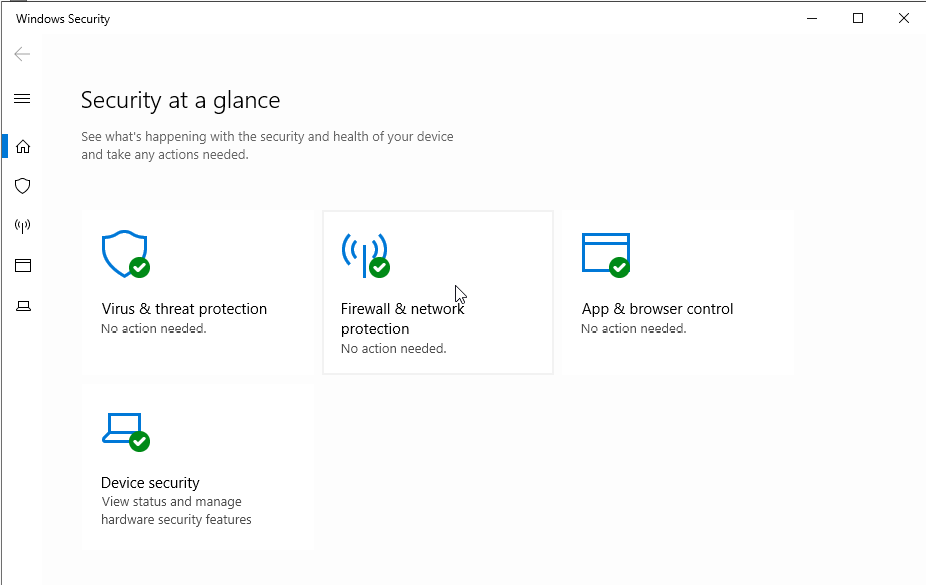
_Imagen 12. Windows Security Firewall._

Una vez ahí, desactivamos los firewalls de las distintas redes (de dominio, privada y pública).

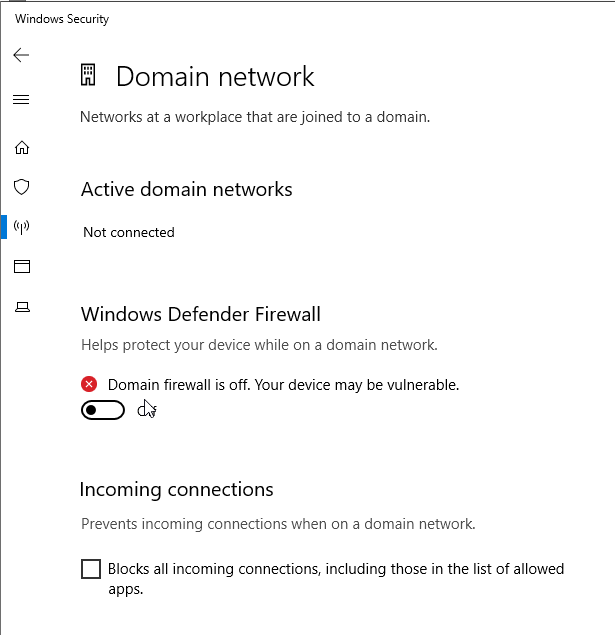
_Imagen 13. Desactivación de firewall de red de dominio._

Finalmente comprobamos que todas las protecciones de firewall han sido desactivadas.

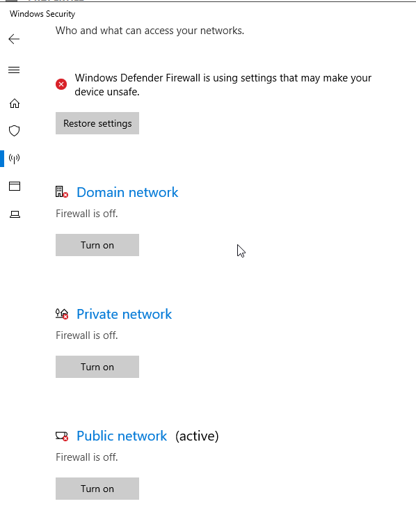
_Imagen 14. Lista de firewalls desactivados._

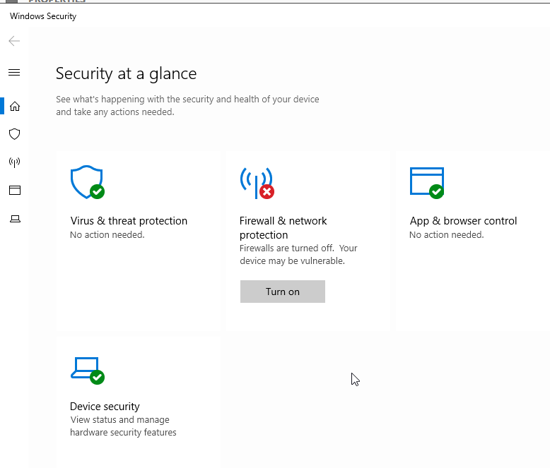
_Imagen 15. Lista de firewalls desactivados._

> Desactivar el firewall por completo es, obviamente, una pésima práctica de seguridad. Aquí lo hacemos a propósito para que el laboratorio no interfiera con los ataques que estudiaremos más adelante. **Nunca** hagas esto en un entorno real.
{: .prompt-warning }

### Windows 10 — Cliente

Al igual que con la instalación de Windows Server 2019, en esta parte también se omitirá la creación de la máquina virtual y la instalación del sistema operativo, ya que se considera un proceso sencillo y con poca relevancia para el post en general.

Por lo tanto, una vez instalada correctamente la máquina Cliente, modificamos el nombre por defecto que se le da al equipo y lo actualizamos con el nombre *Cliente*.

Para ello buscamos la opción "*View your PC name*" y, posteriormente, presionamos el botón "*Rename PC*" e introducimos el nuevo nombre.

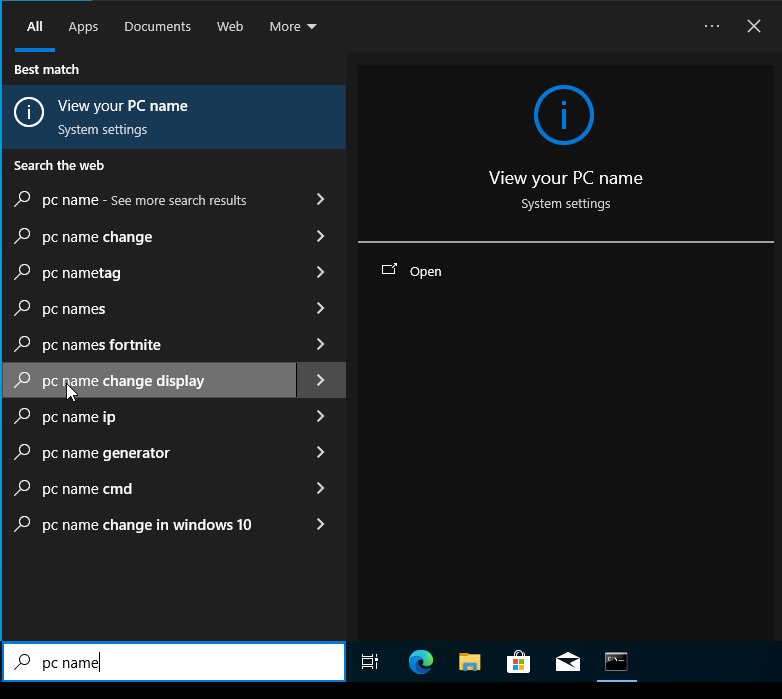
_Imagen 16. Opción ver nombre PC._

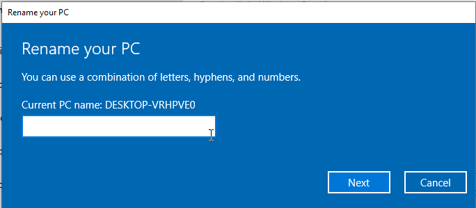
_Imagen 17. Cambio de nombre del PC a Cliente._

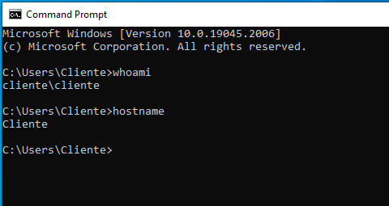
_Imagen 18. Nombre del PC cambiado correctamente._

#### Desactivación completa del Firewall

Para desactivar el Firewall en la máquina Cliente de Windows 10 se siguen los mismos pasos que con Windows Server 2019 hasta desactivar todas las opciones del firewall.

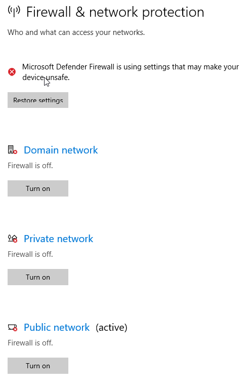
_Imagen 19. Desactivación del firewall Windows 10._

### Despliegue del Active Directory

Para desplegar una estructura de Directorio Activo se necesita al menos un **controlador de dominio**. Para ello se asigna el rol de controlador de dominio o DC ("*Domain Controller*") al servidor instalado.

Lo primero es instalar los roles y características del directorio activo en el servidor. Hacemos *click* en la opción *Manage* de la esquina superior derecha y en la opción "*Add Roles and Features*".

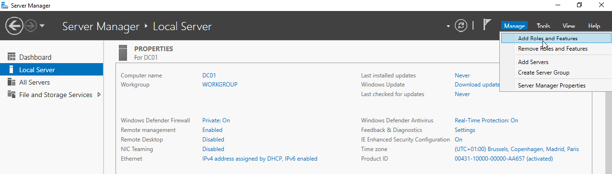
_Imagen 20. Menú instalación de roles y características en Windows Server (1)._

En el menú asistente que aparece configuramos las opciones.

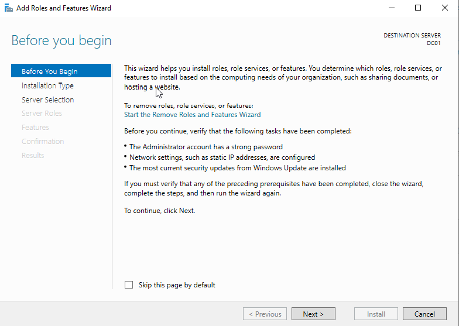
_Imagen 21. Menú instalación de roles y características en Windows Server (2)._

Como tipo de instalación seleccionamos la opción "*Role-based or feature-based installation*".

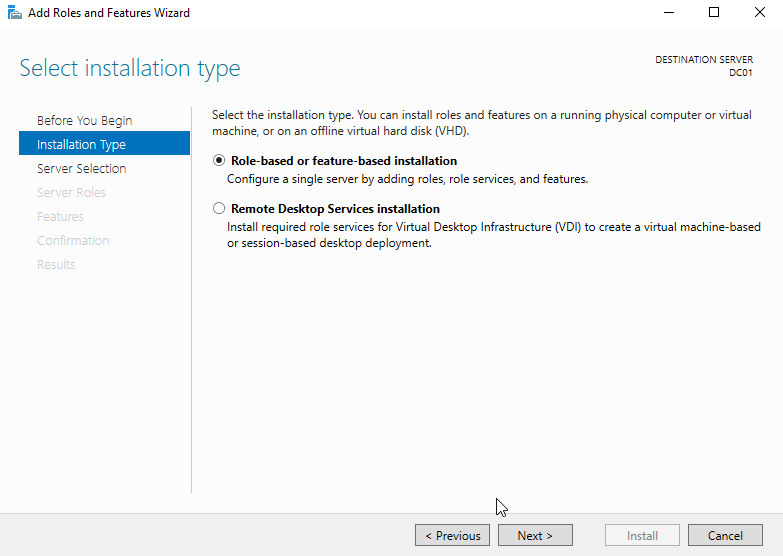
_Imagen 22. Selección del tipo de instalación._

A continuación, seleccionamos el servidor donde se instalarán los roles y características y hacemos *click* en *Next*.

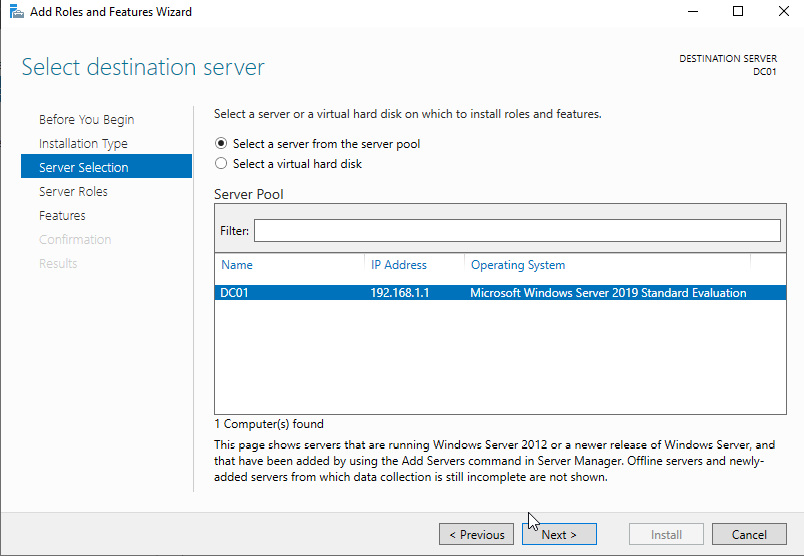
_Imagen 23. Selección del servidor de instalación._

Seleccionamos el rol de "*Active Directory Domain Services*" y hacemos *click* en *Next*.

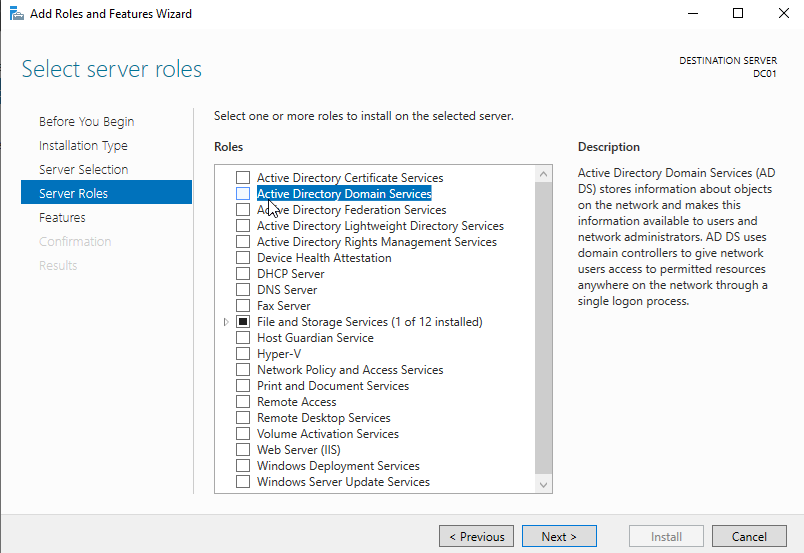
_Imagen 24. Selección del rol a instalar._

Añadimos las características.

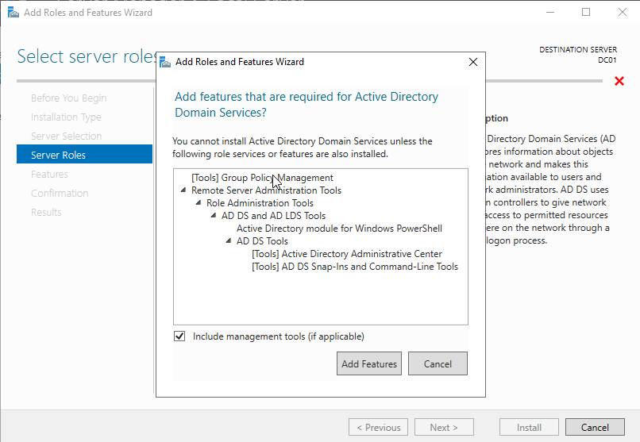
_Imagen 25. Adición de las características del rol._

En las siguientes pantallas simplemente dejaremos las opciones por defecto y daremos a siguiente.

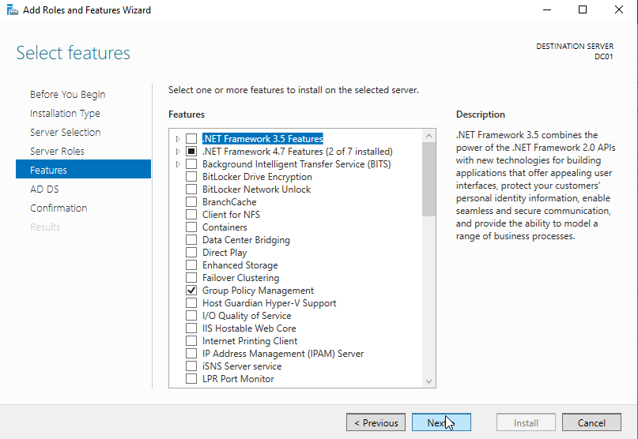
_Imagen 26. Selección de características para el servidor._

En la pantalla final revisamos que los roles y características son los deseados y hacemos *click* en *Install*.

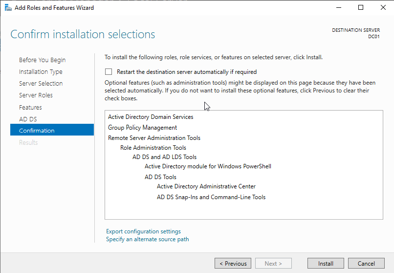
_Imagen 27. Finalización del proceso de instalación del rol de Active Directory._

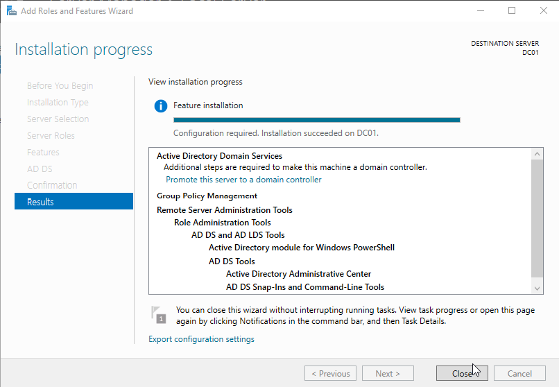
_Imagen 28. Finalización del proceso de instalación del rol de Active Directory._

Una vez instalados los roles y características, se abre el panel de notificaciones y se promueve el servidor a controlador de dominio.

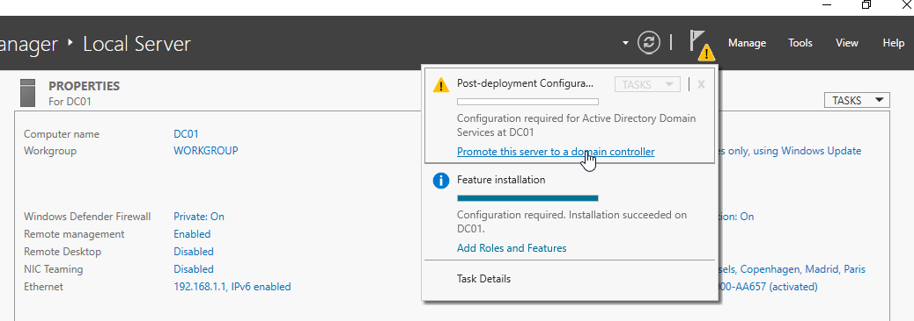
_Imagen 29. Promoción del servidor a controlador de dominio._

### Configuración del Domain Controller

En este apartado se creará el dominio **CAPSULE.CORP** y se promoverá el servidor DC01 como controlador de dominio del mismo. Además, se crearán distintos usuarios haciendo uso de la herramienta "*Active Directory Users and Computers*".

Siguiendo los pasos anteriores se nos presenta el siguiente menú para la creación de un nuevo dominio.

Marcamos las opciones que se muestran y damos el nombre de **CAPSULE.CORP** al nuevo dominio.

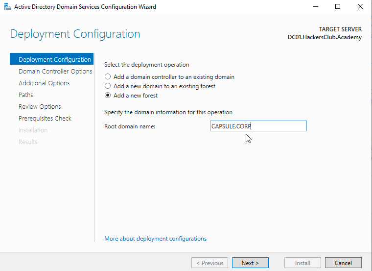
_Imagen 30. Creación del dominio CAPSULE.CORP._

Establecemos la contraseña de recuperación.

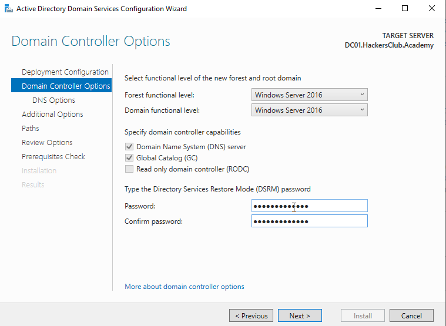
_Imagen 31. Establecimiento de la contraseña de recuperación._

Para el resto de las opciones hacemos *click* en "*Next*" hasta llegar a la pantalla de confirmación final.

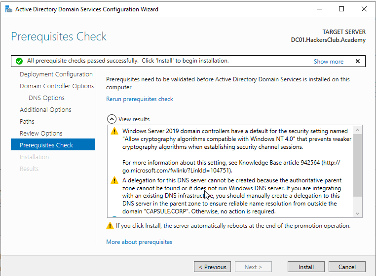
_Imagen 32. Pantalla final antes de la instalación final del AD Services._

En la siguiente imagen se comprueba cómo ahora el servidor DC01 es el controlador de dominio de CAPSULE.CORP.

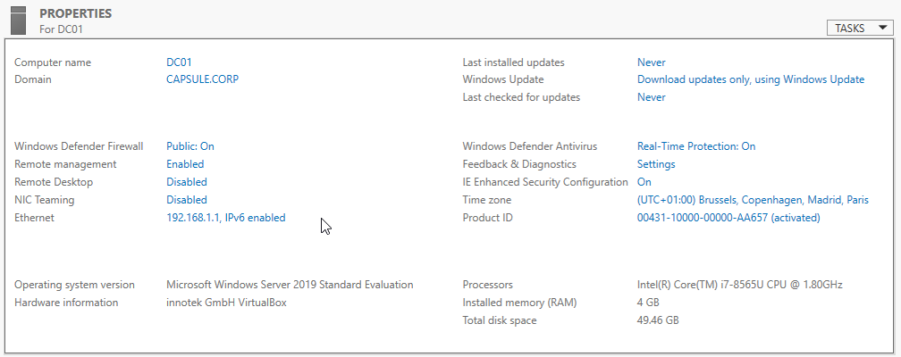
_Imagen 33. Panel de control del servidor DC01 como controlador de dominio de CAPSULE.CORP._

#### Creación de usuarios

Para la creación de los usuarios **Pepe**, **Carolina** y **CuentaDeServicio** se utilizará la herramienta "*Active Directory Users and Computers*" a través del controlador de dominio DC01.

Dentro del dominio CAPSULE.CORP hacemos *click* derecho en *Users* y nos dirigimos a la opción "*New*" > "*User*".

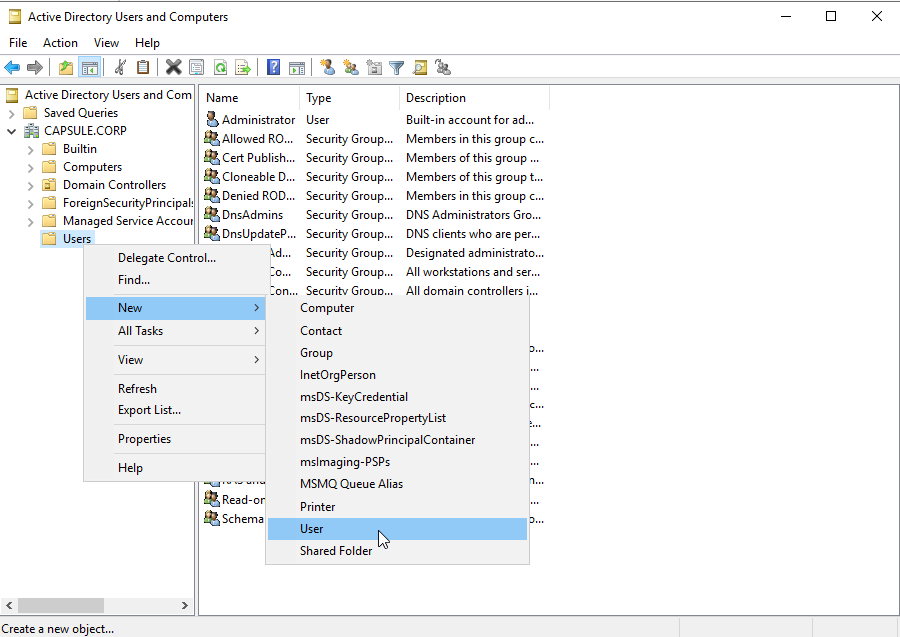
_Imagen 34. Creación de usuario mediante Active Directory Users and Computers._

Establecemos el nombre del usuario y su *logon*.

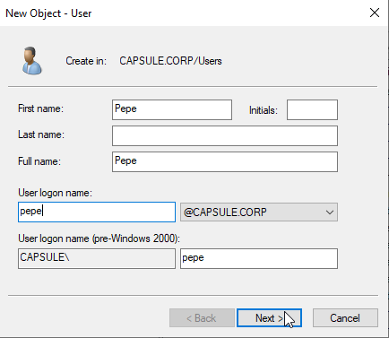
_Imagen 35. Establecimiento del nombre y logon del nuevo usuario._

Establecemos la contraseña tal y como se indica en el enunciado e indicamos que esta no expire (lo cual sería una mala práctica en un entorno real).

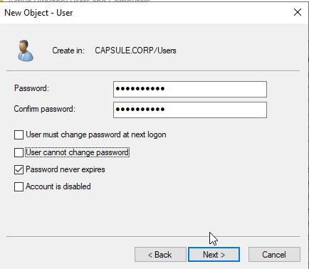
_Imagen 36. Establecimiento de la contraseña del nuevo usuario._

Por último, finalizamos el proceso y el usuario queda creado.

Para los usuarios Carolina y CuentaDeServicio se repite el mismo proceso adaptando los datos acordemente.

### Conexión de usuarios al dominio

Para conectar el Cliente al dominio CAPSULE.CORP se debe, primero, establecer el DNS de este con la IP del controlador de dominio DC01 de la siguiente manera.

Accedemos a la configuración de "*Network & Internet Settings*" y hacemos *click* en "*Change adapter options*".

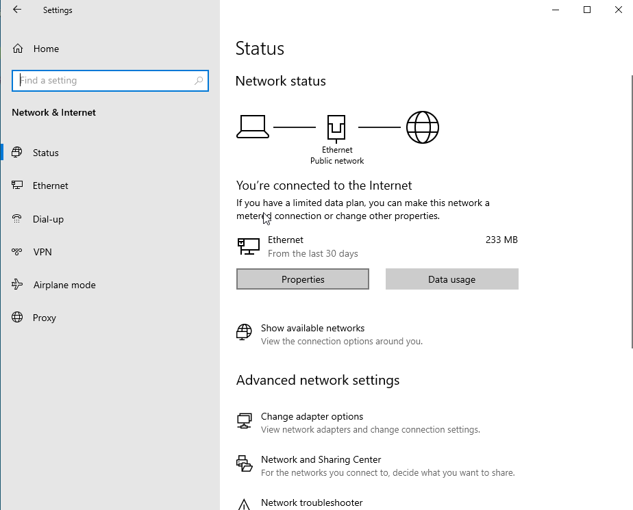
_Imagen 37. Configuración de red de Windows 10._

Una vez ahí, hacemos *click* derecho en la red Ethernet y seleccionamos la opción de *Propiedades*.

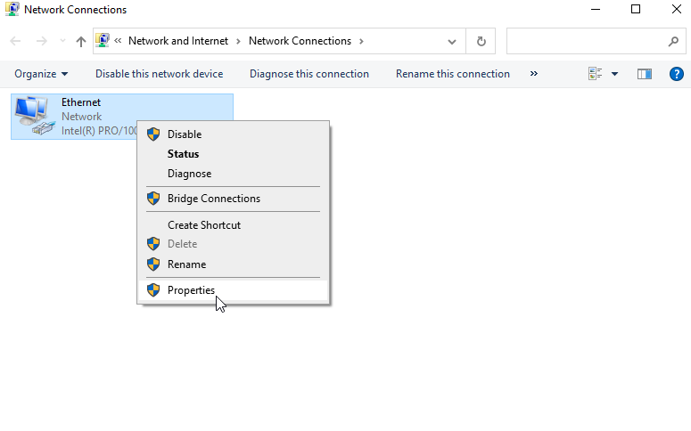
_Imagen 38. Propiedades de red Ethernet._

Seleccionamos la opción de *IPv4/TCP* y, de nuevo, el botón de "*Properties*".

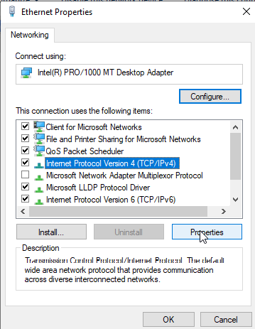
_Imagen 39. Configuración IPv4 Ethernet._

Establecemos la dirección IP del controlador de dominio en el apartado de servidor DNS y finalizamos.

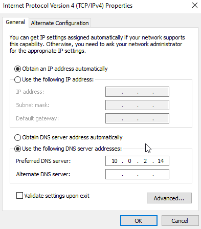
_Imagen 40. Establecimiento del servidor DNS en el Cliente._

Una vez configurado el DNS del Cliente, el siguiente paso es unir el equipo al dominio CAPSULE.CORP. Para ello buscamos la herramienta "*Access work or school*" y seguimos los pasos siguientes.

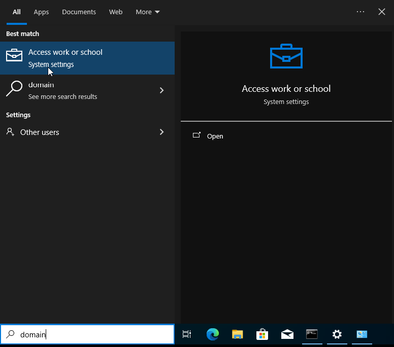
_Imagen 41. Herramienta de "Access work or school" para añadir equipos al dominio._

Seleccionamos la opción de conectar un nuevo equipo.

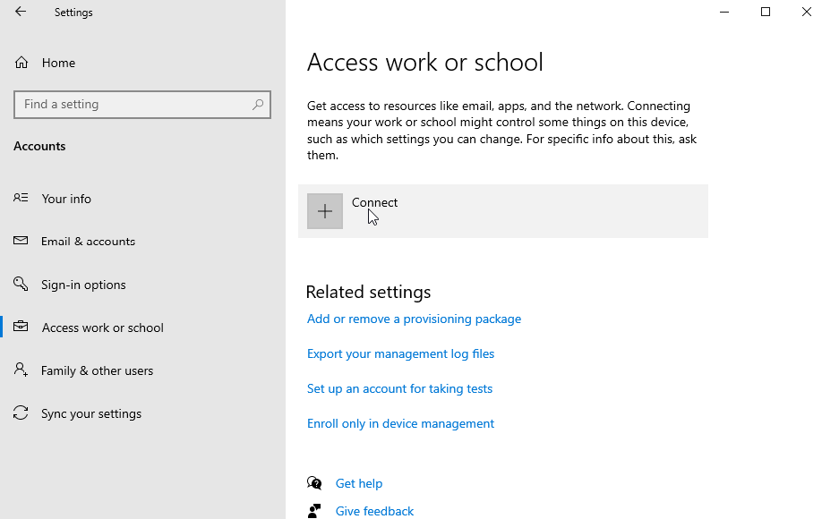
_Imagen 42. Conectar nuevo equipo._

Hacemos *click* en añadir a un dominio local.

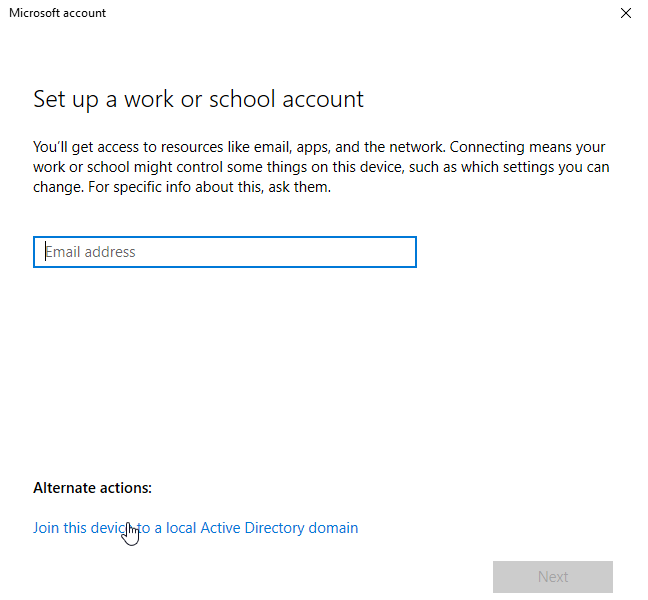
_Imagen 43. Opción unir equipo a dominio local._

Establecemos el nombre del dominio.

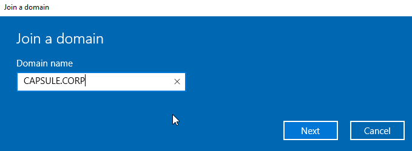
_Imagen 44. Menú unir a dominio._

Introducimos las credenciales de un usuario del dominio.

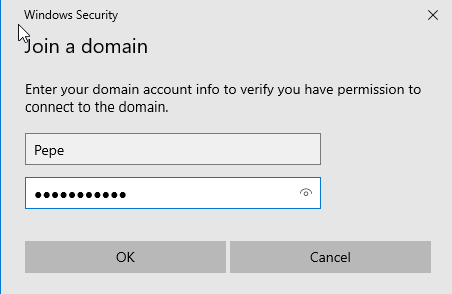
_Imagen 45. Menú de autenticación en el dominio._

Finalmente reiniciamos el equipo para que los cambios surtan efecto.

#### Inicios de sesión en el dominio

Para verificar que el entorno se ha configurado correctamente y que el Cliente se ha unido con éxito al dominio, a continuación se muestran inicios de sesión exitosos para el administrador del servidor DC01 y para la máquina Cliente a través de las credenciales de Pepe.

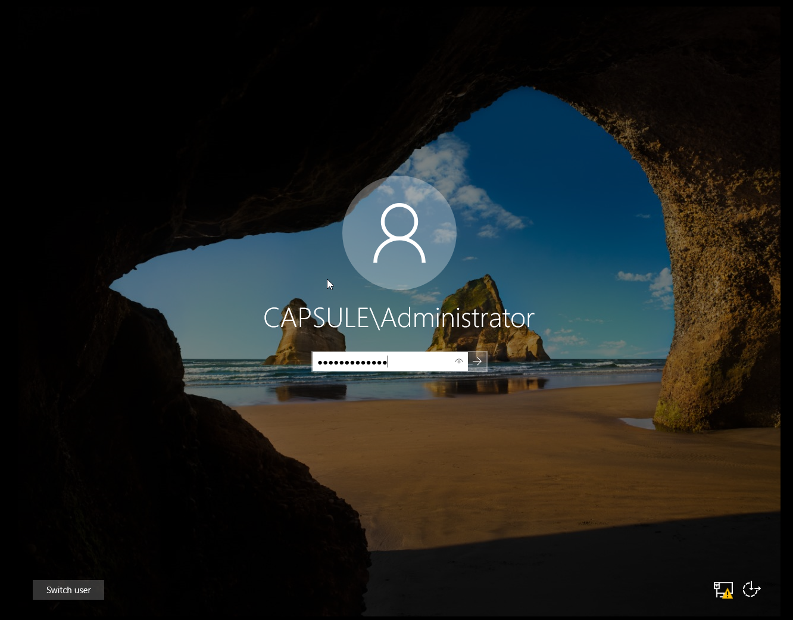
_Imagen 46. Inicio de sesión del Administrador en el servidor DC01._

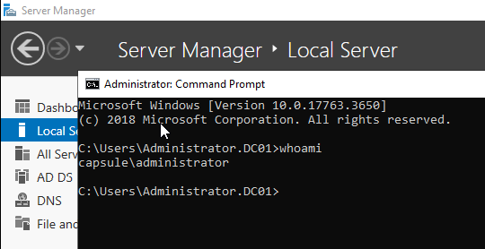
_Imagen 47. Inicio de sesión del Administrador en el servidor DC01._

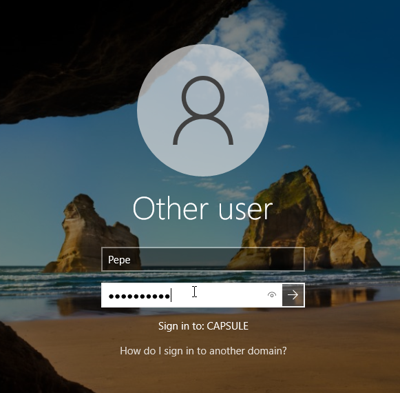
_Imagen 48. Inicio de sesión del Cliente en el dominio mediante las credenciales de Pepe._

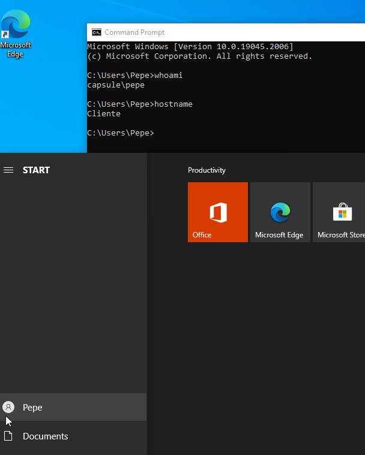
_Imagen 49. Inicio de sesión del Cliente en el dominio mediante las credenciales de Pepe._

## Configuración de objetos

En este apartado se crearán y modificarán distintos objetos del dominio CAPSULE.CORP. Aquí es donde, de forma intencionada, añadimos configuraciones débiles que explotaremos en las próximas entregas:

- Creación de un grupo denominado "*AdminSistemas*".
- Creación de una GPO denominada "*GPOTest*".
- **Pepe**
  - Unión al grupo "*AdminSistemas*".
  - Añadir la característica "*Do not require Kerberos preauthentication*".
- **Carolina**
  - Unión al grupo "*Domain Admins*".
  - Añadir en la descripción el texto "*Mi contraseña es Patatas123*".
- **CuentaDeServicio**
  - Añadir al atributo "*servicePrincipalName*" el valor "*kerberoastable/service*".

A continuación se muestran imágenes del proceso de creación, modificación y resultados finales de los puntos listados.

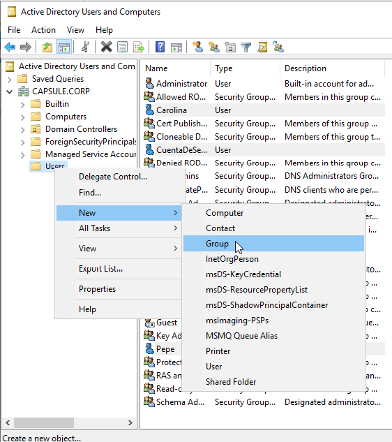
_Imagen 50. Creación de un nuevo grupo._

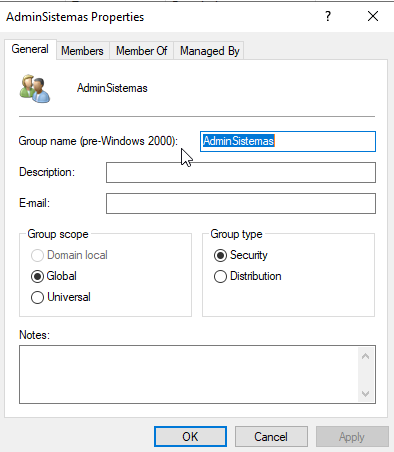
_Imagen 51. Propiedades del nuevo grupo AdminSistemas._

Haciendo uso de la herramienta "*Group Policy Management*" de Windows Server se crea una nueva GPO.

_Imagen 52. Creación de una nueva GPO para el dominio._

_Imagen 53. Nueva GPO denominada GPOTest creada._

Unión del usuario Pepe al grupo AdminSistemas a través del menú de "*Members*" de las propiedades del grupo AdminSistemas, mediante la herramienta "*Active Directory Users and Computers*".

_Imagen 54. Unión de usuario al grupo AdminSistemas (1)._

_Imagen 55. Unión de usuario al grupo AdminSistemas (2)._

_Imagen 56. Modificación de la opción "Do not require Kerberos preauthentication" para Pepe._

_Imagen 57. Unión de Carolina al grupo de "Domain Admins"._

_Imagen 58. Texto de la descripción de Carolina._

A continuación, para modificar el atributo "*servicePrincipalName*" para la CuentaDeServicio, primero tenemos que activar la vista avanzada para poder ver la pestaña de atributos de un objeto.

_Imagen 59. Activación de vista avanzada en Active Directory Users and Computers._

Y en ella podemos ver la propiedad modificada.

_Imagen 60. Propiedad servicePrincipalName modificada para la CuentaDeServicio._

## Conclusión

En esta primera entrega hemos levantado desde cero un laboratorio de Active Directory completamente funcional. Partiendo de tres máquinas virtuales en VirtualBox —un Windows Server 2019 (DC01), un Windows 10 Enterprise (Cliente) y un Kali Linux (atacante)—, hemos recorrido todo el camino: renombrar y fijar la red del servidor, desplegar el rol de *Active Directory Domain Services*, promover DC01 como controlador del dominio **CAPSULE.CORP**, crear los usuarios Pepe, Carolina y CuentaDeServicio, unir el equipo cliente al dominio y verificar que todo funciona con un primer inicio de sesión correcto.

Por último, hemos preparado deliberadamente el terreno de juego añadiendo configuraciones débiles —cada una de ellas representa un vector de ataque real— que diseccionaremos en los próximos capítulos:

- **Firewall desactivado** en todas las máquinas: elimina una capa de defensa y de telemetría, facilitando el reconocimiento y la explotación.
- **Pepe con "*Do not require Kerberos preauthentication*"**: habilita el ataque de **AS-REP Roasting**, que permite obtener material cifrado con la contraseña del usuario sin necesidad de autenticarse, para después crackearlo offline.
- **CuentaDeServicio con un *servicePrincipalName* (SPN)**: abre la puerta al **Kerberoasting**, donde cualquier usuario autenticado puede solicitar un ticket de servicio y atacar offline la contraseña de la cuenta de servicio.
- **Carolina en *Domain Admins* y con su contraseña escrita en el campo descripción**: combina una cuenta de altísimo privilegio con una fuga de credenciales trivial de enumerar. El atributo *description* es legible por cualquier usuario del dominio.
- **Contraseñas que nunca expiran**: alargan indefinidamente la ventana de explotación de una credencial comprometida.

### Lecciones y medidas de seguridad

Aunque este entorno es intencionadamente inseguro, cada debilidad tiene su contrapartida defensiva. Si gestionas un Active Directory real, estas son las medidas que **sí** deberías aplicar:

- **Mantén el firewall activado** y correctamente segmentado; no renuncies a la visibilidad y al control de tráfico que ofrece.
- **No deshabilites la preautenticación de Kerberos** salvo que exista una necesidad técnica muy concreta y justificada. Audita periódicamente las cuentas con el flag `DONT_REQ_PREAUTH`.
- **Minimiza y protege los SPN**. Usa cuentas de servicio gestionadas (gMSA) con contraseñas largas y rotadas automáticamente; así el Kerberoasting deja de ser rentable.
- **Nunca almacenes secretos en atributos legibles** como *description* o *info*. Las credenciales van en un gestor de secretos, no en el directorio.
- **Aplica el principio de mínimo privilegio**: revisa quién pertenece a *Domain Admins* y reduce ese grupo al mínimo imprescindible.
- **Fuerza políticas de contraseñas robustas y con caducidad**, y habilita MFA siempre que sea posible.
- **Monitoriza y registra** eventos de autenticación y peticiones Kerberos para detectar comportamientos anómalos a tiempo.

Con el laboratorio ya en marcha y las piezas colocadas sobre el tablero, estamos listos para pasar a la acción. En la **Parte 2** comenzaremos por la fase de **enumeración de usuarios y recursos con PowerShell**, el primer paso de cualquier intrusión bien ejecutada. ¡Nos vemos en la siguiente entrega!

## Enlaces a las otras partes
- [Parte 1 - Creación del entorno](/posts/pentesting-ad-01-environment-setup/)
- [Parte 2 - Enumeración y ataques (AS-REP Roasting y Kerberoasting)](/posts/pentesting-ad-02-enumeration-attacks/)
- [Parte 3 - Movimiento lateral y suplantación de identidad](/posts/pentesting-ad-03-lateral-movement-impersonation/)